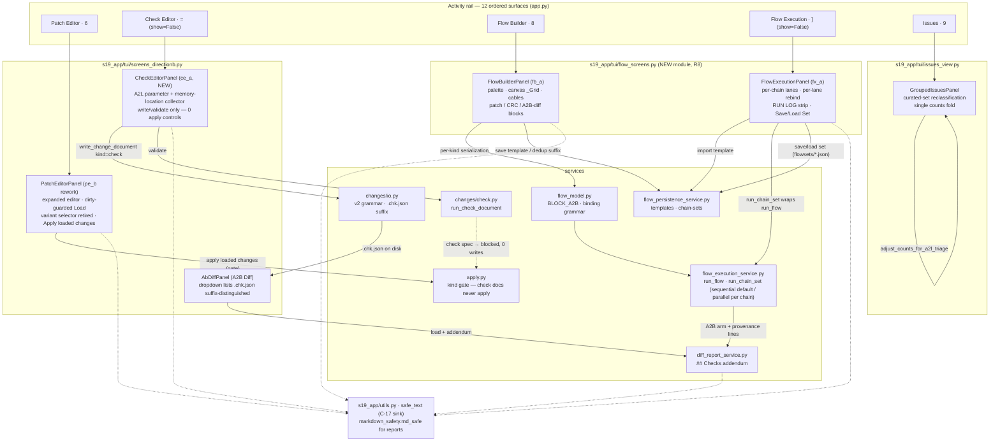

# Diagram — batch-94 architecture

> **Role:** `docs-writer`. Mermaid architecture block for `06-docs/functionality.md` / `traceability-matrix.md`. Facts: `docs/architecture.md` §10 "Batch-94 declarations" (as-built), `01-requirements.md` §3/§4 (surfaces), the four increment packets §2 (file sets).

**Reading notes.** Solid arrows are the shipped information flows (the contract's IFC Part A blocks, `01-requirements.md` §4). Dotted arrows are the safety sink (`safe_text` / `md_safe` — every file-derived string rides it, C-17). The two surfaces Check Editor and Flow Execution entered the rail as entries 11 and 12 with non-digit bindings `=` / `]` (`show=False`, PDR-ratified). Flow semantics stay in `services/flow_*`; the panels are pure view (`docs/architecture.md` §10, R8).
