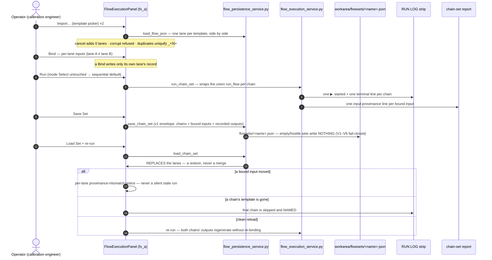

# Diagram — chain-set save → load → re-run (sequence)

> **Role:** `docs-writer`. Mermaid sequence block: the US-007 end-to-end scenario (AT-B94-24, ratified two-node realization `DDR-2026-10-12-batch-94#COND-2`; contract HLR-017…021; `03-increments/increment-003` §1).

**Pins.** Sequential is the untouched default; the parallel mode is operator-selected per run, isolates a failed chain to its own lane, and the selected mode is captured in the run record (C-10 — the acceptance drives the non-default). Save/load reuses the containment-checked persistence idiom; the reload is a replace, not a merge. The UI node `tests/test_tui_flow_execution_b94.py:846` drives the whole chain end-to-end; the service node `tests/test_flow_chainset_b94.py:484` is the declared supplementary arm (`DDR-2026-10-12-batch-94#COND-2`).
