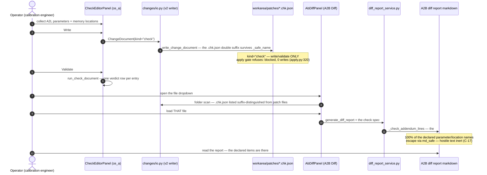

# Diagram — the C-12 check-spec chain (sequence)

> **Role:** `docs-writer`. Mermaid sequence block: Check Editor writes `.chk.json` → A2B Diff loads THAT file → the report carries the `## Checks` addendum. The acceptance observes only the shipped producer→consumer chain (C-12 output-then-consume; contract `01-requirements.md` HLR-010, D-4; AT-B94-11/12, TC-B94-13/15/16).

**Pins.** The chain is accepted only through the shipped surfaces — a hand-written file fed to the consumer is not the acceptance (C-12). The write/validate-only ruling is enforced by the existing kind gate, not by convention. Emitted form pinned by `evidence/p1_probe_diff_report_emitted.txt` + `evidence/p1_probe_chk_roundtrip.txt`.
