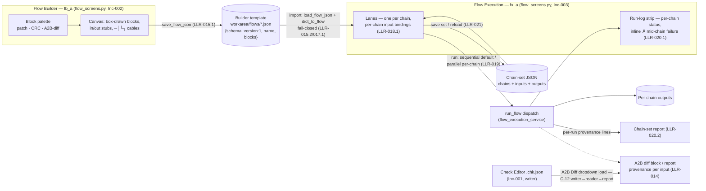

# Design proposal — s19_app — Batch 2026-10-12-batch-94

> **Artifact language.** Canonical **English scaffold**; generate in the batch's language
> The normative rules below are language-independent. **Where that language is declared:**
> `state.json`'s `language` key in `core` and `full`.

> **Reserved field names.** The **field names and block keywords below are language-independent** — the
> validator parses them literally and they are never translated:
> `Design proposal` · `7 · Forward-applicability table` · `⏸ DEFER`
> Everything else on this page — headings, guidance, the prose in every cell — is translated with the batch.
> **One strategy, not two:** the flow ships no alias table, so a translated label is read as an ABSENT one and the
> rule keyed on it reports a true-sounding silence.
> **Why a HEADING is reserved here and a FIELD NAME everywhere else:** `C-49`'s artifact is the §7 TABLE, and a rule that read a summary bullet instead of the rows would be reading a claim about the table rather than the table. `V52` therefore keys on this document's own H1 and on the §7 heading, which is why both are on the machine plane. **And one FLOW-WIDE reserved token, read out of this artifact by `V42` no matter which template minted it:** `⏸ DEFER`.

> **Owed in.** `core` by trigger · `full` ✓
> **Source:** `/dev-flow-init` step 4's seed-by-level table, which is this fact's one home. A level marked `—` **does not owe this artifact, and its absence is not an omission**; `by trigger` means the station exists only when the `triggers` block fired, and `stations_active` in `state.json` is the authority for *this* batch. Where a SECTION or a gate row is owed more narrowly than the artifact, it says so on the row.

> **Where this lives: the VAULT + Drive**, not the repo — it is deliberation, and its traceability to
> code is weak. It is **cited by id** from the repo (`PDR-<batch_id>#D<n>`), never copied.
> What binds code — a frozen interface, a design characteristic — also lands in the **repo**, in the
> requirement or in `docs/ARCHITECTURE.md`. *The vault keeps the deliberation; the repo keeps the commitment.*

> **The forward-applicability rule (ISO/IEC/IEEE 15288).** Everything below must be NAMED as the input
> of a later activity. **If a section of this proposal is nobody's input, delete it — it does not belong
> in the PDR.** That rule is what allows this document to cost half the batch without being waste.

| Field | Value |
|---|---|
| Id | `PDR-2026-10-12-batch-94` |
| Requirements covered | `HLR-001…HLR-021` (all 21 batch HLRs; LLR-001.1…LLR-021.2; AT-B94-01…24; TC-B94-01…31) |
| Modules touched (from `docs/ARCHITECTURE.md`) | `s19_app/tui/screens_directionb.py` · `s19_app/tui/flow_screens.py` (**NEW**, R8) · `s19_app/tui/app.py` · `s19_app/tui/changes/io.py` · `s19_app/tui/services/flow_model.py` · `s19_app/tui/services/flow_persistence_service.py` · `s19_app/tui/services/flow_execution_service.py` · `s19_app/tui/services/diff_report_service.py` *(map-delta row, §2)* · `s19_app/tui/issues_view.py` |
| Triggers that fired | `A1` `A2` `A3` `B1` `B3` `B4` `C6` `C8` `D1` `E1` |
| Author / reviewers | `architect` · `qa-reviewer` · `ux-reviewer` (D1 fired) |

---

## 1 · Objective and scope

This design delivers the Cambio1–7 commission as four sequential increments over the
approved contract (`01-requirements.md`: 21 HLRs · 42 LLRs · 24 ATs · 31 TCs · IFC
Part A ×6 / Part B ×4), graduating the approved spike designs into the production
chrome:

- **Flow Builder → fb_a** (industrial function-block: palette rail, framed canvas
  with grid dots, box-drawn blocks with `in`/`out` stubs, `─│└┐` cable runs, refined
  routing per the operator ruling) — the spike graduation call
  (`flow_bench.NOTES.md`: "connectivity is the builder's job"; fb_c's audit precision
  folds in as an inspector pane, not the primary window).
- **Flow Execution → fx_a** (console instrument lanes: per-chain lane + shaded
  progress + status glyph, RUN LOG strip with mid-chain failure inline — the
  operator's suggestion #1 falls out of the layout for free).
- **Patch Editor → the pe_b row-focus doctrine** as the reworked panel's layout: one
  full-width entries table is the source of truth, the selected row expands an inline
  edit band; pe_a's hex context strip and JSON preview ship as **on-demand
  inspectors** (row action / popover), not permanent chrome.
- **Check Editor → the ce_a collector** (A2L-parameter picker | memory-address
  table, suffix-distinguished file dropdown, `VALIDATE · WRITE .chk.json` footer with
  the struck-APPLY no-apply doctrine) **with ce_b's live A2B addendum folded in as a
  read-only preview toggle** — the ce_b frame answers "what does the report gain?"
  without a second editor surface. (The contract's US-001 refinement line names the
  twins "pe_a/ce_b" as shorthand for the patch/check twin pair; the ratified
  graduation call in `editor_bench.NOTES.md` and the contract's own HLR-001/HLR-003
  rationales pick pe_b + ce_a-with-ce_b-folded — this proposal follows the
  graduation call and cites both families' SVGs as the visual baseline, §3.)

**The four increments** (roadmap per `PLAN.md`; each increment's planned SOURCE-file
set against the ≤4 SOURCE-file cap — tests, docs and `.dev-flow/**` are uncapped and
outside the count):

**Inc-001 — Editors split + Patch Editor rework + `.chk.json` (US-001/002/003;
HLR-001…011; AT-B94-01,03…13; TC-B94-01,02,03,06…17).**
`PatchEditorPanel` reworked in place (pe_b doctrine, six annotations, dirty-guarded
Load, variant machinery retired) + NEW `CheckEditorPanel` (ce_a + ce_b addendum
preview); `.chk.json` suffix-distinguished save/load in the v2 grammar; A2B Diff
dropdown + check addendum; rail entry for Check Editor with its key binding; the
guard-host census constants move 10→11 in the same commit.
SOURCE files (4 — **at the cap, ⚠**: `screens_directionb.py` (panels + popup modal,
R9 home), `changes/io.py` (R10 suffix path), `diff_report_service.py` (check
addendum, C-42 producer discipline), `app.py` (sole rail/routing/scan site).
**⚠ Could not be cut smaller:** the increment's deliverables are contract-bound to
four different modules — the panels' R9 home, the v2 grammar's io home (R10), the
report producer the addendum must emit from (LLR-010.2 names `generate_diff_report`),
and the only legal mount/rail/scan site (`app.py`). No file is discretionary; the
Load-guard popup modal is composed inside `screens_directionb.py` following the
`screens.py` modal idiom rather than adding a fifth SOURCE file, because the modal is
private to the panel that posts it.

**Inc-002 — Flow Builder fb_a + templates (US-005; HLR-013…016; AT-B94-15,16,17,18;
TC-B94-04,20,21,22,23,24,25).**
fb_a palette/canvas/cables rework of `FlowBuilderPanel` at its new address
`flow_screens.py` (B2 move); A2B diff block with flow-output-or-file bindings and
per-input provenance; template save/reload.
SOURCE files (5 — **over the cap, declared per the budget rule's conversation
clause**: `flow_screens.py` (**NEW**, R8), `flow_model.py` (A2B block dataclass +
constant, LLR-013.2), `flow_persistence_service.py` (per-kind serialization
branches, LLR-013.2/015), `flow_execution_service.py` (A2B run branch, LLR-013.3),
`app.py` (the B2 import repoint only). **Why the fifth could not be avoided:** the
moment `FlowBuilderPanel`'s address changes, `app.py`'s import and type references
(`app.py:64`, `:2271`, `:2358`…) must repoint in the same commit — a deferred
repoint leaves the app importing a moved panel (a stale address), and a compat
re-export in `screens_directionb.py` would keep two live addresses and double the B2
census surface the move exists to close. Per the hard-constraint rule this is not a
block: the reason lands in Inc-002's packet §2 and the design/close review looks at
it; four of the five files are one-module-one-seam contract bindings, not sprawl.
**C-20 applies to this increment's RED counterfactual (architect finding 4):** the
RED run for the net-new `flow_screens.py` uses move-aside (rename the file out of
the tree, run the battery, restore) — never `git stash`.

**Inc-003 — Flow Execution fx_a (US-007; HLR-017…021; AT-B94-02,19…24;
TC-B94-05,08,26…31).**
fx_a lanes + run-log; template import; per-chain input rebinding;
sequential(default)/parallel-per-chain control; chain-set save/load; rail entry for
Flow Execution with its key binding; the guard-host census constants move 11→12 in
the same commit (LLR-002.2).
SOURCE files (4 — **at the cap, ⚠**: `flow_screens.py` (FlowExecutionPanel, R8),
`flow_execution_service.py` (mode dispatch + per-chain input plan + run record +
chain-set report emission), `flow_persistence_service.py` (chain-set envelope
save/load, containment idiom), `app.py` (sole rail/routing site).
**⚠ Could not be cut smaller:** the four files map one-to-one onto four
contract-bound seams — the R8 panel home, the existing executor that owns run
semantics (LLR-019/020), the persistence service that owns work-area-contained
save/load (LLR-021, `import_flow_file` idiom at `flow_persistence_service.py:601`),
and the only legal rail/routing site. The chain-set report emission rides in
`flow_execution_service.py` (the run owns the report) rather than adding
`flow_report_service.py` as a fifth file.

**Inc-004 — Issues warnings triage (US-004; HLR-012; AT-B94-14; TC-B94-18,19).**
View-level reclassification of `A2L_UNRECOGNIZED_BLOCK` in the Issues surface via a
curated ASAP2 standard-keyword constant seeded from the executed tally.
SOURCE files (1): `issues_view.py`. The engine (`rules.py`, `a2l.py`) stays frozen
per D-1; `RECOGNIZED_A2L_BLOCKS` is byte-unchanged (checked inside TC-B94-18).

**What this design will NOT do** (scope negatives): no behavior change to what a
patch/check file IS (schema ruling: v2 grammar unchanged, no `from`/`to` fields);
variant application is *removed* from the editors, not relocated there — the
project-variant machinery (`action_select_variant`, `SelectVariantScreen`) stays
(R-6 do-not-touch group); no CRC Designer test-vector (US-006 parked at REFINE); no
BlockTags / README work (US-008/009 OUT — filed to lane A at close); the §7
engine-stability list untouched (D-1); no parallel lanes (A4 not fired, §8).

## 2 · Modules and boundaries

| Module | What it owns here | What it exposes | What it must NOT reach into |
|---|---|---|---|
| `s19_app/tui/flow_screens.py` — **NEW** (R8; Inc-002/003) | The fb_a `FlowBuilderPanel` (reworked, moved) and the fx_a `FlowExecutionPanel`; their `ActionRequested`-kin message types; pure view layer | The two panel classes + message types, consumed by `tui/app.py` routing only | Flow execution **semantics** (stays `services/flow_*`); `changes/` engines; rail/chrome (stays `app.py`); no service imports into view logic — messages out, services never called directly (R8 allowed/forbidden deps) |
| `s19_app/tui/screens_directionb.py` (R9; Inc-001, Inc-002 step) | Inc-001: `PatchEditorPanel` rework (pe_b) + NEW `CheckEditorPanel` (ce_a + ce_b addendum preview) + the Load-guard popup modal (`screens.py` modal idiom) + A2B Diff dropdown listing UI. Inc-002 step: **loses** `FlowBuilderPanel` (B2 move) | Reworked/new panel classes + sibling message family (A3); A2B dropdown output surface | The change engine's parse/apply decisions (messages out to services); flow run semantics; remains the Direction-B shell and keeps the C-34 full-guard-host obligation for every render increment touching it |
| `s19_app/tui/changes/io.py` (R10; Inc-001) | The `.chk.json` suffix-distinguished save/load path on the existing v2 grammar (`kind="check"`); `_safe_name` preserving the double suffix; the suffix-aware listing helper the dropdown consumes | `write_change_document`/`read_change_document`/`parse_change_document` behavior over check docs; the suffix listing helper | View concerns; `apply.py` is **untouched** (the `kind != "change"` gate is the no-apply enforcement, D-5/LLR-009.3) |
| `s19_app/tui/services/diff_report_service.py` (Inc-001 — **map-delta row**) | The check-spec addendum emission appended by `generate_diff_report` (`:1216`), escaping file-derived values through `markdown_safety.md_safe` (batch-19/62 `report_addendum` precedent) | The emitted check addendum section (C-42 emitted form pasted at Inc-001) | Nothing else — frozen beyond the addendum hook; no TUI imports |
| `s19_app/tui/services/flow_model.py` (Inc-002) | `BLOCK_A2B` kind constant + frozen `A2BBlock` dataclass (two input bindings) alongside `BLOCK_PATCH`/`BLOCK_CRC` (`:25-33`) | The A2B block type for model + persistence + execution | Textual; execution logic (pure data, service contract C-7) |
| `s19_app/tui/services/flow_persistence_service.py` (Inc-002/003) | Inc-002: `flow_to_dict`/`dict_to_flow` A2B branches (LLR-013.2), template save/reload contract (LLR-015). Inc-003: chain-set envelope save/load (LLR-021.1), containment idiom per `import_flow_file` (`:601`) | Schema-v1 envelope + builder-template + chain-set artifacts (§11 pending row) | View code; the 1 MiB cap and V1–V7 fail-closed discipline unchanged |
| `s19_app/tui/services/flow_execution_service.py` (Inc-002/003) | Inc-002: the A2B block run branch through `generate_diff_report` (LLR-013.3/014). Inc-003: sequential-default/parallel-per-chain dispatch with per-lane failure isolation (LLR-019), per-chain input plan (LLR-018.2), run record with mode capture (TC-B94-05), chain-set report with per-run provenance lines (LLR-020.2) | Run results, run record, chain-set report | The view; `changes/` + `operations/` + engine read-only, dependency direction unchanged |
| `s19_app/tui/app.py` (all increments) | Rail 10→12 (`RAIL_ENTRIES`, two `Binding`s — §4 R-1 closure), routing handlers for the two new panels, the patches-folder scan's `.chk.json` branch, B2 import repoint (Inc-002) | Rail invariant + routing (§11 pending row) | Panel internals; the two panels' message contracts are consumed, not owned |
| `s19_app/tui/issues_view.py` (Inc-004) | The curated ASAP2 standard-keyword constant (LLR-012.1) + the INFO reclassification with visible justification in `GroupedIssuesPanel` (LLR-012.2); rendering via `safe_text` | The reclassified severity groups | `s19_app/validation/rules.py` and `s19_app/tui/a2l.py` — **frozen** (D-1); the emitter (`rules.py:482-493`) untouched |

- Boundaries respected as declared in `docs/ARCHITECTURE.md`: ✓ — with two recorded readings: (1) the A2B **block-type constant lands in `flow_model.py`**, not in `flow_screens.py` as HLR-013's rationale parenthetically suggests, because R8's boundary forbids the reverse edge ("no engine/services module may import `flow_screens`") and LLR-013.2 names the owner as "the flow model" — the services already import `flow_model`; the view re-uses the constant read-only. (2) `diff_report_service.py` is not listed in the map's batch-94 CHANGED set (which names the `flow_*` services); the contract's LLR-010.2 binds the check addendum to `generate_diff_report`, so the touch is contract-derived and `design/module-map-delta.md` gains the row at Inc-001. Neither moves a boundary — an ARQ change is not being made here.

- **Planned new edge (architect finding 2):** `flow_screens → services/flow_model` — a read-only data import of `BLOCK_A2B`/block-type constants, the established view→model posture per `screens_directionb.py:110`. Declared here so it is expected, and landed in `design/module-map-delta.md` at Inc-002, so a future dependency radiografía does not "fix" it.

**R-3 — dirty-flag writer census plan (C-15.1, closes the plan-level risk; LLR-005.1).** The dirty flag is NEW (writers today: none, per the contract). Planned writer sites in the reworked `PatchEditorPanel`, enumerated for the Phase-3 census: (w1) entries-table edit handler → set; (w2) JSON-text edit handler → set; (w3) save-success path → clear; (w4) load-success path → clear; readers: the Load-guard check and a chrome dirty indicator. Inc-001's executed census (`grep -n "_dirty" screens_directionb.py` diff-scoped) must name exactly these sites and prove every writer is one of them; TC-B94-10 asserts all four transitions.

**R-4 — the executed B2 census is Inc-002's input** (contract §6.3, LED.6; `grep -rl "FlowBuilderPanel\|screen_flow" tests/ s19_app/` → 11 files): `tests/test_flow_builder_render.py`, `tests/test_flow_crc_ui.py`, `tests/test_flow_crc_ribbon.py`, `tests/test_flow_multi_image_ui.py` (:25 import), `tests/test_flow_report_ui.py` (:22 import), `tests/test_tui_flow_persistence_ui.py`, the guard host `tests/test_tui_directionb.py` (screen_flow census), `s19_app/tui/app.py`, `s19_app/tui/screens_directionb.py` (the definition site — 2+1 pattern hits, vacated by the Inc-002 move), `s19_app/tui/services/flow_execution_service.py`, `s19_app/tui/services/flow_model.py` (doc refs). **Membership correction (qa condition C-2, applied 2026-10-13):** the recorded claim reproduces on the current tree only as this adjusted list — `s19_app/tui/screens_directionb.py` joins it (the definition site, omitted from the original recording) and `tests/test_flow_crc_block.py` leaves it (block machinery only — 0 pattern hits); the count 11 is unchanged. The census re-runs at the Inc-002 cut and lands in the packet's `**Reverse census**` field (`V43`); that re-run must exclude `__pycache__` binaries.

**R-6 — variant-retirement observer split (Inc-001; re-run at PDR over the current
tree, reconciling the contract's P1 list).** Executed now:
`grep -rln "patch_variant\|VariantSelected\|VariantHelpRequested" tests/` → 9 files
(today's tree, after the legends batch landed). **REWRITE group** (panel-scoped
observers of the retired editor machinery — Inc-001 rewrites, never deletes
silently): `tests/test_tui_patch_variant.py` (25 hits, 11 tests), `tests/test_tui_patch_big.py` (7; incl. the :647 C-17 hostile test over the removed widget), `tests/test_tui_patch_layout.py` (4), `tests/test_tui_patch_chips.py` (1), `tests/test_tui_patch_card.py` (1), `tests/test_tui_patch_editor_v2.py` (1, `#patch_variant_select` widget census), `tests/test_tui_snapshot.py` (1, docstring), `tests/test_tui_commandbar.py` (1, :2151 docstring). **DO-NOT-TOUCH group** (the app-level project-variant machinery this contract does NOT retire): `tests/test_tui_variants.py` (11 hits — `action_select_variant`/`SelectVariantScreen`), plus `tests/test_variant_execution.py` by the contract's group rule — noted honestly: it matches **0** of the retired-id patterns on today's tree (the P1 census counted it via a broader variant-family match; the group assignment stands because per-variant execution is exactly the machinery HLR-006 leaves in place). Two files absent from the contract's P1 list join the REWRITE group by scope: `test_tui_patch_editor_v2.py` and `test_tui_snapshot.py`. Reconciliation against the contract's named list happens per file at the Inc-001 cut (`V43` re-run), not by silent reassignment here.

**R-7 — the three byte-identity goldens + rebaseline plan (Inc-002/003).** The
inoperative trigger probe (`grep -l "flow_" tests/goldens/**/*.md`, exit 1) stays
recorded as superseded; the executed sweep names the observers of the two report
producers this batch changes: `tests/goldens/batch35/at054b-before-after-report.{md,html}`
(asserted by `tests/test_before_after_report.py`; captures the
`- Image A: … [external] path=… parse-errors=0` provenance lines HLR-010/014 pin),
`tests/goldens/batch71/ac6-unscoped-flow-report.md` (asserted by
`tests/test_flow_report_ac6_golden.py` — the drift candidate for Inc-003's
chain-set/provenance lines), and `tests/test_report_addendum_bound.py` (guards the
addendum territory HLR-010 extends). **Rebaseline plan:** an Inc-002/003 packet that
sees one of these drift names it, rebaselines surgically (one golden per fold, the
diff pasted into the packet), and only after the golden double-proof — the reviewer
re-derives the golden from a clean worktree at the base ref and byte-compares. A
drift without that proof is a finding, not a rebaseline.

## 3 · Diagrams

**Logical / information viewpoint — the flow data model** (the IFC Part A flows
`flow_template_to_execution`, `chain_set_save_load`, `block_input_provenance_to_report`
and the C-12 chain `check_spec_to_diff_report` drawn as one pipeline):

**Visual baseline for the panels' interiors:** the production chrome graduates the
spike renders — `Prototipos/flow_bench.fb_a.svg` (palette/canvas/cable interiors)
and `Prototipos/flow_bench.fx_a.svg` (lane + run-log interiors) for the flow
surfaces; `Prototipos/editor_bench.pe_a.*.svg` / `editor_bench.ce_b.*.svg` (the
premise-4 design-input families: twin-bench editor interiors and the live-addendum
frame) for the editors — with the ratified graduation call's layouts,
`editor_bench.pe_b.*.svg` (row-focus table + inline band) and
`editor_bench.ce_a.*.svg` (two-column collector + folded addendum preview), as the
rendering doctrine the Phase-3 render censuses (TC-B94-09/20/26) assert against the
measured boxed budgets, not the spike's full-screen prototype sizes (C-29 trap,
`evidence/p1-pilot-measurements.txt`).

**Interaction viewpoint (rail → panel mount):** `RailItem.Selected` / key →
`S19TuiApp.action_show_screen` (`app.py:5881`) → `.hidden`-class swap over
`SCREEN_CONTAINER_IDS` + `Rail.set_active` — the two new screens join this existing
data-driven path (no `push_screen`), keyed per §4.

## 4 · Interfaces that change — and which ones FREEZE

| Interface | Current | After | Consumers | **Frozen for the fork?** |
|---|---|---|---|---|
| `PatchEditorPanel.ActionRequested` contract (§11 pending row 1) | Message family consumed by `app.py`/`screens.py`; includes the variant request (`screens_directionb.py:5266` family, `VariantSelected`/`VariantHelpRequested`) | Variant request **retires** with the selector (US-002); the ce_b twin's sibling write/validate messages added; consumer set enumerated at P1 (IFC Part B) | `app.py` routing, `screens.py` modal flow, guard host | **✅ freezes at Inc-001's PDR (this document)** |
| `.chk.json` artifact contract (§11 pending row 2) | v2 grammar discriminates `kind="check"` (`io.py:120-123`) but no suffix-distinguished file path exists (0 `chk.json` hits in `s19_app/`, P0 probe) | Suffix-distinguished `.chk.json` save/load + dropdown listing; write/validate only, never applied (`apply.py` kind gate is the enforcement) | A2B Diff report builder, Check Editor, `changes/io.py` readers | **✅ freezes at Inc-001's PDR** |
| `flow_screens` module surface (§11 pending row 3) | Module does not exist; `FlowBuilderPanel` lives at `screens_directionb.py:4257` | The two panel classes + message types at `s19_app/tui/flow_screens.py` (R8); `FlowBuilderPanel`'s address changes — B2 census (11 files, §2 R-4) lands in Inc-002's packet | `app.py` routing only | **✅ freezes at Inc-002's PDR** |
| Flow template / chain-set artifacts (§11 pending row 4) | `{"schema_version": 1, "name", "blocks"}` envelope (`flow_persistence_service.py:175-245`) | Builder-template contract (Inc-002) + chain-set envelope — chains + bound inputs + recorded outputs (Inc-003); per-run input provenance in reports; sequential(default)/parallel control | Flow Execution import, chain-set save/load, report producers | **✅ freezes in halves — template at Inc-002, chain-set at Inc-003** |
| Rail invariant (§11 pending row 5) | "exactly ten ordered items bound to `1`–`0`" (`rail.py:80-91`, `app.py:1361-1370`) | Twelve ordered surfaces; two new `Binding`s (below); `SCREEN_CONTAINER_IDS`/`_FIND_GOTO_INPUTS` gain the two keys; census constants move with the landing increments (LLR-002.2), never before | guard host `test_tui_directionb.py`, `app.py` routing, operator keymap | **⏳ moves at Inc-001 (11 entries) and Inc-003 (12); frozen complete at Inc-003** |

**A frozen interface is not touched inside a lane.** If a lane needs to change one, the work returns to
the trunk — that is trigger **A3**.

### R-1 CLOSED — the rail key binding, decided by executed probe

**Chosen scheme: `=` (`equals_sign`) → Check Editor, `]` (`right_square_bracket`) →
Flow Execution.** Both bindings `show=False` (discoverable through the `?` help
panel — the app's own discoverability contract for uncrowded footers, C-13), both
routing `show_screen(...)` through the existing data-driven path.

**The evidence** (`evidence/pdr_rail_key_probe.py` → `evidence/pdr_rail_key_probe.txt`,
executed 2026-10-13, Textual 8.2.8, exit 0):

- **Occupied-key census** (static, `S19TuiApp.BINDINGS` at `app.py:1334-1388`): 38
  keys occupied — digits `1`–`0`, `q l U r o s p v j t x k b g`, `slash`,
  `question_mark`, `plus minus comma period`, `pagedown pageup`,
  `ctrl+{k,d,l,s,z,y}`. `equals_sign`, `right_square_bracket`, `f1`, `f2`,
  `exclamation_mark`, `at_sign` are all **absent** — the digit key space is
  exhausted exactly as HLR-002 records, and both candidates are free.
- **Runtime resolution, no collision:** with the two `Binding`s applied and a
  12-entry rail + two stub screens mounted under `run_test` at **120×30 and 80×24**,
  `app.active_bindings` resolves `equals_sign → show_screen('check_editor')` and
  `right_square_bracket → show_screen('flow_execution')`; the ten digit bindings
  still resolve to their screens; a logging watch on the `textual` logger captured
  **zero** collision/conflict/duplicate warnings.
- **Reachability:** pressing `6` mounts `#screen_patch`; `=` mounts
  `#screen_check_editor` and hides the patch screen, the rail's single active
  marker follows; `]` mounts `#screen_flow_execution`; `0` still mounts CRC
  Designer (regression). All pass at both sizes, on the shipped
  `action_show_screen` routing path.
- **Chrome:** both new bindings are `show=False` and no `show=True` binding names
  the new surfaces (footer unchanged); the help-panel source lists both with their
  descriptions.
- **Terminal-side canonicalization** exists in this Textual build:
  `KEY_TO_UNICODE_NAME['equals_sign'] = 'EQUALS SIGN'`,
  `KEY_TO_UNICODE_NAME['right_square_bracket'] = 'RIGHT SQUARE BRACKET'` — a plain
  `=`/`]` keypress from a real terminal normalizes to the bound names.

**Why these keys (muscle memory):** the operator's rail muscle memory is the number
row — `1`…`9`, `0`. `=` is that same row's immediate right-hand neighbour (beside
`-`); `]` sits one row down, at the QWERTY row's right end beside `p` — the key
choice stands probe-verified (§4 evidence); only the geography claim is corrected
here. Both are unmodified single keys, delivered identically by virtually every
terminal emulator.

**Rejected candidates, with reasons:**

| Candidate | Why rejected |
|---|---|
| `F1` / `F2` | Terminal-emulator F-key hazards: many terminals swallow F1 (help) and F2 (rename/menu), and F-key escape sequences vary by emulator. Crucially the hazard is **terminal-side and cannot be measured headlessly** — `run_test` injects key events in-process, so a probe can prove Textual-side mechanics for the chosen scheme but could never disprove an F-key swallow. Recorded, not gambled. |
| `!` / `@` (shift-digit layer) | Layout-dependent glyph production: shift+digit symbols differ across keyboard layouts (e.g. US `@` vs ES-LA `"` on shift+2), so the muscle-memory key would not be the printed key on the operator's layout. |
| Free letters (`c`, `f`, …) | Scarcest namespace; a letters-for-new/digits-for-old split creates two schemes where one existed; single letters already fire app-level actions (`x`, `k`, `b`) — more crowds the namespace without a scalable story for surface #13+. |
| Sub-rail design (ARQ R11's recorded alternative) | Breaks the flat "twelve ordered surfaces" census (HLR-002) and adds chrome the boxed budgets (`evidence/p1-pilot-measurements.txt`) cannot pay for at 80×24. |

**Rail 10→12 mechanics (what each landing increment changes):** Inc-001 inserts the
`check_editor` rail entry after `patch` and adds the `=` binding + the
`screen_check_editor` container + routing handler + `RAIL_ENTRIES`-length census
update, all in one commit (LLR-002.2 — a census updated early green-lights
nothing). Inc-003 does the symmetric `flow_execution` insertion after `flow` with
`]`. The probe's placeholder glyphs (`✔`/`▶` stand-ins) are **not** the production
glyph census — the glyph/ascii pair for the two entries is Phase-3 chrome work
inside the guard host's existing rail-census families.

## 5 · Proposed test cases

**Minting plan.** Every `AT-B94-NN` maps to **exactly one on-disk node** (C-18 —
never "covered by the combination of X + Y"); the increment column is the increment
whose gate the node must pass at. One deliberate subtlety: **AT-B94-02 mints at
Inc-003**, not Inc-001 — its assertion needs the twelfth entry, and the mid-state
11-entry rail between Inc-001 and Inc-003 is guarded by the census constants moving
with their landing increments (LLR-002.2: a census updated early green-lights
nothing). Each node's RED counterfactual and the full mutation battery run at the
increment from ONE complete run (C-19); the mutations named in the last column are
the **authoring-time declarations** the PDR owes — the one edit that would turn each
family RED.

| Id | Layer (0 unit / A white / B black / UX) | Minted at | What it asserts | **The mutation that would turn it RED** |
|---|---|---|---|---|
| **Inc-001 — editors split + rework + `.chk.json`** | | | | |
| AT-B94-01 | B | Inc-001 | Rail selects "Check Editor" → exactly one Check Editor panel mounts (write/validate actions, 0 apply); "Patch Editor" mounts the patch panel (HLR-001) | Swap the mount target: route `check_editor` to `PatchEditorPanel` — the census reads the wrong panel |
| AT-B94-03 | B | Inc-001 | Expanded JSON editor is the primary edit surface — visible with the entries table at 120×30, reachable under scroll at 80×24 (HLR-003, boxed budgets `evidence/p1-pilot-measurements.txt`) | Keep the editor inside the capped `patch_win_json` gauge pane — no expansion, AT sees the pre-state layout |
| AT-B94-04 | B | Inc-001 | Valid JSON confirm merges every declared entry into `patch_doc_entries_table` in document order (count equality) (HLR-004 valid arm) | Merge nothing on valid text (handler drops the parse result) |
| AT-B94-05 | B | Inc-001 | Invalid JSON shows ≥1 validation error and the table is byte-identical (HLR-004 invalid arm) | Let invalid text land rows (or fail silently) |
| AT-B94-06 | B | Inc-001 | Dirty Load pops the warning; accept-loss loads the target, table shows its rows, flag clear (HLR-005, C-10 branch 1) | Popup never appears — Load always proceeds |
| AT-B94-07 | B | Inc-001 | Dirty Load → cancel retains 100% of prior rows and the dirty flag; target not mounted (HLR-005, C-10 branch 2) | Cancel loads anyway |
| AT-B94-08 | B | Inc-001 | 0 variant widgets render; a stale `VariantSelected`-shaped message is a no-op (HLR-006) | Leave `patch_variant_select` composed |
| AT-B94-09 | B | Inc-001 | Apply applies the loaded document: `counts["applied"]` == applicable entries, all from the top table; no-document arm writes 0 bytes (HLR-007) | Apply with nothing loaded performs a write |
| AT-B94-10 | B | Inc-001 | Load reads the adjacent path input (valid path → rows == file entries; empty/unresolved → 1 issue, nothing loaded); Refresh repopulates the dropdown and leaves the loaded doc untouched (HLR-008) | Empty path input loads the dropdown's first file |
| AT-B94-11 | B | Inc-001 | Check Editor assembles `kind="check"`, writes `.chk.json`, validate shows one verdict row per entry, **0 apply affordance anywhere** (HLR-009; C-12 producer arm) | Add an apply control — or write `kind="change"` |
| AT-B94-12 | B | Inc-001 | C-12 chain: the spec **written by AT-B94-11's writer** appears in the A2B Diff dropdown suffix-distinguished; loading THAT file puts every declared parameter/location into the emitted report (HLR-010) | Inject a hand-written spec at the consumer — the chain writer→reader→report is broken, RED by construction |
| AT-B94-13 | B | Inc-001 | C-17 hostile arm: the batch-77 payload (`tests/test_tui_hostile_map.py:105-107`) in an A2L symbol name and a spec file name renders literally in collector, dropdown and report addendum — 0 markup spans, 0 control bytes, sentinel visible (HLR-011) | Render one file-derived string through `Text.from_markup` — a style leaks or MarkupError |
| TC-B94-01 | A | Inc-001 | Validate-merge path: `parse_change_document` collects issues without aborting; merge via `refresh_entries` adds 100% of valid entries in document order; empty valid doc is a no-op (LLR-004.1/004.2) | Drop one entry between parse and table insert (row count off by one) |
| TC-B94-02 | A | Inc-001 | `apply_change_document` gate: applied counts == applicable entries of the loaded doc; blocking-errors arm → `blocked` == len(entries), 0 writes (LLR-007.1) | Bypass the `kind != "change"` gate — a check doc writes |
| TC-B94-03 | A | Inc-001 | `read_change_document` driven by the path input: valid path mounts the file's entries; empty/unresolved path → one `MF-PATH-UNRESOLVED` issue; refresh arm: dropdown options == folder scan, loaded doc identity unchanged (LLR-008.1/008.2) | Refresh remounts/reloads the loaded document |
| TC-B94-06 | A | Inc-001 | `CheckEditorPanel` composition census: ≥1 parameter collector, ≥1 memory-location table, exactly 1 write action, exactly 1 validate action, **0 apply actions**; composes at 80×24 (LLR-001.1) | Add an apply action to the composition |
| TC-B94-07 | A | Inc-001 | Rail selection mounts exactly 1 `CheckEditorPanel`; its write message reaches the service handler (captured call count 1); boundary arm at 80×24 (LLR-001.2) | Cross-mounting — selecting Check Editor mounts the patch twin |
| TC-B94-09 | A | Inc-001 | Reworked panel widget census: 1 `JsonHighlightTextArea` as a first-class region + 1 entries table; composes at 120×30 and 80×24 without exception (LLR-003.1) | Keep the editor inside the capped gauge pane (`patch_win_json` pre-state) |
| TC-B94-10 | A | Inc-001 | Dirty flag: edit-table→set, edit-text→set, save→cleared, load-success→cleared — all 4 transitions; 0 inconsistent reads across the two regions (LLR-005.1 + C-15.1 writer census, §2 R-3) | Save does not clear the flag (it survives its own save) |
| TC-B94-11 | A | Inc-001 | Stale `VariantSelected` post to the panel is a no-op; two consecutive Loads leave exactly 1 bound document, 0 orphaned entries (LLR-006.1/006.2) | Stale message mutates panel state (or crashes) |
| TC-B94-12 | A | Inc-001 | Apply control label/describe text matches the apply-loaded-changes wording; 0 legacy bare-"Apply" labels (LLR-007.2) | The legacy bare label survives the rework |
| TC-B94-13 | A | Inc-001 | `.chk.json` write round-trip: written name ends `.chk.json` (suffix preserved by `_safe_name`), re-read `kind=="check"`, 0 blocking errors, entry count == collected count; 0 apply controls; containment refusal arm (LLR-009.1/009.3) | `_safe_name` reduces `baseline.chk.json` → `baseline.json` (the pre-schema mangling) |
| TC-B94-14 | A | Inc-001 | `run_check_document`: verdict row count == entry count, each row exactly one of pass/fail/uncheckable; `kind="change"` doc run-blocked with reason `doc-kind` (LLR-009.2) | The runner silently skips entries (row count < entry count) |
| TC-B94-15 | A | Inc-001 | Dropdown population: option set == directory scan set (patches + `.chk.json`), every check entry's label carries the CHECK distinction; failing-read spec surfaces issues on load (LLR-010.1) | Check specs render indistinguishable from patch files |
| TC-B94-16 | A | Inc-001 | Report addendum: 100% of declared parameter/location names appear in the emitted report; report non-empty and structurally equal to the pasted base form; C-42 predicate written against the producer's own Phase-3 paste (LLR-010.2) | The addendum emits against any spelling other than its own paste |
| TC-B94-17 | A | Inc-001 | `safe_text` over the hostile payload: 0 control bytes in `.plain`, brackets preserved; inspection arm: 0 markup-parsed constructions in the touched render modules (`test_tc_042_10`) (LLR-011.1) | Let one control byte survive the scrub |
| **Inc-002 — Flow Builder fb_a + templates** | | | | |
| AT-B94-15 | B | Inc-002 | fb_a surface: palette exposes patch/CRC/A2B-diff; placed blocks carry typed in/out stubs; ≥1 cable run renders at 120×30 inside the boxed 96×18; a wired patch block run through Flow Execution writes the patched image (HLR-013) | The list-based tracer UI survives the rework (0 cables) |
| AT-B94-16 | B | Inc-002 | A2B block: each input bound to a flow output or a file; ≥1-from-this-flow enforced at wiring time (0 reports for refused bindings); the report states each input's provenance (HLR-014) | Accept a both-external binding — a report is produced |
| AT-B94-17 | B | Inc-002 | Template save → name appears in the Flow Execution import listing → import reconstructs the flow (block count + kinds); duplicate names dedup-suffix (HLR-015) | Second same-name save clobbers the first |
| AT-B94-18 | B | Inc-002 | C-17 hostile arm: hostile file name bound to a block input renders literally on the canvas and in the flow report — 0 markup spans, 0 control bytes (HLR-016) | Render a block label through markup parsing |
| TC-B94-04 | A | Inc-002 | `save_flow_json`/`dict_to_flow`: saved file parses as the schema-v1 envelope; round-trip block-count + kind equality; collision dedup-suffixes; corrupt/oversized payload refused fail-closed (LLR-015.1/015.2) | A malformed template mounts a partial flow |
| TC-B94-20 | A | Inc-002 | fb_a composition census: 1 palette rail, 1 framed canvas, 3 placeable block types; two-block flow renders ≥1 cable run inside 96×18; empty canvas renders the empty state (LLR-013.1) | Compose the old list widget instead of the canvas |
| TC-B94-21 | A | Inc-002 | `flow_to_dict`/`dict_to_flow` round-trip with one of each block kind incl. A2B: kind equality, per-kind fields (the two A2B bindings) intact, `schema_version` still 1; unknown kind refused (LLR-013.2) | Drop the input-binding fields on serialize (round-trip loses them) |
| TC-B94-22 | A | Inc-002 | Headless two-block run (patch→write-out): 100% of declared addresses hold the new bytes in the output image; per-block results recorded for all blocks; upstream failure → downstream `skipped` (LLR-013.3) | A missing CRC config applies anyway |
| TC-B94-23 | A | Inc-002 | Binding validation matrix: accept (flow,flow)/(flow,file)/(file,flow); refuse (file,file) and any cross-flow source — 0 reports for refused bindings (LLR-014.1) | Accept the (file,file) binding into the runner |
| TC-B94-24 | A | Inc-002 | A2B report emits 2 provenance lines; the external arm matches the executed base form character-for-character in its fixed parts (`- Image A: prg [external] path=… parse-errors=0`); the flow arm names the producing block (LLR-014.2, C-42) | Emit one provenance line instead of two — or drift the external arm's fixed shape |
| TC-B94-25 | A | Inc-002 | `md_safe`/`md_code` mode-truth-table selection: a path-valued name is never raw in a Mode-A cell; hostile template/file name → 0 markup spans in canvas label and report (LLR-016.1) | Emit a raw path in a table cell (Mode-B violation) |
| **Inc-003 — Flow Execution fx_a** | | | | |
| AT-B94-02 | B | Inc-003 | The rail shows twelve entries in the stable declared order; every entry mounts its panel (the keys are exercised by the §4 probe re-runs + TC-B94-08's binding census, not by this AT — contract §6.3 R-1: no acceptance depends on specific keys, and the A4 register records the same) (HLR-002; LLR-002.1; the R-1 closure, §4) | Land 11 entries — or drift the declared order |
| AT-B94-19 | B | Inc-003 | Importing a template adds one lane; a second import shows both chains side by side at 120×30/160×40 within the boxed budgets; each lane's blocks == its template; corrupt import refused with a notice (HLR-017) | A cancelled import adds a lane |
| AT-B94-20 | B | Inc-003 | Rebind chain A→X, chain B→Y; the run reads X for A and Y for B (provenance lines); rebinding A leaves B's binding byte-identical (HLR-018) | Share one binding record — B's report names X after A's rebind |
| AT-B94-21 | B | Inc-003 | C-10 non-default arm: the parallel mode runs both chains concurrently (overlapping elapsed windows), the run record reads `parallel`, a failing chain is isolated to its lane (HLR-019, LLR-019.2) | Ignore the mode flag — the record always reads sequential |
| AT-B94-22 | B | Inc-003 | Untouched run is strictly sequential: chain N+1 starts only after chain N's terminal status; 0 elapsed overlap (HLR-019 default arm) | Parallel-always dispatch — an untouched run overlaps chains |
| AT-B94-23 | B | Inc-003 | Run log shows per-chain start + terminal status and the inline `✗` line naming the block and the missing `crc_regions.json`; the report carries one provenance line per chain input (HLR-020) | Suppress the inline `✗` line (failure only visible elsewhere) |
| AT-B94-24 | B | Inc-003 | Save Set persists chains+bindings+outputs; reload restores 100% of them; re-run regenerates both outputs; a moved input yields a per-chain provenance-mismatch notice, not a silent stale run (HLR-021) | Reload silently drops input bindings (stale run) |
| TC-B94-05 | A | Inc-003 | Mode capture in the persisted run record: `parallel` in 1/1 driven parallel runs, differing from the default arm's record (LLR-019.2, LED.5) | Hard-code the mode field — it never changes |
| TC-B94-08 | A | Inc-003 | `RAIL_ENTRIES` declares 12 in the preserved order (Check Editor after Patch Editor, Flow Execution after Flow Builder); `len(SCREEN_IDS) == len(SCREEN_KEYS) == 12`; duplicate screen keys rejected (LLR-002.1) | Declare 11 — or accept duplicate screen keys |
| TC-B94-26 | A | Inc-003 | Lane mounting: lane count == imported count, 0 missing/duplicates, 0 lanes on cancelled import; lanes' block lists == templates' blocks; render census at 120×30 (96×18) and 160×40 (136×28) — 2 lanes fully visible, overflow scrollable at 80×24 (LLR-017.1/017.2) | Mount a lane for a cancelled import |
| TC-B94-27 | A | Inc-003 | Lane bindings are independent state: editing lane A changes exactly A's record; B's bound path byte-identical before/after; rebind-to-same is a no-op (LLR-018.1) | One shared bindings dict across lanes |
| TC-B94-28 | A | Inc-003 | The run consumes each chain's own bindings: A's provenance names A's file, B's names B's, 0 cross-mentions; a missing input fails that chain only (LLR-018.2) | Swap the inputs — A's report lines name B's file |
| TC-B94-29 | A | Inc-003 | Run-log emission: per chain ≥2 status lines (start, terminal); the failed chain's `✗` line names block + missing config; later blocks in that chain read skipped; all-clean arm shows 0 `✗` (LLR-020.1) | Emit the `✗` line only into a separate surface |
| TC-B94-30 | A | Inc-003 | Chain-set report provenance: line count == chain-input count, 1 per input, 0 missing/duplicates; every line resolves to the bound path; rebind-then-rerun names the new binding (LLR-020.2, C-42) | Name a stale input after a rebind |
| TC-B94-31 | A | Inc-003 | Chain-set serializer: 1 document, chain count == lane count; every chain carries 1 template ref, ≥1 input, ≥1 output; 0 empty sets written as non-empty; containment passes; corrupt set refused fail-closed (LLR-021.1) | Omit the outputs field from the envelope |
| **Inc-004 — Issues warnings triage** | | | | |
| AT-B94-14 | B | Inc-004 | Fixture load (`examples/case_00_public/software_a.a2l`) through the app: WARNING `A2L_UNRECOGNIZED_BLOCK` count goes 1 023 → 0; the same 1 023 rows remain visible as INFO with the justification text; `FROBNICATE` still warns (HLR-012) | Add `FROBNICATE` to the curated set — or drop the reclassified rows |
| TC-B94-18 | A | Inc-004 | Curated-set constant: all 21 seeded families are members; every member is uppercase A2L vocabulary; `FROBNICATE` is not a member; the engine's `RECOGNIZED_A2L_BLOCKS` (`rules.py:9-25`) byte-unchanged in the same run (LLR-012.1) | Add a non-standard name to the set (the freeze check in the same TC goes RED too) |
| TC-B94-19 | A | Inc-004 | Reclassification in `GroupedIssuesPanel`: on the fixture WARNING==0 and INFO==1 023 (no row dropped); justification rendered at the INFO group; mixed file splits curated/unknown across INFO/WARNING; empty state for no A2L (LLR-012.2) | Map unknown blocks to INFO — or drop rows instead of reclassifying |

**Declared here, at authoring time, not at execution time.** A proposed case whose
reddening mutation cannot be named is not yet a test case — it is a hope. Layer 0
applies where the unit has cyclomatic complexity ≥3 **or** transforms data crossing
a declared module boundary.

**Layer-0 candidates** (unit · criterion · host node — each justified, each host to
a named TC/AT; explicitly OUT as pure delegation/getters/UI-wiring/declarative
data: panel `compose` methods, message dataclasses, the `RAIL_ENTRIES` table itself,
rail-row rendering):

| Unit (increment, module) | Criterion | Host node | The mutation that would turn it RED |
|---|---|---|---|
| Edit-JSON validate-merge handler (Inc-001, `screens_directionb.py`) | decision — 3 paths: valid-merge / invalid-issues-display / empty-no-op | TC-B94-01 | Invalid text merges rows into the table |
| Dirty-flag writer set (Inc-001, `screens_directionb.py`) | decision — 4 transitions across 2 regions (C-15.1 census, §2 R-3) | TC-B94-10 | Save leaves the flag set |
| `_safe_name` `.chk.json` suffix preservation (Inc-001, `changes/io.py`) | boundary — name transform at the save boundary (`io.py:1406-1411`) | TC-B94-13 | Reduce `.chk.json` → `.json` |
| Check-file folder-scan branch (Inc-001, `app.py`) | boundary — folder listing → dropdown options transform | TC-B94-15 | The scan drops `*.chk.json` from the listing |
| Check-spec assembly, collector → `ChangeDocument(kind="check")` (Inc-001, `screens_directionb.py`) | boundary — UI state → v2 document | TC-B94-13/TC-B94-14 | Assemble with `kind="change"` |
| A2B binding validation, accept/refuse matrix (Inc-002, `flow_model.py` helper) | decision — 3 accepted combos / 2 refused classes | TC-B94-23 | Accept (file, file) |
| `flow_to_dict`/`dict_to_flow` A2B branches (Inc-002, `flow_persistence_service.py`) | boundary — serialize/validate across the persistence boundary | TC-B94-21 | Serialize the A2B block without its binding fields |
| Provenance-line emission (Inc-002, `diff_report_service.py` via the flow run) | boundary — binding pair → report text (C-42 form) | TC-B94-24 | Emit one line for both inputs |
| Run-mode dispatch, sequential-default/parallel/isolation (Inc-003, `flow_execution_service.py`) | decision — mode branch + per-lane failure isolation | TC-B94-05 + AT-B94-21/22 | Ignore the parallel flag |
| Chain-set serializer (Inc-003, `flow_persistence_service.py`) | boundary — lane state → disk + containment | TC-B94-31 | Omit the outputs field |
| Lane-binding isolation state (Inc-003, `flow_screens.py`) | decision — per-lane edit touches exactly one record | TC-B94-27 | Share one bindings dict across lanes |
| Run-log emission (Inc-003, `flow_screens.py` strip over service events) | boundary — run events → log text with inline ✗ | TC-B94-29 | Suppress the ✗ line |
| Curated-set membership + reclassification predicate (Inc-004, `issues_view.py`) | decision — in-set→INFO / not-in-set→WARNING / empty-set degenerate | TC-B94-18/19 | Admit `FROBNICATE` (or map unknowns to INFO) |

**Hostile-input ATs (C-17)** are AT-B94-13 (editor surfaces, the batch-77 sentinel
shape) and AT-B94-18 (flow surfaces); both pin the sinks to `safe_text` /
`markdown_safety.md_safe` with the `from_markup` source census
(`test_tc_042_10`) as the inspection arm. **C-12 output-then-consume chains** are
AT-B94-11→AT-B94-12 (Check-Editor writer → A2B dropdown reader → report producer —
the acceptance input is always the shipped writer's output, never a hand-written
artifact) and the producer-chain ATs AT-B94-09/15/17/23/24 observe on-disk artifacts
through the shipped surface.

**The C-17 census-extension owner (architect finding 3):** `test_tc_042_10`'s `from_markup` source scan currently covers only `issues_view.py` (`test_tui_directionb.py:8113-8157`); Inc-001's packet extends it to the reworked `screens_directionb.py` surfaces and Inc-002's to `flow_screens.py`.

**C-42 emitted-form pastes owed at the increments** (provisional per V-5): the
check addendum's emitted form (Inc-001, TC-B94-16); the flow-output A2B provenance
line form (Inc-002, TC-B94-24); the chain-set report's provenance-line form
(Inc-003, TC-B94-30). Each predicate is written against the producer's own paste at
the increment.

**`assumed — verify in Phase 3` register** (each flag names its verifier):

| # | Assumption | Verified by |
|---|---|---|
| A1 | The pe_b/ce_a interior pane splits fit the boxed workspaces at 120×30/80×24 — the pilot measured workspace boxes only, not inner splits (C-29, LLR-003.1's own flag) | Inc-001 — TC-B94-09 + AT-B94-03/01 render censuses at the C-34 guard-host gate |
| A2 | The fb_a canvas + cables render inside the boxed 96×18 at 120×30 (the spike measured full-screen 94×26 bodies — the recorded non-transfer trap) | Inc-002 — TC-B94-20 + AT-B94-15 |
| A3 | The fx_a two-lane layout renders side by side within 96×18 at 120×30 | Inc-003 — TC-B94-26 + AT-B94-19 |
| A4 | Unmodified `=`/`]` keypresses are delivered by the operator's real terminal emulator (standard for unmodified punctuation, but `run_test` cannot see terminal delivery) | No headless node can verify this — field-verified by the operator; the contract keeps every AT independent of the specific keys (R-1's recorded note), and AT-B94-02 drives rail entries by identity/order |
| A5 | Parallel-per-chain execution assumes no shared mutable service state across chains — each chain threads its own `(mem_map, ranges)` pair as the sequential executor does today | Inc-003 — AT-B94-21's error arm (sibling lanes complete) + TC-B94-05 |
| A6 | The proposed chain-set envelope shape and the flow-output provenance line forms are design proposals until the C-42 pastes land | Inc-002 (template half) / Inc-003 (chain-set half) — the paste + predicate at the increment (V-5 provisional) |

## 6 · Risks and rejected alternatives

| Risk (contract §6.3) | Disposition in this design |
|---|---|
| **R-1 — rail key binding (was OPEN, owner: PDR)** | **CLOSED here.** `=` → Check Editor, `]` → Flow Execution; executed probe `evidence/pdr_rail_key_probe.txt` (38-key census, runtime resolution, 120×30 + 80×24 reachability, help/footer chrome, zero collision warnings). §4. |
| **R-2 — US-004 view-level seam** | Carried, mitigated as contracted: the curated set is a named reviewable constant; additions are ledger entries; the D-2 re-open condition stands (a genuinely malformed block read as benign moves the seam parser-ward with the freeze crossing stated). Residual accepted for this batch. |
| **R-3 — boxed-geometry transfer (C-29)** | Closed by plan + flags: every layout acceptance keys on the measured 74×12 / 96×18 / 136×28 ceilings (`evidence/p1-pilot-measurements.txt`); inner splits that the pilot did not measure carry the assumed-register (A1–A3) with named verifying increments. |
| **R-4 — B2 move census (Inc-002)** | Closed by census: the executed 11-file census (§2) is Inc-002's input; it re-runs at the increment cut and lands in the packet's `**Reverse census**` field. |
| **R-5 — parallel execution (LLR-019.2)** | Carried, pinned: new concurrency is bounded to the mode dispatch in `flow_execution_service.py`; failure isolation is pinned by AT-B94-21's error arm; the sequential default is pinned by AT-B94-22 (untouched-path regression); A5 flags the shared-state assumption with its verifier. |
| **R-6 — variant-retirement observers (Inc-001)** | Closed by re-run census (§2): 9 files, two groups — 8 REWRITE (incl. the two the P1 list missed: `test_tui_patch_editor_v2.py`, `test_tui_snapshot.py`) and the DO-NOT-TOUCH pair (`test_tui_variants.py`, `test_variant_execution.py` — the latter pattern-clean today, group-kept by rule). Load-bearing: Inc-001 rewrites group 1 and must not delete group 2; the increment re-runs the census at cut. |
| **R-7 — flow-report golden observers (Inc-002/003)** | Closed by plan: the three byte-identity observers are named (batch35 at054b pair, batch71 ac6, `test_report_addendum_bound.py`) with the surgical-rebaseline + golden double-proof plan (§2). |

| Alternative considered | Why it was rejected |
|---|---|
| `F1`/`F2` keys for the new surfaces | Terminal F-key swallow hazards; undetectable headlessly (the probe cannot disprove what `run_test` never sees). §4. |
| Shift-digit `!`/`@` | Layout-dependent glyph production breaks the muscle-memory key ↔ printed-key bond on non-US layouts. §4. |
| Sub-rail design (ARQ R11's recorded alternative) | Breaks the flat twelve-ordered-surfaces census (HLR-002); chrome the 80×24 budget cannot pay. §4. |
| A new grammar / `checkspec/` package for check specs (ARQ R10's alternative) | The v2 model already discriminates `"change"`/`"check"` and `apply.py` already refuses non-change kinds — a second grammar would double the reader/validator surface for one dropdown distinction. |
| Parser-level recognition for US-004 (extending `RECOGNIZED_A2L_BLOCKS`) | Crosses the §7 engine freeze and changes the engine's stability story (D-2, with its re-open condition recorded). |
| Redesigning the builder in place inside `screens_directionb.py` (R8 alt a) | A >5 000-LOC file growing ~2× with every flow increment dragging the whole Direction-B C-34 guard host. |
| Moving the editors to `flow_screens.py` too (R9's alternative) | The editor split is presentational; one move doubles the B2 census surface for zero review benefit. |
| Parallel lanes for the four increments (A4) | Not fired — and unnecessary: the file sets are disjoint except `app.py`'s serialized rail rows (§8). |

*(Recording the rejection is what stops the same option being re-proposed in three batches.)*

## 7 · Forward-applicability table — **the section that makes this document honest**

| Output of this PDR | Named consumer downstream | Where the consumer will read it |
|---|---|---|
| design characteristics — increment scopes, file sets, spike graduations (§1, §3) | the Phase-3 increments | each increment packet §2 (scope · SOURCE-file set · traces-to) + the per-increment `software-dev` brief |
| the rail key scheme + R-1 closure (§4) | Inc-001/003 rail rows; AT-B94-02 | packet §2 of both increments; probe rerun at the landing gates (`evidence/pdr_rail_key_probe.txt`) |
| the freeze set per increment (§4 table) | the increments' frozen-file dual-guard (C-27: SOURCE + TEST guards) and the Phase-4 PR pass | packet §2 `Traces to` + `docs/engineering-rules.md` frozen-module list |
| measured layout budgets + spike visual baseline (§3) | the layout ATs/TCs (AT-03/15/19, TC-09/20/26) and their render censuses | the test bodies' thresholds + the C-34 guard-host runs at the render increments' gates |
| enablers — fixtures (stand-in A2L `examples/case_00_public/software_a.a2l`, the batch-77 hostile payload, `workarea/patches` + `workarea/flows` fixtures, the bench sample chains) | Phase 3 and validation | AT-B94-13/14/18, TC minting, the RED counterfactual runs — under `tests/` + `evidence/` |
| enablers — probe harnesses (`pdr_rail_key_probe.py`, the `p1_*` probes) | gate reruns (C-35/C-39 idiom) | `evidence/` transcripts named in the packets |
| the proposed test cases + authoring-time RED mutations (§5) | layers 0/A/B minting at the mapped increments; the DDR | increment packets §3–§4 (RED counterfactual + mutation battery, C-19) + DDR proposed-vs-landed reconciliation |
| the Layer-0 candidate list with criteria (§5) | unit-test authoring per increment | packet §3 + the mutation battery's unit arms |
| design → requirement traceability (every characteristic cites HLR/LLR/AT/TC ids) | the traceability matrix | the matrix + DDR §traceability |
| the R-4 B2 census (§2) | Inc-002 | packet `**Reverse census**` field (`V43`) |
| the R-6 two-group census + rewrite plan (§2) | Inc-001 | packet `**Reverse census**` field + the test ledger (rewrites post as deletions/additions) |
| the R-7 golden list + rebaseline/double-proof plan (§2) | Inc-002/003 | packet §4 evidence; the golden double-proof at the increment gate |
| the C-42 emitted-form paste obligations (§5) | Inc-001/002/003 | packet §3 evidence paste; predicates written against the paste (V-5 provisional) |
| the assumed-flags register A1–A6 (§5) | the named verifying increments | the increment's verification evidence + DDR reconciliation |

- ⚠ Any row whose consumer column is empty: **remove the output, or explain why it is being produced.** (No empty rows: 14 rows, 14 named consumers.)

## 8 · Parallelisation plan *(only if the batch forks)*

| Lane | Modules / layer | Files it owns | Agent |
|---|---|---|---|
| — none — | — | — | — |

**None — this batch runs one lane.** A4 did not fire (`PLAN.md` trigger table:
multiple increments, sequential in one worktree). The legal empty per the fork
preconditions is already recorded at contract §2.8; what the PDR adds is the
sequential-enabler note: the ARQ module re-cut (R8) leaves Inc-001's file set
(`screens_directionb.py` + the editor-side services) disjoint from Inc-002/003's
(`flow_screens.py` + `services/flow_*`), with `app.py`'s rail rows the only shared
file — and `app.py` is touched by every increment **sequentially anyway** (rail
rows land one per increment, LLR-002.2), so no two increments ever hold it at once.
Inc-004 (`issues_view.py`) is disjoint from all of the above. The per-increment
file-set disjointness is what keeps the increments separable for review even
though they do not fork.

- `modules(lane_i) ∩ modules(lane_j) = { }` — or same domain / different layers with the interface frozen: n/a — one lane
- **File sets are disjoint** (not just modules — two lanes may not edit the same file, not even different regions): n/a — one lane; the sequential file-set disjointness above is the review-separability enabler
- Family-B reverse census run **per lane and shared** before forking: n/a — one lane; family B is evaluated per increment inside this batch and recorded in each packet (`V43`)
- Trunk-only artifacts (requirements · traceability · backlog · SPEC) are written **only** by the trunk: ✓ — this batch IS the trunk
