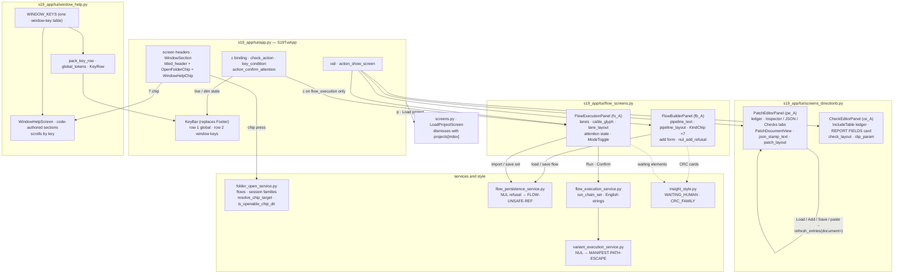

# Diagram — batch-97 architecture

> **Role:** `docs-writer`. Mermaid architecture block for `06-docs/functionality.md` / `traceability-matrix.md`. Facts: the increment packets §1 / §2 (`03-increments/increment-001…009.md`), `01-requirements.md` §3 (shipped surfaces), `docs/architecture.md` §11 (batch-97 interface amendments). No module was created and no boundary moved (`PLAN.md` §Triggers, A1 not fired).

**Reading notes.** Solid arrows are calls or data the packets name; dotted arrows are colour tokens. `WINDOW_KEYS` feeds both the key bar's second row and each help's keys block (LLR-150.1), so the two cannot disagree. The `c` binding acts only when Flow Execution is the active screen (`check_action`). The NUL refusal sits in the persistence and manifest parsers, before any path is resolved (LLR-146.14). Every file-derived string on the four screens is painted through `safe_text` or a `markup=False` widget (LLR-144.7, 145.5, 146.8, 147.6); that sink is not drawn, to keep the figure readable.
