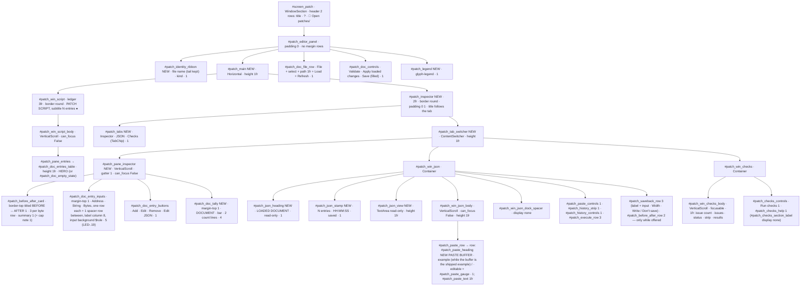
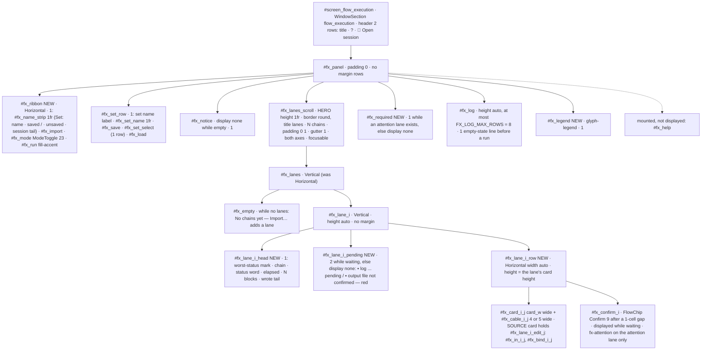
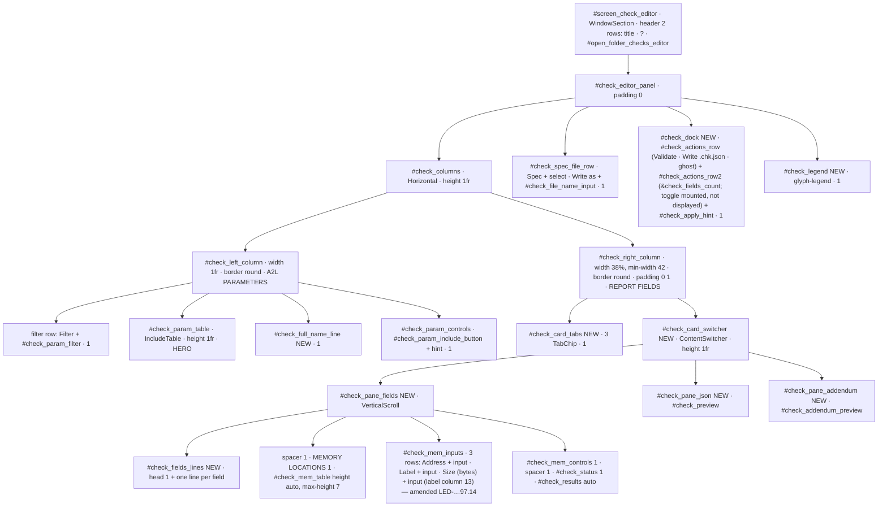
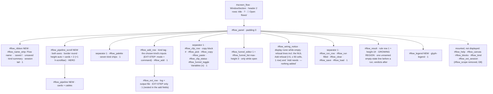
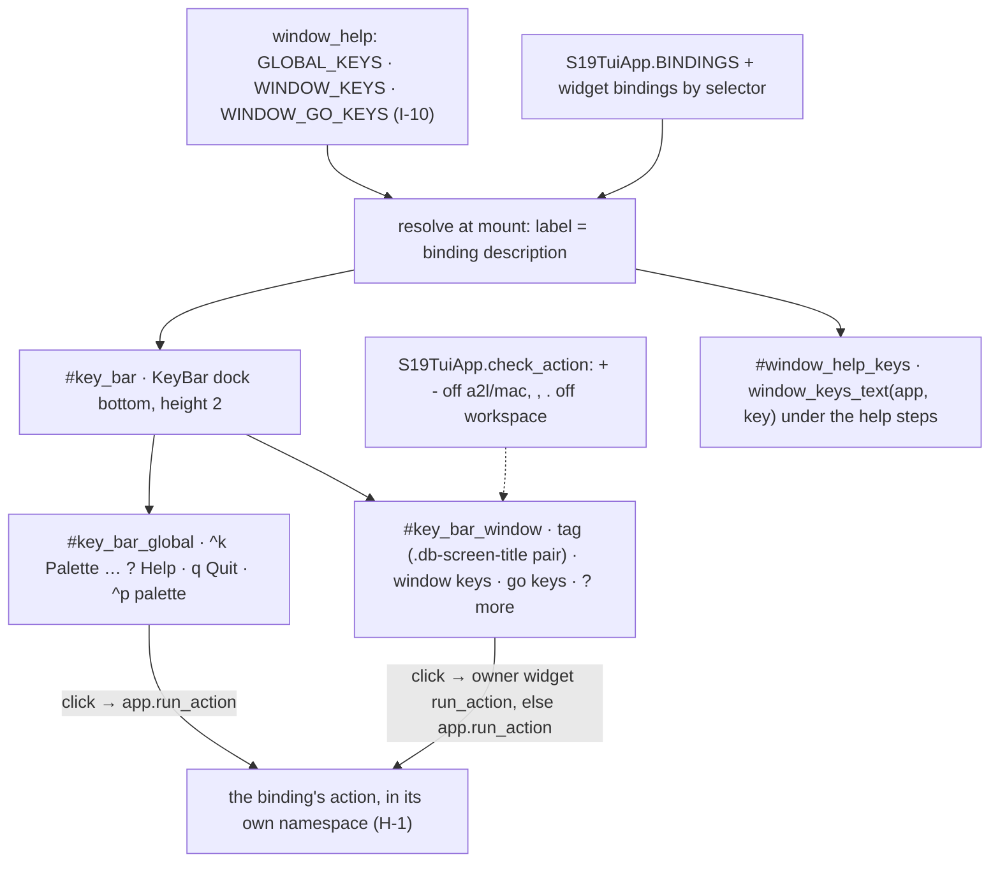

# Design proposal — s19_app — Batch 2026-10-19-batch-97

> **Artifact language.** Canonical **English scaffold**; generate in the batch's language
> The normative rules below are language-independent. **Where that language is declared:**
> `state.json`'s `language` key in `core` and `full`.

> **Reserved field names.** The **field names and block keywords below are language-independent** — the
> validator parses them literally and they are never translated:
> `Design proposal` · `7 · Forward-applicability table` · `⏸ DEFER`
> Everything else on this page — headings, guidance, the prose in every cell — is translated with the batch.
> **One strategy, not two:** the flow ships no alias table, so a translated label is read as an ABSENT one and the rule keyed on it reports a true-sounding silence.
> **Why a HEADING is reserved here and a FIELD NAME everywhere else:** `C-49`'s artifact is the §7 TABLE, and a rule that read a summary bullet instead of the rows would be reading a claim about the table rather than the table. `V52` therefore keys on this document's own H1 and on the §7 heading, which is why both are on the machine plane. **And one FLOW-WIDE reserved token, read out of this artifact by `V42` no matter which template minted it:** `⏸ DEFER`.

> **Owed in.** `core` by trigger · `full` ✓
> **Source:** `/dev-flow-init` step 4's seed-by-level table, which is this fact's one home. A level marked `—` **does not owe this artifact, and its absence is not an omission**; `by trigger` means the station exists only when the `triggers` block fired, and `stations_active` in `state.json` is the authority for *this* batch. Where a SECTION or a gate row is owed more narrowly than the artifact, it says so on the row.

> **Where this lives: the VAULT + Drive**, not the repo — it is deliberation, and its traceability to
> code is weak. It is **cited by id** from the repo (`PDR-<batch_id>#D<n>`), never copied.
> What binds code — a frozen interface, a design characteristic — also lands in the **repo**, in the
> requirement or in `docs/ARCHITECTURE.md`. *The vault keeps the deliberation; the repo keeps the commitment.*

> **The forward-applicability rule (ISO/IEC/IEEE 15288).** Everything below must be NAMED as the input
> of a later activity. **If a section of this proposal is nobody's input, delete it — it does not belong
> in the PDR.** That rule is what allows this document to cost half the batch without being waste.

| Field | Value |
|---|---|
| Id | `PDR-2026-10-19-batch-97` (decisions cited as `PDR-2026-10-19-batch-97#D1` … `#D29`, §1.1; D26–D29, I-10, I-11 and Inc-8 added by the dated delta of 2026-10-20, operator verdict on the key bar) |
| Requirements covered | `01-requirements.md` at `e91631b` (ledger to `LED-2026-10-19-batch-97.5`): HLR-144 to HLR-149 · 65 LLR (LLR-144.1 to LLR-149.6) · AT-B97-01 to AT-B97-24 · TC-B97-01 to TC-B97-65; plus, from `LED-2026-10-19-batch-97.9` (the operator's key-bar scope addition): HLR-150 · LLR-150.1 to LLR-150.7 · AT-B97-25, AT-B97-26 · TC-B97-66 to TC-B97-72 |
| Modules touched (from `docs/ARCHITECTURE.md`) | `s19_app/tui/screens_directionb.py` · `s19_app/tui/flow_screens.py` · `s19_app/tui/app.py` · `s19_app/tui/styles.tcss` · `s19_app/tui/window_help.py` · `s19_app/tui/open_folder_chip.py` · `s19_app/tui/insight_style.py` · `s19_app/tui/services/{folder_open_service, flow_persistence_service, variant_execution_service, flow_execution_service}.py` — all CHANGED, none created (`docs/architecture.md:420`, A1 not fired) |
| Triggers that fired | A2 · A3 · B1 · B3 · C8 · D1 · E1 (`PLAN.md` §Triggers) |
| Author / reviewers | `architect` (author) · `qa-reviewer` · `ux-reviewer` (D1) · `security-reviewer` (owner of the S2-2 carry, Inc-2 gate) |

---

## 1 · Objective and scope

**Objective.** Turn the approved contract into eight sequential increments of ≤ 4 SOURCE files each — executed in the order Inc-1, 2, 3, 4, 5, 6, **8**, 7 (D29; labels kept so no condition is renumbered) — that re-compose the four batch-94 panels at their shipped ids (R13), with every implementation-shape item the contract left open (§6.2 items 1–9) and every P2 carry decided here.

**Will NOT do:** change run semantics, any persisted format (`.chk.json`, change-set v2, flow template, chain-set — batch-94 `#D2` / `#D4` stay frozen), any message type (batch-94 `#D3`), the batch-96 waiting-human doctrine, or any screen other than the four — except the two app-wide changes the contract names: the folder-chip guard and labels (HLR-148) and the two-row key bar on every window (HLR-150, Inc-8); no worker thread (declared OUT, contract §2.6); nothing imported from `prototypes/`.

### 1.1 Decisions (`#D<n>`) — every §6.2 item and every P2 carry

| # | Decision | One-line reason | Lands in |
|---|---|---|---|
| D1 | **I-2/I-3 shape = a `refresh_entries` keyword** `document: PatchDocumentView \| _Unset = _UNSET` (sentinel ⇒ preserve), the payload built by ONE app helper `S19TuiApp._patch_document_view()` and passed at all four sites (`app.py:3265, :3451, :5279, :10758`) | rows, identity and JSON view refresh in the same call, so they cannot disagree; a setter is a second call-site set to keep in step — the MJ-1 defect the code records at `app.py:6273` ("missed a mount-time fourth"); the `mem_map` sentinel idiom is already proven (TC-080.2a) | Inc-4 |
| D2 | `PatchDocumentView` = frozen dataclass in `screens_directionb.py`: `name: Optional[str]`, `kind: str`, `json_text: str`, `entry_count: int`. **`json_text` is the whole document, uncapped** — the app helper decodes the serialiser's `bytes` with `.decode("ascii")` (the wire is pure ASCII: `ensure_ascii=True`, Code-Wire H-P4); the panel applies `cap_json_lines` when it paints (amended 2026-10-21, PC-21) | the panel keeps importing nothing from the service layer (C-7); the app serialises with `serialize_change_document` (R17); a missed decode would paint `b'{…'` | Inc-4 |
| D3 | JSON view = `TextArea(read_only=True, soft_wrap=False)` `#patch_json_view`; the cap note is its last line; the stamp is `#patch_json_stamp` (Static) above it | literal by construction (no markup parser, C-17); focusable, arrow keys (LLR-144.10); no raw C0/C1 reaches it — the serialiser calls `json.dumps(payload, indent=2)` with the default `ensure_ascii=True` (`changes/io.py:1419`) | Inc-4 |
| D4 | The stamp is recomposed by the panel's own `_refresh_dirty_indicator` (the four dirty-flag writers, P-48) and by the D1 document path; text from a pure `json_stamp_text(n, hhmmss, dirty)`. **Retained state and fresh start (amended 2026-10-21, PC-21 / Code-Wire H-P3, PC-18 / H-P1):** (1) the panel retains `_json_shown: Optional[tuple[int, str, str]]` = (entry count, `HH:MM:SS`, uncapped `json_text`) of the payload it last painted, `None` until the first push; (2) **equal-payload rule** — the document path compares the incoming `json_text` with the retained one: different → reload `#patch_json_view` with `cap_json_lines(json_text)`, take the time from the panel's module-level clock `_json_clock()` (`datetime.now().strftime("%H:%M:%S")`, the seam the tests monkeypatch), store the new triple and recompose the stamp; **equal → leave the view (text, cursor, scroll), the retained time and the stamp untouched**; the identity ribbon is repainted from `name` / `kind` on every push either way (a Save can name a draft); (3) the dirty trigger recomposes the stamp from the retained count and time plus the new flag — so `HH:MM:SS` is **the time the view's text was last replaced**, one reading; (4) **fresh start** (no push yet, `_json_shown is None`): the view holds the LLR-148.9 empty-state line `No document yet: Load, paste or Add.` (36 cells) and the stamp reads `no document yet`, plus ` · unsaved changes` while the dirty flag is set (paste-buffer typing before any document); the first document push replaces both. `json_stamp_text(n: Optional[int], hhmmss: Optional[str], dirty: bool) -> str` returns `no document yet[ · unsaved changes]` for `n is None`, else `N entries · HH:MM:SS · saved` / `· unsaved changes` | Save and paste typing change the flag, not the document (P-57); one composer, two triggers. Every Patch action ends at the refresh at `app.py:3276` (H-P1, re-located 2026-10-21; it was `:3265`), so without the equal-payload rule the document path would recompose the stamp after every Save and the Save arm of TC-B97-06 could not go RED; with it, a Save (which writes the file and leaves the serialised document byte-equal) reaches the stamp only through `mark_saved`. The rule also stops a Validate, Run checks or image load from resetting the view's scroll and moving the stamp time while the document is unchanged (H-P2) | Inc-4 |
| D5 | **Hex strip = REUSE `BeforeAfterCard` `#patch_before_after_card`**, moved from `#patch_win_json_body` into `#patch_pane_inspector` and **extended to the pe_A grid** (operator decision 1 = A, 2026-10-20; the grid designed 2026-10-21, PC-1): (a) builder `before_after_card_text(address, before, after, per_row=8, *, lead=(), trail=(), row_cap=STRIP_ROW_CAP)` — every input an `int` or a sequence of `Optional[int]`, so TC-080.7's int-only gate stays green; the elision parameter `max_bytes` and `CARD_BYTES_MAX` retire; (b) **rows of `per_row` bytes aligned down to a multiple of `per_row`**: `lead` = the image bytes from the aligned row start up to `address`, `trail` = the image bytes from the span end to the end of its last row (the panel reads both from `mem_map`, `None` per unmapped address); each row paints three lines — the **offset header** `0000EC00 +0 +1 … +7` (the row address as 8 hex digits in `CYAN`, offsets `+X` = `(row_start + col) mod 16` in `DGRAY`), `  was    ` + the image bytes, `  now    ` + the bytes the entry writes (a context position repeats its image byte); a 9-cell label column, line width `3·per_row + 8`; (c) **stacked, not elided**: every row of the span up to `STRIP_ROW_CAP = 8` rows (64 B at `per_row` 8, 128 B at 16); a longer run paints its first 8 rows and one note line `first 64 of 200 B shown`; (d) the **changed count** on a summary line under the grid, `11 B @ 0x0000EC00 · 11 changed` (≤ 37 cells for any 32-bit address and a 65 536-byte run), counted over the whole span with the card's shipped rule (image byte `None` or different = changed); (e) **colour + bold** (amended at the Inc-4 gate, `LED-2026-10-19-batch-97.18`; was `"bold " + VALUE`, white): a changed span position paints `"bold " + PATCH_TEAL` (`#56e0d6`, the PATCH family teal of the batch-94 spike, as in pe_A) on the `now` line and `VALUE` on the `was` line, and a non-zero `N changed` count on the summary line is `bold PATCH_TEAL` (`0 changed` stays `DGRAY`); an unchanged span position and every context position paint `DGRAY` on both lines and are never bold; an unmapped byte paints `--` (`CARD_UNMAPPED_TOKEN`); TC-B97-39's attribute oracle reads the `now` line, its attribute and its colour (hue distance with a tolerance, PC-7); (f) **`per_row` from the card's content width**: `patch_layout(…).strip_bytes` = the largest of 4, 8, 16, 32 with `3·k + 8 ≤ inspector_w − 3` (the pane's 1-cell scrollbar gutter + the card's `padding: 0 1`) — **8 at 118 columns (card content 38), 16 at 220 (72)**, measured on a CSS mock of the §3 tree at the shipped panel sizes (`evidence/pc-before-inc4-2026-10-21/pe-tree-budget-probe.txt`); on a resize `_apply_layout` re-renders the card when `strip_bytes` changes (D21 item 4, PC-19); (g) chrome: `BeforeAfterCard.DEFAULT_CSS` drops `max-height: 4` and `overflow-y` (height auto); its existing `border-top` row carries `border_title = "BEFORE → AFTER"`, so the title costs no row; strip height = `2 + 3·r` (+ 1 note), `r = ceil((address mod per_row + n) / per_row) ≤ 8`; (h) the three states, each ≤ 38 cells (LLR-148.9, LLR-149.4): no entries `No entry yet: Add one or Load a file.`, no selection `Select a ledger row to see its bytes.`, no image `No image loaded: ^l loads one.` — the `CARD_NO_SELECTION` / `CARD_NO_IMAGE` constants are rewritten (41 and 44 cells today, both wider than the card at 118) | it already follows the highlight with a positional join, a no-image state and an unmapped token (`screens_directionb.py:4122-4220`, `:6273`); its id is in `PE_IDS_9C7BEAF`, so LLR-144.1 keeps it; a new widget would duplicate a tested renderer. The capture's identity line (`#3 string 0xEC00 · inside · check`) is not painted in the strip: it would read `kind_text` / `status_text`, which TC-080.7 classes as file-derived (`tests/test_tui_patch_card.py:962`) and would void LLR-080.7's int-only N/A; the highlighted ledger row beside it already shows kind and status. The 8-row cap kept the entry form and its chips inside the pane at scroll 0 for any run at 118x53 (`2 + 24 + 1` strip + `1 + 3` form + `1` chips = 32 = the pane height); **amended at the Inc-4 gate (`LED-2026-10-19-batch-97.19`):** the form takes one spacer row between its three rows (`1 + 5`), so with the strip at its cap and note the Add / Edit / Remove chips sit 2 rows below the fold at 118x53 (1 at 118x54), reached by `tab` or by scrolling the pane — the cost the operator accepted | Inc-4 |
| D6 | **`✓` / `▼` (U2-11):** on the two flow screens `✓` means only *check block* and `▼` only *write-out block* (kind glyphs, named in help); `#fx_confirm_<i>` is labelled `Confirm` with no glyph; lane state uses only the cable vocabulary. In the Check Editor `✓` means only *included* (ledger), `◆` / `▪` the included-parameter / memory-row Fields marks (LLR-145.6; `◆` replaced `☑` at the Inc-3 gate, LED-2026-10-19-batch-97.12 — `☑` painted two cells wide in Windows Terminal and is the rail's Checks icon) | one meaning per glyph per vocabulary (LLR-148.7); the `✓ Confirm` label and the retired lane `✓ clean` were the second meanings. **Amended at the Inc-5 gate (LED-2026-10-19-batch-97.26):** the Builder ribbon's batch-53 `✓` (saved) / `●` (unsaved) — the last second meanings on the Builder — became the words `· saved` (DGRAY) / `· unsaved` (YELLOW) | Inc-3, 5, 6 |
| D7 | Closed vocabularies are `Mapping[str, str]` (glyph → meaning) in their renderer's module: `PATCH_GLYPHS` (strip + ledger verdict glyphs), `CHECK_GLYPHS`, `FLOW_KIND_GLYPHS` + `FLOW_CABLE_GLYPHS` (Builder), `FX_CABLE_GLYPHS` (`▓ ░ ✗ ◇ □`) + `FX_PENDING_GLYPH = "▪"` (amended 2026-10-22, (a) below; was `"▸"`); each legend is generated from its mapping. **Builder glyphs fixed before Inc-5 (2026-10-21, real Windows Terminal capture `evidence/pc-before-inc5-2026-10-21/png/glyph-ruler-wt*.png`):** `FLOW_KIND_GLYPHS = {"◉": "load", "▣": "patch", "✓": "check", "⊕": "CRC", "▼": "write-out", "⏚": "A2B diff", "»": "external step", "≡": "report"}` (`≡` only when a loaded flow carries a report block; the palette offers the other seven); `FLOW_CABLE_GLYPHS = {"─": "cable", "▶": "feeds the next block"}`; card frame `╭ ╮ ╰ ╯ │ ─`, `←` (input from block #n), `→` (ribbon kind summary), `…`, `·`, `—`; the result area keeps the shipped status glyphs `_BLOCK_STATUS_GLYPH` (`flow_screens.py:215-224`: `●` ok · `◈` notices · `○` skipped · `□` waiting), self-labelled by the status word on the same line, outside the legend, **except `✖` (error), which becomes `✗`** — the WT capture paints `✖` U+2716 as a two-cell purple emoji over the next cell (as `☑` was at Inc-3), `✗` U+2717 one cell, and `✗` already means *error* in the Execution cable vocabulary (LLR-147.1); no requirement literal and no test names `✖` (`git grep` over `tests/`: 0). The three Builder sets are pairwise disjoint. Every glyph above painted one cell in the capture, `▶` included (it has an emoji form, but WT paints the text form); the wide ones in the same capture were `✖`, `⚠`, `✔`, `☑`, `⏸` — `⚠` is in the Execution pending lines (`flow_screens.py:2246, :2271, :2280`), which D7's pending glyph replaces at Inc-6 (`▪`, (a) below). `📂` (header chip, I-1) paints two cells and Textual counts it two (`cell_len` 2), so it never misaligns. **Execution glyphs fixed 2026-10-22 before Inc-6 (Inc-5 carry):** (a) **`FX_PENDING_GLYPH = "▪"`** (U+25AA), not `▸`: `▸` painted one cell in the WT ruler too (`glyph-ruler-readings.txt`), but it reads as a small twin of `▶`; `▪` painted one cell in the ruler and in the Inc-3 capture (`LED-…97.12`) and has no meaning on the two flow screens (its Check Editor meaning, a memory-row field, is another screen's vocabulary). It heads the two red pending lines and the reload notice `▪ '<ref>' missing - re-bind`, one meaning: *owed by the engineer before the lane can go on*. The three shipped `⚠` (`flow_screens.py:2736, :2761, :2770` at HEAD `b514b07`) go, so no `⚠ ✖ ✔ ☑ ⏸` is painted on the Execution screen; (b) **`_FX_STATUS_STYLE`** (`:2294-2302`) is re-keyed to `FX_CABLE_GLYPHS` (PC-2): ok `▓`, issues / notices `◇`, error `✗`, paused `□`, nothing run `░` — `✓` (ok; on the flow screens `✓` means *check block*, D6) and `◈` (the Builder's notices verdict) leave the Execution screen; the lane head's worst-status mark (LLR-147.12) and the run log's terminal marks come from this one mapping; (c) **name strip:** `#fx_name_strip`'s `✓` / `●` (`:2554`) become the Builder's words `· saved` (`DGRAY`) / `· unsaved` (`YELLOW`) — `LED-…97.26`'s reason (`✓` already means *check block* on the flow screens) holds on this screen too, so no new decision; `mark_saved`'s notice `✓ saved flowsets/<stem>.json` (`:2579`) drops the glyph; (d) **Confirm** is labelled `Confirm`, no glyph (PC-2, D6); (e) **the run log's start mark** stays `▶` until the operator answers Q-B97-6a (see §6.1 Inc-6 item (12)) — **answered 2026-10-22 at the Inc-6 pre-work gate: start lines carry no mark** (`LED-2026-10-19-batch-97.31`; the three batch-94 start-mark pins rewritten by named supersession): on the Execution screen `▶` is also the cable arrowhead (`─▓─▶`, fx_A; `FLOW_CABLE_GLYPHS` "feeds the next block") — two meanings on one flow screen. TC-B97-33's Execution arm: the glyphs painted in the lanes, pending lines, REQUIRED line, run log and legend ⊆ `FLOW_KIND_GLYPHS ∪ FX_CABLE_GLYPHS ∪ FLOW_CABLE_GLYPHS ∪ {FX_PENDING_GLYPH}` ∪ the card-frame and separator glyphs, and that union ⊆ `WT_NARROW_GLYPHS` (extended with `▪ ◇ ░ ▓` from the ruler); RED: a `⚠` back, `▸` painted (not in the list) | a dict key cannot carry two meanings, so "one meaning" holds by construction; help bodies stay hand-authored in `window_help.py` (no `window_help → panels` import edge) and TC-B97-33 couples them; the headless compositor counts `✖` as 1 cell (`cell_len` 1), so only a real-terminal capture can see the overlap | Inc-3..6 |
| D8 | **Builder variant branch `app.py:2586-2609`: DELETED**; the handler always runs `run_flow`; `RunRequested.scope` stays in the message (frozen `#D3`) and always carries `FLOW_SCOPE_SINGLE`; `_SCOPE_OPTIONS` and `#flow_scope` leave the panel; `render_fused_result` and `run_flow_over_variants` stay untouched (backlog row at close) | an unreachable branch that paints "run over 'This image' instead" names a control that no longer exists; the service and its `test_d4_*` nodes stay (contract §6.3) | Inc-5 |
| D9 | **Check Editor chip id = suffix:** `OpenFolderChip(family, *, id_suffix=None)` → `open_folder_<family>` or `open_folder_<family>_<suffix>`; the Check Editor mounts `OpenFolderChip("checks", id_suffix="editor")` → `#open_folder_checks_editor` | LLR-148.4 requires an id NO other mounted widget carries; scoping the query would leave two equal ids | Inc-1 (param), Inc-3 (mount) |
| D10 | **Help keys `check_editor` and `flow_execution`** (the `SCREEN_CONTAINER_IDS` keys, `app.py:6752`, per `window_help.py`'s key convention); **both screens become `WindowSection`**. ~~Flow Execution uses `_FlowExecutionSection(WindowSection)` declared in `app.py` with `Binding("c", …)`~~ — **amended 2026-10-22 before Inc-6 (PC-13, `LED-2026-10-19-batch-97.29`): `c` is an APP binding gated by `check_action`.** (1) `#screen_flow_execution` = `WindowSection("flow_execution", titled_header("Flow Execution", OpenFolderChip("session"), help_button=WindowHelpChip("flow_execution")), FlowExecutionPanel(), id="screen_flow_execution", classes="db-screen hidden")` — a plain `WindowSection`, no subclass; (2) `S19TuiApp.BINDINGS` gains `Binding("c", "confirm_attention", "Confirm", show=False)` (the description is the key bar's label, D27 / M-2 of the key-bar QA, and it lands with Inc-6; `show=False` because the shipped `Footer` lives until Inc-8); (3) `S19TuiApp.check_action(action, parameters)` is created here (I-11; Inc-8 adds D28's four arms to it): `"confirm_attention"` → `self._active_screen_key == "flow_execution"` (`False` on every other screen and while Split / Join / Export shows, whose key is `"split_join"`, `app.py:7028`); every other action → `super().check_action(...)`; (4) `action_confirm_attention()` → `self.set_status(panel.confirm_attention())`, where the panel returns one of the three I-9 lines (D15); the status line paints plain text (`set_status` → `_append_log_line`, "markup stays off at construction", `app.py:13231-13250`). Why the app: Textual 8.2.8 builds the binding chain from the focused widget's ancestors, or `[screen, app]` when nothing is focused (`Screen._binding_chain`), and `action_show_screen` moves no focus — executed on HEAD `b514b07`: after `]` the focus stays on `rail_item_workspace` and the chain holds no node of `#screen_flow_execution`; with no focus the chain is `[_default, S19TuiApp]` (scratch probe `c-scope-probe.txt`, `LED-…97.29`). A section binding is therefore dead on the commonest arrival path while the REQUIRED line says `press c to confirm`. What still holds: an `Input` consumes `c` (`check_consume_key("c")` is `True` on `#fx_set_name`, so the chain drops the app's `c` and the input types it); a modal (help, palette pop-up) truncates the chain at the modal (`_modal_binding_chain`), so `c` confirms nothing under it; `run_action` honours `check_action` (`App.run_action`), so the ^K palette entry `Confirm` that LLR-003.2 (TC-007) adds is a no-op off Flow Execution | every other rail screen with help is a `WindowSection` (focused `?`); an app binding gated by the active screen makes `c` work wherever the focus is on that screen (LLR-147.13 "on the Flow Execution screen"), with no import edge; an `Input` consumes `c` itself, so typing still types | Inc-3, Inc-6 |
| D11 | **Token names** `insight_style.WAITING_HUMAN = "#e8ad3d"`, `insight_style.CRC_FAMILY = "#c9562b"`, mirrored as `$waiting-human` / `$crc-family` in `styles.tcss` with the `/* insight_style.X */` comment (the `$accent-calm` convention, `styles.tcss:26-31`); TC-B97-18 couples the pair | role names, because LLR-147.7 restricts the waiting colour to a role; the TCSS mirror is the project's existing way to reach a token from CSS | Inc-2 (py), Inc-5/6 (tcss) |
| D12 | **NEW names.** Ids: `#patch_identity_ribbon`, `#patch_main`, `#patch_inspector`, `#patch_tabs`, `#patch_tab_inspector`, `#patch_tab_json`, `#patch_tab_checks`, `#patch_tab_switcher`, `#patch_pane_inspector`, `#patch_json_stamp`, `#patch_json_view`, `#patch_legend` — plus, added 2026-10-21 by the PC-1 / PC-6 discharge before any consumer exists, `#patch_json_heading`, `#patch_paste_heading`, `#patch_doc_tally` and the constants `STRIP_ROW_CAP = 8`, `STRIP_ROW_BYTES = (4, 8, 16, 32)`; `#check_full_name_line`, `#check_card_tabs`, `#check_tab_fields`, `#check_tab_json`, `#check_tab_addendum`, `#check_card_switcher`, `#check_pane_fields`, `#check_fields_lines`, `#check_pane_json`, `#check_pane_addendum`, `#check_dock`, `#check_legend`; `#flow_ribbon`, `#flow_pipeline_scroll`, `#flow_pipeline`, `#flow_legend`; `#fx_ribbon`, `#fx_lane_<i>_head`, `#fx_lane_<i>_pending`, `#fx_lane_<i>_row`, `#fx_card_<i>_<j>`, `#fx_cable_<i>_<j>`, `#fx_required`, `#fx_legend`. Classes: `fill-accent`, `chip-selected`, `fx-attention`, `fx-waiting` (named `sev-waiting` until the Inc-6 suite run, LED-…97.35), `tab-chip`, `kind-chip`, `glyph-legend`, and the no-wrap categories `nowrap-ledger · nowrap-log · nowrap-pipeline · nowrap-ribbon · nowrap-legend · nowrap-heading · nowrap-fields`. Constants: `JSON_TAB_LINE_CAP = 5000` (`screens_directionb.py`), `CONFIRM_DWELL_S = 0.5` (`flow_screens.py`). **Added 2026-10-22 before Inc-6, before any consumer (PC-3, PC-4, PC-15, PC-21):** in `flow_screens.py` the classes `FlowChip`, `ModeToggle`, `LaneLayout`; the functions `lane_layout`, `fx_run_error_line`; the constants `CONFIRM_RESERVE = 10`, `FX_LOG_MAX_ROWS = 8`, `FX_PENDING_GLYPH = "▪"` (was `"▸"`, D7 (a)) and the clock seam `_fx_clock`; the help key `flow_execution` and the window section id stay `#screen_flow_execution` | contract §6.2 item 5; TC-B97-37 reads the no-wrap set from the DOM by category class, so membership is declared on the widget, not re-listed in the test | per screen increment |
| D13 | **Mode control:** `#fx_mode` becomes a one-row `Button` toggle labelled `sequential · parallel` (the active word in the selection style, ≤ 23 cells); a `FlowExecutionPanel.mode` property feeds the unchanged `RunRequested.mode`. **Shape fixed 2026-10-22 before Inc-6 (PC-3, operator decision 3 = A):** `ModeToggle(FlowChip)` in `flow_screens.py`, id `fx_mode`, `mode: str` (`"sequential"` default, `"parallel"`); label `Text`: `sequential · parallel` (21 cells; 23 with the chip's 1-cell line pads), the active word in the `chip-selected` component style, the other word and the ` · ` in `DGRAY`; **click** — `_on_click(event)` maps `event.x` (widget coordinates, pad at x 0) to a word (`x ≤ 10` → `sequential`, `x ≥ 14` → `parallel`, the separator cells 11–13 → no change; the offsets are re-read on the painted chip, and the click arm uses `pilot.click("#fx_mode", offset=(x, 0))` at the middle of each word), sets that word, calls `event.stop()` and does not call `press()` (a click on a word selects that word, it does not toggle); **`enter` / `space`** — `press()` is overridden to toggle and repaint, posting no `Button.Pressed` (the panel's `on_button_pressed` never sees `fx_mode`); `FlowExecutionPanel.mode` returns the toggle's `mode`, and `on_button_pressed("fx_run")` reads it instead of `query_one("#fx_mode", Select).value` (`flow_screens.py:3104`). **`space` on every chip (PC-3):** `FlowChip(Button)` with `BINDINGS = [Binding("space", "press", "Press", show=False)]` is declared in `flow_screens.py`; `KindChip` becomes `class KindChip(FlowChip)` (body unchanged); every `Button(` composed in `flow_screens.py` — the Builder's `#flow_copy`, `#flow_paste`, `#flow_run`, `#flow_clear`, `#flow_save`, `#flow_load` and the other Builder buttons, the Execution's `#fx_import`, `#fx_run`, `#fx_save`, `#fx_load`, `#fx_bind_<i>_<j>`, `#fx_confirm_<i>` — becomes `FlowChip(`; CSS type selectors match subclasses, so no paint changes (guarded by the Builder painted-frame diff, §6.1 Inc-6 item (11)) | one focus stop, switches on click or `enter` (LLR-147.4); keeps the shipped id; one chip class keeps `space` uniform without an import edge to `TabChip` | Inc-6 |
| D14 | **One run at a time:** the panel disables `#fx_run` before posting `RunRequested`; the app handler wraps `run_chain_set` in `try/except Exception` → `render_run_error(<English line>)`; `render_run` / `render_run_error` re-enable through `call_after_refresh`. **Extended 2026-10-22 before Inc-6 (PC-15, `LED-2026-10-19-batch-97.29`): the confirm re-run is a run.** (1) The panel's one confirm path `_post_confirm(i)` (Confirm button and `c`, D15) disables `#fx_run` and every displayed `#fx_confirm_<k>` before posting `ExternalStepConfirmed`; (2) `on_flow_execution_panel_external_step_confirmed` (`app.py:2794-2862`) wraps `run_chain_set` in the same `try/except Exception as exc` → `panel.render_confirm_error(event.lane_index, fx_run_error_line(exc))`, and **every** exit of that handler calls exactly one of `apply_confirmed_run` / `render_confirm_error` — the no-project return (`:2825-2829`) passes `"no project loaded - load or save a project first"`, the three guard returns (`:2831-2838`: lane gone, block gone, not an EXT-STEP) pass `"confirm refused - lane <i> no longer waits at block <j+1>"` — so no path leaves the controls disabled; (3) the Run handler's raise limb uses the same composer; (4) `fx_run_error_line(exc) -> str` (pure, `flow_screens.py`): `f"run failed - {type(exc).__name__}: {first line of str(exc)}"`, the message through `safe_text(...).plain` and clipped to 160 cells, never a traceback (LLR-148.9); `render_run_error` paints `✗ ` + it (replacing the log, as shipped, for a set run); `render_confirm_error(i, line)` **appends** `✗ <chain> · confirm re-run failed - <line>` to the retained log, removes lane *i*'s current `paused_block` from its `confirmed` (the entry is unconfirmed again, so it can be retried), keeps the lane waiting, and re-arms the attention (I-7); (5) all four painters re-enable through `call_after_refresh` | input queued during the synchronous run reaches a disabled button (P-44); "ends or raises" is met by the `except` limb (LLR-147.10, 148.9); without (1) a double press on Confirm, queued during its own re-run, would confirm the lane's NEXT waiting entry with no human (the re-armed Confirm is enabled when the queued press arrives) | Inc-6 |
| D15 | **Amended at the Inc-6 gate (`LED-2026-10-19-batch-97.34`): the posted line reads `Confirmed <chain> — re-running from block i/n.`; a failed re-run writes `<chain> failed at block i/n — <reason>; Run re-runs the set.`; `c` during a run writes `c: a run is in progress — wait for it to finish.`** **`c` dwell feedback (ux carry):** a `c` inside `CONFIRM_DWELL_S` confirms nothing and sets the status line. **Texts frozen in I-9 by operator decision 2 (PC-2), which supersede this row's first wording `c ignored: the waiting lane just appeared — press c again`:** `c ignored — <chain> started waiting a moment ago. Press c again to confirm.` (inside the dwell), `c: no lane is waiting for confirmation.` (no attention lane), `Confirmed <chain> — the run continues.` (posted); `<chain>` = `safe_text(lane.name).plain`. **Dwell base (2026-10-22, PC-21):** the time the lane **became the attention lane and its attention class was painted** — not the record's arrival, nor the lane's first paint: after a confirm on lane *a*, the attention moves to the next unconfirmed waiting lane *b* and *b*'s dwell starts then, so `press("c", "c")` on `two_wait` confirms 1 even though lane *b* was painted long before (I-7). The clock is the module seam `_fx_clock = time.monotonic` (the `_json_clock` idiom of D4), which tests may monkeypatch. **Stray `enter` (ux carry):** kept as the contract states — one more run, one more report, 0 confirms; that new run clears every lane's `confirmed` | removes the silent swallow without changing the LLR's outcome; the extra report is the contract's own choice (LLR-147.13) | Inc-6 |
| D16 | **Space keys:** `TabChip(Button)` (`screens_directionb.py`) adds `Binding("space", "press", show=False)` for the six editor tab chips; `#check_param_table` becomes `IncludeTable(DataTable)` with `Binding("space", "toggle_include", "Include", show=False)` (the description `Include` is the key bar's label, key-bar QA M-2 — it lands with Inc-3; `show=False` amended 2026-10-20, PC-5 pass: the shipped `Footer` stays live until Inc-8 and would otherwise add a `space Include` token to the Check Editor's footer whenever the table holds the focus, a chrome drift Inc-8 then removes; the key bar reads the description, not `show`, D27). Both bindings live on classes in `screens_directionb.py`, so TC-081.4 (`tests/test_tui_patch_history_strip.py:667`, which diffs `s19_app/tui/app.py` only, `:682`) does not see them | `Button` binds only `enter`, `DataTable` no `space` (P-43); a panel-level `space` would also fire on focused buttons; `query(DataTable)` still matches the subclass (C-38) | Inc-3 |
| D17 | **Q-18 (snapshots):** all 29 snapshot cells already carry the batch-94 `xfail(strict=False)` envelope (`_batch94_inc001_drift_marks`, `tests/test_tui_snapshot.py:1046-1075`, applied at `:1095` and `:1150`) — corrected 2026-10-20 (key-bar QA L-12; the earlier text named only the two `patch` cells), so no cell's C-22 bound can go RED before the regen; Inc-4 writes the C-22 per-cell prediction (both cells drift — the panel is re-composed); Inc-7 triggers the canonical regen (`.github/workflows/snapshot-regen.yml`, textual 8.2.8) after the push and retires the mark in the follow-up commit named in `05-close.md` | a local regen drifts unrelated baselines (`test_tui_snapshot.py:518-520`); the regen is what lets the cells go RED again | Inc-4, Inc-7 |
| D18 | **Q-14 (registry):** each increment that adds a scanned test module re-measures `EXPECTED_SCANNED_TEST_FILES` (`tests/test_id_registry.py:124`) through `scanned_test_files()` — expected 189 → 192 (Inc-1: `test_b97_chips_help.py`, `b97_fixtures.py`, `b97_probes.py` — the glob is `tests/**/*.py`, helpers included) → 194 (Inc-2) → 196 (Inc-3) → 197 (Inc-4) → 198 (Inc-8: `test_b97_key_bar.py`, delta 2026-10-20); measured, never incremented by hand (PC-12, qa C6 / architect C4) | the file's own convention (`:130`, "MEASURED, not incremented"); whether `b97_*.py` helpers are scanned is measured, not assumed | Inc-1..4, Inc-8 |
| D19 | **U2-15 (`Size` vs `Fmt`) — decided 2026-10-20 (PC-14):** the memory table's column stays **`Fmt`** (LLR-145.7's own column name) and the input `#check_mem_size_input` is labelled **`Size (bytes)`**; the help line ties the two: `Size (bytes) — 1 to 8; the Fmt column shows it as u8 / u16 / u32 / u64`. Ids unchanged; no ledger amendment — LLR-145.7 asks for "a visible label naming its field", and the field is a byte count | read at HEAD `f93dadc`: the input is parsed as a decimal byte count, `int(size_text, 10)` (`screens_directionb.py:7484`), refused outside `1..8` with `size must be 1..8 bytes` (`:7487-7491`), and the column paints `_fmt_label(size)` (`:7498`, `:7099-7101`) over `_FMT_LABELS = {1: "u8", 2: "u16", 4: "u32", 8: "u64"}` (`:6909`), any other size as `<n>B`. The two words name two different things: the input takes bytes, the column shows the resulting format — the same `u<bits>` token as the parameter ledger's `Fmt · Unit` column (`:7039`). Labelling the input `Fmt` would invite `u16`, which `int(…, 10)` rejects and the `except ValueError: size = 1` limb (`:7485-7486`) silently turns into **1 byte** — a wrong spec written with no message. `Size` alone would leave the unit unstated. That silent fallback is batch-94 validation, outside this batch (LLR-145.7 boundary catalog: "input validation is batch-94's"); routed to the backlog at close | Inc-3 |
| D20 | **qa carry (LLR-148.6 patch guard 19+7 vs 20+5+1) — corrected 2026-10-21 (PC-9):** TC-B97-32's Patch arm derives its floor at test time by the **type tuple `(Button, Input, Select)`** — `TabChip` is a `Button`, so tab chips count through it — over the widgets of `PE_IDS_9C7BEAF` on the live panel: **26** (20 `Button` + 5 `Input` + 1 `Select` + 0 tab chips, measured identical at `9c7beaf` and at HEAD `98f3c84`, `evidence/pc-before-inc4-2026-10-21/pc9-control-types.txt`); the `TextArea` `#patch_paste_text` is **not** in the tuple (its coverage label is the paste-buffer heading, not a control label), nor is the NEW `#patch_json_view`. The arm asserts `derived == 26` (LLR-148.6's own number, so a drift of the list or of the tuple is seen) and then `count ≥ derived`, where `count` = the number of distinct control **widgets** of the tuple whose labels entered the coverage set over the driven states (Inspector, JSON and Checks tabs; the save-back and before/after rows offered) — expected 29 with the three tab chips — never the number of distinct label strings, because two buttons read `Edit JSON` (`#patch_entry_edit_json_button`, Inspector: the highlighted entry as JSON; `#patch_edit_json_button`, JSON tab: the paste buffer full size), whose one help line names both effects, and the arm asserts that line names both tabs. Label normalisation: a stateful button is matched on the text before its first `:` (`Scope: all variants` → `Scope`, `Width: 16 bytes/line` → `Width`); an `Input` / `Select` on the `Label` on its own row to its left, else its placeholder — so the save-back label sits on its input's row (§3) | the breakdown is a fact of the frozen id list; a hand split is the disagreement itself; LLR-148.6's threshold is corrected to the measured split by `LED-2026-10-19-batch-97.16` | Inc-4 |
| D21 | **Width derivation (LLR-149.1):** CSS expresses every split it can (`fr`, `%`, `height: 1fr` heroes, one-row docked rows); Python sizes only what CSS cannot — DataTable column widths, painted card widths, the REPORT FIELDS name width, the strip's `max_bytes`, the full-name line — through one pure `<screen>_layout(...) -> NamedTuple` per panel, applied by `_apply_layout()`; `_apply_layout` never adds columns or widgets. **Resize path (amended 2026-10-20, PC-19 / PC-8):** (1) *triggers* — `on_mount`, `on_resize` and `on_show` each call `self.call_after_refresh(self._apply_layout)`, so the inputs are read from the child regions after the layout pass (a panel's own `on_resize` runs before its children are re-laid out), and a panel resized while another screen was shown re-derives when it is shown again; (2) *inputs* — measured content widths and counts, never the terminal width: `check_layout(table_w, card_w, fmt_longest)`, `patch_layout(ledger_w, inspector_w)`, `pipeline_layout(avail_w, n_cards)` (**amended at the Inc-5 gate, code-reviewer F2:** returns `PipelineLayout(card_w, spare)`; `spare` = the cells integer card widths leave, 0 … n − 1, one more on each of the first `spare` cables, so the chain paints exactly the rail width at off-grid widths such as 163x56 and 223x60), `lane_layout(viewport_w, n_max)` (**amended 2026-10-22, PC-4:** `n_max` is the set's largest block count and the result is applied to every lane, D24), where `table_w` / `ledger_w` / `card_w` / `inspector_w` are `content_region.width` of `#check_param_table` / `#patch_doc_entries_table` / `#check_right_column` / `#patch_inspector`, `avail_w` / `viewport_w` the `scrollable_content_region.width` of `#flow_pipeline_scroll` / `#fx_lanes_scroll`, `n_cards` the chain's (lane's) block count, and `fmt_longest` the longest right-stripped `Fmt · Unit` text of the loaded rows; (3) *equality guard* — the new tuple is compared with the stored one and an equal tuple returns at once (a resize that changes no width repaints nothing); (4) *painted text recomposed, not only widths* — every text whose content depends on a derived width is rebuilt in the same call by the one painter that builds it at load: Check — the Parameter cells (first segment + `…` + tail at `param`), the `Fmt · Unit` cells (unit clipped at `fmt`), the column label (`Fmt · Unit` when `fmt ≥ 10`, else `Fmt` — a DataTable crops a header label with no ellipsis: spike, painted `Fmt ·` at `fmt = 6`), the REPORT FIELDS lines (name field `card content − 13`); Patch — the strip (`strip_bytes` → `BeforeAfterCard` re-render, D5 (f); amended 2026-10-21, was `max_bytes`), the Value/bytes cells and the identity ribbon's file name (the tail kept at the ribbon width, LLR-149.4 file-name class); Builder / Execution — the card text (`clip_head` / `clip_tail` at the new card width) and the ribbon / pending-line path tails. Head-kept single-line Statics (hints, legends, status) clip by CSS (`text-wrap: nowrap; text-overflow: ellipsis`) and are not recomposed; (5) *DataTable repaint path (PC-8 spike, executed 2026-10-20, `evidence/pc8-width-spike-2026-10-20/pc8-width-spike.txt`)* — set `Column.width` and `auto_width = False` on the `table.columns` entries, then rewrite the width-dependent cells with `table.update_cell(row_key, column_key, text)`, the **first** call of the pass with `update_width=True` (that flag is what makes the table recompute its virtual width); with no rows the pass is `table.clear()` (rows only). Measured over 118x54 → 220x60 → 118x54 → 118x53: painted cells, `virtual_size` and `max_scroll_x == 0` correct at every step, cursor row and `scroll_y` kept, 1.6–2.6 ms for 5 075 rows. Rejected on the same run: `Column.width` + `refresh(layout=True)` alone — `get_render_width` reads the new widths (`[3, 44, 12, 8]`) while the first painted frame keeps the old column positions (`Address` and `Fm` shifted right) and `virtual_size` stays 79 wide, `max_scroll_x` 12 at both 118 readings (the vacuous read PC-8 names); `_clear_caches()` — correct but private; `clear()` + re-add the rows — correct, 94–321 ms per pass at 5 075 rows, cursor and scroll restored by hand; `clear(columns=True)` + re-add — correct but it adds columns (the E-1 trap). No fallback is needed, so "never adds columns" stands | the E-1 trap (columns added twice) is avoided structurally; a width change that left the cell text as built at load would crop names with no ellipsis (a DataTable hard-clips, P-39), so the text belongs to the layout pass; the pure functions are layer-0 arms of TC-B97-34 | Inc-3..6 |
| D22 | **E-1/E-2 removal:** delete `PatchEditorPanel._apply_window_geometry` (`screens_directionb.py:5488-5593`) and its calls (`:5596`, `:5656`), the forced `table.styles.height = 3` and fixed select/path widths in `on_mount` (`:5598-5660`), and the app's show-time block (`app.py:6966-6978`); `#patch_win_json_dock_spacer` stays mounted with `display: none` | LLR-144.3; the spacer id is in the frozen census (LLR-144.1) | Inc-4 |
| D23 | **E-3 replaced:** delete `#patch_win_script { width: 2fr }` (`styles.tcss:1117-1118`), the six-selector grid block (`:1160-1168`, replaced by `layout: horizontal; height: 1`), the `#patch_doc_controls` grid (`:1536-1538`), `#patch_doc_entries_table { height: 10 }` (`:1581-1584`), and every `#workspace_body.width-narrow` rule that targets a widget of the four panels; each panel gets ONE scoped section (`/* batch-97 <screen> */`) under its panel id. **Inc-4 guard (Inc-3 F9, 2026-10-21):** the Check Editor's rows still carry the Patch classes `patch-docked-row`, `patch-chip`, `patch-chip-entry`, `patch-chip-apply` (`screens_directionb.py:7514-7636`), and the one unscoped rule over them, `.patch-docked-row, .patch-docked-group { width: 100%; height: auto; padding: 0 1; }` (`styles.tcss:1149-1154`), is what gives `#check_spec_file_row` and `#check_mem_inputs` their padding today; the `#patch_editor_panel .patch-chip*` rules (`:1197-1246`) are already scoped. Inc-4 therefore leaves `:1149-1154` byte-equal and roots every rule it adds or changes at `#patch_editor_panel` | "replaced, not overridden" (LLR-144.4); the four layouts are the same on both sides of 120 (LLR-149.2); an edit to the unscoped rule would restyle the Check Editor, which no snapshot cell shows (Inc-3 PC-10 census: no cell renders it) | Inc-3..6 |
| D24 | **Lanes scroll:** ONE scroller, `#fx_lanes_scroll` (`ScrollableContainer`, both axes, focusable); each `#fx_lane_<i>_row` is a plain `Horizontal` with `width: auto`. **Card width once per set (PC-4, fixed 2026-10-22 before Inc-6):** `lane_layout(viewport_w: int, n_max: int) -> LaneLayout(card_w, spare)` (pure, `flow_screens.py`) = `pipeline_layout(viewport_w − CONFIRM_RESERVE, n_max)` — the Builder's rule and its `spare` (D21, Inc-5 F2) over the viewport minus the Confirm reserve; `n_max` = the largest block count over **all** lanes (1 with no lanes); `CONFIRM_RESERVE = 10` (I-9) = a 1-cell gap + the 9-cell `Confirm` chip (`Confirm` 7 + the chip's two line pads), fx_A's 10-cell confirm column; the reserve is taken **whether or not a lane waits**, so no card changes width when a lane enters or leaves the waiting state. **The one result is applied to every lane:** each card of every lane is `card_w` wide, and cable *k* (between card *k* and *k+1*, 0-based) is `4 + (1 if k < spare else 0)` cells in every lane, so card *k* starts at the same x in every lane and the cards line up in columns; a lane with fewer blocks than `n_max` ends earlier, its `#fx_confirm_<i>` one gap after its own last card. `viewport_w` = `#fx_lanes_scroll.scrollable_content_region.width` (border, padding and the reserved 1-cell vertical scrollbar excluded: `scrollbar-gutter: stable; scrollbar-size-vertical: 1`). **Recomputed** by `_apply_layout` (D21 triggers `on_mount` / `on_resize` / `on_show`, plus `add_lane`, `restore_lane`, `begin_set_restore` and the lane removal, each through `call_after_refresh`); the equality guard compares `(card_w, spare, lane_card_heights)`; a changed width repaints every card's text through the one card painter (D21 item 4). Illustrative (`#fx_panel` measured 112 / 196 wide on HEAD `b514b07`, `fx-regions.txt`; the viewport assumes a round border, padding `0 1` and the 1-cell gutter: 107 / 191): 4 blocks → `pipeline_layout(97, 4)` = card 21, spare 1 at 118; `pipeline_layout(181, 4)` = card 42, spare 1 at 220; 6 blocks at 118 → card 21 (minimum), chain + reserve 156 > 107 → `#fx_lanes_scroll` scrolls (LLR-147.12's boundary); 6 at 220 → card 26, fits. Inc-6 re-measures `viewport_w` on its own tree and states the four readings in its packet | LLR-147.12 names `#fx_lanes_scroll` as the scroller with its keyboard path (P-53); a per-lane `HorizontalScroll` (fx_A) adds a focus stop per lane; a per-lane width (fx_A computed per lane) makes the same block kind a different width in two lanes and moves every card when one lane starts to wait (ux C4) | Inc-6 |
| D25 | **Help bodies:** `check_editor` written in Inc-3, `patch` rewritten in Inc-4, `flow` rewritten in Inc-5, `flow_execution` written in Inc-6; at the Inc-4 gate `crc_designer` and `reports` are declared code-authored too (their step 6 names its folder in code, F3/F4; the untracked operator draft `help_sections.md` keeps its own wording and no test reads those two sections from it, `LED-2026-10-19-batch-97.20`) | each body names the labels its increment paints; Inc-2 carries the three flow services + tokens precisely so Inc-5/6 keep a slot for `window_help.py` | Inc-3..6 |
| D26 | **Key bar = one custom widget, not Textual's `Footer`:** `KeyBar(Vertical)` `#key_bar` (dock bottom, height 2) composing two `KeyRow(Static)` rows, `#key_bar_global` and `#key_bar_window`, each painted from the pure `pack_key_row(tokens, width, *, keep, more) -> PackedRow(text, hits, dropped)` (`hits` = one `(x0, x1, key)` per kept enabled token); a click maps `event.x` to a hit and **runs the binding's action in its own namespace** (operator decision 2026-10-20, key-bar QA H-1): an entry with no `owner` → `app.run_action(action)`, which honours `check_action` (`textual/app.py:4223-4248`); an `owner` entry → `widget.run_action(action)` on the widget the selector resolves; never `simulate_key`, which hands the key to the focused widget first; a click on `? Help` / `? more` runs `show_help_panel`; a click on a dimmed token rings the bell; packing = reserve the mandatory parts (`? Help`; the tag and the `? more` tail), then the longest display-order prefix of the rest (no greedy skip); go separator ` · go` after window keys, ` go` without; colours from component classes (`key-bar--key`, `key-bar--description`, `key-bar--tag`, `key-bar--separator`) styled in `styles.tcss` with `$footer-*`, `$accent-calm`, `$bg-base` and read with `get_component_rich_style` — no hex in Python; declared in `window_help.py` beside `WindowSection` and `WindowHelpChip`, the window-chrome widgets; text built as `rich.Text` (no markup parser) | `Footer` paints `screen.active_bindings`, where the focused `WindowSection`'s `?` (`show=False`) hides `? Help` (P-61); it crops at the row width instead of dropping whole tokens (`perio▏`, P-67); it cannot paint a tag or a per-window second row, and two painters for one bar would drift. Click support is kept without `Footer`'s `simulate_key` path, which would type `c` / `q` into a focused input or press a focused tab chip with `space`. A new `key_bar.py` module would be an A1 change for ~150 lines that belong with the window chrome | Inc-8 |
| D27 | **The window-key table (I-10) lives in `window_help.py` and is the one source for row 2 and the help's key lines:** `KeyEntry(key, when=None, owner=None)`; `WINDOW_KEYS: Mapping[str, tuple[KeyEntry, ...]]` and `WINDOW_GO_KEYS: Mapping[str, tuple[str, ...]]` over the 13 windows; `GLOBAL_KEYS`; labels resolved once at mount from the binding (`owner=None` → `S19TuiApp.BINDINGS`; `owner="<selector>"` → the class bindings of the widget that selector finds inside the window's container), the app passed in — no `window_help → app` import; an unbound key or an empty description raises at mount; the only painter literals are `more` and `palette`; `HELP_KEY_WINDOW` maps help sections to windows (`split_join_export` → `split_join`; `reports`, `changes_file_notation` → none); the help modal shows `window_keys_text(app, key)` (NEW, `#window_help_keys`) beneath the steps; `section_body_text` stays the steps alone. D7's "help bodies hand-authored" is amended for key lines only: Inc-8 deletes every hand-typed key line the block now carries | one table cannot drift from itself (the prototype round's own finding); the label is the binding's description, so renaming a binding renames its token and its help line together; the selector `owner` reaches `IncludeTable`'s `space` (D16) with no new import edge (Flow Execution's `c` is an app binding since the 2026-10-22 amendment of D10, so its entry has no `owner` and its click runs `app.run_action("confirm_attention")`, which honours `check_action`); keeping the block out of `section_body_text` leaves TC-707's numbered-steps census (`tests/test_window_usage_help.py:208`) untouched | Inc-8 |
| D28 | **`S19TuiApp.check_action` (NEW) and one `key_display`:** `False` for `page_next_context` / `page_prev_context` off `a2l` / `mac` and for `hex_page_prev` / `hex_page_next` off `workspace` (keyed on `_active_screen_key`); every other action falls through to `super().check_action`; `Binding("period", "hex_page_next", "Hex+", key_display=".")`; the `show` flags are not changed | the keys page a hidden view today (P-63), so painting them away without disabling them would leave a live key nobody sees; `False` (left out) because they mean nothing there, while "handled here, not now" is the table's `when` condition, painted dim; unchanged `show` flags keep `tests/test_discoverability.py:33` and the stock help panel as shipped | Inc-8 |
| D29 | **Execution order 1, 2, 3, 4, 5, 6, 8, 7.** The key bar refreshes on `Screen.bindings_updated_signal` (focus changes and `app.refresh_bindings()`, the signal `Footer` subscribes to), and the app calls `refresh_bindings()` at the end of `action_show_screen`, of the split-join show and of every writer of a table condition (PC-23) — no timer. Inc-3..Inc-6 run their vertical-budget arms (LLR-149.3, LLR-149.5's height clause) also at 118x53, the body height 118x54 has once the two-row bar lands (PC-24). Inc-7 sweeps the real two-row layout, where PC-22's 118x53 hedge retires | the sweep and the snapshot regen must see the final bottom rows, or both run twice; the 118x53 arms keep Inc-8 from re-cutting four layouts it does not own; a signal keeps every key-bar assertion free of waits, which a polling timer (the prototype's `set_interval(0.5)`) would not | Inc-3..Inc-8 |

## 2 · Modules and boundaries

| Module | What it owns here | What it exposes | What it must NOT reach into |
|---|---|---|---|
| `tui/screens_directionb.py` | `PatchEditorPanel`, `CheckEditorPanel` compositions; `PatchDocumentView`, `TabChip`, `IncludeTable`, `JSON_TAB_LINE_CAP`, `PATCH_GLYPHS`, `CHECK_GLYPHS`, `patch_layout()`, `check_layout()`, `json_stamp_text()` | `refresh_entries(…, document=)` (I-2/I-3); the shipped ids | the service layer (C-7: payloads arrive as plain data) |
| `tui/flow_screens.py` | Builder rail, Execution lanes; `FLOW_KIND_GLYPHS`, `FLOW_CABLE_GLYPHS`, `FX_CABLE_GLYPHS`, `FX_PENDING_GLYPH`, `CONFIRM_DWELL_S`, `pipeline_layout()`, `lane_layout()`, `cable_glyph()`, `clip_head()` / `clip_tail()` | `confirm_attention()`, `mode`, `lane_paint_plain()` (kept, re-implemented over the new lane) | app state (the shipped message posture); service writers |
| `tui/app.py` | headers, the `c` app binding + `action_confirm_attention` + `check_action` (D10 amended 2026-10-22; was `_FlowExecutionSection`), the D1 helper, the run guard's and the confirm re-run's `except` limbs (D14); deletes the variant branch and the geometry call; mounts the key bar in place of `Footer`, `check_action`, the `period` `key_display`, the `refresh_bindings()` calls (D26, D28, D29) | `check_action` (I-11) | panel internals (public methods only) |
| `tui/styles.tcss` | one scoped section per panel; `$waiting-human`, `$crc-family` | — | rules of other screens |
| `tui/window_help.py` | `check_editor`, `flow_execution` sections; rewritten `patch`, `flow`; the window-key table, `KeyBar` / `KeyRow`, `pack_key_row`, `window_keys_text` (D26, D27) | `SHIPPED_WINDOW_KEYS` (I-4); I-10; `KeyBar` (I-11) | panel modules and `app.py` (no import; the app instance is passed in) |
| `tui/open_folder_chip.py` + `services/folder_open_service.py` | `flows` / `session` families, per-family no-project reason, the real-directory guard, labels, `id_suffix` | I-1 | a second `"flows"` literal (R15 imports `FLOWS_SUBDIR`) |
| `services/flow_persistence_service.py`, `services/variant_execution_service.py` | NUL refusal; `stat()` guards catch `(OSError, ValueError)` | unchanged return shapes | — |
| `services/flow_execution_service.py` | its 11 painted strings in English | unchanged API | — |
| `tui/insight_style.py` | `WAITING_HUMAN`, `CRC_FAMILY` | tokens | — |

- Boundaries respected as declared in `docs/ARCHITECTURE.md`: ✓ — no module created, no file moves; the only new edge is ARQ's `folder_open_service → flow_persistence_service` (`FLOWS_SUBDIR`, `docs/architecture.md` batch-97 §Dependencies). D7 and D10 were chosen so that no second edge appears.

## 3 · Diagrams

**Structure — Patch Editor widget tree (Inc-4; PC-1, PC-6, PC-24, measured 2026-10-21).** Kept ids plain, NEW ids marked; every row count is a terminal row. The 2-row WindowSection header sits above the panel (shipped).

The panel height `H` is the shipped `#patch_editor_panel` region on HEAD `98f3c84` — **40** at 118x54, **39** at 118x53, **46** at 220x60, **45** at 220x59 — and its width **112** / **196** (`evidence/pc-before-inc4-2026-10-21/patch-panel-regions-98f3c84.txt`); the same as the Check Editor's. Every region below was read on a CSS mock of this tree at exactly those panel sizes (`pe-tree-budget-probe.txt`). The three `patch_win_*_body` ids keep their `9c7beaf` type, `VerticalScroll` (`pe-container-types-9c7beaf.txt`); the `Container` ids of LLR-144.1 are `patch_win_script`, `patch_win_json`, `patch_win_json_dock_spacer`, `patch_win_checks`, `patch_saveback_row`, `patch_before_after_row`, `patch_checks_results`. The two bodies whose only content is a focusable scroller (the ledger, the paste area) take `can_focus = False`, so neither adds a focus stop; the Checks body stays focusable — it is the Checks tab's scroll view, the first member of the checks group of LLR-144.10.

| Region (Patch Editor) | Rows | 118x54 · H 40 | 118x53 · H 39 | 220x60 · H 46 | 220x59 · H 45 | Slack |
|---|---|---|---|---|---|---|
| ribbon · file row · document controls · legend | 1 each | 4 | 4 | 4 | 4 | 0 — fixed single rows |
| `#patch_main` | `H − 4` | 36 | 35 | 42 | 41 | — (split below) |
| **`#patch_doc_entries_table` (hero)**, inside the ledger border | `H − 6` (header 1 + data) | 34 (33 data rows) | 33 (32) | 40 (39) | 39 (38) | the hero absorbs every row change; 6-entry fixture: 27 · 26 · 33 · 32 empty ledger rows (plain ledger background, no box) |
| inspector chrome: border 2, tab chips 1 | 3 | 3 | 3 | 3 | 3 | 0 |
| `#patch_tab_switcher` (one pane shown) | `H − 7` | 33 | 32 | 39 | 38 | see the three panes |
| Inspector pane content | `2 + 3·r` strip (+1 cap note) + `6` form (`4` before the Inc-4 gate; one spacer row between the three inputs, `LED-2026-10-19-batch-97.19`) + `1` chips + `5` tally; `r ≤ 8` byte rows of `strip_bytes` (8 at 118, 16 at 220) | 18 with row #3 of the fixture (11 B at `0xEC00`, r = 2) | 18 | 15 (r = 1) | 15 | empty rows at the pane's bottom: **13 · 12 · 22 · 21** (re-measured at the Inc-4 gate, `evidence/inc-4/budget-fold.txt`; were 15 · 14 · 24 · 23 before the spacer rows, `LED-2026-10-19-batch-97.19`); a 4-byte entry: 16 · 15 · 22 · 21 and nothing loaded: 21 · 20 · 27 · 26 (both derived, each 2 fewer than before); longest run (cap + note: 27-row strip): the Add / Edit / Remove chips end 2 rows below the fold at 118x53 and 1 at 118x54 (measured, TC-B97-40), reached by `tab` or by scrolling the pane; all inside at 220 |
| JSON pane: heading, stamp, paste controls, history strip, Undo/Redo, execute (label · buttons · scope line) | `1 + 1 + 1 + 1 + 1 + 3` | 8 | 8 | 8 | 8 | 0 — fixed |
| `#patch_json_view` · paste area (`#patch_paste_text` under its 1-row heading) | the rest, `1fr` each | **12 · 12** | 12 · 11 | 15 · 15 | 15 · 14 | no empty rows — both are scroll views; with the save-back prompt (+3) and the report row (+2) offered: 10 · 9 at 118x54, 9 · 9 at 118x53 |
| Checks pane: `#patch_win_checks_body` | `H − 9` (controls 2) | 31 | 30 | 37 | 36 | before a run ≈ 3 status lines and ≈ 28 · 27 · 34 · 33 empty rows; after a run one result line per entry from the top (6-entry fixture ≈ 22 empty at 118x54) |

**JSON tab, top to bottom (PC-6).** The two text areas are told apart by visible headings: `LOADED DOCUMENT · read-only` (`#patch_json_heading`, `nowrap-heading`) over the stamp and `#patch_json_view`; `PASTE BUFFER · editable` (`#patch_paste_heading`, `nowrap-heading`; it reads `PASTE BUFFER · example` while the buffer equals `DUMMY_CHANGESET_TEXT`, ux Obs 5 at the Inc-4 gate) on one row with `#patch_paste_gauge` at its right (`PASTE BUFFER · editable` 23 cells / `· example` 22 + the gauge `0.3K / 64.0K` ≤ 13 cells, inside the 41-cell pane at 118; the WT capture `evidence/inc-4/png/impl.patch-editor-json.png` shows both whole) over `#patch_paste_text`. Then Parse pasted · Edit JSON, the history strip, Undo · Redo (`#patch_history_controls`, kept in the JSON tab beside the strip that describes them; `ctrl+z` / `ctrl+y` still work from anywhere on the screen), the execute row, and the save-back / report rows while offered. The save-back prompt's label shares its input's row (`Save patched image as:` 22 cells + the input `1fr`), and its three buttons take two rows because `Width: 16 bytes/line` + `Write file` + `Don't save` need 48 cells against the pane's 41.

**Where the capture's other elements went (PC-6).** *DOCUMENT tally* — placed: `#patch_doc_tally` at the foot of the Inspector pane, as in the pe_A capture: `DOCUMENT`, a 12-cell `▓/░` bar, `N entries · I inside · P partial`, `O outside · F faults` (` · U no image` when non-zero), four explicit lines (no wrapped row), painted from the rows' closed status vocabulary as counts only; `0 entries` alone when empty. *Issues line* — placed: `#patch_doc_issue_count` and `#patch_doc_issues` at the top of the Checks tab's body, the home LLR-144.12 gives them; a refused load also shows its finding as the ledger's one state line (LLR-148.9), so it is visible without opening the tab. *Undo / Redo* — placed in the JSON tab (above). *Inspector hint* (`Add writes the typed entry · Edit loads the selected row into the form`) — **removed, a visible delta**: it is 70 cells and painted on two wrapped rows at 40 cells (LLR-149.4 forbids a wrapped row); `Add — …` and `Edit — …` are help lines (LLR-148.6). *Foot hint* (`JSON / Checks → tabs in the inspector`) — **removed, a visible delta**: the tab chips it points at are on screen. *Row identity line* (`#3 string 0xEC00 · inside · check: not run`) — **removed, a visible delta**: D5 (the strip paints ints only); the highlighted ledger row shows kind and status.

**Widths (measured on the mock, 2026-10-21).** Ledger frame 67 / 117, inspector frame 45 / 79 (content 41 / 75), card content 38 / 72 → `strip_bytes` 8 / 16, strip line 32 / 56 cells. The strip's state lines (≤ 38) and summary line (≤ 37) fit the 118 card; the stamp `N entries · HH:MM:SS · unsaved changes` is ≤ 41 cells up to 4-digit counts and clips its tail with `…` at 5 digits (`saved` is never clipped, so the two states stay distinct).

**Remaining empty rows, in plain words (for the operator, Patch Editor).** The entry list fills the whole left side: 33 rows of entries at 118x54 (32 once the two-row key bar lands) and 39 (38) at 220x60; with the 6-entry example, the 27 rows under the last entry are plain list background, not a box. The right card has three tabs. *Inspector:* with the third example entry highlighted (11 bytes), the before/after bytes, the form, its buttons and the document tally take 18 rows and leave 15 empty rows at the bottom of the card at 118x54 (14 with the bar); at 220x60 the bytes fit on one 16-byte row and 24 (23) rows stay empty. With nothing loaded, 23 (22) and 29 (28). An entry longer than 64 bytes at 118 columns (128 at 220) shows its first 8 byte rows and one line saying how many bytes are shown (the whole entry stays readable in the JSON tab); the form stays visible and the tally moves below, reachable by scrolling; since the Inc-4 gate (one blank row between the three input rows, the operator's choice) the Add / Edit / Remove buttons of such a long entry also sit 1 row (118x54) or 2 rows (118x53) below the card's bottom edge, reached with `tab` or by scrolling. With the third example entry the empty rows are now 13 (12) at 118x54 and 22 (21) at 220x60. *JSON:* no empty rows — the read-only document and the paste buffer share the height, 12 rows each at 118x54 (12 and 11 with the bar) and 15 each at 220x60; while the save-image prompt and the report button are showing they shrink to 10 and 9. *Checks:* before a run, three status lines and about 28 empty rows; after a run, one line per entry fills from the top. Every row outside the list and the card is a single filled row with no gap.

**Structure — Flow Execution widget tree (Inc-6; PC-4, PC-21, PC-24, written 2026-10-22 before Inc-6).** Kept ids plain, NEW ids marked; every row count is a terminal row. The 2-row header sits above the panel: `#screen_flow_execution` is a plain `WindowSection` (D10 amended), and its present 1-row title already leaves the panel at y = 4 (`fx-regions.txt`: screen `(5, 2, 112, 42)`, panel `(5, 4, 112, 40)` at 118x54), so the header costs the panel no row — the Check Editor's case.

**Lanes, cards, cables (PC-4, D24).** Lanes stack vertically (fx_A). Each lane is a head, its pending lines while it waits, and one row of cards. Every card of every lane is `card_w` wide, from the one `lane_layout(viewport_w, n_max)` result, and cable *k* is `4 + (1 if k < spare)` cells in every lane, so the cards line up in columns. A card is a bordered `Vertical`. Its border title carries the kind glyph and name (`◉ LOAD`, from `FLOW_KIND_GLYPHS`; it costs no row). Then come the block's io lines, clipped by the Builder's `clip_head` / `clip_tail` at `card_w − 4`, and one status line (`<cable-vocabulary mark> <status word>`). The SOURCE card's file line is its `#fx_in_<i>_<j>` input (one row, full card width), and `#fx_bind_<i>_<j>` sits on the next row (LLR-147.2: inside the card, Bind right after its input in the focus order). Cable *k* paints `─<mark>─▶` on the card's output row. The mark comes from LLR-147.1's table over the retained record (`cable_glyph`); it paints in the waiting colour when it leads into the waiting card. **Card height per lane** = 2 (border) + the largest content-row count over that lane's cards. `_apply_layout` sets it on every card of the lane and on `#fx_lane_<i>_row`, so a lane's cards share one height. The waiting card's border paints in `$waiting-human`. **Confirm styles (LLR-147.3, LLR-147.9):** `#fx_confirm_<i>` is a 1-row `FlowChip` (the batch's chip shape, as Run) on the card row's output line; every displayed Confirm is a filled element (LLR-147.9 counts one per waiting lane): a waiting Confirm without the attention class is filled with `$waiting-human 40%` (the TCSS blend) and normal-weight `$text`, the attention Confirm (`.fx-attention`) paints the fx_A amber slab colours — `$waiting-human` background, bold `$bg-base` text — and `#fx_run` keeps `fill-accent`; the three differ in the compositor strips (TC-B97-23 reads them with `span_colours`). fx_A drew Confirm as a 10x6 slab; the 1-row chip is a visible delta shown with the Inc-6 captures. `#fx_lane_<i>_paint` (the 44-cell box with the progress bar) is not mounted any more. `lane_paint_plain(i)` returns the plain text of the lane's head, pending lines and painted card rows (the C-32 seam, I-7); the Inc-6 reverse census names the nodes that query `#fx_lane_<i>_paint` directly. `#fx_lanes` changes from `Horizontal` to `Vertical`, and the two `query_one("#fx_lanes", Horizontal)` sites in the panel change with it.

**Run log (LLR-147.8).** `#fx_log` is a `Static`, `height: auto; max-height: 8`, and **not** a scroll view: a scroll view would be a focus stop that LLR-147.11's order does not list. Before a run it paints one line, `No run yet — Run executes every lane.`. After a run it paints one start line and one terminal line per lane (LLR-020.1), with the re-run lines appended (I-7 (e)). When the log holds more than `FX_LOG_MAX_ROWS` lines, the first painted line reads `… <k> earlier lines — the full log is in the run report` and the newest 7 follow; the chain-set report under `reports/` keeps every line.

The panel height `H` is the shipped `#fx_panel` region on HEAD `b514b07`: **40** at 118x54, **39** at 118x53, **46** at 220x60, **45** at 220x59, width **112** / **196** (`fx-regions.txt`; the same as the Builder's and the Check Editor's). The card height `h` is illustrative until Inc-6 paints its own cards. fx_A's capture gave a lane 8 rows (head 1 + card 7, `prototypes/b94_polish/NOTES.flows.md` §fx_A, "lanes 21 = 2 lanes × 8 + ghost 3 + frame 2"), so the table uses `h = 7`. Inc-6 re-measures and the table moves with it, the lanes region absorbing the difference (as Inc-5 did for the Builder's cards).

| Region (Flow Execution) | Rows | 118x54 · H 40 | 118x53 · H 39 | 220x60 · H 46 | 220x59 · H 45 | Slack |
|---|---|---|---|---|---|---|
| ribbon · set row · legend | 1 each | 3 | 3 | 3 | 3 | 0 — fixed single rows |
| `#fx_notice` · `#fx_required` | 0 unless shown | 0 · 0 | 0 · 0 | 0 · 0 | 0 · 0 | +1 each when shown, taken from the lanes region |
| `#fx_log` | 1 before a run; `min(lines, 8)` after | 1 | 1 | 1 | 1 | after the 3-lane run: 6 (3 start + 3 terminal lines) |
| **`#fx_lanes_scroll` (hero)**, border 2 | `H − 3 − log − notice − required` | 36 before a run | 35 | 42 | 41 | the hero absorbs every row change |
| lanes viewport, 3-lane run with lane 1 waiting (log 6, REQUIRED 1) | region − 2 (− 1 with the horizontal scrollbar) | **28** | **27** | **34** | **33** | content `3 × (1 + h) + 2` = **26** with `h = 7`: 2 · 1 · 8 · 7 empty rows under the last lane, inside the frame |
| lanes viewport, `wait_third_6` (6 blocks scroll sideways at 118) | as above, − 1 scrollbar row at 118 | **27** | **26** | 34 | 33 | content 26: **1 · 0** at 118x54 · 118x53 — no slack at 118x53; a taller card makes the lanes scroll vertically, and LLR-147.3's scroll step still brings the waiting card and its Confirm into view |

**Remaining empty rows, in plain words (for the operator, Flow Execution).** The top two rows are the set's ribbon (name, saved state, session folder, Import…, the `sequential · parallel` switch and Run) and the set row (name, Save Set, saved sets, Load Set). The bottom row is the legend. Everything between them is the framed lanes area, except the run log just above the legend (one line before the first run, then two lines per lane, at most 8) and, while a lane waits, the one `REQUIRED … press c to confirm` line above the log. Each lane is a header line, two red lines while it waits for a human, and one row of block cards joined by status cables. Every lane uses the same card width, so the cards line up in columns, and Confirm sits right after a waiting lane's last card. With the 3-lane example after a run (one lane waiting), the lanes need about 26 rows and the frame offers 28 at 118x54 (27 once the two-row key bar lands) and 34 (33) at 220x60, so 2 (1) and 8 (7) rows stay empty at the bottom of the frame. With 6-block lanes at 118 columns the cards scroll sideways, and the frame is exactly full at 118x53.

**Structure — Check Editor widget tree (Inc-3, PC-5 / PC-24, measured 2026-10-20).** Kept ids plain, NEW ids marked; every row count below is a terminal row.

The panel height `H` is measured on HEAD `f93dadc` (`#check_editor_panel` and `#flow_panel` regions, headless `run_test`): **40** at 118x54, **39** at 118x53 — the height 118x54 keeps once the two-row key bar of Inc-8 lands (PC-24) — **46** at 220x60 and **45** at 220x60 with the bar. The 2-row WindowSection header sits above the panel and is already the `#screen_flow` shape (`Horizontal 112x2`, panel at y=4); the Check Editor's present 1-row label also leaves the panel at y=4, so making `#screen_check_editor` a `WindowSection` (D10) costs the panel no row. **No margin rows anywhere in the panel** (LLR-149.5 / TC-B97-53: no blank row outside the hero): the two `margin-top: 1` gaps of the ce_A capture are given to the ledger.

| Region (Check Editor) | Rows | 118x54 · H 40 | 118x53 · H 39 | 220x60 · H 46 | 220x60 + bar · H 45 | Slack (rows it can give up) |
|---|---|---|---|---|---|---|
| spec row · dock · legend | 1 each | 3 | 3 | 3 | 3 | 0 — fixed single rows |
| `#check_columns` | `H − 3` | 37 | 36 | 43 | 42 | — (split below) |
| left column chrome: border 2, filter 1, full-name line 1, include row 1 | 5 | 5 | 5 | 5 | 5 | 0 |
| **`#check_param_table` (hero)** | `H − 8` | 32 (31 data rows) | 31 (30) | 38 (37) | 37 (36) | the hero absorbs every row change; 75 rows scroll vertically only |
| card chrome: border 2, tabs 1 | 3 | 3 | 3 | 3 | 3 | 0 |
| `#check_card_switcher` (one pane shown) | `H − 6` | 34 | 33 | 40 | 39 | see the Fields pane |
| Fields pane content | `10 + L + min(m, 6) + r` — head 1, `L` field lines (1 empty-state line when 0), spacer 1, MEMORY LOCATIONS 1, mem table `1 + min(m, 6)`, inputs 3, chips 1, spacer 1, status 1, `r` validate rows (**amended at the Inc-3 gate, LED-2026-10-19-batch-97.14**; was `7 + …` with inputs 2 and no spacer) | 20 for the ce_A scenario (2 params + 4 memory rows, no run) | 20 | 20 | 20 | empty rows under the status line, re-measured (`evidence/inc-3/form-measure-fold.txt`): **14 · 13 · 20 · 19** (scenario) and **23 · 22 · 29 · 28** with nothing included; the pane scrolls once `L + min(m, 6) + r` exceeds `H − 16`. The spacers lie inside the card, beside the ledger, so no full-width blank panel row appears (TC-B97-38 unchanged) |
| JSON / Addendum panes | full switcher height | 34 | 33 | 40 | 39 | a scroll view; empty rows only below a short addendum |

Widths (measured 2026-10-20 on the shipped panel restyled with this tree's CSS, in the spike run of `evidence/pc8-width-spike-2026-10-20/`): card **42** / left **70** / table content **68** at 118 columns; **74 / 122 / 120** at 220. `check_layout(table_w, card_w, fmt_longest)`: usable = `table_w − 1` (`#check_param_table { scrollbar-size-vertical: 1 }`, the gutter always reserved, so widths do not flip when the list stops overflowing); fixed = mark 3 + Address 12 + the two remaining paddings 4 = 19; **`Fmt · Unit` is sized before Parameter grows:** `fmt = max(4, min(fmt_longest, 16, usable − 19 − 42))` — the longest right-stripped unit text, capped at 16, never below `u128`'s 4 and never eating the Parameter floor 42; `param = usable − 19 − fmt`; the label reads `Fmt · Unit` when `fmt ≥ 10`, else `Fmt`. Result: **118 → param 42, fmt 6** (painted `u16 h…`: the width always shows, the unit is clipped — LLR-149.4); **220 → param 89, fmt 11** (the demo's longest unit `u16 U/  min` in full; the spike ran a cap of 10 and painted param 90 / fmt 10). Fields name field = card content − 14 (mark 2, address 11, the pane's 1-cell scrollbar gutter, `#check_pane_fields { scrollbar-gutter: stable; scrollbar-size-vertical: 1 }`) = **24 at 118** (LLR-145.3's floor, held by `min-width: 42`), **56 at 220** (the 47-cell names in full); mem-table Label column = card content − 21 = 17 / 49, head kept with `…`. Mem inputs at 118 (pane content 37): Address input ≈ 29 cells, Label input ≈ 14, `Size (bytes)` input 3. **Amended at the Inc-3 gate (LED-2026-10-19-batch-97.14):** one row per field, labels in a 13-cell column, Address and Label inputs `1fr` (≈ 24 cells at 118), Size 6.

**Structure — Flow Builder widget tree (Inc-5, PC-5 / PC-24, measured 2026-10-20).**

Operator decision 2026-10-20 (PC-5, **B · like the approved fb_A capture**, `LED-2026-10-19-batch-97.11`): the pipeline frame fits the cards and the result area under Run is the Builder's growing region.

**Amended by name at the Inc-5 gate (2026-10-22).** (a) *Order (ux L3):* the palette and the add form (with the EXT-STEP row nested in it) come before the copy / paste strip and `Variables (n)`, not after the frame as first drawn: LLR-146.13's focus order is kind chips → add inputs → Add → copy / paste → Variables → foot, and Textual sorts the focus chain by on-screen position, so the drawn order would have inverted those groups. (b) *Air (operator decision 2, `LED-2026-10-19-batch-97.25`, fb_A):* one separator row above `#flow_palette`, `#flow_clip_row` and `#flow_run_row`, and a rule row (`border-top: solid $rule`) opening `#flow_result`; inside the result area no blank row after the banner nor before the memory ribbon, and the written path on one row (`wrote <tail>`). The table below gives the re-measured numbers (`evidence/inc-5/budget-fold.txt`).

| Region (Flow Builder) | Rows | 118x54 · H 40 | 118x53 · H 39 | 220x60 · H 46 | 220x59 (= 220x60 + bar) · H 45 | Slack |
|---|---|---|---|---|---|---|
| ribbon · clip row · kind chips · add row · run row · legend | 1 each | 6 | 6 | 6 | 6 | 0 — fixed single rows |
| separator rows above kind chips · clip row · run row (Inc-5 gate, LED-…97.25) | 1 each | 3 | 3 | 3 | 3 | 0 — named, outside the growing region |
| EXT-STEP row · funnel editor + list · wiring notice | 0 unless shown | 0 | 0 | 0 | 0 | +1 · +2..4 · +1..2 when shown, taken from the result area |
| **`#flow_pipeline_scroll` (hero, fits the cards)** | cards + 2, + 1 with the horizontal scrollbar | 13 (4-block demo, 11-row cards) | 13 | 13 | 13 | 0 — 0 blank rows inside the frame; 15 with an EXT-STEP block (13-row cards), 16 when 5+ cards scroll at 118 |
| **`#flow_result` (growing region)**, 4-block demo | `H − 9 − 13` (was `H − 6 − 13` = 21 · 20 · 27 · 26 before the Inc-5 gate fold); its first row is the rule row, so content = region − 1 | **18 (17)** | **17 (16)** | **24 (23)** | **23 (22)** | before a run: 1 empty-state line + the rest empty, unbordered; after a run: verdicts without scrolling up to this height |
| `#flow_result`, EXT-STEP demo (ext row + 15-row frame) | `H − 10 − 15` (was `H − 7 − 15`) | **15 (14)** | **14 (13)** | **21 (20)** | **20 (19)** | same; the paused `flash_chain` run needs 15 rows, so it scrolls by 1 / 2 at 118x54 / 118x53 (`evidence/inc-5/budget-fold.txt`) |
| worst case at 118x53: EXT-STEP, 5+ cards (16-row frame), funnel open with 3 variables, a 2-line notice | `39 − 7 − 16 − 4 − 2` | — | 10 | — | — | Run stays inside the panel at scroll 0 (LLR-149.3); `#flow_result` scrolls past 10 verdict lines |

Card heights (11, 13) are the fb_A capture's (`prototypes/b94_polish/NOTES.flows.md` §fb_A, "cards 13 rows in ext, 11 default"); Inc-5 re-measures them on its own captures and the table moves with them, the result area absorbing the difference.

**Re-checked before Inc-5 (2026-10-21, decision B / `LED-2026-10-19-batch-97.11`).** `H` re-measured on HEAD `09e44de` (Inc-4 merged), headless `run_test`, `#flow_panel` region: **40** at 118x54 (y 4, width 112), **39** at 118x53, **46** at 220x60 (width 196), **45** at 220x59 — unchanged from `f93dadc`, so every row of the table stands (`evidence/pc-before-inc5-2026-10-21/flow-panel-heights-and-s41.txt`). The 220x59 column is 220x60 with the two-row key bar (PC-24), measured, no longer derived. The card height follows the fb_A card builder (`variants/fb_A.py` `_card_lines`): `7 + 2·m` rows, `m` = the most inputs any card of the chain shows — 2 for LOAD (file, fmt), PATCH, CHECK, A2B → **11**; 3 for EXT-STEP (image, command, log) → **13**; so the frame is 13 / 15 rows, +1 when the cards overflow the rail's width — at 118 from the 5th card (`21·5 + 4·4 = 121 > 108` rail cells), at 220 from the 8th (`21·8 + 4·7 = 196 > 192`). A refusal line in `#flow_wiring_notice` (the NUL Add refusal included, ≤ 93 cells, one row at both widths) costs the result area one row while it shows.

**Remaining empty rows, in plain words (for the operator, PC-5).** *Check Editor:* the parameter list fills the whole left side — 31 rows of parameters at 118x54 (30 once the two-row key bar lands) and 37 (36) at 220x60; the only empty space is on the right card under the memory form and the status line: with the example's 6 fields that is 17 empty rows at 118x54 (16 with the bar) and 23 (22) at 220x60, and with nothing included yet 26 (25) and 32 (31) rows. The JSON and Addendum tabs use the full card height. *Flow Builder (operator decision B, 2026-10-20; re-checked 2026-10-21 on the current code, same numbers):* the box around the block cards is exactly as tall as the cards — 13 rows for the 4-block example, 15 when the chain has an external step, one more when there are too many cards to fit side by side (5 or more at 118 columns, 8 or more at 220) and a sideways scrollbar appears — so there is never an empty row inside that box. All the spare height goes to the result area under Run: 21 rows at 118x54 (20 once the two-row key bar lands) and 27 (26) at 220x60 for the 4-block example; 18 (17) and 24 (23) for a chain with an external step. Before the first run that area shows one line ("no run yet…") and the rest is plain, unboxed background — that is the screen's only empty space, and it is where the run's verdicts appear, without scrolling, after Run. Opening the Variables editor or showing a refusal line (for example, a pasted file name with a hidden NUL character) takes its rows from that same area; even in the worst case at 118x53 (external step, 5+ cards, Variables open with 3 entries, a 2-line notice) 10 rows remain and Run stays on screen. Every other row of the screen is a single filled row with no gap.

**Interaction — increment order** (sequential; each arrow names the dependency that forces it).

```mermaid
graph LR
  I1["Inc-1 chip families + guard"] --> I2["Inc-2 flow foundations: NUL, EN service, tokens"]
  I1 -->|"id_suffix, labels"| I3["Inc-3 Check Editor"]
  I2 --> I3
  I3 -->|"TabChip, layout helpers, predicates"| I4["Inc-4 Patch Editor"]
  I2 -->|"tokens, NUL refusal"| I5["Inc-5 Flow Builder"]
  I4 --> I5
  I5 -->|"card clip, kind glyphs, CRC css"| I6["Inc-6 Flow Execution + headers close"]
  I6 -->|"c app binding + check_action, space on IncludeTable, the two help keys"| I8["Inc-8 two-row key bar (all windows)"]
  I8 -->|"final bottom rows on every window"| I7["Inc-7 width sweep, captures, regen"]
```

**Structure — the key bar (Inc-8, D26/D27).** One widget, two rows, one table.

**Algorithm — width derivation (D21).** Values are **illustrative, non-normative** (C-23): each screen increment re-measures the whole pane budget at 118x54 and 220x60 before fixing them.

| Screen | CSS split | Python-derived (pure fn) | Illustrative, 118 → 220 |
|---|---|---|---|
| Check | left `1fr` / card `width: 38%; min-width: 42` (re-measured 2026-10-20, PC-5: 42 keeps the Fields name field ≥ 24 with the pane's scrollbar gutter) | Address = 10 (never clipped); `Fmt · Unit` = `max(4, min(longest, 16, usable − 19 − 42))`, sized before Parameter grows; Parameter = the rest (≥ 42); Fields name = card content − 14 (≥ 24); mem Label = card content − 21 | **measured**, no longer illustrative: table 68 → 120; Parameter 42 → 89, Fmt 6 → 11, Fields name 24 → 56 |
| Patch | ledger `3fr` / inspector `2fr` (frames 67 / 45 at 118, 117 / 79 at 220, measured on the mock, PC-1) | Value/bytes column = table content − the 4 other columns; strip `strip_bytes` = the largest of 4, 8, 16, 32 with `3·k + 8 ≤ inspector_w − 3` (D5 (f); was `max_bytes = (inspector_w − 8) // 3`, an elision width) | **measured**: card content 38 → 72; strip 8 → 16 bytes per row |
| Builder | rail `1fr`; EXT inputs `1fr` on two rows | card = `max(21, (avail − 4·(n−1)) // n)`, the remainder one cell each to the first cards (void 0) | 4 cards: 24 → 49 |
| Execution | lanes take the height left (`1fr`) | card = `lane_layout(viewport_w, n_max)` = `pipeline_layout(viewport_w − CONFIRM_RESERVE, n_max)`, once per set, applied to every lane (PC-4, D24); when `21·n + cables + 10 > viewport` cards stay 21 and `#fx_lanes_scroll` scrolls | 4 blocks: 21 → 42 (viewport 107 / 191, illustrative); 6 cards scroll at 118, fit at 220 (card 26) |

## 4 · Interfaces that change — and which ones FREEZE

| Interface | Current | After | Consumers | **Frozen for the fork?** |
|---|---|---|---|---|
| I-1 chip families (`folder_open_service.py:57-90`, `open_folder_chip.py:59`) | 4 families; `REPORTS_NO_PROJECT_REASON` for any `None`; `OpenFolderChip(family)`; guard = `exists()` | + `CHIP_FAMILY_FLOWS`, `CHIP_FAMILY_SESSION` (`CHIP_FAMILIES` = 6); `no_project_reason(family) -> str` (the Reports constant kept, equal to `no_project_reason("reports")`); `_CREATABLE_FAMILIES` removed — nothing reads it (Code-Wire H-C2): create-on-press is offered for every non-`None` target except `session`, whose target is the project directory and is never created; `chip_family_root(project_dir, base_dir) -> Path` — the ONE producer of the guard's trust anchor (project dir, else `base_dir / WORKAREA_DIRNAME`, §1.3 "family root"; H-C3); `is_openable_chip_dir(target, root) -> bool`; `OpenFolderChip(family, *, id_suffix=None)`; label `📂 Open <folder>/` where `<folder>` is the leaf of the folder the chip resolves to — the family constant with a project, `patches` for the no-project `checks` chip, whose common home is `workarea/patches` (LED-.6, H-C1) — and `📂 Open session`; the no-project `session` chip is disabled with `📂 Open session: no active project — load a project first.` (LLR-148.3, H-C3) (PC-20). **Behaviour amended at the Inc-5 gate (A3, LED-2026-10-19-batch-97.24; `open_folder_chip.py` approved as Inc-5's fifth source file):** `refresh_target`'s first call (from `on_mount`) writes no status line; the reason is written on a transition to disabled after mount. Signatures, families and labels unchanged | `open_folder_chip.py`, `app.py` headers + refresh loop `:12756`, `screens.py:1668`, `tests/test_open_folder_chips.py` | **yes — frozen at PDR**, lands Inc-1; Inc-3/5/6 consume it unchanged |
| I-2/I-3 `PatchEditorPanel.refresh_entries(rows, mem_map=_UNSET)` (`screens_directionb.py:6104`) | rows + map; no identity, no JSON feed | `refresh_entries(rows, mem_map=_UNSET, document=_UNSET)`; `document: PatchDocumentView` (D1/D2) | `app.py:3265, :3451, :5279, :10758`; the panel's own `:5662`; 27 test calls in 6 files (the keyword default keeps them valid) | **yes — frozen at PDR**, lands Inc-4 |
| I-4 `window_help.SHIPPED_WINDOW_KEYS` (`:270`) | 8 keys | + `check_editor` (Inc-3), + `flow_execution` (Inc-6) | `tests/test_window_usage_help.py:250`, `_EXPECTED_KEYS` (`:95-107`), `tests/test_changes_file_notation_help.py`, the `WindowHelpChip` sites | **names frozen at PDR**; membership lands per increment |
| I-5 tokens (`insight_style.py`) | none | `WAITING_HUMAN`, `CRC_FAMILY` + the TCSS mirrors | `flow_screens.py`, `styles.tcss`, TC-B97-18 / 52 | **yes — frozen at PDR**, lands Inc-2 |
| I-6 NUL refusal in `load_flow_json`, `load_chain_set`, `_resolve_manifest_entry` | raise `ValueError` (P-36, P-50); `ExternalStepBlock.log_ref` / `output_path` and `WriteOutBlock.output_name` accept a NUL (no raise) | the shipped refusal shapes with `FLOW-UNSAFE-REF` / `CHAIN-SET-UNSAFE-REF` / `MANIFEST-PATH-ESCAPE`; `stat()` guards catch `(OSError, ValueError)`. **Placement and code per field (PC-17, Code-Wire H-N1/N2/N3):** a NUL is a path-shape pre-reject, like the drive-relative one, placed before the shared guard (whose `resolve()` raises) and before any field-specific shape check — `dict_to_flow`: `image_ref`, `change_doc_ref`, `check_doc_ref`, `config_ref`, `output_name` (before V7, so not `FLOW-UNSAFE-OUTPUT-NAME`) and the optional `a2l_ref` → `FLOW-UNSAFE-REF`; `_parse_a2b_entry`: each binding `ref`, either source → `FLOW-UNSAFE-REF`; `_parse_external_step_entry`: `log_ref`, `output_path` (before the relative-name shape check) → `FLOW-UNSAFE-REF`; `dict_to_chain_set`: the template (through `_is_plain_template_stem`) and each input ref → `CHAIN-SET-UNSAFE-REF`; `_resolve_manifest_entry` (every other caller: manifest `batch` / `assignments`, `run_flow` read refs, `_chain_inputs`, a lane input bound by `#fx_bind_<i>_<j>`) → `MANIFEST-PATH-ESCAPE`; the `stat()` guards of `load_flow_json` / `load_chain_set` → `FLOW-JSON-PARSE` / `CHAIN-SET-JSON-PARSE` (`… unreadable: ValueError`). LLR-146.14's codes stand as written; a non-NUL unsafe ref keeps its shipped code. **Builder add form (S4-1, `LED-2026-10-19-batch-97.23`, placed 2026-10-21, lands Inc-5):** the add handler builds blocks without the loader (`_make_flow_block`, `flow_screens.py:128-161`; `A2BBlock` `:1377-1405`; `ExternalStepBlock` `:1407-1453`; dispatched from `on_button_pressed` `:1463-1480` at HEAD `09e44de`), so the check sits in `flow_screens.py` as the **first statement of the `flow_add` branch, before the A2B / EXT-STEP dispatch and before `_make_flow_block`**: a module-level pure helper `nul_add_refusal(kind, values) -> Optional[str]` over `_ADD_PATH_INPUTS` (kind → its path-bearing `(input id, field)` pairs in LLR-146.3 order: `#flow_ref` → `image_ref` / `change_doc_ref` / `check_doc_ref` / `config_ref` / `output_name`; `#flow_ref_a` → `image_a.ref`, `#flow_ref_b` → `image_b.ref`; `#flow_ext_log` → `log_ref`, `#flow_ext_output` → `output_path`) returns, for the first value holding `"\x00"`, `f"Add refused: [{fps.FLOW_UNSAFE_REF}] {kind} {field} carries a NUL character - not a path"` (≤ 93 cells, one row of the 110-cell notice at 118; the value is not echoed), painted by `_show_wiring_notice` (`safe_text`, `.sev-warning`); then the branch returns — no block, no `_mark_dirty`, the inputs keep their text. `#flow_ext_instruction` (a command, not a path), `#flow_funnel_*` and `#flow_pick` are not path-bearing (n/a); Paste already re-validates through `dict_to_flow` (`:1312-1364`) | `app.py` load / import / run handlers; the panels' refusal renders; the Builder add handler (Inc-5) | **yes — return shapes unchanged** (batch-94 `#D4` artifacts untouched), lands Inc-2 |
| I-7 `FlowExecutionPanel` surface | `#fx_mode` is a `Select`; `apply_confirmed_run` always sets `paused_block = None` and hides Confirm (`flow_screens.py:3011-3016` at `b514b07`); the confirm handler sends one confirmation (`app.py:2852-2855`); no attention state | `#fx_mode` is a toggle `Button` (`ModeToggle`, D13); `mode` property; `confirm_attention()`; `lane_paint_plain()` kept over the new lane. **Amended 2026-10-22 before Inc-6 (PC-16, PC-21, PC-15; Code-Wire H-X1, H-X2, H-X3), all in `flow_screens.py` / `app.py`:** **(a) public methods** — `confirm_attention() -> str` (the `c` path: returns one of D15's three I-9 lines; posts only after the dwell); `confirmed_blocks(lane_index) -> tuple[int, ...]` (the EXT-STEP block indexes lane *i* has confirmed in its current wait sequence, the current one included once posted); `render_confirm_error(lane_index, line) -> None` (D14 (4)); `mode -> str`; `apply_confirmed_run(lane_index, record)` changed as (d); messages unchanged (`ExternalStepConfirmed(lane_index, block_index)` keeps its batch-94 `#D3` shape). **(b) The attention state — owner `FlowExecutionPanel`, nobody else writes it:** per lane `_FxLane.paused_block: Optional[int]` (shipped) and `_FxLane.confirmed: tuple[int, ...] = ()` (NEW); panel-wide `_attention: Optional[int]` (the attention lane's index), `_attention_block: Optional[int]` (its `paused_block` when it became the attention) and `_attention_since: Optional[float]` (the `_fx_clock()` reading taken **after** the attention class was painted), plus `_run_start: float` (the set run's earliest `started_at`, retained by `render_run` for the log stamps). **(c) Writers, and only these:** `render_run` — sets every lane's `paused_block` from its outcome (shipped rule) and clears every lane's `confirmed` (a new run starts every wait over), retains `_run_start`, then `_rearm_attention()`; `apply_confirmed_run` — (d); `_post_confirm(i)` (the one confirm path, shared by `#fx_confirm_<i>` and `confirm_attention`; refuses when lane *i*'s `paused_block` is `None` or already in its `confirmed`) — appends `paused_block` to `confirmed`, disables `#fx_run` and every displayed Confirm (D14 (1)), calls `_rearm_attention()` (the attention leaves lane *i*: its entry is no longer unconfirmed), posts `ExternalStepConfirmed(i, paused_block)`; `render_confirm_error` — removes the failed block from lane *i*'s `confirmed`, `_rearm_attention()`; `_rebind(i, …)` on a successful bind — clears lane *i*'s `confirmed` (an input changed, so the human's earlier outputs no longer apply; the next confirm re-runs from the first EXT-STEP); `add_lane` / `restore_lane` / `begin_set_restore` — new lanes start with `paused_block None`, `confirmed ()`, then `_rearm_attention()`. **`_rearm_attention()`** (private, the only writer of the three panel-wide fields): the attention lane = the first lane in lane order whose `paused_block` is not `None` and not in its `confirmed`; if it is the same `(lane, block)` as `(_attention, _attention_block)` nothing changes (the dwell keeps running); otherwise it moves the `fx-attention` class to that lane's Confirm (removed from every other), sets `_attention` / `_attention_block`, sets `_attention_since = None`, updates `#fx_required` (`log + output file: REQUIRED for <chain> · press c to confirm`, hidden when there is no attention lane), scrolls the waiting card and its Confirm into `#fx_lanes_scroll`'s viewport on both axes (keeping a focused widget inside the lanes in view, LLR-147.3), and schedules `call_after_refresh(self._stamp_attention, lane, block)`, which sets `_attention_since = _fx_clock()` only if `(lane, block)` is still the attention — so the dwell starts when the class has been painted, never at the record's arrival (H-X2). **Reader:** `confirm_attention()` — no attention → `c: no lane is waiting for confirmation.`; `_attention_since is None` or `_fx_clock() − _attention_since < CONFIRM_DWELL_S` → `c ignored — <chain> started waiting a moment ago. Press c again to confirm.`; else `_post_confirm(_attention)` → `Confirmed <chain> — the run continues.` A press of `#fx_confirm_<i>` calls `_post_confirm(i)` with no dwell (a click on a visible button is deliberate) but with the same once-per-entry refusal and the D14 disable, so a double click queued during the re-run confirms nothing more. **(d) `apply_confirmed_run(i, record)` (PC-16, H-X1):** `fail_block` and `paused_block` derived from `record.outcomes[0].block_results` exactly as `render_run` derives them (`flow_screens.py:2906-2926` at `b514b07`: the first `error`, the first `waiting`, and `fail_block = paused_block` when waiting); `#fx_confirm_<i>` displayed iff `paused_block is not None`; when the outcome is not `paused`, lane *i*'s `confirmed` is cleared (the wait sequence ended); then `_rearm_attention()` — so a lane that waits again at a second EXT-STEP shows its wait, its Confirm and, after the dwell, takes `c` again. **The re-run carries every confirmation (PC-16 completion, `LED-…97.29`):** the app's confirm handler builds `external_confirmations = {b: ExternalStepConfirmation(b, blocks[b].log_ref, blocks[b].output_path) for b in panel.confirmed_blocks(i)}` — every confirmed block of the lane, each from its own block's declared fields — instead of `{event.block_index: …}` alone; it keeps the guard that `event.block_index` is in that set and is an EXT-STEP; the executor re-validates each block's log and output on every re-run (`flow_execution_service.py:853-864`) and `copy_into_workarea` reuses a byte-identical copy (`workspace.py:282-284`), so re-confirming an earlier step writes no duplicate. **(e) Run-log lines of a re-run (H-X3):** one composer `_log_lines(lane, outcome, run_start) -> Text` serves `render_run` and `apply_confirmed_run`, so a re-run line carries the same stamp clock (`_fx_stamp(outcome.started_at − _run_start)`, the elapsed time since the set's run began — never the raw monotonic value) and the status word of its outcome: `▓ <chain> · done` (PC-2), `◇ <chain> · done with notices`, `✗ <chain> · block i/n KIND — … · chain halted`, `□ <chain> · WAITING FOR A HUMAN — external step (block i/n) · log '<log_ref>' pending`; the re-run's start line reads `<stamp> <chain> · re-run after confirming the external step (block i/n)` (no mark, Q-B97-6a answered 2026-10-22, `LED-…97.31`) | `app.py`; `tests/test_tui_flow_execution_b94.py:626, :693` (rewritten Inc-6); TC-B97-55, TC-B97-64, AT-B97-20; the Code-Wire probe re-run at Inc-6 (`design/codewire/CODEWIRE-PDR.md` §next step 5) | **yes — frozen at PDR; amended 2026-10-22 before its owning increment, no consumer yet**; message types stay frozen by batch-94 `#D3` |
| I-8 `FlowBuilderPanel.RunRequested` | carries the selector's scope | always `FLOW_SCOPE_SINGLE`; shape unchanged | `app.py:2518` (branch deleted, D8) | **yes — shape frozen** (batch-94 `#D3`) |
| I-9 the NEW names of D12 (ids, classes, constants, vocabularies) | — | as D12 | the batch's TCs / ATs, the `window_help` bodies | **yes — frozen at PDR**; a rename after PDR is A3 |
| I-10 the window-key table (`window_help.py`, NEW) | — (no table; keys live only in `S19TuiApp.BINDINGS`, P-62) | `KeyEntry(key: str, when: str \| None = None, owner: str \| None = None)` (frozen dataclass); `GLOBAL_KEYS = ("ctrl+k", "ctrl+d", "ctrl+l", "ctrl+s", "x", "question_mark", "q")` + the command-palette token; `WINDOW_KEYS` / `WINDOW_GO_KEYS: Mapping[str, tuple]` keyed on the 13 windows; `when` ∈ `{"has_image", "patch_history", "has_variants"}`, evaluated by the app on render; frozen rows — **workspace** `/` `g` `,`(has_image) `.`(has_image) `k` `p` `o` `r` `U`(has_image) · go —; **patch** `ctrl+z`(patch_history) `ctrl+y`(patch_history) `v`(has_variants) `k` · go `=` `9`; **check_editor** `space`(owner `#check_param_table`) · go `6` `9`; **flow** — · go `]` `6` `=`; **flow_execution** `c` (no owner: an app binding gated by `check_action`, D10 amended 2026-10-22 before any consumer of this row exists; was `owner: the screen's _FlowExecutionSection`) · go `8` `t` (15 entries, 9 go keys); **a2l, mac, map, issues, diff, checks, crc_designer, split_join**: entries derived in Inc-8 from each action's own guard — a binding is a window key of `w` when its action changes something on `w` and it is not global — each with its `file:line` in the packet, and no go keys (PC-26); `HELP_KEY_WINDOW: Mapping[str, str \| None]` (every help key equal to a window key → itself; `split_join_export` → `split_join`; `reports`, `changes_file_notation` → `None`, no keys block); `window_keys_text(app, key) -> str` (empty for a section mapped to `None`); `resolve_window_tokens(app, window) -> (tokens, go_tokens)` raising on an unbound key or an empty description; each token carries `(key, key_display, label, action, owner, enabled)` so the click can run `action` in `owner`'s namespace (H-1) | `app.py` (the key bar's build, `check_action`'s window set), `WindowHelpScreen`, `tests/test_b97_key_bar.py`, TC-B97-32 (parse source from Inc-8) | **yes — frozen at this delta**, lands Inc-8; a row edit later is a table edit reviewed on the operator's review page, not an interface change |
| I-11 the key bar and `check_action` | `Footer()` at `app.py:2077`; no `check_action` override (P-64); `period` displayed `period` (P-65). **Amended 2026-10-22 (PC-13):** `S19TuiApp.check_action` is created by Inc-6 with one arm (`confirm_attention` → `_active_screen_key == "flow_execution"`, D10); Inc-8 adds D28's four actions to the same method | `KeyBar` `#key_bar` (rows `#key_bar_global`, `#key_bar_window`) replaces `Footer`; `pack_key_row(tokens, width, *, keep, more)` (reserve `keep` and `more`, then the display-order prefix); click → `app.run_action(action)` or `owner_widget.run_action(action)`, never `simulate_key` (H-1); component classes `key-bar--key`, `key-bar--description`, `key-bar--tag`, `key-bar--separator`; `S19TuiApp.check_action(action, parameters)` per D28; `key_display="."` on `period`; colours (all through those component classes, `styles.tcss`): row 1 `$footer-key-foreground` / `$footer-description-foreground` on `$footer-background`, row 2 tag bold `$bg-base` on `$accent-calm`, descriptions `$accent-calm`, key glyphs the row-1 key colour, background `$footer-background` | `app.py` compose; `styles.tcss` (one scoped `/* batch-97 key bar */` section); the footer tests named in Inc-8; all 29 snapshot cells | **yes — frozen at this delta**, lands Inc-8 |

**A frozen interface is not touched inside a lane.** If a lane needs to change one, the work returns to
the trunk — that is trigger **A3**. (One lane here; the freeze still binds every later increment.)

## 5 · Proposed test cases

Layer: **0** pure unit · **A** white-box integration · **B** black-box acceptance · **UX** keyboard / chip-state. Files are `tests/test_b97_<name>.py`. The procedure is A.4 (TC) / A.5 (AT) under the same id, and the RED column points to the row that names the mutation (`NC` = that LLR's *Negative control*) — not restated. A cross-screen TC grows by `parametrize` arms per screen increment and is **closed** at the increment that adds its last arm.

| Id | Layer (0 unit / A white / B black / UX) | What it asserts | **The mutation that would turn it RED** |
|---|---|---|---|
| TC-B97-01 | 0 · patch_editor · Inc-4 | LLR-144.1 / A.4 | drop one shipped id (LLR-144.1 NC) |
| TC-B97-02 | A · patch_editor · Inc-4 | LLR-144.2 | executed on `main`: table height 3 (NC) |
| TC-B97-03 | A · patch_editor · Inc-4 | LLR-144.3 | re-add the `app.py` geometry call or a second `add_columns` (NC) |
| TC-B97-04 | 0 · patch_editor · Inc-4 | LLR-144.4 | restore any E-3 pair (NC) |
| TC-B97-05 | A · patch_editor · Inc-4 | LLR-144.5 | remove the cap; wire Parse to the view (NC) |
| TC-B97-06 | A · patch_editor · Inc-4 | LLR-144.6 (amended `LED-2026-10-19-batch-97.17`); the clock seam `_json_clock` monkeypatched to a counter so every repaint gets a distinct time | drop `document=` at the Undo site (NC); **stamp recomposed by the document path only** (P-57) → the typing arm stays `saved` and the Save arm stays `unsaved changes`, both RED — the Save arm isolates `mark_saved` because its precondition asserts the view text and the stamp time equal across Save (the equal-payload rule, D4 (2)); **an equal payload repainted** → the equal-payload arm (scroll the view, press Validate with the document unchanged) sees the time move and `scroll_y` reset, RED (PC-18, Code-Wire H-P1) |
| TC-B97-07 | A · patch_editor · Inc-4 | LLR-144.7 | `Text.from_markup` on the ribbon (NC) |
| TC-B97-39 | A · patch_editor · Inc-4 | LLR-144.8 + the D5 grid (PC-1): the `now` line carries the attribute; a 20-byte entry paints 3 byte rows at 118 and 2 at 220, re-read after a resize | strip bound to row 0; bold on an unchanged byte (NC); bold on a context byte; rows elided to the first 8 bytes (the shipped `max_bytes` path) |
| TC-B97-40 | A · patch_editor · Inc-4 | LLR-144.9 | inputs left in `#patch_doc_entry_inputs` outside the pane (NC) |
| TC-B97-41 | UX · patch_editor · Inc-4 | LLR-144.10, §4 method | `can_focus = False` on one control (P-54) |
| TC-B97-42 | A · patch_editor · Inc-4 | LLR-144.11 | a second primary; the active chip given `fill-accent` (NC) |
| TC-B97-60 | A · patch_editor · Inc-4 | LLR-144.12 | a control under a hidden pane; paste area read-only (NC) |
| TC-B97-08 | A · check_editor · Inc-3 | LLR-145.1 | executed on `main`: docked ids on y 35 / 38 (NC) |
| TC-B97-09 | A · check_editor · Inc-3 | LLR-145.2 | executed on `main`: `max_scroll_x 25` (NC) |
| TC-B97-10 | 0 · check_editor · Inc-3 | LLR-145.3 (+ `check_layout` arms) | head-keeping clip; a 40-cell Parameter column (NC) |
| TC-B97-11 | A · check_editor · Inc-3 | LLR-145.4 | executed on `main`: height 3 (NC) |
| TC-B97-12 | A · check_editor · Inc-3 | LLR-145.5 | `Text.from_markup` on one surface (NC) |
| TC-B97-43 | A · check_editor · Inc-3 | LLR-145.6 | Fields fed from the unfiltered list (NC) |
| TC-B97-44 | A · check_editor · Inc-3 | LLR-145.7 | executed on `main`: no label widget (NC) |
| TC-B97-45 | UX · check_editor · Inc-3 | LLR-145.8 | remove `IncludeTable`'s `space` binding (P-43) |
| TC-B97-46 | A · check_editor · Inc-3 | LLR-145.9 | a second primary (NC) |
| TC-B97-61 | A · check_editor · Inc-3 | LLR-145.10 | a control under a hidden pane; a shipped control dropped from the table (P-55) |
| TC-B97-13 | A · flow_builder · Inc-5 | LLR-146.1 | executed on `main`: `#flow_blocks` displayed (NC) |
| TC-B97-14 | A · flow_builder · Inc-5 | LLR-146.2 | executed on `main`: 4 chips (P-13) |
| TC-B97-15 | A · flow_builder · Inc-5 | LLR-146.3 | executed on `main`: EXT inputs share y 13 (P-22) |
| TC-B97-16 | 0 · flow_builder · Inc-5 | LLR-146.4 (`clip_head` / `clip_tail` arms) | tail-keeping instruction clip (NC) |
| TC-B97-17 | A · flow_builder · Inc-5 | LLR-146.5 | a second primary chip (NC) |
| TC-B97-18 | 0 · flow_builder · Inc-2 (token) → Inc-5 (paint, A; TCSS mirror, 0) | LLR-146.6 (amended `LED-2026-10-19-batch-97.22`, PC-7): paint arm through `span_colours` + `hue_matches` (4°), mirror arm parses `styles.tcss` | `#e8a33d` → 19.5° (P-40); CRC card painted with `WAITING_HUMAN` (NC); CRC card painted with fb_A's `#d9a35b` (17.96° off CRC) → paint arm RED; `$crc-family: #e8ad3d` (swapped) or a missing `$waiting-human` → mirror arm RED |
| TC-B97-19 | 0 · flow_builder · Inc-5 | LLR-146.7 | leave `'pegado: '` (NC) |
| TC-B97-20 | A · flow_builder · Inc-5 | LLR-146.8 | `Text.from_markup` on the card IO line (NC) |
| TC-B97-47 | A · flow_builder · Inc-5 | LLR-146.9 | executed on `main`: `flow_clip_status` overflows (NC) |
| TC-B97-48 | A · flow_builder · Inc-5 | LLR-146.10 | executed on `main`: `Funnel (1)` (NC) |
| TC-B97-49 | A · flow_builder · Inc-5 | LLR-146.11 | executed on `main`: `#flow_ext_session` displayed (NC) |
| TC-B97-50 | A · flow_builder · Inc-5 | LLR-146.12 | re-compose `#flow_scope` (P-47) |
| TC-B97-51 | UX · flow_builder · Inc-5 | LLR-146.13 | `can_focus = False` on a kind chip (P-54) |
| TC-B97-62 | 0 · flow_builder · Inc-2 (15 loader arms) → 0 + A · Inc-5 (9 add-form arms + the `nul_add_refusal` arms, S4-1, `LED-2026-10-19-batch-97.23`) | LLR-146.14 | a `stat()` guard catching `OSError` only (NC); add-form: the helper call removed → 9 of 9 RED by acceptance (executed on HEAD `09e44de`, `evidence/pc-before-inc5-2026-10-21/s41-add-form-arms.txt`); the helper reads `#flow_ref` only → the A2B and EXT-STEP arms RED |
| TC-B97-21 | 0 · flow_execution · Inc-6 | LLR-147.1 (`cable_glyph`, 5 rows) | executed on `main`: progress bar, no `◇` / `□` (NC) |
| TC-B97-22 | A · flow_execution · Inc-6 | LLR-147.2 | input or Bind re-parented to the lane row (NC, Inc-6 tree) |
| TC-B97-23 | A · flow_execution · Inc-6 | LLR-147.3; the attention style read from the compositor strips (`span_colours`, PC-7), never `render().spans` | remove the scroll step; auto-focus Confirm; ignore the focused widget (NC); `fx-attention` left on every waiting Confirm → the two-waiting arm sees equal styles |
| TC-B97-24 | A · flow_execution · Inc-6 | LLR-147.4 | executed on `main`: `#fx_mode` 80 wide (P-11) |
| TC-B97-25 | 0 · flow_execution · Inc-2 (service) → Inc-5 (module `:235`) → Inc-6 (panel) | LLR-147.5 | keep `comando` (NC) |
| TC-B97-26 | A · flow_execution · Inc-6 | LLR-147.6 | executed on `main`: set-picker spans (P-37) |
| TC-B97-52 | A · flow_execution · Inc-6 | LLR-147.7 (four screens) | a notices glyph in `WAITING_HUMAN` (NC) |
| TC-B97-53 | A · flow_execution · Inc-6 | LLR-147.8 | executed on `main`: 3 blank rows (P-32) |
| TC-B97-54 | A · flow_execution · Inc-6 | LLR-147.9 | a primary Import (NC) |
| TC-B97-55 | A · flow_execution · Inc-6 | LLR-147.10 (amended `LED-2026-10-19-batch-97.29`: the confirm re-run is a run) | drop the disable (P-44; real-tree RED recorded in Inc-6); confirm arm: the Confirm left enabled during its own re-run → 2 confirms; confirm error arm: no `except` in the confirm handler (shipped, `app.py:2856`) → the raise escapes, and an error painter that leaves the block in `confirmed` → the retry `c` confirms 0 |
| TC-B97-56 | UX · flow_execution · Inc-6 | LLR-147.11 | executed on `main`: no header chip in the chain (P-33) |
| TC-B97-63 | A · flow_execution · Inc-6 | LLR-147.12 | executed on `main`: panel `max_scroll_x 77` (NC) |
| TC-B97-64 | UX · flow_execution · Inc-6 | LLR-147.13 (+ the D15 status arm; the `]` arrival, hidden-screen, modal and `flash2_chain` completion arms of `LED-2026-10-19-batch-97.29`) | remove the dwell → the burst confirms 2 (P-60); `c` bound on the section (the sealed D10) → the `]` arms confirm 0; the `check_action` arm removed → the hidden-screen arm confirms 1; the dwell stamped when the record arrives instead of after the attention paint → the `two_wait` burst confirms 2; `apply_confirmed_run` keeping `paused_block = None` (shipped) → no Confirm after the first `flash2_chain` confirm; the re-run built from the current block only (shipped) → the lane waits again at its first EXT-STEP |
| TC-B97-27 | 0 · chips_help · Inc-1 | LLR-148.1 | executed on `main`: `"flows"` not a family (NC) |
| TC-B97-28 | 0 · chips_help · Inc-1 | LLR-148.2 | executed on `main`: `"session"` not a family (NC) |
| TC-B97-29 | A · chips_help · Inc-1 | LLR-148.3 | executed on `main`: `(Reports)` on a `flows` chip (NC) |
| TC-B97-57 | A · chips_help · Inc-1 | LLR-148.8 | guard reduced to `exists()` (P-34) |
| TC-B97-65 | A · chips_help · Inc-1 (4 instances) → Inc-6 (7) | LLR-148.10 | executed on `main`: `📂 Open folder` (P-46) |
| TC-B97-30 | A · chips_help · Inc-3 → Inc-6 | LLR-148.4 | mount the Check chip without `id_suffix` (P-19) |
| TC-B97-31 | A · chips_help · Inc-3 → Inc-6 | LLR-148.5 | executed on `main`: 1 of 4 (NC) |
| TC-B97-32 | A · chips_help · Inc-3/4/5/6 | LLR-148.6 (D20 guard; Patch floor derived by type over `PE_IDS_9C7BEAF` = 26, `LED-2026-10-19-batch-97.16`) | a body without ` — effect`; coverage from one state (NC); an `Edit JSON` line naming one tab only; `TextArea` put back in the type tuple → derived 27 ≠ the threshold's 26 (the arm asserts `derived == 26` before `count ≥ derived`) |
| TC-B97-33 | A · chips_help · Inc-3/4/5/6 | LLR-148.7; Builder arm (Inc-5): the painted pipeline + legend before a run and `#flow_result` after a run ⊆ `FLOW_KIND_GLYPHS ∪ FLOW_CABLE_GLYPHS ∪ _BLOCK_STATUS_GLYPH.values()`, the three sets pairwise disjoint, the legend from the first two; WT-narrow arm: that union ⊆ `WT_NARROW_GLYPHS` (`tests/test_b97_chips_help.py:845`), extended at Inc-5 with `◉ ▣ ⊕ ▼ ⏚ » ≡ ─ ▶ ● ◈ ○ □ ✗` from the WT capture `evidence/pc-before-inc5-2026-10-21/png/glyph-ruler-wt*.png` (SHA-256 in `png/SHA256SUMS.txt`) and re-confirmed on Inc-5's own capture | a glyph outside its mapping (NC); `_BLOCK_STATUS_GLYPH` error back to `✖` → WT arm RED |
| TC-B97-58 | A · chips_help · Inc-3/4/5/6 | LLR-148.9 | executed on `main`: no Builder empty line (NC) |
| TC-B97-34 | 0 + A · width · Inc-3/4/5/6 → Inc-7 | LLR-149.1 (`<screen>_layout` arms). **Painted after each resize (PC-19, D21 resize path):** the A arms read the widths and the width-dependent text as painted cells — `app.screen._compositor.render_strips()` over the widget region, the idiom of `tests/test_tui_diff_screen.py:872` — never `get_render_width` or `styles.width`; Check arm at every step of 118x54 → 160x56 → 220x60 → 260x70 → 118x54: the 47-cell name's Parameter cell (first segment + `…` + tail at 118, full at 220), every visible Address cell a full `0x%08X`, `max_scroll_x == 0`, the header label `Fmt · Unit` or `Fmt` uncropped, the six `0x13A00` Fields lines distinct; back at 118x54 the painted table rows equal the first reading; one arm resizes while another screen is shown, then shows the Check Editor and reads the same | executed on `main`: EXT inputs 28 at both sizes (P-22); spike-executed: `Column.width` + `refresh(layout=True)` alone (painted columns shifted, `max_scroll_x` 12 — `evidence/pc8-width-spike-2026-10-20/pc8-width-spike.txt`, P1); cell text left as built at load (a cropped name with no `…`) |
| TC-B97-35 | A · width · Inc-3/4/5/6 → Inc-7 | LLR-149.2 | a non-scrolling ancestor counts 4 (P-52) |
| TC-B97-36 | A · width · Inc-3/4/5/6 → Inc-7 | LLR-149.3 | executed on `main`: 7 of 10 (P-11) |
| TC-B97-37 | A · width · Inc-3/4/5/6 → Inc-7 | LLR-149.4 | a 20-cell width on `#fx_log` (NC) |
| TC-B97-38 | A · width · Inc-3/4/5/6 → Inc-7 | LLR-149.5; the Builder's height arm reads `#flow_result` as the growing region: 0 blank rows inside `#flow_pipeline_scroll` (height = card height + 2, + 1 when scrolling), `#flow_result` ending on the legend's row, before and after a run (LED-2026-10-19-batch-97.11) | fixed 24-cell cards at 220 (NC); `#flow_pipeline_scroll { height: 1fr }` (the A placement) → blank rows inside the frame, RED |
| TC-B97-59 | A · width · Inc-3/4/5/6 → Inc-7 | LLR-149.6 | a panel with `overflow: hidden` (NC) |
| AT-B97-01 | B · patch_editor · Inc-4 | HLR-144, A.5 row | A.5 RED arm (P-4) |
| AT-B97-02 | B · patch_editor · Inc-4 | HLR-144 | A.5 RED arm (P-57 mutation) |
| AT-B97-03 | B · patch_editor · Inc-4 | HLR-144 | A.5 RED arm |
| AT-B97-17 | B · patch_editor · Inc-4 | HLR-144 | A.5 RED arm (P-33) |
| AT-B97-04 | B · check_editor · Inc-3 | HLR-145 | A.5 RED arm (P-12) |
| AT-B97-05 | B · check_editor · Inc-3 | HLR-145 | A.5 RED arm |
| AT-B97-18 | B · check_editor · Inc-3 | HLR-145 | A.5 RED arm (P-33, P-43) |
| AT-B97-21 | B · check_editor · Inc-3 | HLR-145 | A.5 RED arm |
| AT-B97-06 | B · flow_builder · Inc-5 | HLR-146 | A.5 RED arm (P-11) |
| AT-B97-07 | B · flow_builder · Inc-5 | HLR-146 | A.5 RED arm (P-13) |
| AT-B97-08 | B · flow_builder · Inc-5 (NUL arm over Inc-2) | HLR-146 | A.5 RED arm (P-36) |
| AT-B97-19 | B · flow_builder · Inc-5 | HLR-146 | A.5 RED arm (P-56) |
| AT-B97-09 | B · flow_execution · Inc-6 | HLR-147 | A.5 RED arm (P-17) |
| AT-B97-10 | B · flow_execution · Inc-6 | HLR-147 | A.5 RED arm (P-11) |
| AT-B97-11 | B · flow_execution · Inc-6 | HLR-147 | A.5 RED arm (P-36, P-37) |
| AT-B97-20 | B · flow_execution · Inc-6 | HLR-147 | A.5 RED arms (auto-focus, no dwell, P-43) |
| AT-B97-22 | B · flow_execution · Inc-6 | HLR-147 | A.5 RED arm (P-11, P-50) |
| AT-B97-12 | B · chips_help · Inc-6 | HLR-148 | A.5 RED arm |
| AT-B97-13 | B · chips_help · Inc-6 | HLR-148 | A.5 RED arm (P-18) |
| AT-B97-14 | B · chips_help · Inc-6 | HLR-148 | A.5 RED arm (P-21) |
| AT-B97-23 | B · chips_help · Inc-6 | HLR-148 | A.5 RED arm (P-50) |
| AT-B97-15 | B · width · Inc-7 | HLR-149 | A.5 RED arm (P-10) |
| AT-B97-16 | B · width · Inc-7 | HLR-149; the widths, voids and clipped text are read as painted cells after each step of the in-session resize (PC-19), and on the return to 118x54 each screen's painted rows equal its first 118x54 reading | A.5 RED arm (P-22, P-32) |
| AT-B97-24 | B · width · Inc-7 | HLR-149 | A.5 RED arm (P-10) |
| TC-B97-66 | A · key_bar · Inc-8 | LLR-150.1 | an unbound key in the table (mount raises); a hand-typed keys block (NC) |
| TC-B97-67 | A · key_bar · Inc-8 | LLR-150.2 | executed on `main`: no `? Help` with the focus in a window, `perio▏` (P-61, P-67) |
| TC-B97-68 | A · key_bar · Inc-8 | LLR-150.3 | executed on `main`: no second row; the tag in the description pair (NC) |
| TC-B97-69 | A · key_bar · Inc-8 | LLR-150.4 | executed on `main`: `.` on Patch pages the hidden view (P-63); drop the `check_action` arm (NC) |
| TC-B97-70 | 0 + A · key_bar · Inc-8 | LLR-150.5 (`pack_key_row` arms) | a packer that crops instead of dropping (NC); executed on `main`: `period` (P-65) |
| TC-B97-71 | A · key_bar · Inc-8 → Inc-7 (149.x re-run) | LLR-150.6 | executed on `main`: Footer height 1, rows 42 (P-68); bar height 3 (NC) |
| TC-B97-72 | A · key_bar · Inc-8 | LLR-150.7 | hit ranges offset by the tag width; dimmed tokens clickable (NC) |
| AT-B97-25 | B · key_bar · Inc-8 (re-run Inc-7) | HLR-150 | A.5 RED arm (P-61, P-67, P-68) |
| AT-B97-26 | B · key_bar · Inc-8 (re-run Inc-7) | HLR-150 | A.5 RED arm (P-61, P-63) |

**Declared here, at authoring time, not at execution time.** A proposed case whose reddening mutation
cannot be named is not yet a test case — it is a hope. Layer 0 applies where the unit has cyclomatic
complexity ≥3 **or** transforms data crossing a declared module boundary. The new pure functions of D4 / D7 / D21 / D26 and I-1 (`json_stamp_text`, `cable_glyph`, `clip_head` / `clip_tail`, `<screen>_layout`, `no_project_reason`, `is_openable_chip_dir`, `pack_key_row`) are tested as layer-0 arms of the TC that owns their LLR — no new test id is minted.

### 5.1 Enablers (Phase 3 and validation)

| Enabler | Where | Built in | Content |
|---|---|---|---|
| Frozen literals | `tests/b97_fixtures.py` | Inc-1 | A.2 verbatim: `ES_MARKER`, `ES_48_9C7BEAF`, `HOSTILE_NAME`, `HOSTILE_CONTENT`, `HOSTILE_C1`, `HOSTILE_NUL`, `PE_IDS_9C7BEAF`, `CE_IDS_9C7BEAF`, each with its own `len` guard |
| Fixture builders | `tests/b97_fixtures.py` | grown per increment: Inc-1 project builder + junction; Inc-2 `nul_flow`, `nul_set`, `nul_bind`; Inc-3 A2L, `hostile.a2l`, `staging_block`; Inc-4 change-sets; Inc-5/6 flows and sets | one function per A.5 row, all under `tmp_path/.s19tool/workarea/<name>`; binaries copied from `examples/case_00_public/`; JSON generated with the current serialisers; the project opened through the app's own load (P-58) |
| Shared predicates | `tests/b97_probes.py` | Inc-1 (chip helpers), Inc-3 (the rest), extended later | `focus_method(app, panel, groups)` (contract §4 preamble a–d, reference set by type, independent of `can_focus`); `chip_states(widget)` (strip styles unfocused / focused / selected); `clipped_overflow(panel)` (§1.3 clipped region, P-52); `wrapped_rows(widget)` (content height vs logical lines, P-39); `void(widget)` over `content_region` (U2-5); `painted_extent`; `blank_rows(panel, outside=)`; `span_colours(widget)` off `render().spans` (C-37) and `hue_distance()` (`colorsys`, circular); `nowrap_members(panel, category)` (D12 classes). **`span_colours` specified 2026-10-21 (PC-7, `LED-2026-10-19-batch-97.22`), lands Inc-5 in `tests/b97_probes.py`:** `ColourRun(source, text, fg, bg, bold, x, y)` (frozen dataclass; `source` ∈ `"strip"`, `"span"`; `fg` / `bg` as `#rrggbb` or `None`); `span_colours(app, widget, region=None) -> list[ColourRun]` returns (1) one run per non-blank segment of `app.screen._compositor.render_strips()` cropped to the widget region (`Strip.crop`, the `painted_rows` idiom), its `style.color` / `style.bgcolor` truecolor hex and `bold` — the colour the terminal paints, CSS rules, TCSS variables and opacity blends included — then (2) one run per span of `widget.render()` when that is a `textual.content.Content` or a `rich.text.Text` (a `str` span style parsed with `rich.style.Style.parse`, a Textual `Style` through `.rich_style`); `HUE_TOLERANCE = 4.0` (degrees), `MIN_SATURATION = 0.30`; `hue_distance(a, b)` circular over `colorsys.rgb_to_hsv`; `hue_matches(hex, target, tol=HUE_TOLERANCE)` = saturation ≥ `MIN_SATURATION` and distance ≤ `tol`. **Rule:** a colour claim (LLR-146.6, 147.7, 144.8, 150.3) is asserted on the `"strip"` runs; the `"span"` runs serve the C-37 origin checks (0 spans from the payload). Spike, executed on HEAD `09e44de` (`evidence/pc-before-inc5-2026-10-21/pc7-span-colours.txt`): a `$crc-family` variable, a class rule and a 70 % `text-opacity` blend paint the CRC hue in the strips (`#c9562b`, `#c9562b`, `#914229` = 1.91° off) with **0** `render().spans`; the real `#flow_wiring_notice` paints `.sev-warning` `#f6ff8f` in the strips with 0 spans; a `Text` reader alone sees 0 spans even on a span-styled `Static`, because Textual 8.2.8 returns `Content`. The window 4° keeps CRC and waiting (22.97° apart) disjoint. `test_b97_flow_builder.py`'s local `_hue_distance` is replaced by the probe at Inc-5; `test_b97_patch_editor.py`'s local `hue_distance` / `HUE_TOLERANCE` (same values) stay — consolidation routed to the backlog at close |
| Seam spy | imported, not copied: `from tests.test_open_folder_chips import SeamSpy` | Inc-1 | the OS-boundary idiom (`tests/test_open_folder_chips.py:101`) |
| Junction arm | `b97_fixtures.make_junction()` | Inc-1 | `mklink /J` on Windows; on a non-Windows runner the arm uses `os.symlink` and says so (P-34) |
| Capture harness | `prototypes/b94_polish/run_real.py` gains `--real-tree` (prepend the repo root instead of `appcopy/`, no `--variant`); `capture.ps1` unchanged; new scenario `flow-execution-crc-wait` | Inc-3 (throwaway harness, not product source) | each screen increment writes `png/impl.<scenario>.png` (118x54) and `png/impl.<scenario>.220.png` (`-Cols 220 -Rows 60`); Inc-6 adds `flow-execution-paused` and `-crc-wait`; Inc-7 rebuilds the single review page from them |
| Baseline list | `PLAN.md` §Test ledger (10 node ids) | every increment | the per-increment diff rule of §6.1 |
| Key-bar fixtures and captures | `tests/b97_fixtures.py` (the key-bar session: `prg.s19`, `calib_hotfix.json`, a paste-authored 2-entry change-set); `prototypes/keybar/run_keybar.py` + `capture.ps1` re-pointed at the real tree (throwaway harness, not product source) | Inc-8 | the five rendered windows at 118x54 and 220x60 re-captured as `prototypes/keybar/png/impl.*` beside the verdict captures for the operator; the 13-window table rows (PC-26) on the same review page |

## 6 · Risks and rejected alternatives

> **Rejected alternatives are owed WHERE A REAL DECISION EXISTS**, otherwise `n/a — <the decision already made, and by what>` — an existing pattern, a frozen interface, a prior ADR. **Do not fabricate a second design to fill this section:** two invented options make an arbitrary pick look deliberated, which is worse than one honest constraint. (the same ruling as `agents/architect.md` §Evidence checklist and the PDR row — one obligation, three stations, and closing it at one of them is `C-14`.)

### 6.1 Increment plan (sequential — ARQ verdict; ≤ 4 SOURCE files each, tests uncapped)

**Execution order: Inc-1 → 2 → 3 → 4 → 5 → 6 → 8 → 7** (D29). Inc-8 was added by the dated delta of 2026-10-20 (operator verdict on the key bar, `LED-…97.9`); the old Inc-7 label is kept so that no PDR condition is renumbered.

| Inc | SOURCE files (count) | LLRs closed | Tests: new · superseded retired / rewritten (contract §6.3) | Depends on |
|---|---|---|---|---|
| **Inc-1** chip families + guard + labels | `services/folder_open_service.py`, `open_folder_chip.py` (2) | 148.1, 148.2, 148.3, 148.8; 148.10 (4 shipped instances; 7 at Inc-6); the 148.4 mechanism (`id_suffix`) | NEW `test_b97_chips_help.py`, `b97_fixtures.py`, `b97_probes.py`; Q-14 re-measure (expected 192). Retires none — the 11 nodes of `test_open_folder_chips.py` stay green (P-59). Also copies §4 into `docs/architecture.md` §11 | — |
| **Inc-2** flow foundations | `services/flow_persistence_service.py`, `services/variant_execution_service.py`, `services/flow_execution_service.py`, `insight_style.py` (4) | 146.14; 147.5 service scope (11 strings); 146.6 token half | NEW `test_b97_flow_builder.py` (TC-B97-62, TC-B97-18 token arm — the TCSS mirror arm moves to Inc-5, where `styles.tcss` is in the file set, PC-12), `test_b97_flow_execution.py` (TC-B97-25 service arm); Q-14 (expected 194). Rewrites the Spanish pins of `test_flow_external_step_b96.py` (`:265, 266, 302, 333, 345, 507-509, 514`) **whose literal is a service string** — split by the Inc-2 reverse census (grep each service value of `ES_48_9C7BEAF` in `tests/`); the rest move with Inc-6. `security-reviewer` at the gate (S2-2 RED → GREEN) | Inc-1 (order only) |
| **Inc-3** Check Editor | `screens_directionb.py`, `app.py`, `styles.tcss`, `window_help.py` (4) | 145.1–145.10; check arms of 148.4, 148.5, 148.6 (`check_editor` key), 148.7, 148.9, 149.1–149.6 | NEW `test_b97_check_editor.py`, `test_b97_width.py`; Q-14 (expected 196). Retires / rewrites: `test_tui_check_editor.py` button height 3; `test_window_usage_help.py:250` + `_EXPECTED_KEYS :95-107` and `test_changes_file_notation_help.py` `_EXPECTED_KEYS` (check key); `test_open_folder_chips.py:94-98` `_RAIL_CHIPS`; check-file 80x24 layout asserts re-baselined (P-35). D19 lands as decided (column `Fmt`, input `Size (bytes)`); the D21 resize path with the `update_cell` repaint (PC-8 spike) and `painted_rows(app, widget)` over `render_strips()` added to `tests/b97_probes.py`; capture harness added. **Owed from the key-bar delta (2026-10-20):** `IncludeTable`'s `Binding("space", "toggle_include", "Include", show=False)` — the description is the key bar's label (M-2) and `#check_param_table` is the selector owner of I-10's `check_editor` row, so the id and the class binding stay where D16 puts them; a hand-typed `space — Include` help line is allowed now and deleted by Inc-8 for the generated keys block (D27); every vertical arm also at 118x53 (PC-24): TC-B97-08 (docked row), TC-B97-36 (Check arm: Validate and Write inside at scroll 0), TC-B97-38's height clause (0 blank rows outside the ledger), AT-B97-04's docked-row clause, with the slack of §3's Check budget table restated in the packet; TC-081.4 is **not** touched — it diffs `s19_app/tui/app.py` only (`tests/test_tui_patch_history_strip.py:682`) and both Inc-3 `space` bindings sit in `screens_directionb.py`; Inc-3 writes no `Binding(` text into `app.py`, comments included, because the guard matches that substring on every added or removed line (`:746-753`) | Inc-1 |
| **Inc-4** Patch Editor | `screens_directionb.py`, `app.py`, `styles.tcss`, `window_help.py` (4) | 144.1–144.12; patch arms of 148.6, 148.7, 148.9, 149.1–149.6 | NEW `test_b97_patch_editor.py`; Q-14 (expected 197). Retires / rewrites: `test_tui_patch_layout.py` (9 tests), `test_tui_patch_chips.py` (E-3 grid); the layout asserts of the 24 patch files that reach the 66 ids; `test_tui_patch_json.py` / `test_tui_patch_history_strip.py` kept green (paste area editable). Q-18 per-cell prediction (D17). The four baseline Patch failures re-examined. **Owed by the PDR conditions discharged before Inc-4 (2026-10-21):** (1) *sites re-located at HEAD `98f3c84`* — D1's four `refresh_entries` sites are `app.py:3276, :3462, :5290, :10775` (the D1 row's `:3265, :3451, :5279, :10758` are the PDR-time lines); D22's show-time block is `app.py:6976-6995`, the panel's `_apply_window_geometry` `screens_directionb.py:5491-5596` with its calls at `:5599` and `:5659`; the dirty-flag writers are `:5710` (typing), `:5774` (entry action), `:5956` (`mark_saved`), `:5967` (`mark_loaded`); (2) *the §3 Patch tree and budget* (PC-1, PC-6) — the D5 grid, the JSON tab's two headings, `#patch_doc_tally`, the three removed deltas named in its packet beside the captures; (3) *TC-B97-06* per D4 and its §5 row (PC-18): the typing arm and the Save arm both name the document-path-only mutation, the Save arm with its equal-text / equal-time precondition, plus the equal-payload arm; the RED of each is executed, not predicted (PC-11); (4) *TC-B97-32 Patch arm* per D20 (PC-9): `derived == 26`, `count ≥ derived`, the `Edit JSON` line naming both tabs; (5) *F3/F4 carry, the seven stale `📂 Open folder` prose sites, re-located*: `app.py:2458` and `:3028` (docstrings), `window_help.py:5` and `:462` (module / class docstrings), and the help bodies `window_help.py:78` (patch), `:117` (CRC Designer) and `:136` (Reports) — all inside this increment's `app.py` / `window_help.py`, so they cost no file; each names the family's folder (`📂 Open patches/` …) or, in the two generic docstrings, `📂 Open <folder>/`; (6) *F9 / D23 guard*: `styles.tcss:1149-1154` (the unscoped `.patch-docked-row, .patch-docked-group` rule the Check Editor's rows inherit) stays byte-equal and every Inc-4 rule is rooted at `#patch_editor_panel`; **guards:** TC-B97-04 gains a scope arm (that block equals its `98f3c84` text; every selector between `/* batch-97 patch_editor */` and the next section starts with `#patch_editor_panel`) — RED mutation: an unscoped `.patch-docked-row { padding: 0; }`; and the gate re-runs `tests/test_b97_check_editor.py` + the Check arms of `tests/test_b97_width.py` and diffs the Check Editor's painted text frame at 118x54 and 220x60 against `98f3c84` (0 differing rows), because no snapshot cell renders the Check Editor; (7) *superseded by name*: `tests/test_tui_patch_card.py` — TC-080.6 (parent `patch_win_json_body`, 3 lines, budgets 60 / 81), AT-080c (`startswith("before")`), TC-080.4 (the two state literals) — and the `patch_before_after_card: patch_win_json_body` parent rows of `test_tui_patch_editor_v2.py:2343` and `test_tui_patch_layout.py:183`; TC-080.7 (int-only builder, no file-derived row read) stays green unchanged; (8) *PC-24 set at 118x53*: TC-B97-02 (ledger ≥ 7, 6 of 6 rows), AT-B97-01 (6 of 6), TC-B97-36 Patch arm (Load, Save, Validate, Apply inside at scroll 0), TC-B97-38 Patch height clause (0 blank rows outside the ledger and the card), TC-B97-60 with the save-back and report rows offered (view 9 · paste 9, every control inside), with the §3 slack restated in the packet; (9) *PC-10*: predicted drift 2 of 29 cells — the two `patch` cells; no other cell shows the Patch Editor and the prose carries paint in none; (10) *PC-11*: TC-B97-02, TC-B97-40 and AT-B97-01, whose RED is a run on `main`, assert their main-observable clause (table height, inputs outside an inspector, 6 of 6 rows) before any new-id lookup | Inc-3 |
| **Inc-5** Flow Builder | `flow_screens.py`, `app.py`, `styles.tcss`, `window_help.py` (4) | 146.1–146.13 (146.6 paint half; the AT-B97-08 NUL arm over Inc-2); 147.5 module scope (`:235`); Builder arms of 148.5 (`📂 Open flows/`), 148.6 (`flow` rewrite), 148.7, 148.9, 149.1–149.6 | Retires / rewrites: `test_flow_funnel_b96.py:330`; `test_tui_flow_builder_b94.py:144-159, 241, 371, 436-454`; `test_flow_external_step_b96.py:404, 387, 425`; `test_flow_multi_image_ui.py:150, 185, 215, 251, 271` retired, `:234` rewritten, `:156` kept; Spanish pins `test_flow_external_step_b96.py:422, 425`, `test_flow_funnel_b96.py:331, 475, 477`. **Layout per the operator's decision B (2026-10-20, `LED-2026-10-19-batch-97.11`):** `#flow_pipeline_scroll` height auto (cards + border, + the horizontal scrollbar row), `#flow_result` height `1fr` as the growing region with its unnamed empty-state line, no margin rows; TC-B97-38's Builder height arm and AT-B97-16's Builder oracle read that region; the §3 Builder budget's 118x53 column is Inc-5's PC-24 set. **Owed by the PDR conditions discharged before Inc-5 (2026-10-21):** (1) *sites re-located at HEAD `09e44de`* — the D8 variant branch is `app.py:2588-2611` with the scope read `:2578-2579` (the row's `:2586-2609` is the line at PDR time), the `#screen_flow` compose `app.py:2380-2410` (header `:2406`, where `OpenFolderChip("flows")` joins it, LLR-148.5), the add handler `flow_screens.py:1455-1480`, `_make_flow_block` `:128-161`, `_BLOCK_STATUS_GLYPH` `:215-224`, the Spanish module constant `:235`; `styles.tcss` token block `:25-30`, `#flow_gating` / `#flow_result` `:1948-1956`, the shared `.flow-name-strip` `:2009-2014`, `window_help.py` `flow` body `:198-210`; (2) *PC-7*: `span_colours`, `ColourRun`, `hue_matches`, `HUE_TOLERANCE`, `MIN_SATURATION` added to `tests/b97_probes.py` as §5.1 specifies; TC-B97-18's paint arm and mirror arm per its §5 row and appendix A.4 (`LED-…97.22`); `$crc-family` / `$waiting-human` declared in the token block after `$odd-row` (`styles.tcss:30`) in the `/* … (insight_style.X) */` form; (3) *S4-1*: `nul_add_refusal` / `_ADD_PATH_INPUTS` and the check as the first statement of the `flow_add` branch (I-6 row); TC-B97-62's 9 add-form arms + helper arms and AT-B97-08's paste clause (`LED-…97.23`); every new wait a bounded poll (`_settled` idiom), never one `pilot.pause()` (Inc-3 / Inc-4 flake class); (4) *glyphs (D7)*: the Builder vocabularies as D7 fixes them, `_BLOCK_STATUS_GLYPH` error `✖` → `✗`, `WT_NARROW_GLYPHS` extended and TC-B97-33's Builder arm, re-confirmed on `png/impl.flow-builder*.png`; the `✖ → ✗` swap and the CRC colour (`#c9562b`, not fb_A's `#d9a35b`) listed as visible deltas against fb_A beside the captures; (5) *kind chips*: `space` bound on the kind-chip class declared in `flow_screens.py` (LLR-146.13 at Inc-5; `TabChip` lives in `screens_directionb.py` and `flow_screens.py` imports nothing from it today — importing it would add an edge, so the binding is declared locally, `show=False`); (6) *CSS guard*: every rule Inc-5 adds or changes sits in one `/* batch-97 flow_builder */` section with selectors rooted at `#flow_panel` (or `#screen_flow` for the header); `#flow_gating` / `#flow_result` move into it (Builder-only ids); the token block gains only the two declarations; `.flow-name-strip` (`:2009-2014`, also painting `#fx_name_strip`, `flow_screens.py:2071-2072`), `.sev-*`, `.modal-hint` and the unscoped `.patch-docked-row, .patch-docked-group` (`styles.tcss:1073-1078`) stay byte-equal — the Builder's ribbon margin is overridden as `#flow_panel #flow_name_strip`. **Guards:** a TC-B97-04-style scope arm in `test_b97_flow_builder.py` (those four blocks byte-equal to `09e44de`; every selector of the new section starts with `#flow_panel` or `#screen_flow`; RED mutation: `.flow-name-strip { margin-bottom: 0; }`); the gate diffs the painted text frames of the Check Editor, the Patch Editor and Flow Execution at 118x54 and 220x60 against `09e44de` (0 differing rows) and re-runs `tests/test_b97_check_editor.py`, `tests/test_b97_patch_editor.py` and their arms of `tests/test_b97_width.py`; (7) *PC-24 set at 118x53*: TC-B97-36 Builder arm (Run, Clear, Save, Load inside at scroll 0), TC-B97-38's Builder height clause (0 blank rows in the frame, `#flow_result` ends on the legend's row), AT-B97-06 (Run inside), with §3's Builder slack restated in the packet; (8) *PC-10*: predicted drift **0 of 29** — no snapshot cell renders `#screen_flow` (`tests/test_tui_snapshot.py:109-110`: workspace, a2l, mac, issues, map, patch, diff), the token declarations paint nothing and the rail chrome is unchanged; (9) *PC-11*: the main-RED rows TC-B97-13, -14, -15, -47, -48, -49 and AT-B97-06, -07 assert their main-observable clause (`#flow_blocks` displayed, 4 chips, EXT inputs on one row, clip status outside, `Funnel (1)`, `#flow_ext_session` displayed, Run below the fold) before any new-id lookup; (10) *D18*: no new scanned module (`test_b97_flow_builder.py` exists since Inc-2), registry stays 197, measured | Inc-2, Inc-4 |
| **Inc-6** Flow Execution + headers close | `flow_screens.py`, `app.py`, `styles.tcss`, `window_help.py` (4) | 147.1–147.13 (147.5 panel scope; 147.7 over the four panels); closes 148.4, 148.5, 148.6 (`flow_execution` key), 148.7, 148.9, 148.10; Execution arms of 149.1–149.6 | Q-14 unchanged (files exist since Inc-2). Retires / rewrites: `test_tui_flow_execution_b94.py:277` (asserts `:345-348`), `:363` (asserts `:451-454`), `:626, :693` (`#fx_mode` read as `Select`); the remaining Spanish pins of LLR-147.5; `test_window_usage_help.py` keys (execution key); `test_tui_patch_history_strip.py:667` TC-081.4 — the `Binding("c", "confirm_attention", "Confirm", show=False)` line sits in `app.py` (in `S19TuiApp.BINDINGS` since the D10 amendment of 2026-10-22; it was `_FlowExecutionSection`'s), so the marker `confirm_attention` is added to `_SANCTIONED_BINDING_MARKERS` (`:739-745`, named supersession, key-bar QA M-3). **Owed by the PDR conditions discharged before Inc-6 (2026-10-22; source files `flow_screens.py`, `app.py`, `styles.tcss`, `window_help.py` — 4 of 4):** (1) *sites re-located at HEAD `b514b07`* — `app.py`: `]` binding `:1432`, `_active_screen_key` `:1507` / `:6948` / `:7028`, `_compose_screen_flow_execution` `:2417-2449`, the Run handler `:2747-2792` (`run_chain_set` `:2786`), the confirm handler `:2794-2862` (no-project return `:2825-2829`, guards `:2831-2838`, the one-entry confirmation `:2839-2855`, `run_chain_set` `:2856`), `action_show_screen` `:6907-6983`, `set_status` `:13231`; `flow_screens.py`: `_FX_LANE_W` `:2280`, `_FX_STATUS_STYLE` `:2294-2302`, `_FxLane` `:2330-2348`, `FlowExecutionPanel` `:2364-3155` (compose `:2493-2546`, `_name_strip_text` `:2553-2559`, `mark_saved` `:2573-2579`, `_lane_widgets` `:2655-2688`, `_lane_paint` `:2696-2800`, `render_run` `:2889-2989`, `apply_confirmed_run` `:2991-3031`, `render_run_error` `:3033-3038`, `on_button_pressed` `:3096-3131`, the mode read `:3104`, `_rebind` `:3133-3155`); (2) *PC-13* — D10 as amended (app binding, `check_action`, plain `WindowSection`, `action_confirm_attention` → status line); the ^K palette gains `Confirm` (LLR-003.2: TC-007 stays green because the palette derives from `BINDINGS`; AT-B78-03, a baseline failure, records the new row in the packet and is not fixed here); TC-B97-64's arrival, hidden-screen and modal arms (`LED-…97.29`); (3) *PC-15* — D14 (1)–(5); TC-B97-55's confirm arm and confirm error arm; (4) *PC-16 + PC-21* — I-7 (a)–(e): the attention state with its one owner and its writers, `_rearm_attention` / `_stamp_attention`, `confirmed_blocks`, the app building `external_confirmations` from every confirmed block, the one log composer; the Code-Wire probe (`design/codewire/extract/probe_two_ext.py`) is re-run at the gate, extended with the second confirm: after the first confirm `(paused_block 2, Confirm shown)`, after the second the lane `ok` (`CODEWIRE-PDR.md` next step 5); (5) *PC-4* — D24 `lane_layout` once per set; TC-B97-34's Execution arm reads painted cells after every resize step: equal card width and equal card x per column over all lanes; mutations: `n` per lane with a 4-block + 6-block set → columns differ, RED; the reserve taken only while a lane waits → a card width changes when the pause paints, RED; (6) *PC-3* — D13 `ModeToggle` and `FlowChip`; TC-B97-24 click arms (a click on the middle of `parallel` selects it; a second click on `parallel` keeps it; `enter` and `space` toggle); a `space` arm per Execution button group (TC-B97-56) and per Builder button group (TC-B97-51, re-run); an AST census arm: 0 `Button(` constructors left in `flow_screens.py` — RED mutation: one `Button(` put back; (7) *carries* — (a) the `c` binding's description is `Confirm` (D10 / D16, key-bar QA M-2); (b) the glyphs of D7 (a)–(e): `▪` pending mark, `_FX_STATUS_STYLE` on the cable vocabulary, the name strip's words, `Confirm` without a glyph, 0 `⚠ ✖ ✔ ☑ ⏸` on the screen, `WT_NARROW_GLYPHS` extended and re-confirmed on `png/impl.flow-execution*.png`; (c) `OpenFolderChip("session")` mounts at app start with no project and stays silent (`LED-…97.24`); the AT-B97-13 / TC-B97-29 / TC-B97-65 session arms read the reason after a load-then-drop transition; (d) the eight Spanish sites of the panel go to English — `✓ Confirmar paso externo` → `Confirm`; `sesión: ` → `session ` (on the ribbon, LLR-147.4); `(sin proyecto activo)` → `(no active project)`; `⚠ LOG '<ref>' pendiente` → `▪ log '<ref>' pending`; `⚠ SALIDA sin confirmar - esperando humano` → `▪ output file not confirmed — waiting for a human`; the lane state word `ESPERANDO HUMANO` → `waiting for a human`; the log line `· ESPERANDO HUMANO — paso externo (block i/n) · LOG '<ref>' pendiente` → `· WAITING FOR A HUMAN — external step (block i/n) · log '<ref>' pending`; `· re-run tras confirmar paso externo` → `· re-run after confirming the external step (block i/n)`; TC-B97-25's panel scope over the `FlowExecutionPanel` rows of `ES_48_9C7BEAF` (`tests/b97_fixtures.py:64-71`) reads 0; (e) every colour assert reads the painted strips through `span_colours` (`tests/b97_probes.py:271`): the attention Confirm vs another waiting Confirm vs `#fx_run` (TC-B97-23), the waiting colour (TC-B97-52), the CRC card (AT-B97-09), `· unsaved` (ribbon), the red pending lines; (f) every wait is the bounded `settled(pilot, predicate, description)` (`tests/b97_probes.py:314`), never one bare `pilot.pause()`; the dwell arms keep the contract's `pilot.pause(0.6)` as their time step and then `settled` on the outcome; (8) *PC-24 set at 118x53* — TC-B97-23 (both fixtures), AT-B97-20's `wait_third_6` clause, TC-B97-53, TC-B97-24 and AT-B97-10 (eight header ids inside), TC-B97-36's Execution arm (Import, the mode switch, Run, Save Set and Load Set inside at scroll 0), TC-B97-38's Execution height clause (0 blank rows outside the lanes area; `#fx_lanes_scroll.region.bottom` equals the y of the first shown of `#fx_required` / `#fx_log`), with §3's Execution slack restated in the packet; (9) *PC-10* — predicted drift **0 of 29**: no cell renders `#screen_flow_execution` (`tests/test_tui_snapshot.py:109-110`), the app's `c` is `show=False`, `check_action` returns `super()` for every other action so the shipped `Footer` paints the same, and the `session` chip is silent at mount; Inc-5's lesson applies — the prediction is verified with `evidence/inc-3/snapshot_cells.py` (HEAD vs Inc-6 cells), not only written; (10) *PC-11* — the main-RED rows assert their main-observable clause before any new-id lookup: TC-B97-21 (`lane_paint_plain` has no `◇` / `□` between blocks), TC-B97-24 and AT-B97-22 (`#fx_mode` width 80 > 30), TC-B97-26 and AT-B97-11 (set-picker option spans), TC-B97-53 (3 blank panel rows outside `#fx_lanes_scroll`), TC-B97-56 (the number of `OpenFolderChip` / `WindowHelpChip` under `#screen_flow_execution`, found by type — never `query_one("#open_folder_session")`, which is `NoMatches` on `main`), TC-B97-63 (`#fx_panel.max_scroll_x` 77), AT-B97-09 (progress bar, Spanish log), AT-B97-10 (`#fx_save` / `#fx_load` outside), AT-B97-20 (0 re-run calls after `c`, read on a `run_chain_set` spy before `#fx_required`), AT-B97-23 (the `nul_bind` raise); TC-B97-22 and TC-B97-55's real-tree arms go RED by mutation; (11) *CSS guard and neighbours* — every rule Inc-6 adds or changes sits in one `/* batch-97 flow_execution */` section, selectors rooted at `#fx_panel` or `#screen_flow_execution`; `.flow-name-strip` (shared with the Builder), `.sev-*`, `.modal-hint`, `.patch-docked-row, .patch-docked-group` and the `/* batch-97 flow_builder */` section stay byte-equal to `b514b07` (scope arm in `test_b97_flow_execution.py`, RED mutation: `.flow-name-strip { margin-bottom: 0; }`); the gate diffs the painted text frames of the Check Editor, the Patch Editor and the Flow Builder at 118x54 and 220x60 against `b514b07` (0 rows; the Builder frame is also the guard of `FlowChip`) with `evidence/inc-5/frames.py`; (12) *operator question Q-B97-6a* — the run log's start mark (D7 (e)); until answered the start lines keep `▶` (no batch-94 pin is rewritten for it); (13) *help* — `flow_execution` written code-authored (D25): one `label — effect` line per chip, field, key and glyph, the key line `c — Confirm: confirms the attention lane's waiting external step once it has waited 0.5 s` (hand-typed now, deleted by Inc-8 for the generated keys block, D27); `SHIPPED_WINDOW_KEYS` + `flow_execution`; `_EXPECTED_KEYS` of the two help test modules; AT-B97-14's Execution guard (6); (14) *docs* — `docs/architecture.md` §11 gets the I-7 and I-11 amendments (a doc file, not counted); (15) *D18* — no new scanned module, the registry stays 197, measured; (16) *B1 reverse census* over `tests/`: `FlowExecutionPanel|fx_confirm_|fx_mode|fx_lane_|fx_lanes|apply_confirmed_run|render_run_error|lane_paint_plain|external_step_confirmed|Confirmar|ESPERANDO|sesión|pendiente|_FX_STATUS_STYLE|_FX_LANE_W`; known pins: `tests/test_flow_external_step_b96.py:437-514` (Spanish) and `tests/test_tui_flow_execution_b94.py:714-717, :772, :832` (`▶` start lines, touched only if Q-B97-6a changes the mark) | Inc-5 |
| **Inc-8** two-row key bar (every window) | `window_help.py`, `app.py`, `styles.tcss` (3) | 150.1–150.7; the key-binding half of 148.6 moves to the generated keys block (all four screens' help keys) | NEW `tests/test_b97_key_bar.py` (TC-B97-66..72, AT-B97-25, AT-B97-26); Q-14 re-measure (expected 198). Rewrites (ledger-named, §6.3 of the contract): `test_tui_diff_screen.py:3692` AT-B78-28 clause 3 (the 14-key set re-derived per window from the painted bar), `test_tui_directionb.py:6910, :6940, :6972, :7011` (the four `test_tc030_*` footer nodes read the key bar), `test_tui_diff_screen.py:3806` AT-B78-32 re-pinned with the `period` row (a baseline failure); `test_tui_patch_history_strip.py:667` TC-081.4 — the marker `key_display="."` added to `_SANCTIONED_BINDING_MARKERS` (`:739-745`) with its comment (named supersession); the `test_tc030_*` rewrite records LLR-013.2 / `keymap-proposal.md` §2–§3 as superseded (LED-…97.10); every hand-typed key line the keys block now carries deleted from the four screens' help bodies; TC-707 (`test_window_usage_help.py:208`) kept green. C-22 per-cell prediction: all 29 snapshot cells drift (the bottom two rows of every window, PC-10). The full guard host and the B1 census of `Footer` / `active_bindings` / `show_help_panel` in `tests/`; the 118x53 arms of Inc-3..6 re-run at 118x54 with the bar. Captures + the table rows (PC-26) on the Inc-8 review page; packet scope also lists the throwaway harness re-point (`prototypes/keybar/run_keybar.py` + `capture.ps1` → the real tree), not counted as source | Inc-6 |
| **Inc-7** width sweep, captures, regen | 0 expected; any fix is ≤ 4 from {`styles.tcss`, `screens_directionb.py`, `flow_screens.py`, `app.py`, `window_help.py`} and named in its packet | 149.1–149.6 closed over the 24 screen×sample matrix (AT-B97-15, AT-B97-16, AT-B97-24) **on the two-row layout**; LLR-150.6's 149.x clauses; AT-B97-25 / AT-B97-26 re-run as regression | the full matrix of `test_b97_width.py`; captures + the single review page; the D17 regen trigger and mark retirement — the regen now moves the bottom rows of all 29 cells, reconciled against Inc-8's prediction; PC-22's 118x53 hedge retires (the bar is real) | Inc-8 |

**Gate runs per increment:** the increment's `test_b97_*` files + the superseded files it rewrites + the B1 reverse-census files of its ids + the full guard host `pytest tests/test_tui_directionb.py` (C-34, every render increment: Inc-3..8) + the full suite in the background, compared **node by node** against the 10 baseline failures (`PLAN.md` §Test ledger) with one command (PC-12): `pytest -q -rfE -p no:cacheprovider > run.txt`; `grep -E '^(FAILED|ERROR) ' run.txt | cut -d' ' -f2 | sort -u > now.txt`; the same extraction over `evidence/baseline-pytest-51ee191.txt` → `base.txt`; `comm -13 base.txt now.txt` lists the regressions (must be empty) and `comm -23` the baseline nodes now green; the xfail / XPASS / skip counts of the summary line are reconciled against the baseline's 32 / 0 / 3 in the packet; a failure outside the list is a regression and blocks; a baseline node that turns green is recorded in the packet, not claimed as a fix; Inc-4 records the outcome of the four `test_tui_patch_editor_v2.py` baseline nodes against the re-composed panel and routes any still-red one to the backlog at close.

### 6.2 Risks

| Risk | Kind | Likelihood · impact | Mitigation / owner |
|---|---|---|---|
| Changing a DataTable column width after mount may need a Textual-internal refresh path | operational | **low · medium** (spike executed 2026-10-20) | the public path `Column.width` + `update_cell` (first call `update_width=True`) repaints the painted cells, the virtual width and `max_scroll_x` correctly across 118x54 → 220x60 → 118x54 → 118x53; `refresh(layout=True)` alone does not (`evidence/pc8-width-spike-2026-10-20/pc8-width-spike.txt`). Residual: the path leans on the `Column` dataclass fields and on `update_width`'s re-measure in Textual 8.2.8 — a Textual bump re-runs TC-B97-34's painted arms; no column is ever re-added (D21) |
| `☑` (an LLR-145.6 literal) renders double-width in Windows Terminal (`NOTES.editors.md` item 7) | UX | medium · low | judged on the Inc-3 capture; a misalignment is a **ledger amendment** of LLR-145.6, never a silent swap. **Observed and closed at the Inc-3 gate:** `☑` glued to the address; the operator chose `◆` (LED-2026-10-19-batch-97.12), pinned by TC-B97-33's WT-narrow arm |
| `#fx_run` re-enable timing (D14) is proven only on a model (P-44) | operational | low · medium | TC-B97-55's real-tree RED run is owed in Inc-6 before GREEN |
| `CONFIRM_DWELL_S` arms depend on pilot timing (0.05 s paint, 0.6 s pause) | test | low · medium | the dwell is measured from the attention paint's `time.monotonic()`; the arms keep A.5's ≥ 0.1 s margins |
| 86 test files reach Patch ids (B1); layout asserts move | maintenance | certain · medium | ids kept (LLR-144.1); Inc-4's reverse census lists every rewritten node in its packet |
| Snapshot regen runs in remote CI (D17) | process | certain · low | `strict=False` bound of 2 cells until the regen commit, named in `05-close.md` |
| A concurrent all-screens review (Kimi) edits `styles.tcss` / `app.py` | process | medium · medium | the rebase rule (`COORDINACION-batch92.md`); this batch's CSS lives in four scoped sections |
| The junction arm is unavailable off Windows | test | low · low | the labelled symlink fallback (§5.1) |
| A UI-thread run freezes the UI on large images | UX | low · medium | declared OUT (contract §2.6); backlog row at close |
| `app.py` is touched by four sequential increments | maintenance | certain · low | sequential by ARQ; each packet lists its `app.py` hunks |
| Chip guard and NUL refusal are security-relevant | security | low (P2: risk LOW, 0 HIGH) | the Inc-1 and Inc-2 gates run the security lens; trust anchor per LLR-148.8 |
| The key bar shows a stale dim state when a table condition changes without a `refresh_bindings()` call | operational | medium · low | PC-23: Inc-8 lists every writer of `current_file`, the patch document source and `_variant_set` (`app.py:7911, :7926, :8201, :8294`, `:10618`) and hooks each, or turns the attribute into a property whose setter refreshes; TC-B97-69 flips each condition with no timer wait |
| Moving every window's body up one row re-breaks a batch-97 layout after its increment closed | operational | medium · medium | PC-24: Inc-3..6 run their vertical-budget arms also at 118x53 (body height equal to 118x54 with the bar); Inc-8 re-runs them at 118x54 and owns any fix only inside its 3 files, otherwise it stops and reports |
| The footer tests encode the one-row Footer (AT-B78-28 clause 3, four `test_tc030_*`, AT-B78-32) | maintenance | certain · low | rewritten in Inc-8 by named supersession, never deleted; the re-derived sets are stated in the packet (PC-25) |
| `section_body_text` grows the keys block and breaks TC-707's numbered-steps census | test | low · medium | D27 keeps the block out of `section_body_text` (`#window_help_keys` beneath the steps); TC-707 runs unchanged at the Inc-8 gate |
| A `check_action` override returns `False` for an action another window needs | operational | low · medium | D28 names exactly four actions and two window sets; every other action falls through to `super()`; TC-B97-69's workspace arm proves `.` still pages there |
| A long patch entry (> 64 B at 118 columns, > 128 B at 220) shows only its first 8 byte rows in the strip | UX | low · low | D5 (c): one note line names how many bytes are shown; the whole entry is in the JSON tab's read-only view (`Edit JSON` is disabled for a file-backed document, the A-01 guard); the cap keeps the form and its chips inside the pane at 118x53; stated to the operator with the §3 plain-word paragraph |
| Row-2 content for the eight windows the prototype round did not render is an unreviewed editorial choice | UX | medium · low | PC-26: entries derived only from action guards with `file:line`, no go keys outside the five rendered windows, the full table shown on the Inc-8 review page |
| Cost / latency — the D1 document push (corrected 2026-10-21, PC-21 / Code-Wire H-P2) | performance | **certain · low at ≤ 10 000 entries, medium at the S-5 boundary** | no API or runtime cost (local TUI). The serialiser runs on **every** `refresh_entries` call, not once per document write: every Patch action (the 11 `PATCH_ACTIONS_V2` kinds, Validate and Run checks included), Undo, Redo, entry-JSON edit, every image load, and **twice per Load by button** (`app.py:5290`, then `:3276`). Measured at HEAD `98f3c84` (serialise + ASCII decode + 5000-line cap, median): **0.03 ms** at 6 entries, **3.3 ms** at 1 000, **37 ms** at 10 000, **413 ms** at 100 000 — about 1.7× `service.rows()`, which every refresh already pays (0.01 / 1.7 / 20 / 246 ms) (`evidence/pc-before-inc4-2026-10-21/serializer-cost.txt`). At 100 000 entries a Validate costs ≈ +0.4 s on the UI thread and a button Load ≈ +0.8 s. The equal-payload rule (D4 (2)) skips the view reload and the stamp on an unchanged document, so the paint is bounded by the 5000-line cap and the view keeps its scroll; the serialisation itself is not skipped. Skipping it needs a document revision counter in `ChangeService` (a fifth source file for Inc-4, and the writers mutate in place, so object identity is no key) — routed to the backlog at close with the UI-thread row; re-opened if a real document passes 10 000 entries |
| A glyph Textual counts one cell paints two in Windows Terminal (emoji-class: `✖` `⚠` `✔` `☑` `⏸`), covering the next cell — invisible to every headless test (added 2026-10-21, before Inc-5) | UX | medium · low | D7: the Builder paints only glyphs the WT capture `evidence/pc-before-inc5-2026-10-21/png/glyph-ruler-wt*.png` showed one cell wide; `✖` → `✗` in the result ledger; TC-B97-33's WT arm keeps the union inside `WT_NARROW_GLYPHS`, and a new glyph joins that list only from a real capture; `⚠` in the Execution pending lines is carried to Inc-6 (D7's `▪` replaces it, amended 2026-10-22) |
| A two-EXT-STEP lane never finishes: each confirm re-run carries only the block just confirmed, so the lane alternates between its two waits (added 2026-10-22, before Inc-6) | operational | **certain without the fix** · high (the human is asked to confirm the same step again, forever) | executed on the service at HEAD `b514b07`: `{2}` → waiting at block 1, `{1, 2}` → `ok` (`LED-…97.29`); I-7 (b)–(d): the panel keeps each lane's `confirmed` and the app sends every one of them; TC-B97-64's `flash2_chain` arm reads the lane `ok`. Residual: each re-run re-validates the earlier steps' log and output, so evidence deleted after its confirm turns the lane `error` at that block (a recorded block error, not a raise) — the honest outcome |
| A double press on Confirm, queued during its own synchronous re-run, confirms the lane's next waiting entry with no human (added 2026-10-22) | operational | medium · high | D14 (1): `_post_confirm` disables `#fx_run` and every Confirm before posting; the queued press reaches a disabled button (P-44); once-per-entry refusal and the dwell on `c`; TC-B97-55's confirm arm |
| The ^K palette lists `Confirm` on every screen; off Flow Execution it does nothing (added 2026-10-22, PC-13) | UX | certain · low | LLR-003.2 makes every app binding a palette entry; `run_action` honours `check_action`, so the entry is inert elsewhere; shown as a visible delta with the Inc-6 captures |
| `FlowChip` replaces `Button(` on the Builder too (PC-3), inside Inc-6 | operational | low · low | CSS type selectors match the subclass; the gate's painted-frame diff of the Builder against `b514b07` must be 0 rows, and `tests/test_b97_flow_builder.py` re-runs whole |
| `wait_third_6` fills the lanes frame exactly at 118x53 with fx_A's 7-row cards (§3 Execution budget) | UX | medium · low | a taller card scrolls the lanes vertically; LLR-147.3's scroll step brings the waiting card and Confirm into view (TC-B97-23 at 118x53, PC-24) |
| A colour arm reads `render().spans` only and passes vacuously (CSS colour has no span; Textual 8 `Static.render()` returns `Content`, not `Text`) (added 2026-10-21, PC-7) | test | medium · medium | `span_colours` reads the compositor strips first and asserts colour claims on them (§5.1); the spike shows 0 spans and the right strip colour on the same widget, the vacuous case named |

### 6.3 Rejected alternatives

| Alternative considered | Why it was rejected |
|---|---|
| I-2/I-3 as a separate setter called after `refresh_entries` | a second call-site set that must track the first — the MJ-1 shape `app.py:6273` records (D1) |
| JSON view as a `Static` inside a `VerticalScroll` | a second focus stop and wrapped long lines; a read-only `TextArea` is literal, focusable and unwrapped (D3) |
| A new hex-strip widget | duplicates `BeforeAfterCard`'s tested positional join and states (D5) |
| Scoping the Check Editor chip query instead of a suffix | leaves two equal ids, which LLR-148.4 forbids (D9) |
| Leaving the Builder variant branch unreachable | dead code painting a message about a removed control (D8) |
| Mode control as a compact `Select` or a `RadioSet` | `Select` needs open + choose, not one press; `RadioSet` is ~28 cells with two focus internals (D13) |
| Per-lane `HorizontalScroll` (fx_A) | one focus stop per lane; LLR-147.12 names `#fx_lanes_scroll` (D24) |
| `c` bound on `FlowExecutionPanel` | dead with the focus on the header chips (D10) |
| `c` bound on the screen's `WindowSection` subclass (`_FlowExecutionSection`, the sealed D10) | dead on the commonest arrival path: after `]` the focus stays on the rail item (or is `None`), and Textual's binding chain is the focused widget's ancestors, so no node of the section is in it — executed on HEAD `b514b07`, `LED-…97.29` (PC-13) |
| A ledger amendment scoping LLR-147.13 to "the focus inside `#screen_flow_execution`" (PC-13's other branch) | makes the dead key legal instead of live: the REQUIRED line says `press c to confirm` on the screen where `c` would do nothing until the engineer tabs into the panel; the app binding costs one `check_action` arm and one palette entry |
| Moving the focus into the section on show (`action_show_screen` focusing the panel) | a click on the rail or a modal close moves the focus out again, and LLR-147.3 asks the panel to leave the focus alone |
| The confirm re-run carrying only the confirmed block (shipped, `app.py:2852-2855`) and the message type extended with the lane's confirmed set | the first livelocks a two-EXT-STEP lane (executed, `LED-…97.29`); the second changes a message type that batch-94 `#D3` froze — the app reads `panel.confirmed_blocks(i)` instead (I-7) |
| Vocabularies in one shared module | a new module is an A1 change, and a `window_help → panels` import adds an edge (D7) |
| CSS-only widths | Textual CSS cannot size DataTable columns or painted cards (D21) |
| Overriding the E-3 rules | n/a — decided by LLR-144.4 ("replaced, not overridden") |
| A shared ledger + inspector module | n/a — rejected at ARQ (R13, `docs/architecture.md` batch-97) |
| A worker thread for runs | n/a — declared OUT by the operator (contract §2.6, P-42) |
| Fewer, larger increments | n/a — the ≤ 4-source budget (contract §2.4) forces Inc-2 to carry the three flow services and the tokens, so Inc-5/6 keep a slot for `window_help.py` |
| Keep Textual's `Footer` for row 1 (backlog U-17's first shape) and add a second widget for row 2 | `Footer` drops `? Help` whenever a window holds the focus (P-61) and crops tokens mid-word (P-67); two painters for one bar (D26) |
| Subclass `Footer` and override its composition | its per-binding widget and grouping are private (`textual/widgets/_footer.py`), so a Textual bump could break the bar silently; the click path, the only part worth reusing, is one public call (`app.simulate_key`) |
| Variant B · one scoped row | on the Workspace the nine window keys push out every global but `^l Load`, and the globals change position per window — not chosen by the operator (verdict: B `no opinion`) |
| Variant C · keys in the strip under each window title (0 rows lost) | the architect's recommendation in the round; the operator chose A (C `no opinion`, A `accept` + `preferred`) — decided by the verdict |
| A click through `app.simulate_key(key)` (the Footer's and the prototype's path) | the key goes to the focused widget first: `space` presses a focused tab chip, `c` / `q` type into a focused input — the operator chose action dispatch (H-1, 2026-10-20) |
| A greedy packer that skips a token too wide and keeps a later one (the prototype's `pack`) | a later token showing while an earlier one is hidden reads as "that key does not exist"; a display-order prefix keeps the reading order honest (L-2) |
| A polling timer to refresh the bar (the prototype's `set_interval(0.5)`) | every assertion would wait for a tick, and a stale half-second shows a wrong dim state; the bindings signal plus explicit refresh calls is deterministic (D29) |
| A separate `key_bar.py` module | a new module is an A1 change; the bar belongs with the window chrome already in `window_help.py` (D26) |
| The keys block inside `section_body_text` | breaks TC-707's numbered-steps census over the md-ported sections (D27) |

*(Recording the rejection is what stops the same option being re-proposed in three batches.)*

### 6.4 Evidence checklist (architect)

- [x] Constraints stated — 4-source budget, English UI, nothing from `prototypes/`, 118x54 / 220x60 / 80x24 floor, UI-thread runs, Python 3.11 + Textual 8.2.8 (contract §2.4) — `executed`.
- [x] 2+ alternatives where a real decision exists — §6.3 (D1, D3, D5, D7, D8, D9, D10, D13, D21, D24); the others `n/a — <decided by>` on their rows.
- [x] Non-applying constraints marked — cost / latency `n/a — local TUI`; fork `n/a — sequential` (§8).
- [x] Recommendation tied to constraints — each `#D` row carries its reason.
- [x] Risks listed — §6.2 (operational, security, cost, process, UX).
- [x] Cost / latency — `n/a` with its reason (§6.2 last row).
- [x] Diagrams — §3 (four widget trees — Patch Editor, Flow Execution, Check Editor and Flow Builder; the Patch Editor, Check Editor and Flow Builder with their vertical budgets at 118x54, 118x53, 220x60 and 220x60 with the bar (Patch added 2026-10-21) — increment order, key bar, width table).
- [x] What would change it — a rename after PDR is A3 (I-9); a `☑` misalignment → ledger amendment; the Inc-3 width spike ran at PDR time (2026-10-20) and passed on the public `update_cell` path, so the fallback is not taken — a Textual bump that breaks TC-B97-34's painted arms reopens D21's repaint path, not the layout. Key bar (delta 2026-10-20): if Inc-8 cannot keep the four batch-97 layouts inside its 3 files at 118x54 with the bar, it stops and the fix returns to the owning screen's files as a named re-cut (PC-24); if the operator objects to a derived row of the table on the Inc-8 review page, the row changes, not the design. Patch Editor (PC discharge 2026-10-21): if the operator wants every byte of a long entry in the strip, `STRIP_ROW_CAP` goes and the entry form scrolls below a long strip (D5 (c)); if a real change-set passes 10 000 entries, the D1 push gets a revision counter in `ChangeService` (§6.2 cost row); if Textual's `TextArea` reload stops being skippable by the panel (the equal-payload rule, D4 (2)), the Save arm of TC-B97-06 returns to being a pin and the typing arm stays the D4 RED arm. Flow Builder (PC discharge 2026-10-21): if Inc-5's own cards measure other than 11 / 13 rows, the §3 Builder table moves and the result area absorbs it (decision B holds); if Inc-5's WT capture paints any Builder glyph two cells wide, it leaves its vocabulary by a dated D7 amendment before the gate (a requirement literal would go to the operator as before / after); if the operator rejects `✗` for the result's error mark, `✖` cannot return (two cells in WT) — the alternative is a word-only status; if a Textual bump changes how the compositor exposes `Strip` segments, `span_colours` and `painted_rows` move together. Flow Execution (PC discharge 2026-10-22): if a Textual bump puts the focused screen section in the binding chain whatever the focus (or `action_show_screen` starts moving the focus into the shown screen), the `c` binding could return to the section and `check_action`'s arm retire; if the operator objects to the `Confirm` entry in the ^K palette, the alternative is a palette exclusion, which needs a ledger amendment of LLR-003.2; if Inc-6's own cards measure taller than 7 rows, the §3 Execution table moves and the lanes scroll vertically at 118x53 for `wait_third_6` (LLR-147.3's scroll step still applies); if the operator answers Q-B97-6a with another start mark, the change is one constant plus the three batch-94 pins named in the Inc-6 row; if the service ever retains confirmations across re-runs itself, `confirmed_blocks` becomes redundant and the app sends only the new one.
- [x] Two-layer chains — every LLR → TC and every HLR → AT mapped to a file and an increment (§5, §6.1); HLR-150 / LLR-150.1–150.7 → AT-B97-25, -26 / TC-B97-66..72 → `tests/test_b97_key_bar.py` · Inc-8.

## 7 · Forward-applicability table — **the section that makes this document honest**

| Output of this PDR | Named consumer downstream | Where the consumer will read it |
|---|---|---|
| design characteristics | the Phase-3 increments | §1.1 decisions and §3 trees, cited as `PDR-2026-10-19-batch-97#D1` … `#D29` in each `03-increments/increment-00N.md`; the frozen ones copied into `docs/architecture.md` batch-97 section at Inc-1 |
| enablers (fixtures, data, scaffolding, env) | Phase 3 and validation | §5.1 → `tests/b97_fixtures.py`, `tests/b97_probes.py`, `prototypes/b94_polish/run_real.py --real-tree`; read by every `tests/test_b97_*.py` and by `04-validation.md` for the capture set |
| proposed test cases | layers 0/A/B and the DDR | §5 table → written by the owning increment in `tests/test_b97_*.py`; `design/DDR-2026-10-19-batch-97.md` checks each row's RED mutation was executed |
| design → requirement traceability | the matrix and the DDR | §6.1 (LLR → increment) and §5 (TC / AT → file · increment) → the traceability rows of `00-checklists.md` and the DDR's realised-vs-proposed comparison |
| interfaces that freeze | every later increment (the A3 guard) | §4 → `docs/architecture.md` §11 "Batch-97 interface amendments" (written at Inc-1; I-10 / I-11 appended at Inc-8), read before any increment touches I-1..I-11 |
| risks and rejected alternatives | the PDR record and the close | §6.2 / §6.3 → the conditions of `design/PDR-2026-10-19-batch-97.md` and the backlog routing in `05-close.md` (D8 fused-result row, UI-thread freeze, baseline failures) |

- ⚠ Any row whose consumer column is empty: **remove the output, or explain why it is being produced.**

## 8 · Parallelisation plan *(only if the batch forks)*

**Declared empty** — the batch does not fork: ARQ's mechanical verdict is *sequential* (every increment pair shares `styles.tcss`; `docs/architecture.md` batch-97 §Parallelisation verdict), and `01-requirements.md` §2.8 discharges the four fork preconditions as one lane.

| Lane | Modules / layer | Files it owns | Agent |
|---|---|---|---|
| trunk (only lane) | all of §2 | all of §6.1 | orchestrator + `software-dev` per increment |

- `modules(lane_i) ∩ modules(lane_j) = { }` — n/a, one lane
- **File sets are disjoint** — n/a, one lane
- Family-B reverse census run per increment inside the trunk: ✓ (§6.1)
- Trunk-only artifacts (requirements · traceability · backlog · SPEC) are written **only** by the trunk: ✓
