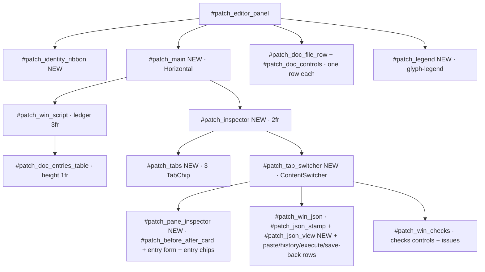
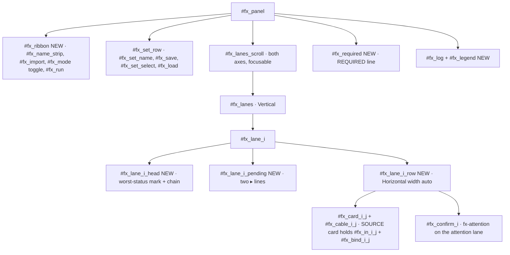
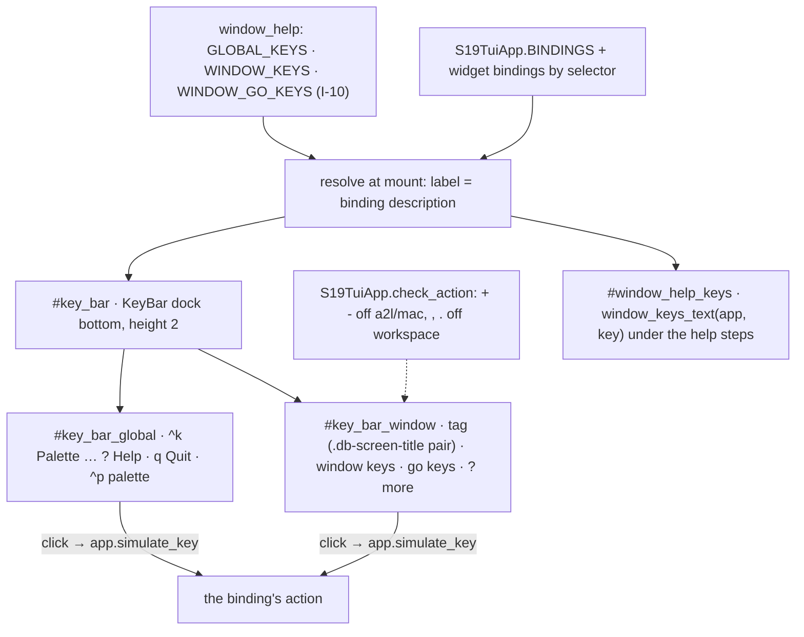

# Design proposal — s19_app — Batch 2026-10-19-batch-97

> **Artifact language.** Canonical **English scaffold**; generate in the batch's language
> The normative rules below are language-independent. **Where that language is declared:**
> `state.json`'s `language` key in `core` and `full`.

> **Reserved field names.** The **field names and block keywords below are language-independent** — the
> validator parses them literally and they are never translated:
> `Design proposal` · `7 · Forward-applicability table` · `⏸ DEFER`
> Everything else on this page — headings, guidance, the prose in every cell — is translated with the batch.
> **One strategy, not two:** the flow ships no alias table, so a translated label is read as an ABSENT one and the rule keyed on it reports a true-sounding silence.
> **Why a HEADING is reserved here and a FIELD NAME everywhere else:** `C-49`'s artifact is the §7 TABLE, and a rule that read a summary bullet instead of the rows would be reading a claim about the table rather than the table. `V52` therefore keys on this document's own H1 and on the §7 heading, which is why both are on the machine plane. **And one FLOW-WIDE reserved token, read out of this artifact by `V42` no matter which template minted it:** `⏸ DEFER`.

> **Owed in.** `core` by trigger · `full` ✓
> **Source:** `/dev-flow-init` step 4's seed-by-level table, which is this fact's one home. A level marked `—` **does not owe this artifact, and its absence is not an omission**; `by trigger` means the station exists only when the `triggers` block fired, and `stations_active` in `state.json` is the authority for *this* batch. Where a SECTION or a gate row is owed more narrowly than the artifact, it says so on the row.

> **Where this lives: the VAULT + Drive**, not the repo — it is deliberation, and its traceability to
> code is weak. It is **cited by id** from the repo (`PDR-<batch_id>#D<n>`), never copied.
> What binds code — a frozen interface, a design characteristic — also lands in the **repo**, in the
> requirement or in `docs/ARCHITECTURE.md`. *The vault keeps the deliberation; the repo keeps the commitment.*

> **The forward-applicability rule (ISO/IEC/IEEE 15288).** Everything below must be NAMED as the input
> of a later activity. **If a section of this proposal is nobody's input, delete it — it does not belong
> in the PDR.** That rule is what allows this document to cost half the batch without being waste.

| Field | Value |
|---|---|
| Id | `PDR-2026-10-19-batch-97` (decisions cited as `PDR-2026-10-19-batch-97#D1` … `#D29`, §1.1; D26–D29, I-10, I-11 and Inc-8 added by the dated delta of 2026-10-20, operator verdict on the key bar) |
| Requirements covered | `01-requirements.md` at `e91631b` (ledger to `LED-2026-10-19-batch-97.5`): HLR-144 to HLR-149 · 65 LLR (LLR-144.1 to LLR-149.6) · AT-B97-01 to AT-B97-24 · TC-B97-01 to TC-B97-65; plus, from `LED-2026-10-19-batch-97.9` (the operator's key-bar scope addition): HLR-150 · LLR-150.1 to LLR-150.7 · AT-B97-25, AT-B97-26 · TC-B97-66 to TC-B97-72 |
| Modules touched (from `docs/ARCHITECTURE.md`) | `s19_app/tui/screens_directionb.py` · `s19_app/tui/flow_screens.py` · `s19_app/tui/app.py` · `s19_app/tui/styles.tcss` · `s19_app/tui/window_help.py` · `s19_app/tui/open_folder_chip.py` · `s19_app/tui/insight_style.py` · `s19_app/tui/services/{folder_open_service, flow_persistence_service, variant_execution_service, flow_execution_service}.py` — all CHANGED, none created (`docs/architecture.md:420`, A1 not fired) |
| Triggers that fired | A2 · A3 · B1 · B3 · C8 · D1 · E1 (`PLAN.md` §Triggers) |
| Author / reviewers | `architect` (author) · `qa-reviewer` · `ux-reviewer` (D1) · `security-reviewer` (owner of the S2-2 carry, Inc-2 gate) |

---

## 1 · Objective and scope

**Objective.** Turn the approved contract into eight sequential increments of ≤ 4 SOURCE files each — executed in the order Inc-1, 2, 3, 4, 5, 6, **8**, 7 (D29; labels kept so no condition is renumbered) — that re-compose the four batch-94 panels at their shipped ids (R13), with every implementation-shape item the contract left open (§6.2 items 1–9) and every P2 carry decided here.

**Will NOT do:** change run semantics, any persisted format (`.chk.json`, change-set v2, flow template, chain-set — batch-94 `#D2` / `#D4` stay frozen), any message type (batch-94 `#D3`), the batch-96 waiting-human doctrine, or any screen other than the four — except the two app-wide changes the contract names: the folder-chip guard and labels (HLR-148) and the two-row key bar on every window (HLR-150, Inc-8); no worker thread (declared OUT, contract §2.6); nothing imported from `prototypes/`.

### 1.1 Decisions (`#D<n>`) — every §6.2 item and every P2 carry

| # | Decision | One-line reason | Lands in |
|---|---|---|---|
| D1 | **I-2/I-3 shape = a `refresh_entries` keyword** `document: PatchDocumentView \| _Unset = _UNSET` (sentinel ⇒ preserve), the payload built by ONE app helper `S19TuiApp._patch_document_view()` and passed at all four sites (`app.py:3265, :3451, :5279, :10758`) | rows, identity and JSON view refresh in the same call, so they cannot disagree; a setter is a second call-site set to keep in step — the MJ-1 defect the code records at `app.py:6273` ("missed a mount-time fourth"); the `mem_map` sentinel idiom is already proven (TC-080.2a) | Inc-4 |
| D2 | `PatchDocumentView` = frozen dataclass in `screens_directionb.py`: `name: Optional[str]`, `kind: str`, `json_text: str`, `entry_count: int` | the panel keeps importing nothing from the service layer (C-7); the app serialises with `serialize_change_document` (R17) | Inc-4 |
| D3 | JSON view = `TextArea(read_only=True, soft_wrap=False)` `#patch_json_view`; the cap note is its last line; the stamp is `#patch_json_stamp` (Static) above it | literal by construction (no markup parser, C-17); focusable, arrow keys (LLR-144.10); no raw C0/C1 reaches it — the serialiser calls `json.dumps(payload, indent=2)` with the default `ensure_ascii=True` (`changes/io.py:1419`) | Inc-4 |
| D4 | The stamp is recomposed by the panel's own `_refresh_dirty_indicator` (the four dirty-flag writers, P-48) and by the D1 document path; text from a pure `json_stamp_text(n, hhmmss, dirty)` | Save and paste typing change the flag, not the document (P-57); one composer, two triggers | Inc-4 |
| D5 | **Hex strip = REUSE `BeforeAfterCard` `#patch_before_after_card`**, moved from `#patch_win_json_body` into the inspector pane; the changed-byte style becomes `"bold " + VALUE` (attribute = **bold**); `max_bytes` derived from the inspector width | it already follows the highlight with a positional join, a no-image state and an unmapped token (`screens_directionb.py:4119-4216`, `:6270`); its id is in `PE_IDS_9C7BEAF`, so LLR-144.1 keeps it; a new widget would duplicate a tested renderer | Inc-4 |
| D6 | **`✓` / `▼` (U2-11):** on the two flow screens `✓` means only *check block* and `▼` only *write-out block* (kind glyphs, named in help); `#fx_confirm_<i>` is labelled `Confirm` with no glyph; lane state uses only the cable vocabulary. In the Check Editor `✓` means only *included* (ledger), `☑` / `▪` the included-parameter / memory-row Fields marks (LLR-145.6) | one meaning per glyph per vocabulary (LLR-148.7); the `✓ Confirm` label and the retired lane `✓ clean` were the second meanings | Inc-3, 5, 6 |
| D7 | Closed vocabularies are `Mapping[str, str]` (glyph → meaning) in their renderer's module: `PATCH_GLYPHS` (strip + ledger verdict glyphs), `CHECK_GLYPHS`, `FLOW_KIND_GLYPHS` + `FLOW_CABLE_GLYPHS` (Builder), `FX_CABLE_GLYPHS` (`▓ ░ ✗ ◇ □`) + `FX_PENDING_GLYPH = "▸"`; each legend is generated from its mapping | a dict key cannot carry two meanings, so "one meaning" holds by construction; help bodies stay hand-authored in `window_help.py` (no `window_help → panels` import edge) and TC-B97-33 couples them | Inc-3..6 |
| D8 | **Builder variant branch `app.py:2586-2609`: DELETED**; the handler always runs `run_flow`; `RunRequested.scope` stays in the message (frozen `#D3`) and always carries `FLOW_SCOPE_SINGLE`; `_SCOPE_OPTIONS` and `#flow_scope` leave the panel; `render_fused_result` and `run_flow_over_variants` stay untouched (backlog row at close) | an unreachable branch that paints "run over 'This image' instead" names a control that no longer exists; the service and its `test_d4_*` nodes stay (contract §6.3) | Inc-5 |
| D9 | **Check Editor chip id = suffix:** `OpenFolderChip(family, *, id_suffix=None)` → `open_folder_<family>` or `open_folder_<family>_<suffix>`; the Check Editor mounts `OpenFolderChip("checks", id_suffix="editor")` → `#open_folder_checks_editor` | LLR-148.4 requires an id NO other mounted widget carries; scoping the query would leave two equal ids | Inc-1 (param), Inc-3 (mount) |
| D10 | **Help keys `check_editor` and `flow_execution`** (the `SCREEN_CONTAINER_IDS` keys, `app.py:6752`, per `window_help.py`'s key convention); **both screens become `WindowSection`**; Flow Execution uses `_FlowExecutionSection(WindowSection)` declared in `app.py` with `Binding("c", "confirm_attention", "Confirm", show=False)` (the description is the key bar's label, D27 / M-2 of the key-bar QA, so it must land with Inc-6) delegating to `FlowExecutionPanel.confirm_attention()` | every other rail screen with help is a `WindowSection` (focused `?`); a screen-level binding makes `c` work with the focus on the header chips too (LLR-147.13 "on the Flow Execution screen"); declaring the subclass in `app.py` adds no import edge; an `Input` consumes `c` itself, so typing still types | Inc-3, Inc-6 |
| D11 | **Token names** `insight_style.WAITING_HUMAN = "#e8ad3d"`, `insight_style.CRC_FAMILY = "#c9562b"`, mirrored as `$waiting-human` / `$crc-family` in `styles.tcss` with the `/* insight_style.X */` comment (the `$accent-calm` convention, `styles.tcss:26-31`); TC-B97-18 couples the pair | role names, because LLR-147.7 restricts the waiting colour to a role; the TCSS mirror is the project's existing way to reach a token from CSS | Inc-2 (py), Inc-5/6 (tcss) |
| D12 | **NEW names.** Ids: `#patch_identity_ribbon`, `#patch_main`, `#patch_inspector`, `#patch_tabs`, `#patch_tab_inspector`, `#patch_tab_json`, `#patch_tab_checks`, `#patch_tab_switcher`, `#patch_pane_inspector`, `#patch_json_stamp`, `#patch_json_view`, `#patch_legend`; `#check_full_name_line`, `#check_card_tabs`, `#check_tab_fields`, `#check_tab_json`, `#check_tab_addendum`, `#check_card_switcher`, `#check_pane_fields`, `#check_fields_lines`, `#check_pane_json`, `#check_pane_addendum`, `#check_dock`, `#check_legend`; `#flow_ribbon`, `#flow_pipeline_scroll`, `#flow_pipeline`, `#flow_legend`; `#fx_ribbon`, `#fx_lane_<i>_head`, `#fx_lane_<i>_pending`, `#fx_lane_<i>_row`, `#fx_card_<i>_<j>`, `#fx_cable_<i>_<j>`, `#fx_required`, `#fx_legend`. Classes: `fill-accent`, `chip-selected`, `fx-attention`, `sev-waiting`, `tab-chip`, `kind-chip`, `glyph-legend`, and the no-wrap categories `nowrap-ledger · nowrap-log · nowrap-pipeline · nowrap-ribbon · nowrap-legend · nowrap-heading · nowrap-fields`. Constants: `JSON_TAB_LINE_CAP = 5000` (`screens_directionb.py`), `CONFIRM_DWELL_S = 0.5` (`flow_screens.py`) | contract §6.2 item 5; TC-B97-37 reads the no-wrap set from the DOM by category class, so membership is declared on the widget, not re-listed in the test | per screen increment |
| D13 | **Mode control:** `#fx_mode` becomes a one-row `Button` toggle labelled `sequential · parallel` (the active word in the selection style, ≤ 23 cells); a `FlowExecutionPanel.mode` property feeds the unchanged `RunRequested.mode` | one focus stop, switches on click or `enter` (LLR-147.4); keeps the shipped id | Inc-6 |
| D14 | **One run at a time:** the panel disables `#fx_run` before posting `RunRequested`; the app handler wraps `run_chain_set` in `try/except Exception` → `render_run_error(<English line>)`; `render_run` / `render_run_error` re-enable through `call_after_refresh` | input queued during the synchronous run reaches a disabled button (P-44); "ends or raises" is met by the `except` limb (LLR-147.10, 148.9) | Inc-6 |
| D15 | **`c` dwell feedback (ux carry):** a `c` inside `CONFIRM_DWELL_S` confirms nothing and sets the status line `c ignored: the waiting lane just appeared — press c again`. **Stray `enter` (ux carry):** kept as the contract states — one more run, one more report, 0 confirms | removes the silent swallow without changing the LLR's outcome; the extra report is the contract's own choice (LLR-147.13) | Inc-6 |
| D16 | **Space keys:** `TabChip(Button)` (`screens_directionb.py`) adds `Binding("space", "press")` for the six editor tab chips; `#check_param_table` becomes `IncludeTable(DataTable)` with `Binding("space", "toggle_include", "Include")` (the description is the key bar's label — must land with Inc-3) | `Button` binds only `enter`, `DataTable` no `space` (P-43); a panel-level `space` would also fire on focused buttons; `query(DataTable)` still matches the subclass (C-38) | Inc-3 |
| D17 | **Q-18 (snapshots):** all 29 snapshot cells already carry the batch-94 `xfail(strict=False)` envelope (`_batch94_inc001_drift_marks`, `tests/test_tui_snapshot.py:1046-1075`, applied at `:1095` and `:1150`) — corrected 2026-10-20 (key-bar QA L-12; the earlier text named only the two `patch` cells), so no cell's C-22 bound can go RED before the regen; Inc-4 writes the C-22 per-cell prediction (both cells drift — the panel is re-composed); Inc-7 triggers the canonical regen (`.github/workflows/snapshot-regen.yml`, textual 8.2.8) after the push and retires the mark in the follow-up commit named in `05-close.md` | a local regen drifts unrelated baselines (`test_tui_snapshot.py:518-520`); the regen is what lets the cells go RED again | Inc-4, Inc-7 |
| D18 | **Q-14 (registry):** each increment that adds a scanned test module re-measures `EXPECTED_SCANNED_TEST_FILES` (`tests/test_id_registry.py:124`) through `scanned_test_files()` — expected 189 → 192 (Inc-1: `test_b97_chips_help.py`, `b97_fixtures.py`, `b97_probes.py` — the glob is `tests/**/*.py`, helpers included) → 194 (Inc-2) → 196 (Inc-3) → 197 (Inc-4) → 198 (Inc-8: `test_b97_key_bar.py`, delta 2026-10-20); measured, never incremented by hand (PC-12, qa C6 / architect C4) | the file's own convention (`:130`, "MEASURED, not incremented"); whether `b97_*.py` helpers are scanned is measured, not assumed | Inc-1..4, Inc-8 |
| D19 | **U2-15 (`Size` vs `Fmt`):** one term on screen, the column's (`Fmt`), unless Inc-3 reads that `#check_mem_size_input` accepts byte counts, in which case both say `Size`; ids unchanged | the term follows what the input accepts; that fact is read in the named increment, not guessed here | Inc-3 |
| D20 | **qa carry (LLR-148.6 patch guard 19+7 vs 20+5+1):** TC-B97-32 derives the control-label guard by widget type over `PE_IDS_9C7BEAF` at test time (`Button`, `Input`, `Select`, `TextArea`) and asserts the total 26, never a hand split | the breakdown is a fact of the frozen id list; a hand split is the disagreement itself | Inc-4 |
| D21 | **Width derivation (LLR-149.1):** CSS expresses every split it can (`fr`, `%`, `height: 1fr` heroes, one-row docked rows); Python sizes only what CSS cannot — DataTable column widths, painted card widths, the REPORT FIELDS name width, the strip's `max_bytes`, the full-name line — through one pure `<screen>_layout(width) -> NamedTuple` per panel, applied by `_apply_layout()` from `on_mount` (after refresh) and `on_resize`; `_apply_layout` sets widths only, never adds columns or widgets | the E-1 trap (columns added twice) is avoided structurally; the pure functions are layer-0 arms of TC-B97-34 | Inc-3..6 |
| D22 | **E-1/E-2 removal:** delete `PatchEditorPanel._apply_window_geometry` (`screens_directionb.py:5488-5593`) and its calls (`:5596`, `:5656`), the forced `table.styles.height = 3` and fixed select/path widths in `on_mount` (`:5598-5660`), and the app's show-time block (`app.py:6966-6978`); `#patch_win_json_dock_spacer` stays mounted with `display: none` | LLR-144.3; the spacer id is in the frozen census (LLR-144.1) | Inc-4 |
| D23 | **E-3 replaced:** delete `#patch_win_script { width: 2fr }` (`styles.tcss:1117-1118`), the six-selector grid block (`:1160-1168`, replaced by `layout: horizontal; height: 1`), the `#patch_doc_controls` grid (`:1536-1538`), `#patch_doc_entries_table { height: 10 }` (`:1581-1584`), and every `#workspace_body.width-narrow` rule that targets a widget of the four panels; each panel gets ONE scoped section (`/* batch-97 <screen> */`) under its panel id | "replaced, not overridden" (LLR-144.4); the four layouts are the same on both sides of 120 (LLR-149.2) | Inc-3..6 |
| D24 | **Lanes scroll:** ONE scroller, `#fx_lanes_scroll` (`ScrollableContainer`, both axes, focusable); each `#fx_lane_<i>_row` is a plain `Horizontal` with `width: auto` | LLR-147.12 names `#fx_lanes_scroll` as the scroller with its keyboard path (P-53); a per-lane `HorizontalScroll` (fx_A) adds a focus stop per lane | Inc-6 |
| D25 | **Help bodies:** `check_editor` written in Inc-3, `patch` rewritten in Inc-4, `flow` rewritten in Inc-5, `flow_execution` written in Inc-6 | each body names the labels its increment paints; Inc-2 carries the three flow services + tokens precisely so Inc-5/6 keep a slot for `window_help.py` | Inc-3..6 |
| D26 | **Key bar = one custom widget, not Textual's `Footer`:** `KeyBar(Vertical)` `#key_bar` (dock bottom, height 2) composing two `KeyRow(Static)` rows, `#key_bar_global` and `#key_bar_window`, each painted from the pure `pack_key_row(tokens, width, *, keep, more) -> PackedRow(text, hits, dropped)` (`hits` = one `(x0, x1, key)` per kept enabled token); a click maps `event.x` to a hit and **runs the binding's action in its own namespace** (operator decision 2026-10-20, key-bar QA H-1): an entry with no `owner` → `app.run_action(action)`, which honours `check_action` (`textual/app.py:4223-4248`); an `owner` entry → `widget.run_action(action)` on the widget the selector resolves; never `simulate_key`, which hands the key to the focused widget first; a click on `? Help` / `? more` runs `show_help_panel`; a click on a dimmed token rings the bell; packing = reserve the mandatory parts (`? Help`; the tag and the `? more` tail), then the longest display-order prefix of the rest (no greedy skip); go separator ` · go` after window keys, ` go` without; colours from component classes (`key-bar--key`, `key-bar--description`, `key-bar--tag`, `key-bar--separator`) styled in `styles.tcss` with `$footer-*`, `$accent-calm`, `$bg-base` and read with `get_component_rich_style` — no hex in Python; declared in `window_help.py` beside `WindowSection` and `WindowHelpChip`, the window-chrome widgets; text built as `rich.Text` (no markup parser) | `Footer` paints `screen.active_bindings`, where the focused `WindowSection`'s `?` (`show=False`) hides `? Help` (P-61); it crops at the row width instead of dropping whole tokens (`perio▏`, P-67); it cannot paint a tag or a per-window second row, and two painters for one bar would drift. Click support is kept without `Footer`'s `simulate_key` path, which would type `c` / `q` into a focused input or press a focused tab chip with `space`. A new `key_bar.py` module would be an A1 change for ~150 lines that belong with the window chrome | Inc-8 |
| D27 | **The window-key table (I-10) lives in `window_help.py` and is the one source for row 2 and the help's key lines:** `KeyEntry(key, when=None, owner=None)`; `WINDOW_KEYS: Mapping[str, tuple[KeyEntry, ...]]` and `WINDOW_GO_KEYS: Mapping[str, tuple[str, ...]]` over the 13 windows; `GLOBAL_KEYS`; labels resolved once at mount from the binding (`owner=None` → `S19TuiApp.BINDINGS`; `owner="<selector>"` → the class bindings of the widget that selector finds inside the window's container), the app passed in — no `window_help → app` import; an unbound key or an empty description raises at mount; the only painter literals are `more` and `palette`; `HELP_KEY_WINDOW` maps help sections to windows (`split_join_export` → `split_join`; `reports`, `changes_file_notation` → none); the help modal shows `window_keys_text(app, key)` (NEW, `#window_help_keys`) beneath the steps; `section_body_text` stays the steps alone. D7's "help bodies hand-authored" is amended for key lines only: Inc-8 deletes every hand-typed key line the block now carries | one table cannot drift from itself (the prototype round's own finding); the label is the binding's description, so renaming a binding renames its token and its help line together; the selector `owner` reaches `IncludeTable`'s `space` (D16) and `_FlowExecutionSection`'s `c` (D10) with no new import edge; keeping the block out of `section_body_text` leaves TC-707's numbered-steps census (`tests/test_window_usage_help.py:208`) untouched | Inc-8 |
| D28 | **`S19TuiApp.check_action` (NEW) and one `key_display`:** `False` for `page_next_context` / `page_prev_context` off `a2l` / `mac` and for `hex_page_prev` / `hex_page_next` off `workspace` (keyed on `_active_screen_key`); every other action falls through to `super().check_action`; `Binding("period", "hex_page_next", "Hex+", key_display=".")`; the `show` flags are not changed | the keys page a hidden view today (P-63), so painting them away without disabling them would leave a live key nobody sees; `False` (left out) because they mean nothing there, while "handled here, not now" is the table's `when` condition, painted dim; unchanged `show` flags keep `tests/test_discoverability.py:33` and the stock help panel as shipped | Inc-8 |
| D29 | **Execution order 1, 2, 3, 4, 5, 6, 8, 7.** The key bar refreshes on `Screen.bindings_updated_signal` (focus changes and `app.refresh_bindings()`, the signal `Footer` subscribes to), and the app calls `refresh_bindings()` at the end of `action_show_screen`, of the split-join show and of every writer of a table condition (PC-23) — no timer. Inc-3..Inc-6 run their vertical-budget arms (LLR-149.3, LLR-149.5's height clause) also at 118x53, the body height 118x54 has once the two-row bar lands (PC-24). Inc-7 sweeps the real two-row layout, where PC-22's 118x53 hedge retires | the sweep and the snapshot regen must see the final bottom rows, or both run twice; the 118x53 arms keep Inc-8 from re-cutting four layouts it does not own; a signal keeps every key-bar assertion free of waits, which a polling timer (the prototype's `set_interval(0.5)`) would not | Inc-3..Inc-8 |

## 2 · Modules and boundaries

| Module | What it owns here | What it exposes | What it must NOT reach into |
|---|---|---|---|
| `tui/screens_directionb.py` | `PatchEditorPanel`, `CheckEditorPanel` compositions; `PatchDocumentView`, `TabChip`, `IncludeTable`, `JSON_TAB_LINE_CAP`, `PATCH_GLYPHS`, `CHECK_GLYPHS`, `patch_layout()`, `check_layout()`, `json_stamp_text()` | `refresh_entries(…, document=)` (I-2/I-3); the shipped ids | the service layer (C-7: payloads arrive as plain data) |
| `tui/flow_screens.py` | Builder rail, Execution lanes; `FLOW_KIND_GLYPHS`, `FLOW_CABLE_GLYPHS`, `FX_CABLE_GLYPHS`, `FX_PENDING_GLYPH`, `CONFIRM_DWELL_S`, `pipeline_layout()`, `lane_layout()`, `cable_glyph()`, `clip_head()` / `clip_tail()` | `confirm_attention()`, `mode`, `lane_paint_plain()` (kept, re-implemented over the new lane) | app state (the shipped message posture); service writers |
| `tui/app.py` | headers, `_FlowExecutionSection`, the D1 helper, the run guard's `except` limb; deletes the variant branch and the geometry call; mounts the key bar in place of `Footer`, `check_action`, the `period` `key_display`, the `refresh_bindings()` calls (D26, D28, D29) | `check_action` (I-11) | panel internals (public methods only) |
| `tui/styles.tcss` | one scoped section per panel; `$waiting-human`, `$crc-family` | — | rules of other screens |
| `tui/window_help.py` | `check_editor`, `flow_execution` sections; rewritten `patch`, `flow`; the window-key table, `KeyBar` / `KeyRow`, `pack_key_row`, `window_keys_text` (D26, D27) | `SHIPPED_WINDOW_KEYS` (I-4); I-10; `KeyBar` (I-11) | panel modules and `app.py` (no import; the app instance is passed in) |
| `tui/open_folder_chip.py` + `services/folder_open_service.py` | `flows` / `session` families, per-family no-project reason, the real-directory guard, labels, `id_suffix` | I-1 | a second `"flows"` literal (R15 imports `FLOWS_SUBDIR`) |
| `services/flow_persistence_service.py`, `services/variant_execution_service.py` | NUL refusal; `stat()` guards catch `(OSError, ValueError)` | unchanged return shapes | — |
| `services/flow_execution_service.py` | its 11 painted strings in English | unchanged API | — |
| `tui/insight_style.py` | `WAITING_HUMAN`, `CRC_FAMILY` | tokens | — |

- Boundaries respected as declared in `docs/ARCHITECTURE.md`: ✓ — no module created, no file moves; the only new edge is ARQ's `folder_open_service → flow_persistence_service` (`FLOWS_SUBDIR`, `docs/architecture.md` batch-97 §Dependencies). D7 and D10 were chosen so that no second edge appears.

## 3 · Diagrams

**Structure — Patch Editor widget tree (Inc-4).** Kept ids plain, NEW ids marked.

**Structure — Flow Execution widget tree (Inc-6).** Inside `_FlowExecutionSection` (header: title, `?`, `📂 Open session`).

**Interaction — increment order** (sequential; each arrow names the dependency that forces it).

```mermaid
graph LR
  I1["Inc-1 chip families + guard"] --> I2["Inc-2 flow foundations: NUL, EN service, tokens"]
  I1 -->|"id_suffix, labels"| I3["Inc-3 Check Editor"]
  I2 --> I3
  I3 -->|"TabChip, layout helpers, predicates"| I4["Inc-4 Patch Editor"]
  I2 -->|"tokens, NUL refusal"| I5["Inc-5 Flow Builder"]
  I4 --> I5
  I5 -->|"card clip, kind glyphs, CRC css"| I6["Inc-6 Flow Execution + headers close"]
  I6 -->|"c on the section, space on IncludeTable, the two help keys"| I8["Inc-8 two-row key bar (all windows)"]
  I8 -->|"final bottom rows on every window"| I7["Inc-7 width sweep, captures, regen"]
```

**Structure — the key bar (Inc-8, D26/D27).** One widget, two rows, one table.

**Algorithm — width derivation (D21).** Values are **illustrative, non-normative** (C-23): each screen increment re-measures the whole pane budget at 118x54 and 220x60 before fixing them.

| Screen | CSS split | Python-derived (pure fn) | Illustrative, 118 → 220 |
|---|---|---|---|
| Check | left `1fr` / card `max(41, 38%)` | Address = 10 (never clipped); Parameter = table content − mark − Address − Fmt·Unit (≥ 42); Fields name = card − 14 (≥ 24) | Parameter 42 → ~105 |
| Patch | ledger `3fr` / inspector `2fr` | Value/bytes column = table content − the 4 other columns; strip `max_bytes = (inspector_w − 8) // 3` | strip 12 → 26 bytes |
| Builder | rail `1fr`; EXT inputs `1fr` on two rows | card = `max(21, (avail − 4·(n−1)) // n)`, the remainder one cell each to the first cards (void 0) | 4 cards: 24 → 49 |
| Execution | lanes take the height left (`1fr`) | card = `lane_layout(viewport_w, n)`, same rule; when `21·n + cables > viewport` cards stay 21 and `#fx_lanes_scroll` scrolls | 6 cards scroll at 118; 4 fill at 220 |

## 4 · Interfaces that change — and which ones FREEZE

| Interface | Current | After | Consumers | **Frozen for the fork?** |
|---|---|---|---|---|
| I-1 chip families (`folder_open_service.py:57-90`, `open_folder_chip.py:59`) | 4 families; `REPORTS_NO_PROJECT_REASON` for any `None`; `OpenFolderChip(family)`; guard = `exists()` | + `CHIP_FAMILY_FLOWS`, `CHIP_FAMILY_SESSION` (`CHIP_FAMILIES` = 6); `no_project_reason(family) -> str` (the Reports constant kept, equal to `no_project_reason("reports")`); `_CREATABLE_FAMILIES` removed — nothing reads it (Code-Wire H-C2): create-on-press is offered for every non-`None` target except `session`, whose target is the project directory and is never created; `chip_family_root(project_dir, base_dir) -> Path` — the ONE producer of the guard's trust anchor (project dir, else `base_dir / WORKAREA_DIRNAME`, §1.3 "family root"; H-C3); `is_openable_chip_dir(target, root) -> bool`; `OpenFolderChip(family, *, id_suffix=None)`; label `📂 Open <folder>/` where `<folder>` is the leaf of the folder the chip resolves to — the family constant with a project, `patches` for the no-project `checks` chip, whose common home is `workarea/patches` (LED-.6, H-C1) — and `📂 Open session`; the no-project `session` chip is disabled with `📂 Open session: no active project — load a project first.` (LLR-148.3, H-C3) (PC-20) | `open_folder_chip.py`, `app.py` headers + refresh loop `:12756`, `screens.py:1668`, `tests/test_open_folder_chips.py` | **yes — frozen at PDR**, lands Inc-1; Inc-3/5/6 consume it unchanged |
| I-2/I-3 `PatchEditorPanel.refresh_entries(rows, mem_map=_UNSET)` (`screens_directionb.py:6104`) | rows + map; no identity, no JSON feed | `refresh_entries(rows, mem_map=_UNSET, document=_UNSET)`; `document: PatchDocumentView` (D1/D2) | `app.py:3265, :3451, :5279, :10758`; the panel's own `:5662`; 27 test calls in 6 files (the keyword default keeps them valid) | **yes — frozen at PDR**, lands Inc-4 |
| I-4 `window_help.SHIPPED_WINDOW_KEYS` (`:270`) | 8 keys | + `check_editor` (Inc-3), + `flow_execution` (Inc-6) | `tests/test_window_usage_help.py:250`, `_EXPECTED_KEYS` (`:95-107`), `tests/test_changes_file_notation_help.py`, the `WindowHelpChip` sites | **names frozen at PDR**; membership lands per increment |
| I-5 tokens (`insight_style.py`) | none | `WAITING_HUMAN`, `CRC_FAMILY` + the TCSS mirrors | `flow_screens.py`, `styles.tcss`, TC-B97-18 / 52 | **yes — frozen at PDR**, lands Inc-2 |
| I-6 NUL refusal in `load_flow_json`, `load_chain_set`, `_resolve_manifest_entry` | raise `ValueError` (P-36, P-50); `ExternalStepBlock.log_ref` / `output_path` and `WriteOutBlock.output_name` accept a NUL (no raise) | the shipped refusal shapes with `FLOW-UNSAFE-REF` / `CHAIN-SET-UNSAFE-REF` / `MANIFEST-PATH-ESCAPE`; `stat()` guards catch `(OSError, ValueError)`. **Placement and code per field (PC-17, Code-Wire H-N1/N2/N3):** a NUL is a path-shape pre-reject, like the drive-relative one, placed before the shared guard (whose `resolve()` raises) and before any field-specific shape check — `dict_to_flow`: `image_ref`, `change_doc_ref`, `check_doc_ref`, `config_ref`, `output_name` (before V7, so not `FLOW-UNSAFE-OUTPUT-NAME`) and the optional `a2l_ref` → `FLOW-UNSAFE-REF`; `_parse_a2b_entry`: each binding `ref`, either source → `FLOW-UNSAFE-REF`; `_parse_external_step_entry`: `log_ref`, `output_path` (before the relative-name shape check) → `FLOW-UNSAFE-REF`; `dict_to_chain_set`: the template (through `_is_plain_template_stem`) and each input ref → `CHAIN-SET-UNSAFE-REF`; `_resolve_manifest_entry` (every other caller: manifest `batch` / `assignments`, `run_flow` read refs, `_chain_inputs`, a lane input bound by `#fx_bind_<i>_<j>`) → `MANIFEST-PATH-ESCAPE`; the `stat()` guards of `load_flow_json` / `load_chain_set` → `FLOW-JSON-PARSE` / `CHAIN-SET-JSON-PARSE` (`… unreadable: ValueError`). LLR-146.14's codes stand as written; a non-NUL unsafe ref keeps its shipped code | `app.py` load / import / run handlers; the panels' refusal renders | **yes — return shapes unchanged** (batch-94 `#D4` artifacts untouched), lands Inc-2 |
| I-7 `FlowExecutionPanel` surface | `#fx_mode` is a `Select` | `#fx_mode` is a toggle `Button`; `mode` property; `confirm_attention()`; `lane_paint_plain()` kept over the new lane | `app.py`; `tests/test_tui_flow_execution_b94.py:626, :693` (rewritten Inc-6) | **yes — frozen at PDR**; message types stay frozen by batch-94 `#D3` |
| I-8 `FlowBuilderPanel.RunRequested` | carries the selector's scope | always `FLOW_SCOPE_SINGLE`; shape unchanged | `app.py:2518` (branch deleted, D8) | **yes — shape frozen** (batch-94 `#D3`) |
| I-9 the NEW names of D12 (ids, classes, constants, vocabularies) | — | as D12 | the batch's TCs / ATs, the `window_help` bodies | **yes — frozen at PDR**; a rename after PDR is A3 |
| I-10 the window-key table (`window_help.py`, NEW) | — (no table; keys live only in `S19TuiApp.BINDINGS`, P-62) | `KeyEntry(key: str, when: str \| None = None, owner: str \| None = None)` (frozen dataclass); `GLOBAL_KEYS = ("ctrl+k", "ctrl+d", "ctrl+l", "ctrl+s", "x", "question_mark", "q")` + the command-palette token; `WINDOW_KEYS` / `WINDOW_GO_KEYS: Mapping[str, tuple]` keyed on the 13 windows; `when` ∈ `{"has_image", "patch_history", "has_variants"}`, evaluated by the app on render; frozen rows — **workspace** `/` `g` `,`(has_image) `.`(has_image) `k` `p` `o` `r` `U`(has_image) · go —; **patch** `ctrl+z`(patch_history) `ctrl+y`(patch_history) `v`(has_variants) `k` · go `=` `9`; **check_editor** `space`(owner `#check_param_table`) · go `6` `9`; **flow** — · go `]` `6` `=`; **flow_execution** `c`(owner: the screen's `_FlowExecutionSection`) · go `8` `t` (15 entries, 9 go keys); **a2l, mac, map, issues, diff, checks, crc_designer, split_join**: entries derived in Inc-8 from each action's own guard — a binding is a window key of `w` when its action changes something on `w` and it is not global — each with its `file:line` in the packet, and no go keys (PC-26); `HELP_KEY_WINDOW: Mapping[str, str \| None]` (every help key equal to a window key → itself; `split_join_export` → `split_join`; `reports`, `changes_file_notation` → `None`, no keys block); `window_keys_text(app, key) -> str` (empty for a section mapped to `None`); `resolve_window_tokens(app, window) -> (tokens, go_tokens)` raising on an unbound key or an empty description; each token carries `(key, key_display, label, action, owner, enabled)` so the click can run `action` in `owner`'s namespace (H-1) | `app.py` (the key bar's build, `check_action`'s window set), `WindowHelpScreen`, `tests/test_b97_key_bar.py`, TC-B97-32 (parse source from Inc-8) | **yes — frozen at this delta**, lands Inc-8; a row edit later is a table edit reviewed on the operator's review page, not an interface change |
| I-11 the key bar and `check_action` | `Footer()` at `app.py:2077`; no `check_action` override (P-64); `period` displayed `period` (P-65) | `KeyBar` `#key_bar` (rows `#key_bar_global`, `#key_bar_window`) replaces `Footer`; `pack_key_row(tokens, width, *, keep, more)` (reserve `keep` and `more`, then the display-order prefix); click → `app.run_action(action)` or `owner_widget.run_action(action)`, never `simulate_key` (H-1); component classes `key-bar--key`, `key-bar--description`, `key-bar--tag`, `key-bar--separator`; `S19TuiApp.check_action(action, parameters)` per D28; `key_display="."` on `period`; colours (all through those component classes, `styles.tcss`): row 1 `$footer-key-foreground` / `$footer-description-foreground` on `$footer-background`, row 2 tag bold `$bg-base` on `$accent-calm`, descriptions `$accent-calm`, key glyphs the row-1 key colour, background `$footer-background` | `app.py` compose; `styles.tcss` (one scoped `/* batch-97 key bar */` section); the footer tests named in Inc-8; all 29 snapshot cells | **yes — frozen at this delta**, lands Inc-8 |

**A frozen interface is not touched inside a lane.** If a lane needs to change one, the work returns to
the trunk — that is trigger **A3**. (One lane here; the freeze still binds every later increment.)

## 5 · Proposed test cases

Layer: **0** pure unit · **A** white-box integration · **B** black-box acceptance · **UX** keyboard / chip-state. Files are `tests/test_b97_<name>.py`. The procedure is A.4 (TC) / A.5 (AT) under the same id, and the RED column points to the row that names the mutation (`NC` = that LLR's *Negative control*) — not restated. A cross-screen TC grows by `parametrize` arms per screen increment and is **closed** at the increment that adds its last arm.

| Id | Layer (0 unit / A white / B black / UX) | What it asserts | **The mutation that would turn it RED** |
|---|---|---|---|
| TC-B97-01 | 0 · patch_editor · Inc-4 | LLR-144.1 / A.4 | drop one shipped id (LLR-144.1 NC) |
| TC-B97-02 | A · patch_editor · Inc-4 | LLR-144.2 | executed on `main`: table height 3 (NC) |
| TC-B97-03 | A · patch_editor · Inc-4 | LLR-144.3 | re-add the `app.py` geometry call or a second `add_columns` (NC) |
| TC-B97-04 | 0 · patch_editor · Inc-4 | LLR-144.4 | restore any E-3 pair (NC) |
| TC-B97-05 | A · patch_editor · Inc-4 | LLR-144.5 | remove the cap; wire Parse to the view (NC) |
| TC-B97-06 | A · patch_editor · Inc-4 | LLR-144.6 | drop `document=` at the Undo site; stamp fed by document writers only (NC) |
| TC-B97-07 | A · patch_editor · Inc-4 | LLR-144.7 | `Text.from_markup` on the ribbon (NC) |
| TC-B97-39 | A · patch_editor · Inc-4 | LLR-144.8 | strip bound to row 0; bold on an unchanged byte (NC) |
| TC-B97-40 | A · patch_editor · Inc-4 | LLR-144.9 | inputs left in `#patch_doc_entry_inputs` outside the pane (NC) |
| TC-B97-41 | UX · patch_editor · Inc-4 | LLR-144.10, §4 method | `can_focus = False` on one control (P-54) |
| TC-B97-42 | A · patch_editor · Inc-4 | LLR-144.11 | a second primary; the active chip given `fill-accent` (NC) |
| TC-B97-60 | A · patch_editor · Inc-4 | LLR-144.12 | a control under a hidden pane; paste area read-only (NC) |
| TC-B97-08 | A · check_editor · Inc-3 | LLR-145.1 | executed on `main`: docked ids on y 35 / 38 (NC) |
| TC-B97-09 | A · check_editor · Inc-3 | LLR-145.2 | executed on `main`: `max_scroll_x 25` (NC) |
| TC-B97-10 | 0 · check_editor · Inc-3 | LLR-145.3 (+ `check_layout` arms) | head-keeping clip; a 40-cell Parameter column (NC) |
| TC-B97-11 | A · check_editor · Inc-3 | LLR-145.4 | executed on `main`: height 3 (NC) |
| TC-B97-12 | A · check_editor · Inc-3 | LLR-145.5 | `Text.from_markup` on one surface (NC) |
| TC-B97-43 | A · check_editor · Inc-3 | LLR-145.6 | Fields fed from the unfiltered list (NC) |
| TC-B97-44 | A · check_editor · Inc-3 | LLR-145.7 | executed on `main`: no label widget (NC) |
| TC-B97-45 | UX · check_editor · Inc-3 | LLR-145.8 | remove `IncludeTable`'s `space` binding (P-43) |
| TC-B97-46 | A · check_editor · Inc-3 | LLR-145.9 | a second primary (NC) |
| TC-B97-61 | A · check_editor · Inc-3 | LLR-145.10 | a control under a hidden pane; a shipped control dropped from the table (P-55) |
| TC-B97-13 | A · flow_builder · Inc-5 | LLR-146.1 | executed on `main`: `#flow_blocks` displayed (NC) |
| TC-B97-14 | A · flow_builder · Inc-5 | LLR-146.2 | executed on `main`: 4 chips (P-13) |
| TC-B97-15 | A · flow_builder · Inc-5 | LLR-146.3 | executed on `main`: EXT inputs share y 13 (P-22) |
| TC-B97-16 | 0 · flow_builder · Inc-5 | LLR-146.4 (`clip_head` / `clip_tail` arms) | tail-keeping instruction clip (NC) |
| TC-B97-17 | A · flow_builder · Inc-5 | LLR-146.5 | a second primary chip (NC) |
| TC-B97-18 | 0 · flow_builder · Inc-2 (token + TCSS mirror) → Inc-5 (paint) | LLR-146.6 | `#e8a33d` → 19.5° (P-40); CRC card painted with `WAITING_HUMAN` (NC) |
| TC-B97-19 | 0 · flow_builder · Inc-5 | LLR-146.7 | leave `'pegado: '` (NC) |
| TC-B97-20 | A · flow_builder · Inc-5 | LLR-146.8 | `Text.from_markup` on the card IO line (NC) |
| TC-B97-47 | A · flow_builder · Inc-5 | LLR-146.9 | executed on `main`: `flow_clip_status` overflows (NC) |
| TC-B97-48 | A · flow_builder · Inc-5 | LLR-146.10 | executed on `main`: `Funnel (1)` (NC) |
| TC-B97-49 | A · flow_builder · Inc-5 | LLR-146.11 | executed on `main`: `#flow_ext_session` displayed (NC) |
| TC-B97-50 | A · flow_builder · Inc-5 | LLR-146.12 | re-compose `#flow_scope` (P-47) |
| TC-B97-51 | UX · flow_builder · Inc-5 | LLR-146.13 | `can_focus = False` on a kind chip (P-54) |
| TC-B97-62 | 0 · flow_builder · Inc-2 | LLR-146.14 (15 arms) | a `stat()` guard catching `OSError` only (NC) |
| TC-B97-21 | 0 · flow_execution · Inc-6 | LLR-147.1 (`cable_glyph`, 5 rows) | executed on `main`: progress bar, no `◇` / `□` (NC) |
| TC-B97-22 | A · flow_execution · Inc-6 | LLR-147.2 | input or Bind re-parented to the lane row (NC, Inc-6 tree) |
| TC-B97-23 | A · flow_execution · Inc-6 | LLR-147.3 | remove the scroll step; auto-focus Confirm; ignore the focused widget (NC) |
| TC-B97-24 | A · flow_execution · Inc-6 | LLR-147.4 | executed on `main`: `#fx_mode` 80 wide (P-11) |
| TC-B97-25 | 0 · flow_execution · Inc-2 (service) → Inc-5 (module `:235`) → Inc-6 (panel) | LLR-147.5 | keep `comando` (NC) |
| TC-B97-26 | A · flow_execution · Inc-6 | LLR-147.6 | executed on `main`: set-picker spans (P-37) |
| TC-B97-52 | A · flow_execution · Inc-6 | LLR-147.7 (four screens) | a notices glyph in `WAITING_HUMAN` (NC) |
| TC-B97-53 | A · flow_execution · Inc-6 | LLR-147.8 | executed on `main`: 3 blank rows (P-32) |
| TC-B97-54 | A · flow_execution · Inc-6 | LLR-147.9 | a primary Import (NC) |
| TC-B97-55 | A · flow_execution · Inc-6 | LLR-147.10 | drop the disable (P-44; real-tree RED recorded in Inc-6) |
| TC-B97-56 | UX · flow_execution · Inc-6 | LLR-147.11 | executed on `main`: no header chip in the chain (P-33) |
| TC-B97-63 | A · flow_execution · Inc-6 | LLR-147.12 | executed on `main`: panel `max_scroll_x 77` (NC) |
| TC-B97-64 | UX · flow_execution · Inc-6 | LLR-147.13 (+ the D15 status arm) | remove the dwell → the burst confirms 2 (P-60) |
| TC-B97-27 | 0 · chips_help · Inc-1 | LLR-148.1 | executed on `main`: `"flows"` not a family (NC) |
| TC-B97-28 | 0 · chips_help · Inc-1 | LLR-148.2 | executed on `main`: `"session"` not a family (NC) |
| TC-B97-29 | A · chips_help · Inc-1 | LLR-148.3 | executed on `main`: `(Reports)` on a `flows` chip (NC) |
| TC-B97-57 | A · chips_help · Inc-1 | LLR-148.8 | guard reduced to `exists()` (P-34) |
| TC-B97-65 | A · chips_help · Inc-1 (4 instances) → Inc-6 (7) | LLR-148.10 | executed on `main`: `📂 Open folder` (P-46) |
| TC-B97-30 | A · chips_help · Inc-3 → Inc-6 | LLR-148.4 | mount the Check chip without `id_suffix` (P-19) |
| TC-B97-31 | A · chips_help · Inc-3 → Inc-6 | LLR-148.5 | executed on `main`: 1 of 4 (NC) |
| TC-B97-32 | A · chips_help · Inc-3/4/5/6 | LLR-148.6 (D20 guard) | a body without ` — effect`; coverage from one state (NC) |
| TC-B97-33 | A · chips_help · Inc-3/4/5/6 | LLR-148.7 | a glyph outside its mapping (NC) |
| TC-B97-58 | A · chips_help · Inc-3/4/5/6 | LLR-148.9 | executed on `main`: no Builder empty line (NC) |
| TC-B97-34 | 0 + A · width · Inc-3/4/5/6 → Inc-7 | LLR-149.1 (`<screen>_layout` arms) | executed on `main`: EXT inputs 28 at both sizes (P-22) |
| TC-B97-35 | A · width · Inc-3/4/5/6 → Inc-7 | LLR-149.2 | a non-scrolling ancestor counts 4 (P-52) |
| TC-B97-36 | A · width · Inc-3/4/5/6 → Inc-7 | LLR-149.3 | executed on `main`: 7 of 10 (P-11) |
| TC-B97-37 | A · width · Inc-3/4/5/6 → Inc-7 | LLR-149.4 | a 20-cell width on `#fx_log` (NC) |
| TC-B97-38 | A · width · Inc-3/4/5/6 → Inc-7 | LLR-149.5 | fixed 24-cell cards at 220 (NC) |
| TC-B97-59 | A · width · Inc-3/4/5/6 → Inc-7 | LLR-149.6 | a panel with `overflow: hidden` (NC) |
| AT-B97-01 | B · patch_editor · Inc-4 | HLR-144, A.5 row | A.5 RED arm (P-4) |
| AT-B97-02 | B · patch_editor · Inc-4 | HLR-144 | A.5 RED arm (P-57 mutation) |
| AT-B97-03 | B · patch_editor · Inc-4 | HLR-144 | A.5 RED arm |
| AT-B97-17 | B · patch_editor · Inc-4 | HLR-144 | A.5 RED arm (P-33) |
| AT-B97-04 | B · check_editor · Inc-3 | HLR-145 | A.5 RED arm (P-12) |
| AT-B97-05 | B · check_editor · Inc-3 | HLR-145 | A.5 RED arm |
| AT-B97-18 | B · check_editor · Inc-3 | HLR-145 | A.5 RED arm (P-33, P-43) |
| AT-B97-21 | B · check_editor · Inc-3 | HLR-145 | A.5 RED arm |
| AT-B97-06 | B · flow_builder · Inc-5 | HLR-146 | A.5 RED arm (P-11) |
| AT-B97-07 | B · flow_builder · Inc-5 | HLR-146 | A.5 RED arm (P-13) |
| AT-B97-08 | B · flow_builder · Inc-5 (NUL arm over Inc-2) | HLR-146 | A.5 RED arm (P-36) |
| AT-B97-19 | B · flow_builder · Inc-5 | HLR-146 | A.5 RED arm (P-56) |
| AT-B97-09 | B · flow_execution · Inc-6 | HLR-147 | A.5 RED arm (P-17) |
| AT-B97-10 | B · flow_execution · Inc-6 | HLR-147 | A.5 RED arm (P-11) |
| AT-B97-11 | B · flow_execution · Inc-6 | HLR-147 | A.5 RED arm (P-36, P-37) |
| AT-B97-20 | B · flow_execution · Inc-6 | HLR-147 | A.5 RED arms (auto-focus, no dwell, P-43) |
| AT-B97-22 | B · flow_execution · Inc-6 | HLR-147 | A.5 RED arm (P-11, P-50) |
| AT-B97-12 | B · chips_help · Inc-6 | HLR-148 | A.5 RED arm |
| AT-B97-13 | B · chips_help · Inc-6 | HLR-148 | A.5 RED arm (P-18) |
| AT-B97-14 | B · chips_help · Inc-6 | HLR-148 | A.5 RED arm (P-21) |
| AT-B97-23 | B · chips_help · Inc-6 | HLR-148 | A.5 RED arm (P-50) |
| AT-B97-15 | B · width · Inc-7 | HLR-149 | A.5 RED arm (P-10) |
| AT-B97-16 | B · width · Inc-7 | HLR-149 | A.5 RED arm (P-22, P-32) |
| AT-B97-24 | B · width · Inc-7 | HLR-149 | A.5 RED arm (P-10) |
| TC-B97-66 | A · key_bar · Inc-8 | LLR-150.1 | an unbound key in the table (mount raises); a hand-typed keys block (NC) |
| TC-B97-67 | A · key_bar · Inc-8 | LLR-150.2 | executed on `main`: no `? Help` with the focus in a window, `perio▏` (P-61, P-67) |
| TC-B97-68 | A · key_bar · Inc-8 | LLR-150.3 | executed on `main`: no second row; the tag in the description pair (NC) |
| TC-B97-69 | A · key_bar · Inc-8 | LLR-150.4 | executed on `main`: `.` on Patch pages the hidden view (P-63); drop the `check_action` arm (NC) |
| TC-B97-70 | 0 + A · key_bar · Inc-8 | LLR-150.5 (`pack_key_row` arms) | a packer that crops instead of dropping (NC); executed on `main`: `period` (P-65) |
| TC-B97-71 | A · key_bar · Inc-8 → Inc-7 (149.x re-run) | LLR-150.6 | executed on `main`: Footer height 1, rows 42 (P-68); bar height 3 (NC) |
| TC-B97-72 | A · key_bar · Inc-8 | LLR-150.7 | hit ranges offset by the tag width; dimmed tokens clickable (NC) |
| AT-B97-25 | B · key_bar · Inc-8 (re-run Inc-7) | HLR-150 | A.5 RED arm (P-61, P-67, P-68) |
| AT-B97-26 | B · key_bar · Inc-8 (re-run Inc-7) | HLR-150 | A.5 RED arm (P-61, P-63) |

**Declared here, at authoring time, not at execution time.** A proposed case whose reddening mutation
cannot be named is not yet a test case — it is a hope. Layer 0 applies where the unit has cyclomatic
complexity ≥3 **or** transforms data crossing a declared module boundary. The new pure functions of D4 / D7 / D21 / D26 and I-1 (`json_stamp_text`, `cable_glyph`, `clip_head` / `clip_tail`, `<screen>_layout`, `no_project_reason`, `is_openable_chip_dir`, `pack_key_row`) are tested as layer-0 arms of the TC that owns their LLR — no new test id is minted.

### 5.1 Enablers (Phase 3 and validation)

| Enabler | Where | Built in | Content |
|---|---|---|---|
| Frozen literals | `tests/b97_fixtures.py` | Inc-1 | A.2 verbatim: `ES_MARKER`, `ES_48_9C7BEAF`, `HOSTILE_NAME`, `HOSTILE_CONTENT`, `HOSTILE_C1`, `HOSTILE_NUL`, `PE_IDS_9C7BEAF`, `CE_IDS_9C7BEAF`, each with its own `len` guard |
| Fixture builders | `tests/b97_fixtures.py` | grown per increment: Inc-1 project builder + junction; Inc-2 `nul_flow`, `nul_set`, `nul_bind`; Inc-3 A2L, `hostile.a2l`, `staging_block`; Inc-4 change-sets; Inc-5/6 flows and sets | one function per A.5 row, all under `tmp_path/.s19tool/workarea/<name>`; binaries copied from `examples/case_00_public/`; JSON generated with the current serialisers; the project opened through the app's own load (P-58) |
| Shared predicates | `tests/b97_probes.py` | Inc-1 (chip helpers), Inc-3 (the rest), extended later | `focus_method(app, panel, groups)` (contract §4 preamble a–d, reference set by type, independent of `can_focus`); `chip_states(widget)` (strip styles unfocused / focused / selected); `clipped_overflow(panel)` (§1.3 clipped region, P-52); `wrapped_rows(widget)` (content height vs logical lines, P-39); `void(widget)` over `content_region` (U2-5); `painted_extent`; `blank_rows(panel, outside=)`; `span_colours(widget)` off `render().spans` (C-37) and `hue_distance()` (`colorsys`, circular); `nowrap_members(panel, category)` (D12 classes) |
| Seam spy | imported, not copied: `from tests.test_open_folder_chips import SeamSpy` | Inc-1 | the OS-boundary idiom (`tests/test_open_folder_chips.py:101`) |
| Junction arm | `b97_fixtures.make_junction()` | Inc-1 | `mklink /J` on Windows; on a non-Windows runner the arm uses `os.symlink` and says so (P-34) |
| Capture harness | `prototypes/b94_polish/run_real.py` gains `--real-tree` (prepend the repo root instead of `appcopy/`, no `--variant`); `capture.ps1` unchanged; new scenario `flow-execution-crc-wait` | Inc-3 (throwaway harness, not product source) | each screen increment writes `png/impl.<scenario>.png` (118x54) and `png/impl.<scenario>.220.png` (`-Cols 220 -Rows 60`); Inc-6 adds `flow-execution-paused` and `-crc-wait`; Inc-7 rebuilds the single review page from them |
| Baseline list | `PLAN.md` §Test ledger (10 node ids) | every increment | the per-increment diff rule of §6.1 |
| Key-bar fixtures and captures | `tests/b97_fixtures.py` (the key-bar session: `prg.s19`, `calib_hotfix.json`, a paste-authored 2-entry change-set); `prototypes/keybar/run_keybar.py` + `capture.ps1` re-pointed at the real tree (throwaway harness, not product source) | Inc-8 | the five rendered windows at 118x54 and 220x60 re-captured as `prototypes/keybar/png/impl.*` beside the verdict captures for the operator; the 13-window table rows (PC-26) on the same review page |

## 6 · Risks and rejected alternatives

> **Rejected alternatives are owed WHERE A REAL DECISION EXISTS**, otherwise `n/a — <the decision already made, and by what>` — an existing pattern, a frozen interface, a prior ADR. **Do not fabricate a second design to fill this section:** two invented options make an arbitrary pick look deliberated, which is worse than one honest constraint. (the same ruling as `agents/architect.md` §Evidence checklist and the PDR row — one obligation, three stations, and closing it at one of them is `C-14`.)

### 6.1 Increment plan (sequential — ARQ verdict; ≤ 4 SOURCE files each, tests uncapped)

**Execution order: Inc-1 → 2 → 3 → 4 → 5 → 6 → 8 → 7** (D29). Inc-8 was added by the dated delta of 2026-10-20 (operator verdict on the key bar, `LED-…97.9`); the old Inc-7 label is kept so that no PDR condition is renumbered.

| Inc | SOURCE files (count) | LLRs closed | Tests: new · superseded retired / rewritten (contract §6.3) | Depends on |
|---|---|---|---|---|
| **Inc-1** chip families + guard + labels | `services/folder_open_service.py`, `open_folder_chip.py` (2) | 148.1, 148.2, 148.3, 148.8; 148.10 (4 shipped instances; 7 at Inc-6); the 148.4 mechanism (`id_suffix`) | NEW `test_b97_chips_help.py`, `b97_fixtures.py`, `b97_probes.py`; Q-14 re-measure (expected 192). Retires none — the 11 nodes of `test_open_folder_chips.py` stay green (P-59). Also copies §4 into `docs/architecture.md` §11 | — |
| **Inc-2** flow foundations | `services/flow_persistence_service.py`, `services/variant_execution_service.py`, `services/flow_execution_service.py`, `insight_style.py` (4) | 146.14; 147.5 service scope (11 strings); 146.6 token half | NEW `test_b97_flow_builder.py` (TC-B97-62, TC-B97-18 token arm — the TCSS mirror arm moves to Inc-5, where `styles.tcss` is in the file set, PC-12), `test_b97_flow_execution.py` (TC-B97-25 service arm); Q-14 (expected 194). Rewrites the Spanish pins of `test_flow_external_step_b96.py` (`:265, 266, 302, 333, 345, 507-509, 514`) **whose literal is a service string** — split by the Inc-2 reverse census (grep each service value of `ES_48_9C7BEAF` in `tests/`); the rest move with Inc-6. `security-reviewer` at the gate (S2-2 RED → GREEN) | Inc-1 (order only) |
| **Inc-3** Check Editor | `screens_directionb.py`, `app.py`, `styles.tcss`, `window_help.py` (4) | 145.1–145.10; check arms of 148.4, 148.5, 148.6 (`check_editor` key), 148.7, 148.9, 149.1–149.6 | NEW `test_b97_check_editor.py`, `test_b97_width.py`; Q-14 (expected 196). Retires / rewrites: `test_tui_check_editor.py` button height 3; `test_window_usage_help.py:250` + `_EXPECTED_KEYS :95-107` and `test_changes_file_notation_help.py` `_EXPECTED_KEYS` (check key); `test_open_folder_chips.py:94-98` `_RAIL_CHIPS`; check-file 80x24 layout asserts re-baselined (P-35). D19 decided here; capture harness added | Inc-1 |
| **Inc-4** Patch Editor | `screens_directionb.py`, `app.py`, `styles.tcss`, `window_help.py` (4) | 144.1–144.12; patch arms of 148.6, 148.7, 148.9, 149.1–149.6 | NEW `test_b97_patch_editor.py`; Q-14 (expected 197). Retires / rewrites: `test_tui_patch_layout.py` (9 tests), `test_tui_patch_chips.py` (E-3 grid); the layout asserts of the 24 patch files that reach the 66 ids; `test_tui_patch_json.py` / `test_tui_patch_history_strip.py` kept green (paste area editable). Q-18 per-cell prediction (D17). The four baseline Patch failures re-examined | Inc-3 |
| **Inc-5** Flow Builder | `flow_screens.py`, `app.py`, `styles.tcss`, `window_help.py` (4) | 146.1–146.13 (146.6 paint half; the AT-B97-08 NUL arm over Inc-2); 147.5 module scope (`:235`); Builder arms of 148.5 (`📂 Open flows/`), 148.6 (`flow` rewrite), 148.7, 148.9, 149.1–149.6 | Retires / rewrites: `test_flow_funnel_b96.py:330`; `test_tui_flow_builder_b94.py:144-159, 241, 371, 436-454`; `test_flow_external_step_b96.py:404, 387, 425`; `test_flow_multi_image_ui.py:150, 185, 215, 251, 271` retired, `:234` rewritten, `:156` kept; Spanish pins `test_flow_external_step_b96.py:422, 425`, `test_flow_funnel_b96.py:331, 475, 477` | Inc-2, Inc-4 |
| **Inc-6** Flow Execution + headers close | `flow_screens.py`, `app.py`, `styles.tcss`, `window_help.py` (4) | 147.1–147.13 (147.5 panel scope; 147.7 over the four panels); closes 148.4, 148.5, 148.6 (`flow_execution` key), 148.7, 148.9, 148.10; Execution arms of 149.1–149.6 | Q-14 unchanged (files exist since Inc-2). Retires / rewrites: `test_tui_flow_execution_b94.py:277` (asserts `:345-348`), `:363` (asserts `:451-454`), `:626, :693` (`#fx_mode` read as `Select`); the remaining Spanish pins of LLR-147.5; `test_window_usage_help.py` keys (execution key); `test_tui_patch_history_strip.py:667` TC-081.4 — the `_FlowExecutionSection` `Binding("c", "confirm_attention", "Confirm", show=False)` line sits in `app.py`, so the marker `confirm_attention` is added to `_SANCTIONED_BINDING_MARKERS` (named supersession, key-bar QA M-3) | Inc-5 |
| **Inc-8** two-row key bar (every window) | `window_help.py`, `app.py`, `styles.tcss` (3) | 150.1–150.7; the key-binding half of 148.6 moves to the generated keys block (all four screens' help keys) | NEW `tests/test_b97_key_bar.py` (TC-B97-66..72, AT-B97-25, AT-B97-26); Q-14 re-measure (expected 198). Rewrites (ledger-named, §6.3 of the contract): `test_tui_diff_screen.py:3692` AT-B78-28 clause 3 (the 14-key set re-derived per window from the painted bar), `test_tui_directionb.py:6910, :6940, :6972, :7011` (the four `test_tc030_*` footer nodes read the key bar), `test_tui_diff_screen.py:3806` AT-B78-32 re-pinned with the `period` row (a baseline failure); `test_tui_patch_history_strip.py:667` TC-081.4 — the marker `key_display="."` added to `_SANCTIONED_BINDING_MARKERS` (`:739-745`) with its comment (named supersession); the `test_tc030_*` rewrite records LLR-013.2 / `keymap-proposal.md` §2–§3 as superseded (LED-…97.10); every hand-typed key line the keys block now carries deleted from the four screens' help bodies; TC-707 (`test_window_usage_help.py:208`) kept green. C-22 per-cell prediction: all 29 snapshot cells drift (the bottom two rows of every window, PC-10). The full guard host and the B1 census of `Footer` / `active_bindings` / `show_help_panel` in `tests/`; the 118x53 arms of Inc-3..6 re-run at 118x54 with the bar. Captures + the table rows (PC-26) on the Inc-8 review page; packet scope also lists the throwaway harness re-point (`prototypes/keybar/run_keybar.py` + `capture.ps1` → the real tree), not counted as source | Inc-6 |
| **Inc-7** width sweep, captures, regen | 0 expected; any fix is ≤ 4 from {`styles.tcss`, `screens_directionb.py`, `flow_screens.py`, `app.py`, `window_help.py`} and named in its packet | 149.1–149.6 closed over the 24 screen×sample matrix (AT-B97-15, AT-B97-16, AT-B97-24) **on the two-row layout**; LLR-150.6's 149.x clauses; AT-B97-25 / AT-B97-26 re-run as regression | the full matrix of `test_b97_width.py`; captures + the single review page; the D17 regen trigger and mark retirement — the regen now moves the bottom rows of all 29 cells, reconciled against Inc-8's prediction; PC-22's 118x53 hedge retires (the bar is real) | Inc-8 |

**Gate runs per increment:** the increment's `test_b97_*` files + the superseded files it rewrites + the B1 reverse-census files of its ids + the full guard host `pytest tests/test_tui_directionb.py` (C-34, every render increment: Inc-3..8) + the full suite in the background, compared **node by node** against the 10 baseline failures (`PLAN.md` §Test ledger) with one command (PC-12): `pytest -q -rfE -p no:cacheprovider > run.txt`; `grep -E '^(FAILED|ERROR) ' run.txt | cut -d' ' -f2 | sort -u > now.txt`; the same extraction over `evidence/baseline-pytest-51ee191.txt` → `base.txt`; `comm -13 base.txt now.txt` lists the regressions (must be empty) and `comm -23` the baseline nodes now green; the xfail / XPASS / skip counts of the summary line are reconciled against the baseline's 32 / 0 / 3 in the packet; a failure outside the list is a regression and blocks; a baseline node that turns green is recorded in the packet, not claimed as a fix; Inc-4 records the outcome of the four `test_tui_patch_editor_v2.py` baseline nodes against the re-composed panel and routes any still-red one to the backlog at close.

### 6.2 Risks

| Risk | Kind | Likelihood · impact | Mitigation / owner |
|---|---|---|---|
| Changing a DataTable column width after mount may need a Textual-internal refresh path | operational | medium · medium | Inc-3 opens with a spike: mutate `Column.width` + `refresh(layout=True)` and read `get_render_width`; fallback `clear(columns=True)` and re-add the columns once per layout, cursor row kept (TC-B97-03 still reads 5) |
| `☑` (an LLR-145.6 literal) renders double-width in Windows Terminal (`NOTES.editors.md` item 7) | UX | medium · low | judged on the Inc-3 capture; a misalignment is a **ledger amendment** of LLR-145.6, never a silent swap |
| `#fx_run` re-enable timing (D14) is proven only on a model (P-44) | operational | low · medium | TC-B97-55's real-tree RED run is owed in Inc-6 before GREEN |
| `CONFIRM_DWELL_S` arms depend on pilot timing (0.05 s paint, 0.6 s pause) | test | low · medium | the dwell is measured from the attention paint's `time.monotonic()`; the arms keep A.5's ≥ 0.1 s margins |
| 86 test files reach Patch ids (B1); layout asserts move | maintenance | certain · medium | ids kept (LLR-144.1); Inc-4's reverse census lists every rewritten node in its packet |
| Snapshot regen runs in remote CI (D17) | process | certain · low | `strict=False` bound of 2 cells until the regen commit, named in `05-close.md` |
| A concurrent all-screens review (Kimi) edits `styles.tcss` / `app.py` | process | medium · medium | the rebase rule (`COORDINACION-batch92.md`); this batch's CSS lives in four scoped sections |
| The junction arm is unavailable off Windows | test | low · low | the labelled symlink fallback (§5.1) |
| A UI-thread run freezes the UI on large images | UX | low · medium | declared OUT (contract §2.6); backlog row at close |
| `app.py` is touched by four sequential increments | maintenance | certain · low | sequential by ARQ; each packet lists its `app.py` hunks |
| Chip guard and NUL refusal are security-relevant | security | low (P2: risk LOW, 0 HIGH) | the Inc-1 and Inc-2 gates run the security lens; trust anchor per LLR-148.8 |
| The key bar shows a stale dim state when a table condition changes without a `refresh_bindings()` call | operational | medium · low | PC-23: Inc-8 lists every writer of `current_file`, the patch document source and `_variant_set` (`app.py:7911, :7926, :8201, :8294`, `:10618`) and hooks each, or turns the attribute into a property whose setter refreshes; TC-B97-69 flips each condition with no timer wait |
| Moving every window's body up one row re-breaks a batch-97 layout after its increment closed | operational | medium · medium | PC-24: Inc-3..6 run their vertical-budget arms also at 118x53 (body height equal to 118x54 with the bar); Inc-8 re-runs them at 118x54 and owns any fix only inside its 3 files, otherwise it stops and reports |
| The footer tests encode the one-row Footer (AT-B78-28 clause 3, four `test_tc030_*`, AT-B78-32) | maintenance | certain · low | rewritten in Inc-8 by named supersession, never deleted; the re-derived sets are stated in the packet (PC-25) |
| `section_body_text` grows the keys block and breaks TC-707's numbered-steps census | test | low · medium | D27 keeps the block out of `section_body_text` (`#window_help_keys` beneath the steps); TC-707 runs unchanged at the Inc-8 gate |
| A `check_action` override returns `False` for an action another window needs | operational | low · medium | D28 names exactly four actions and two window sets; every other action falls through to `super()`; TC-B97-69's workspace arm proves `.` still pages there |
| Row-2 content for the eight windows the prototype round did not render is an unreviewed editorial choice | UX | medium · low | PC-26: entries derived only from action guards with `file:line`, no go keys outside the five rendered windows, the full table shown on the Inc-8 review page |
| Cost / latency | n/a — local TUI, no runtime or API cost; serialisation runs once per document write (706 bytes for the fixture) and the 5000-line cap bounds the paint | — | — |

### 6.3 Rejected alternatives

| Alternative considered | Why it was rejected |
|---|---|
| I-2/I-3 as a separate setter called after `refresh_entries` | a second call-site set that must track the first — the MJ-1 shape `app.py:6273` records (D1) |
| JSON view as a `Static` inside a `VerticalScroll` | a second focus stop and wrapped long lines; a read-only `TextArea` is literal, focusable and unwrapped (D3) |
| A new hex-strip widget | duplicates `BeforeAfterCard`'s tested positional join and states (D5) |
| Scoping the Check Editor chip query instead of a suffix | leaves two equal ids, which LLR-148.4 forbids (D9) |
| Leaving the Builder variant branch unreachable | dead code painting a message about a removed control (D8) |
| Mode control as a compact `Select` or a `RadioSet` | `Select` needs open + choose, not one press; `RadioSet` is ~28 cells with two focus internals (D13) |
| Per-lane `HorizontalScroll` (fx_A) | one focus stop per lane; LLR-147.12 names `#fx_lanes_scroll` (D24) |
| `c` bound on `FlowExecutionPanel` | dead with the focus on the header chips (D10) |
| Vocabularies in one shared module | a new module is an A1 change, and a `window_help → panels` import adds an edge (D7) |
| CSS-only widths | Textual CSS cannot size DataTable columns or painted cards (D21) |
| Overriding the E-3 rules | n/a — decided by LLR-144.4 ("replaced, not overridden") |
| A shared ledger + inspector module | n/a — rejected at ARQ (R13, `docs/architecture.md` batch-97) |
| A worker thread for runs | n/a — declared OUT by the operator (contract §2.6, P-42) |
| Fewer, larger increments | n/a — the ≤ 4-source budget (contract §2.4) forces Inc-2 to carry the three flow services and the tokens, so Inc-5/6 keep a slot for `window_help.py` |
| Keep Textual's `Footer` for row 1 (backlog U-17's first shape) and add a second widget for row 2 | `Footer` drops `? Help` whenever a window holds the focus (P-61) and crops tokens mid-word (P-67); two painters for one bar (D26) |
| Subclass `Footer` and override its composition | its per-binding widget and grouping are private (`textual/widgets/_footer.py`), so a Textual bump could break the bar silently; the click path, the only part worth reusing, is one public call (`app.simulate_key`) |
| Variant B · one scoped row | on the Workspace the nine window keys push out every global but `^l Load`, and the globals change position per window — not chosen by the operator (verdict: B `no opinion`) |
| Variant C · keys in the strip under each window title (0 rows lost) | the architect's recommendation in the round; the operator chose A (C `no opinion`, A `accept` + `preferred`) — decided by the verdict |
| A click through `app.simulate_key(key)` (the Footer's and the prototype's path) | the key goes to the focused widget first: `space` presses a focused tab chip, `c` / `q` type into a focused input — the operator chose action dispatch (H-1, 2026-10-20) |
| A greedy packer that skips a token too wide and keeps a later one (the prototype's `pack`) | a later token showing while an earlier one is hidden reads as "that key does not exist"; a display-order prefix keeps the reading order honest (L-2) |
| A polling timer to refresh the bar (the prototype's `set_interval(0.5)`) | every assertion would wait for a tick, and a stale half-second shows a wrong dim state; the bindings signal plus explicit refresh calls is deterministic (D29) |
| A separate `key_bar.py` module | a new module is an A1 change; the bar belongs with the window chrome already in `window_help.py` (D26) |
| The keys block inside `section_body_text` | breaks TC-707's numbered-steps census over the md-ported sections (D27) |

*(Recording the rejection is what stops the same option being re-proposed in three batches.)*

### 6.4 Evidence checklist (architect)

- [x] Constraints stated — 4-source budget, English UI, nothing from `prototypes/`, 118x54 / 220x60 / 80x24 floor, UI-thread runs, Python 3.11 + Textual 8.2.8 (contract §2.4) — `executed`.
- [x] 2+ alternatives where a real decision exists — §6.3 (D1, D3, D5, D7, D8, D9, D10, D13, D21, D24); the others `n/a — <decided by>` on their rows.
- [x] Non-applying constraints marked — cost / latency `n/a — local TUI`; fork `n/a — sequential` (§8).
- [x] Recommendation tied to constraints — each `#D` row carries its reason.
- [x] Risks listed — §6.2 (operational, security, cost, process, UX).
- [x] Cost / latency — `n/a` with its reason (§6.2 last row).
- [x] Diagrams — §3 (two widget trees, increment order, width table).
- [x] What would change it — a rename after PDR is A3 (I-9); a `☑` misalignment → ledger amendment; a failed Inc-3 width spike → the named fallback, not a new design. Key bar (delta 2026-10-20): if Inc-8 cannot keep the four batch-97 layouts inside its 3 files at 118x54 with the bar, it stops and the fix returns to the owning screen's files as a named re-cut (PC-24); if the operator objects to a derived row of the table on the Inc-8 review page, the row changes, not the design.
- [x] Two-layer chains — every LLR → TC and every HLR → AT mapped to a file and an increment (§5, §6.1); HLR-150 / LLR-150.1–150.7 → AT-B97-25, -26 / TC-B97-66..72 → `tests/test_b97_key_bar.py` · Inc-8.

## 7 · Forward-applicability table — **the section that makes this document honest**

| Output of this PDR | Named consumer downstream | Where the consumer will read it |
|---|---|---|
| design characteristics | the Phase-3 increments | §1.1 decisions and §3 trees, cited as `PDR-2026-10-19-batch-97#D1` … `#D29` in each `03-increments/increment-00N.md`; the frozen ones copied into `docs/architecture.md` batch-97 section at Inc-1 |
| enablers (fixtures, data, scaffolding, env) | Phase 3 and validation | §5.1 → `tests/b97_fixtures.py`, `tests/b97_probes.py`, `prototypes/b94_polish/run_real.py --real-tree`; read by every `tests/test_b97_*.py` and by `04-validation.md` for the capture set |
| proposed test cases | layers 0/A/B and the DDR | §5 table → written by the owning increment in `tests/test_b97_*.py`; `design/DDR-2026-10-19-batch-97.md` checks each row's RED mutation was executed |
| design → requirement traceability | the matrix and the DDR | §6.1 (LLR → increment) and §5 (TC / AT → file · increment) → the traceability rows of `00-checklists.md` and the DDR's realised-vs-proposed comparison |
| interfaces that freeze | every later increment (the A3 guard) | §4 → `docs/architecture.md` §11 "Batch-97 interface amendments" (written at Inc-1; I-10 / I-11 appended at Inc-8), read before any increment touches I-1..I-11 |
| risks and rejected alternatives | the PDR record and the close | §6.2 / §6.3 → the conditions of `design/PDR-2026-10-19-batch-97.md` and the backlog routing in `05-close.md` (D8 fused-result row, UI-thread freeze, baseline failures) |

- ⚠ Any row whose consumer column is empty: **remove the output, or explain why it is being produced.**

## 8 · Parallelisation plan *(only if the batch forks)*

**Declared empty** — the batch does not fork: ARQ's mechanical verdict is *sequential* (every increment pair shares `styles.tcss`; `docs/architecture.md` batch-97 §Parallelisation verdict), and `01-requirements.md` §2.8 discharges the four fork preconditions as one lane.

| Lane | Modules / layer | Files it owns | Agent |
|---|---|---|---|
| trunk (only lane) | all of §2 | all of §6.1 | orchestrator + `software-dev` per increment |

- `modules(lane_i) ∩ modules(lane_j) = { }` — n/a, one lane
- **File sets are disjoint** — n/a, one lane
- Family-B reverse census run per increment inside the trunk: ✓ (§6.1)
- Trunk-only artifacts (requirements · traceability · backlog · SPEC) are written **only** by the trunk: ✓
