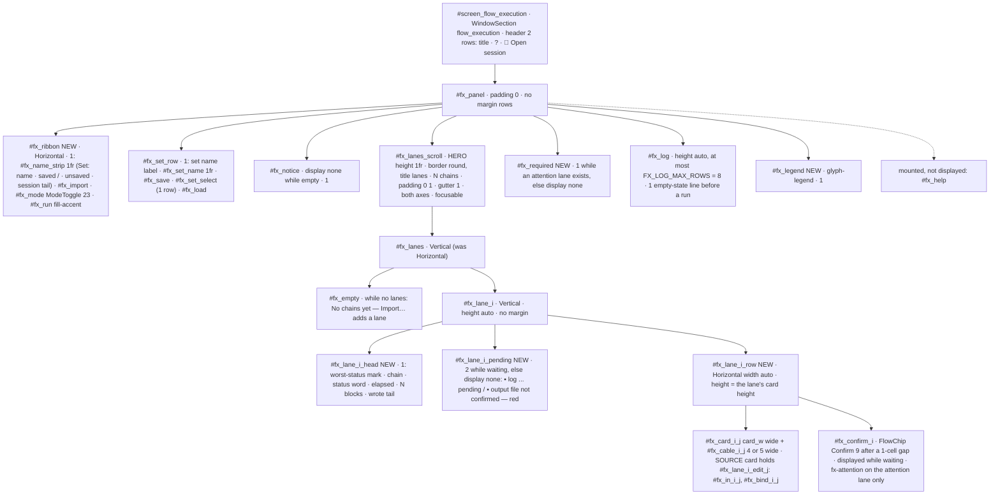

**Structure — Flow Execution widget tree (Inc-6; PC-4, PC-21, PC-24, written 2026-10-22 before Inc-6).** Kept ids plain, NEW ids marked; every row count is a terminal row. The 2-row header sits above the panel: `#screen_flow_execution` is a plain `WindowSection` (D10 amended), and its present 1-row title already leaves the panel at y = 4 (`fx-regions.txt`: screen `(5, 2, 112, 42)`, panel `(5, 4, 112, 40)` at 118x54), so the header costs the panel no row — the Check Editor's case.

**Lanes, cards, cables (PC-4, D24).** Lanes stack vertically (fx_A). Each lane is a head, its pending lines while it waits, and one row of cards. Every card of every lane is `card_w` wide, from the one `lane_layout(viewport_w, n_max)` result, and cable *k* is `4 + (1 if k < spare)` cells in every lane, so the cards line up in columns. A card is a bordered `Vertical`. Its border title carries the kind glyph and name (`◉ LOAD`, from `FLOW_KIND_GLYPHS`; it costs no row). Then come the block's io lines, clipped by the Builder's `clip_head` / `clip_tail` at `card_w − 4`, and one status line (`<cable-vocabulary mark> <status word>`). The SOURCE card's file line is its `#fx_in_<i>_<j>` input (one row, full card width), and `#fx_bind_<i>_<j>` sits on the next row (LLR-147.2: inside the card, Bind right after its input in the focus order). Cable *k* paints `─<mark>─▶` on the card's output row. The mark comes from LLR-147.1's table over the retained record (`cable_glyph`); it paints in the waiting colour when it leads into the waiting card. **Card height per lane** = 2 (border) + the largest content-row count over that lane's cards. `_apply_layout` sets it on every card of the lane and on `#fx_lane_<i>_row`, so a lane's cards share one height. The waiting card's border paints in `$waiting-human`. `#fx_lane_<i>_paint` (the 44-cell box with the progress bar) is not mounted any more. `lane_paint_plain(i)` returns the plain text of the lane's head, pending lines and painted card rows (the C-32 seam, I-7); the Inc-6 reverse census names the nodes that query `#fx_lane_<i>_paint` directly. `#fx_lanes` changes from `Horizontal` to `Vertical`, and the two `query_one("#fx_lanes", Horizontal)` sites in the panel change with it.

**Run log (LLR-147.8).** `#fx_log` is a `Static`, `height: auto; max-height: 8`, and **not** a scroll view: a scroll view would be a focus stop that LLR-147.11's order does not list. Before a run it paints one line, `No run yet — Run executes every lane.`. After a run it paints one start line and one terminal line per lane (LLR-020.1), with the re-run lines appended (I-7 (e)). When the log holds more than `FX_LOG_MAX_ROWS` lines, the first painted line reads `… <k> earlier lines — the full log is in the run report` and the newest 7 follow; the chain-set report under `reports/` keeps every line.

The panel height `H` is the shipped `#fx_panel` region on HEAD `b514b07`: **40** at 118x54, **39** at 118x53, **46** at 220x60, **45** at 220x59, width **112** / **196** (`fx-regions.txt`; the same as the Builder's and the Check Editor's). The card height `h` is illustrative until Inc-6 paints its own cards. fx_A's capture gave a lane 8 rows (head 1 + card 7, `prototypes/b94_polish/NOTES.flows.md` §fx_A, "lanes 21 = 2 lanes × 8 + ghost 3 + frame 2"), so the table uses `h = 7`. Inc-6 re-measures and the table moves with it, the lanes region absorbing the difference (as Inc-5 did for the Builder's cards).

| Region (Flow Execution) | Rows | 118x54 · H 40 | 118x53 · H 39 | 220x60 · H 46 | 220x59 · H 45 | Slack |
|---|---|---|---|---|---|---|
| ribbon · set row · legend | 1 each | 3 | 3 | 3 | 3 | 0 — fixed single rows |
| `#fx_notice` · `#fx_required` | 0 unless shown | 0 · 0 | 0 · 0 | 0 · 0 | 0 · 0 | +1 each when shown, taken from the lanes region |
| `#fx_log` | 1 before a run; `min(lines, 8)` after | 1 | 1 | 1 | 1 | after the 3-lane run: 6 (3 start + 3 terminal lines) |
| **`#fx_lanes_scroll` (hero)**, border 2 | `H − 3 − log − notice − required` | 36 before a run | 35 | 42 | 41 | the hero absorbs every row change |
| lanes viewport, 3-lane run with lane 1 waiting (log 6, REQUIRED 1) | region − 2 (− 1 with the horizontal scrollbar) | **28** | **27** | **34** | **33** | content `3 × (1 + h) + 2` = **26** with `h = 7`: 2 · 1 · 8 · 7 empty rows under the last lane, inside the frame |
| lanes viewport, `wait_third_6` (6 blocks scroll sideways at 118) | as above, − 1 scrollbar row at 118 | **27** | **26** | 34 | 33 | content 26: **1 · 0** at 118x54 · 118x53 — no slack at 118x53; a taller card makes the lanes scroll vertically, and LLR-147.3's scroll step still brings the waiting card and its Confirm into view |

**Remaining empty rows, in plain words (for the operator, Flow Execution).** The top two rows are the set's ribbon (name, saved state, session folder, Import…, the `sequential · parallel` switch and Run) and the set row (name, Save Set, saved sets, Load Set). The bottom row is the legend. Everything between them is the framed lanes area, except the run log just above the legend (one line before the first run, then two lines per lane, at most 8) and, while a lane waits, the one `REQUIRED … press c to confirm` line above the log. Each lane is a header line, two red lines while it waits for a human, and one row of block cards joined by status cables. Every lane uses the same card width, so the cards line up in columns, and Confirm sits right after a waiting lane's last card. With the 3-lane example after a run (one lane waiting), the lanes need about 26 rows and the frame offers 28 at 118x54 (27 once the two-row key bar lands) and 34 (33) at 220x60, so 2 (1) and 8 (7) rows stay empty at the bottom of the frame. With 6-block lanes at 118 columns the cards scroll sideways, and the frame is exactly full at 118x53.

