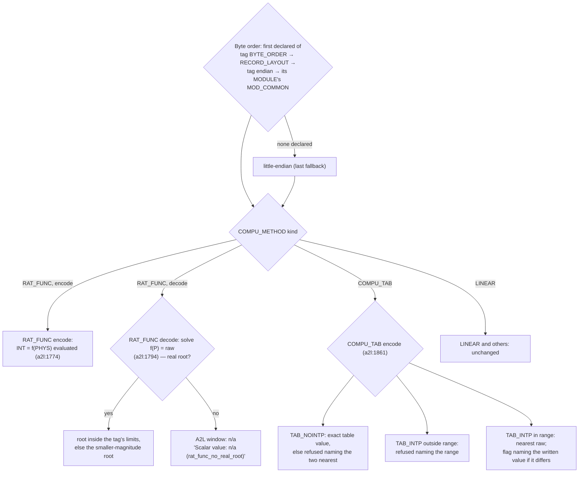

# Diagram — A2L encode / decode decisions (flowchart)

> **Role:** `docs-writer`. Mermaid flowchart, 12 nodes. It shows the three decisions the A2L codec now takes between raw bytes and a physical value (US-147 decode, US-152 encode; HLR-158, LLR-158.1–158.3; AT-B99-09, AT-B99-14; TC-B99-23..25, 42, 43). Facts come from `03-increments/increment-010.md` §1, LED .2, LED .4, LED .6, `a2l.py:2402`, `:1774`, `:1794` and `:1861`. Anchors are on the tree at `bf3917d`.

**Reading notes.**
- On the synthetic corpus, under `MSB_FIRST` with no layout byte order, 4113 ↔ `10 11`. `RAT_FUNC_DIV_10` gives 30 → raw 300 and raw 300 → 30.0. `TAB_NOINTP` 13.0 is refused naming 10.0 and 15.0. `TAB_INTP` 500 is refused naming `[0.0, 62.5]`, and 3.4 encodes raw 1 with a flag naming 2.5. The LINEAR control declares `MSB_LAST` and stays `0F 00` (LED .4: `LSB_FIRST` is not an ASAM token).
- Each MODULE uses its own `MOD_COMMON` (TC-B99-42, LED .6). A RAT_FUNC root where the denominator is zero is no root (TC-B99-43).
- **Visible impact on the shipped examples** (`evidence/inc-10/example-impact.txt`): case_06 has 71,513 tags that now decode big-endian, and software_a has 1,640 RAT_FUNC tags that decode in the ASAM direction (`functionality.md` §Visible behaviour changes).
- No TUI surface calls the encoder (P-22). The encode decisions are observed through the codec API in AT-B99-14; the decode is observed through the A2L window in AT-B99-09.
