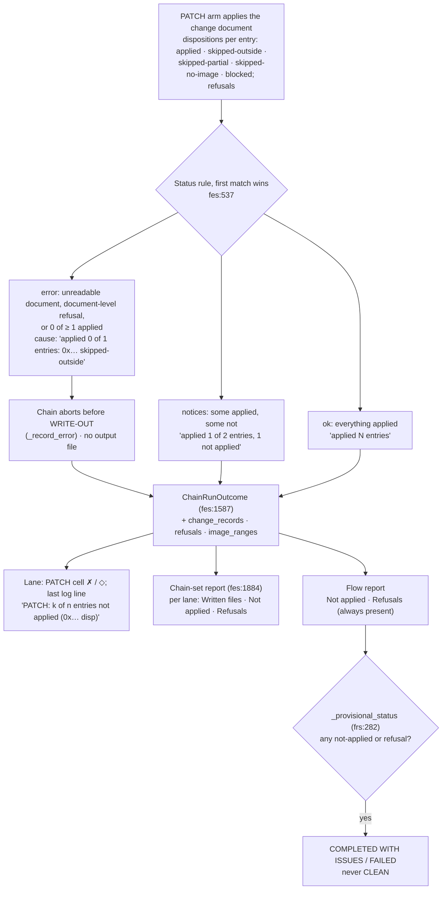

# Diagram — PATCH dispositions into the run records (flowchart)

> **Role:** `docs-writer`. Mermaid flowchart, 12 nodes. It shows how a flow PATCH step's per-entry dispositions and refusals become the block status, the lane display, the chain-set report and the flow report (US-145; HLR-156, LLR-156.1–156.4; AT-B99-06, AT-B99-07; TC-B99-17..20). Facts come from `03-increments/increment-008.md` §1, `flow_execution_service.py:537`, `:1587`, `:1884`, `flow_report_service.py:282` and `flow_screens.py:3376`. Anchors are on the tree at `bf3917d`.

**Reading notes.**
- Before the batch, PATCH reported `ok` (`applied 0 entries`) for every outcome, and the outcome and both reports dropped dispositions (premises P-4, P-14).
- The 8-case matrix in TC-B99-17 reads `error, error, notices, error, error, error, error, ok`.
- File-derived text renders literally everywhere: lane cells through `safe_text`, reports through `md_safe` / `md_code`, notifications with `markup=False`. AT-B99-07 finds 0 markup spans from a hostile symbol name.
- The lane uses only existing glyphs, status words and colour classes (UX-C3).
- The chain-set report's not-applied listing is asserted at the service only (G-003).
- The CRC step follows the same shape (`diagrams/write-path.md` for placement). An empty region is `error` and stops before WRITE-OUT. Partial coverage is `notices`, with the absent count on the lane line (`fs:3353`).
