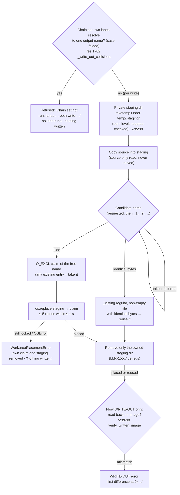

# Diagram — the write path: staging, atomic placement, verify (flowchart)

> **Role:** `docs-writer`. Mermaid flowchart, 12 nodes. It shows one write through `copy_into_workarea` / `save_patched_image`, which covers image save-backs, flow WRITE-OUT, the CRC write and every other caller (US-144; HLR-155, LLR-155.1/155.2/155.3/155.6/155.7; AT-B99-04, AT-B99-05; TC-B99-11..16, 39, 44). The chain-set start check (D7) runs before any lane reaches this path. Facts come from `03-increments/increment-003.md` §1, `increment-003b.md` §1 and `workspace.py:298` / `:402`. Anchors are on the tree at `bf3917d`.

**Reading notes.**
- The final file always holds exactly the bytes of the write that reports it. Eight concurrent writers asking for one name, over 20 trials, gave 0 mismatches (TC-B99-12). The pre-batch mechanism gave 35 of 68 under the restored mutant.
- A same-name save-back no longer deletes the loaded work copy, so Save project completes (PH-3, AT-B99-05).
- A placed file is never replaced. Byte-identical reuse is race-free by that immutability invariant (LED .7), and a 0-byte target is never reused because it may be another writer's claim.
- The `VER` step applies to flow WRITE-OUT only (D9). Its mismatch arm is TC-only (TC-B99-16): no surface can corrupt a file between the write and the read-back.
- An export pair (a BIN and its `.addr`) uses `place_group_into_workarea` (`ws:695`). It claims one `_<N>` for both names before either is written, and rolls back every own claim on failure.
