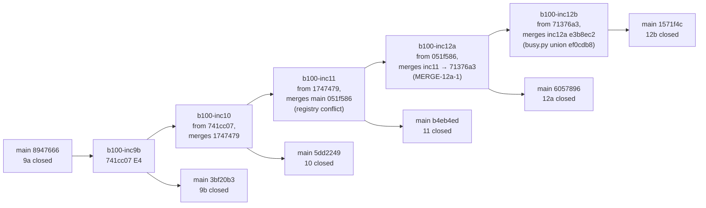

# Post-mortem — s19_app — Batch 2026-10-26-batch-100

> **Artifact language:** canonical English scaffold. Generate in the batch's development language (`state.json` `language`).
> Phase 5 artifact. Co-authors: `architect` + `qa-reviewer`. Structured for cross-batch sweeping — keep the section order.

> **Owed in.** `core` — · `full` ✓
> **Source:** `/dev-flow-init` step 4's seed-by-level table, which is this fact's one home. A level marked `—` **does not owe this artifact, and its absence is not an omission**; `by trigger` means the station exists only when the `triggers` block fired, and `stations_active` in `state.json` is the authority for *this* batch. Where a SECTION or a gate row is owed more narrowly than the artifact, it says so on the row.

> **Reserved field names.** The **field names and block keywords below are language-independent** — the
> validator parses them literally and they are never translated:
> `Gated tree` · `Found before the batch` · `⏸ DEFER`
> Everything else on this page — headings, guidance, the prose in every cell — is translated with the batch.
> **One strategy, not two:** the flow ships no alias table, so a translated label is read as an ABSENT one and the rule keyed on it reports a true-sounding silence.

## 0 · Gate record — which tree this close gated

| Field | Value |
|---|---|
| Gate record | `<the validator command, its exit code, and 0 block · date>` |
| Gated tree | `<the 40-hex HEAD at the gate · clean — or: dirty — the files>` |

> Owed at the close gate, written by the orchestrator from that run's own `git rev-parse HEAD` and `git status --porcelain`. The co-authors do not fill it, and they do not fill the C-44 working-file sweep either; both belong to the close.

## Synthesis (orchestrator)

<!-- SYNTHESIS -->

## Record corrections

Discrepancies between batch records, found while writing Part A. Each row names the record as written, what the other records show, and the evidence. Nothing here was edited in the source records.

| Record | As written | What the other records show | Evidence |
|---|---|---|---|
| `PLAN.md` header and status | `Last updated` = `P3 · 2026-10-29`; *Where we are* still describes ARQ; status row `P3 · in progress · Inc 1 → Kimi K2.8`; the roadmap says "one Kimi K2.8 worktree per increment"; the *Test ledger* row is the template placeholder; trigger E1 says "12 planned increments" | P3 ran to Inc 12b and the batch-end fix rounds (state.json decisions_log[25], [26]). Kimi implemented Inc 1–4 only. Inc 5–7 and hotfix 3b were implemented by Claude (`increment-005.md:11`, `-006.md:11`, `-007.md:11`, `-015.md:10` "Kimi out of budget"). Inc 8a onward ran the design-first pipeline. ARQ planned 15 increments | `PLAN.md:20-21`, `:62`, `:67`, `:69`, `:141-143`; git log `1d677ba..570b4b5` |
| `PLAN.md` trigger A4 | `not fired` — "increments are planned sequential, one worktree each, merged in order" | From Inc 10 on, worktrees were stacked on sibling branches that had not merged yet. `b100-inc10` branched from the integrated 9b (`741cc07`) and merged the corrected 9b (`1747479`). `b100-inc11` branched from `1747479`. `b100-inc12a` merged `b100-inc11` (`71376a3`) before its E5. `b100-inc12b` merged `b100-inc12a` (`e3b8ec2`). E1–E3 of Inc 11, 12a and 12b ran in parallel with 9b and 10. The batch-99 lesson repeated: conflicts on the `test_id_registry` bound (`051f586`) and on `test_b100_busy.py` (union fix `ef0cdb8`), plus a semantic merge defect, MERGE-12a-1 | `PLAN.md:35`; `increment-019.md:13`, `-020.md:13`, `-021.md:13`, `-022.md:13`; `inc-11/steps.log` line 1; `inc-12a/steps.log` lines 1, 15–16 |
| `state.json` | `iterations_per_station` is 0 for every station; `phase_status` = `not-started` at `current_station` P3 | P2 took 3 rounds. P3 ran 15 increments plus a hotfix, with 1–6 code-review rounds each (Metrics below) | `.dev-flow/state.json`; `02-review.md:192-246` |
| `02-review.md` *Verdict (read first)* | `Gate: iterate-to-refine` … "round 2 re-review pending" | The body records round 2 (every reviewer `iterate-to-refine`, cap reached) and a bounded round 3: "**P2 verdict: approved.**" The header block was never brought forward | `02-review.md:12`, `:15`, `:19` vs `:192`, `:236` |
| Packet `Increment` fields 019–022 | `010`, `011`, `012`, `013` | The scheme used by 008a/008b/009a/009b would give 010, 011, 012a, 012b. No Inc 13 exists. `022` is Inc 12b | `increment-008.md:6`, `-016.md:6`, `-017.md:6`, `-018.md:6`, `-019.md:6`, `-020.md:6`, `-021.md:6`, `-022.md:6` |
| Packets 021, 022 `Lane` | "2 SOURCE files … at the 4-file cap" | 2 of 4 is within the cap (packet 017 says "within") | `increment-021.md:7`, `-022.md:7` |
| Packet 022 `Date` | "E1 start 14:55Z through E5 round 2 02:14Z", identical to packet 021 | 12b's E5 round 2 ended at 08:25 (its own step table and commit `ce3a305` 08:25:47 -0600). 02:14 is 12a's round 2 (`9012835`) | `increment-022.md:12`, `:168`; `increment-021.md:12` |
| Time zone in `steps.log` and in the step tables of packets 017–022 | Times are labelled UTC ("Z", "all UTC") | The unsuffixed lines are local time, UTC−6. Two checks: `9012835` at 02:14:41 -0600 matches "02:14 E5 corrective round 2" in `inc-12a/steps.log`, and `9bec70e` at 01:39 -0600 matches the true-UTC "07:40:21Z" in `inc-8b/steps.log`. As a result, 9a's wall, given as 6 h 47 min (07:42:48Z → "14:30"), was about 13 h (close commit `f1b8960` at 20:45Z), including a 6.5 h hung `pi` run. 9b's wall, given as 5 h 52 min (13:41:04Z → "19:33"), was about 11 h 52 min, including a 5 h hung `pi` run. The durations for Inc 10, 11, 12a and 12b are right and only their "Z" labels are wrong | `inc-9a/steps.log` (lines with no `Z`); `increment-017.md:166-168`; `increment-018.md:154`, `:164`; git log `--date=iso` |
| Packets 018 and 019, step-table source | "from `inc-9b/steps.log`", "from `inc-10/steps.log`" | Neither file exists. `inc-9b/` and `inc-10/` hold no `steps.log` | `ls inc-9b inc-10`; `increment-018.md:148`, `-019.md:144` |
| Packet 022 §7 item 5 | "the 5 pre-existing Linux-only failures" | All five (tc1802, b78_03, 056e_a2b, tc707_copy, tc707_numbering) also failed in the Windows battery shards | battery shard logs (session scratchpad, `full-shard0..3.log`) |
| CI comparison list, Inc 11 rows | "New, all Inc 11 tests, all Linux-only (pass on Windows)" | CI11-1 (a product defect) and CI11-4 fail on Windows too, at `760f885` and at `4dfb5a1`. Under the override, nobody had run them on Windows after Inc 11 | `fix-round-1.md:22`; the list `ci-fix-list.md` (session scratchpad only) |
| Battery and CI evidence home | `fix-round-2.md` cites `rerun1.log` and the 4-shard battery as its input | The battery (`full-shard0..3.log`, 71 failed / 5,162 passed on `9e4dd3b`), the re-run (`rerun1.log`) and the CI comparison list exist only in the session scratchpad. The batch tree holds only `evidence/fix-2/battery-rerun1-RED.log` (7 failed / 28 passed) | `fix-round-2.md:4`; `evidence/fix-2/` listing |
| `BACKLOG-CODE.md`, rows Inc 12a fixed | Still `▸` (open): CR9-7, CR9-8, SEC9-2, the LLR-172.4d `os.name`-gate row (CR9-9), C7, OBS-9a-2, and the 9b Q8 labels/snapshots row | Inc 12a's E1 sweep fixed B3/B4/B5/B7/B10, closed B9 as not a defect, and restored LLR-173.2m with its 29 snapshots (`4dfb5a1`). No one flipped the rows. Fix round 2 flipped only the rows that name Inc 12b | `inc-12a/E1-rulings.md:17`; `inc-12a/E1-rulings-proposed.md:28-39`; LED .95; `fix-round-2.md` §BACKLOG-CODE rows |
| `BACKLOG-CODE.md`, rows routed to "the Inc 12a sweep" after 12a's scope was fixed | 12 rows say "What closes it: the Inc 12a sweep": S9b-5, A9b-R3-3, `_COLLIDING_PATH`, CR9b-05, UX loss (`A2L (none)`), the SEC9b-1 redirect, the stale `architecture.md:670` text, OBS-9b-1, S10-04, G-B F-4, A11-03, SE5-11-2 | 12a's sweep list (B1–B12) was ruled at its E1, 2026-10-31 15:17 local. The 9b, Inc 10 and Inc 11 closes routed these rows later (merges `3bf20b3` 20:02, `5dd2249` 21:32, `b4eb4ed` 01:15 local). None of the ids appears in `increment-021.md`. They are open with a target that has passed | `inc-12a/steps.log` line 3; `BACKLOG-CODE.md:1576-1621`; `grep` of `increment-021.md` |
| Packets 001–004 `Agent` | `software-dev` | Correct as a role. The runtime that implemented those increments was Kimi K2.8 (`kimi/BRIEF-inc-1..4*.md`, `kimi/inc-1..4-HANDOFF.md`; decisions_log[12] "implemented by Kimi K2.8 (implementation + timeout resume + 2 corrective…)"). The packets do not name it | `increment-001.md:16` … `-004.md:16` |
| Packet 015 `Increment` | "numbered after the 14 planned units so no planned packet number moves" | 8b took 016 (LED .75 addendum), so 9a–12b moved to 017–022 | `increment-015.md:6`; LED .75 addendum |

---

## Part A — design and process (architect)

> Co-author input for `05-postmortem.md` (`stations/p5-postmortem.md` §Phase 5; section shape of `templates/postmortem-template.md` and of batch-99's Part A). Scope: design, process, scope drift, the root causes of iterations, architecture outcomes and next-batch items. §0 and the C-44 sweep belong to the close. Read-only: the only file written is this one. Evidence states follow `/dev-flow` §*Evidence states*. Times are as recorded, with the UTC−6 correction above applied wherever a duration is quoted.

### At a glance (architect view)

- **Outcome:** closed with carry-over, before P4. All 15 increments and hotfix 3b are on `main`. The two batch-end fix rounds merged at `66d1ea9`, and `570b4b5` is the HEAD this part read. `04-validation.md` and `05-close.md` are still seeds, and the full suite after the fix rounds was handed to CI (decisions_log[26]), whose result is not in the batch records.
- **Top 3:** (1) The design-first pipeline (from Inc 8a) moved defect discovery from code to design. In Inc 1–7 the code gates caught 17 HIGH. In Inc 8a–12b they caught 1 HIGH, while E3 caught 47 MAJOR before any code existed. (2) The test-scope override saved the census time Inc 7 had spent (294.5 of 596.7 min). It also let five breakages wait for the battery, one of them a product defect, and two of them were invisible locally *and* on CI. (3) Moving work onto workers (12a/12b) changed the timing contract of the tests. Count-bounded `pilot.pause()` waits starve workers, and wall-clock bounds measured settle polling, not the requirement. The census found 91 such loops in 40 test files (SR12b-7).
- **New control proposed:** "a test skipped on CI or outside every per-increment selection is a named gap": an increment gate lists every test that its selection and CI both leave unrun (see *Control lineage*).
- **Open items → next batch:** 12 architect items below. The biggest is R1-P1: Save project now sits at its 1 s bound (0.75–1.0 s alone, against 0.71–0.79 s on the base).
- **Metrics (design/process):** P2 took 3 rounds (86 + 58 findings). PDR added 25 ledger entries. There were 100 ledger entries in all, 52 of them in P3. The contract grew from 16 HLR / 58 LLR (P1 draft) to 42 HLR / 351 LLR. E5 ran 711 mutants over 8 design-first increments. The battery on `9e4dd3b` gave 71 failed / 5,162 passed, and 7 failures were real after the alone re-runs. Two fix rounds followed.

### What worked

- **Design review with no code, on a graph.** Each design-first increment wrote strict EARS requirements (E1), a Code-Wire graph prototype (E2) and a design review by an architect and a security reviewer (E3) before any source changed. E3 caught 13 MAJOR in 8a, 5 in 8b, 3 in 9a, 9 in 9b, 3 in Inc 10, 10 in Inc 11, 2 in 12a and 2 in 12b. Several of them were executed probes, not readings. In 8a, the automatic reopen took 33 s at 20,000 entries (S3-1, LED .73 R4), and a hostile document raised `RecursionError` in the pre-parse count (S3R2-3, LED .74 R10). In 9a, `temp::$INDEX_ALLOCATION` and 8.3 names reached the reserved homes (S9-1). In 8b, a pre-existing bug was confirmed: an open-project save wrote an empty `batch` (C-7, `inc-8b/timing-8b.md`). Inc 7's own comparison shows the shift: 0 design-stage and 8 code-stage MAJOR/HIGH for Inc 7, against 13 and 1 for 8a (`experiment-8a/timing-8a.md` §(e)).
- **Fewer code rounds and correctives after the switch.** Inc 1–7 took 22 code-review rounds and 18 corrective passes, and hit the iteration cap twice (Inc 1 and Inc 2, both bounded passes by the operator). Inc 8a–12b took 12 code-review rounds and 8 code corrective passes (plus 2 test-only mutant-kill rounds). Inc 10's integration needed 0 source edits, because both implementers' code matched the graph (LED .90).
- **Planned re-cuts held.** ARQ split Inc 8, 9 and 12. Inc 9's dialog-free half (9a) shipped before the prototype verdict was needed, and 8a/8b stayed at or near the cap. No increment was split after its build started. The one re-cut during P3 (12 → 12a/12b, ruling Q1 at 12a's E1) restored the ARQ cut before any code was written.
- **The operator decisions page, again.** D1–D7 all came back as the recommended option. The UI stories stayed REFINE until the prototype verdict (P-A C, P-B A, P-C B, P-D A, P-E B), which filled every variant slot in one ledger entry (LED .2).
- **Corrective rounds on CI rows stayed narrow.** CI9b-1/2 were fixed in Inc 11's corrective, CI12a-1 in Inc 12b's (test-only), and CI-6-1 in Inc 7 (LED .71). The batch-end rounds took 2 commits and about 3 h between them (`dee0d96` 09:47, `677435e` 12:44 local). Each product fix had a RED transcript before it (CI11-1, SE5-12b-2, OBS-12b-2).
- **The merged smoke caught a merge defect.** Running the stacked branch's tests after merging the predecessor (`green-03-merged`) found MERGE-12a-1, an Inc 11 arm calling `_start_load_worker` without `gen`, before 12a's E5 closed (`inc-12a/steps.log` line 16).

### What didn't / friction

- **The override's blind spots.** On 2026-10-30, LED .75 limited each increment to the tests of new or modified requirements, the modules that exercise the changed functions, and the guards. On 2026-10-31 13:39Z it dropped the touched-module run as well (`inc-9a/steps.log`). What waited for the battery as a result:
  - **CI11-1, a product defect.** Inc 11's rebind used `abspath`, which collapses `..`. CI showed it. The CI list then classed it "Linux-only", and nobody ran it on Windows, where it was also red (`fix-round-1.md:22`, `:51-66`).
  - **CI11-4, a stale test.** Inc 11 moved the blocked-entry refusal ahead of the plan and never re-pinned the test. It was also red on Windows.
  - **The CSS append-only arm** (`test_tc_b97_flow_execution_css_section_is_scoped`). It was red locally from Inc 9b (`741cc07`) onward and **skipped on CI** (shallow clone, no `b514b07`). It was outside every per-increment selection, so it was invisible in both places for five increments (R-2, `fix-round-2.md`).
  - **R-3, a stale oracle since 12a.** It covered 3 nodes in `test_b99_load_project.py`; the product was correct.
  - **R-1, two timing arms since 12b.** Their clocks measured poll-plus-settle, not the bounded action. Behind one of them is a real slowdown, R1-P1.
- **The guard set shrank at Inc 9b.** PLAN's risk line requires the whole-tree guards at every increment gate. Inc 9b ran 3 modules, 45 passed (`test_id_registry`, `test_b99_staging`, `test_engine_unchanged`), and marked the `-k census` sweep "not run (operator ruling; batch-end battery)" (`increment-018.md:131-134`). CI then failed on `test_address_census.py::test_at_b83_08_tree_holds_no_assembled_selectors` (CI9b-1, platform-independent) and on the neighbour re-pin CI9b-2. Both were fixed only in Inc 11. Inc 8a ran 75 guards plus 29 snapshot cells, and 9a, 10, 11 and 12a each ran the wider set.
- **The CI comparison worked by hand, late, and outside the record.**
  - **The known set.** Six known failures went into the list (tc1802, b78_03, b78_32, 056e_a2b, tc707_copy, tc707_numbering). 12a D-1 fixed b78_32, which left 5.
  - **Each close compared its FAILED set with the previous run.** 8b: 7 failed = 6 known + `tc_b100_33[upper case]`, fixed in 9a. 9b: 10 failed / 4,571 passed. Inc 10: 12 failed (+ CI10-1/2, Linux timing flakes that did not repeat). Inc 11: 12 failed / 4,779 passed. 12a: 13 failed / 4,906 passed.
  - **The runs were slow.** They took 3 h 12 min (Inc 10) and 4 h 21 min (12a), so each verdict arrived after the next increment had started.
  - **New rows were routed two ways.** Some went to the next corrective (CI9b-1/2 → Inc 11, CI12a-1 → 12b). Others went to the batch-end round (CI9b-3/4, CI11-1..4).
  - **The list was never in the batch tree,** and its "Linux-only" label was a first read, never executed on Windows (Record corrections).
- **Implicit parallel lanes, again.** A4 stayed `not fired`, but Inc 10–12b ran stacked worktrees (Record corrections). The cost was 2 merge conflicts, 1 semantic merge defect (MERGE-12a-1), and E4 starts that waited on predecessors: Inc 11's E3 closed at 18:20 and its E4 started at 19:33; 12a's E3 closed at 20:12 and E4 started at 23:19; 12b's E3 closed at 21:19 and E4 started at 01:01 (local). The benefit was real: E1–E3 of 11, 12a and 12b were done before their bases existed.
- **Routing to a sweep whose scope was already fixed.** Twelve backlog rows were routed to "the Inc 12a sweep" at the 9b, 10 and 11 closes, after 12a's E1 had ruled its sweep list (B1–B12). None was handled, and none was re-routed. Meanwhile seven rows that 12a did fix still read open (Record corrections).
- **Runtime failures of the external implementer.**
  - **Kimi K2.8** implemented Inc 1–4, which took 16 briefs (Inc 1: 1 + 3 fixes; Inc 2: 1 + 5; Inc 3: 1 + 2; Inc 4: 1 + 2). Inc 3 needed a timeout resume (decisions_log[12]). Its budget ran out before hotfix 3b (`increment-015.md:10`).
  - **DeepSeek v4 Pro through `pi`** hung on stdin twice: 6.5 h on 9a's close records and 5 h on 9b's design-fix. The fix was `< /dev/null` with a timeout. A third run exited 127 part-way through 12b's close records, and a continuation run completed them (`inc-12b/steps.log`, last lines).
  - **Every DeepSeek close-records run needed an orchestrator fix-up:** a V4 threshold in 8b, V26 back-pointers and a C7 bullet in 9a, and R2-F1 carried into LLR-177.4c in 12b.
- **An orchestrator fix after the last review, again.** R2-F1, a MAJOR product defect (a result panel over a closing app on a routed quit), was fixed by the orchestrator at `ce3a305`. That was after the code re-review on `c026bd2`, and no reviewer re-read it (`increment-022.md:168`, `:405`; `inc-12b/E5-rulings.md:41`). This is batch-99's process finding 4.
- **Corrective source edits after a non-blocking review were not re-read.** In 9a, 9b, Inc 10 and 12a the ruling was "nothing blocking, so no re-review was owed; the corrective pass's RED/GREEN/mutant evidence is the narrow re-review" (LED .85, .87, .90, .96). In Inc 10 that pass rewrote a source arm: CR10-01 = SEC10-01, the kind of a typed relative path. It is a defensible rule, but it is the same exposure as R2-F1, written down.

### Scope drift (planned vs actual)

| Planned (PLAN roadmap) | Actual | Note |
|---|---|---|
| 15 increments (ARQ); the PDR design proposal says 14 units with "12a + 12b (one unit, R-PD)" | 15 increments + hotfix 3b = 16 packets | ARQ split Inc 12 because the long actions ran on the main thread, so no indicator could animate (`ARQ-batch-100.md:19`, `:201`). P2 round 2 re-joined it, "12a and 12b land together" (LED .11; `design-proposal-b100.md:520`). It was executed as two packets after 12a E1 ruling Q1 moved LLR-176.3/.4 to 12b. The two landed about 6 h 20 min apart (`6057896` 02:44, `1571f4c` 09:07 local) |
| Hotfix 3b: not planned | `increment-015` (app.py, screens_directionb.py) | operator "Hotfix ahora" (decisions_log[14]); LED .60 |
| Inc 1: workspace (+ app) | 4 files: + `segment_split_view.py`, `project_gather_service.py` | LED .49: containment on the unresolved destination; group placement as a second placement kind |
| Inc 2: app, workspace | 3: + `project_gather_service.py` | LED .53/.54: the exact-list rollback and the gather reuse rule moved into Inc 2 |
| Inc 5: app, change_service | 4: + `changes/apply.py`, `project_gather_service.py` | LED .56 (SEC-4 staging inside this work area) |
| Inc 6: app, variant_execution_service | 4: + `screens.py`, `styles.tcss` | the Load-result panel (P-E) |
| Inc 7: manifest_writer, variant_execution_service, app | 4: + `screens.py` | declared 4th |
| Inc 8b: app, project_gather_service | **5**: + `workspace.py`, `screens_directionb.py` (ruling D-5), `variant_execution_service.py` (F2) | the only cap breach in the batch, operator-approved on 2026-10-31 (`inc-8b/steps.log`); the approval landed mid-run and cost a ~30 min restart of the GREEN module set (`timing-8b.md`) |
| Inc 9b: screens, app, styles | 4: + `__init__.py` | PSC-1 (LED .86) |
| Inc 10: screens, app (+ styles) | 3: screens, `screens_directionb.py`, app; styles unchanged | ruling Q-6 |
| Inc 11: screens, app (+ styles) | 4: + `project_gather_service.py` | ruling Q10 |
| Inc 12b: app (+ flow_screens); flow runs onto workers (ARQ) | app, `tui/a2l.py`; project load, Save project and the A2L parse onto workers; flow runs stay | O-7 replaced flow runs with the A2L parse. `a2l.py` is the operator's named frozen-engine crossing at PDR (decisions_log, PDR gate). It is back in `_ENGINE_PATHS` (`increment-022.md`, *The indicator*) |
| Inc 7 verification complete at its gate | the corrective-pass-2 verification was cut by the operator | LED .70. Round-3 review and the probes were done in 8a, and the census moved to the battery (LED .75) |
| Full suite / reverse census per increment cut (P2 guard plan) | none per increment from 8a; a single 4-shard battery at the end | operator rulings LED .75 (2026-10-30) and 2026-10-31 13:39Z |
| Kimi K2.8 implements every increment | Kimi Inc 1–4; Claude `software-dev` Inc 5–7 and 3b; Opus implementers 8a–8b; DeepSeek v4 Pro implementers 9a–12b | Kimi budget; model reassignment after the 8a Sonnet truncation (LED .75 *Model observation*) |

### Metrics (design/process)

| Metric | Value |
|---|---|
| Calendar | open 2026-10-26 (`ada3d16`) → fix rounds merged 2026-11-01 12:46 local (`570b4b5`); 121 commits on `main` since `1d677ba` |
| Iterations per station | P0 1 · ARQ 1 · P1 1 + P2 rounds 2–3 (LED .2–.23) · P2 3 (round 3 bounded, operator, at the cap) · PDR 1 (LED .24–.48) · P3: see the two tables below · battery 1 + 2 fix rounds |
| P2 findings | round 1: 6 blocker / 45 major / 35 minor (86); round 2: 58 open, closed in round 3 (2 blocker / 27 major / 29 minor) (`02-review.md:15`, `:196`) |
| Ledger | 100 entries: P1 1 · P2 22 · PDR 25 · P3 52 |
| Contract size | P1 draft 16 HLR / 58 LLR / 56 TC / 19 AT (`3060d66`) → P2 round 3 74 LLR / 72 TC / 21 AT (`4e9c8f1`) → now 42 `### HLR-` / 351 `### LLR-` headings, 73 TC-B100 ids, 21 AT-B100 ids (`grep` on `01-requirements.md`) |
| Code-stage HIGH | Inc 1–7: 17 (Inc 1: 3; Inc 2: 6; Inc 3: 1; Inc 4: 3; Inc 5: 2; Inc 6: 2; Inc 7: 0). Inc 8a–12b: 1 (SE5-11-1) |
| Design-stage MAJOR (E3) | 47 over the 8 design-first increments (13 / 5 / 3 / 9 / 3 / 10 / 2 / 2) |
| E5 mutants | 711 rows (78 / 72 / 79 / 96 / 83 / 80 / 108 / 115). First-pass survivors in 9b: 26, Inc 11: 18, 12a: 22, 12b: 30 (12b: 14 "wrong target") |
| Source change | 14 files, +16,155 / −2,899 (`git diff --shortstat 1d677ba HEAD -- s19_app`); `app.py` 13,630 → 20,535 lines |
| Battery | `9e4dd3b`, 4 shards: 71 failed / 5,162 passed (shard walls 47 min, 1 h 34, 1 h 19, 47 min) |
| Cap trips | source cap: 1 (8b, 5 files, approved); P3 iteration cap: 2 (Inc 1, Inc 2); P2 iteration cap: 1 |

**Inc 1–7 (implementer + independent review).** "Rounds" are code-review rounds, with security rounds after the slash.

| Inc | LLRs in scope | Implementer | Rounds (code / sec) | Corrective passes | HIGH at the code gates |
|---|---:|---|---|---:|---:|
| 1 | 8 | Kimi | 4 / 2 | 3 | 3 |
| 2 | 4 | Kimi | 6 / 5 | 5 (incl. the operator's "Lista exacta" redesign, LED .53) | 6 |
| 3 | 4 | Kimi | 3 / — | 2 | 1 |
| 4 | 2 | Kimi | 3 / — | 2 | 3 |
| 3b | 2 | orchestrator | 1 / — | 0 | 0 |
| 5 | 8 | Claude | 2 / 1 | 1 | 2 |
| 6 | 7 | Claude | 2 / 4 | 3 | 2 |
| 7 | 10 | Claude | 2 (+ round 3 in 8a) / 2 (+ round 3 in 8a) | 2 (pass 2's verification cut) | 0 (3 MAJOR) |

**Inc 8a–12b (design-first).** E4 implementers wrote the code; Opus did E1–E3, the tester, the integration, the reviews and the correctives. The walls of 10–12b overlap: they include design-ahead and waits for the predecessor's tree.

| Inc | Requirements in scope (E1) | E3 rounds (MAJOR) | E4 implementers (deviations) | Integration source edits | E5 code-review rounds | Opus correctives on code | Mutants (first-pass killed) | Wall |
|---|---:|---|---|---|---:|---|---|---|
| 8a | 11 (pre-strict) | 3 (13) | Opus ×3 | 6 rulings, 6 re-pins | 2 | 1 | 78 (72) | 4 h 28 |
| 8b | 37 | 3 (5) | Opus ×2 | D-5 (4th file), D-3 | 2 | 1 (93 min) | 72 (69) | 5 h 46 |
| 9a | 40 | 2 (3) | DeepSeek ×2 (5; missed R14) | 1 (R14) | 1 | 1 | 79 (70) | ≈13 h, incl. a 6.5 h `pi` hang |
| 9b | 64 | 3 (9) | DeepSeek ×2 (0 + 5) | SR-1..SR-7 | 1 | 1 | 96 (70) | ≈11 h 52, incl. a 5 h `pi` hang |
| 10 | 36 | 2 (3) | DeepSeek ×2 (0) | 0 | 1 | 1 | 83 (69) | 6 h 39 |
| 11 | 52 | 3 (10) | DeepSeek ×2 (3 + 5) | 1 (SR-11-1) | 2 | 1 | 80 (62) | 10 h 08 |
| 12a | 38 | 2 (2) | DeepSeek ×1 (3) | 1 (SR-12a-2) | 1 | 1 + a test-only mutant-kill round | 108 (86) | 11 h 19 |
| 12b | 39 | 2 (2) | DeepSeek ×2 (5) | 1 set, ~4 h 09 | 2 | 1 + a mutant-kill round + the orchestrator's R2-F1 | 115 (85) | 17 h 30 |

Sources: `experiment-8a/steps.log`, `inc-*/steps.log`, the packets' step tables and *Model performance* bullets (`increment-016.md:184`, `-017.md:313`, `-018.md:323`, `-019.md:298`, `-020.md:287`, `-021.md:340`, `-022.md:364`).

### Root causes (stations with ≥2 iterations)

- **P2 r1 → r3.** Round 1 found 86 findings across four lenses, and round 2 found 58 more. Most came from the six UI HLRs, which carried variant slots until the prototype verdict (LED .1, .2), and from security closures on containment and untrusted input (LED .5, .6, .20). Root cause: the contract was drafted before the prototype verdict on purpose, so two of its rounds paid for that ordering. That was the chosen trade, not an error. The cap fired, and round 3 was bounded.
- **Inc 1–4 multi-round gates.** Inc 1 and Inc 2 both hit the iteration cap. Each fix pass opened a new HIGH in the same mechanism: Inc 1's containment (F1 → SEC-1 → R3-1, a regression from fix pass 2), and Inc 2's rollback (F1/F2 → R2-1/R2-2 → R3-1 junction walk → SEC2-7 case-variant deletion). In each case the operator ended it with a redesign ("Lista exacta", LED .53), not another patch. Root cause: the rollback and containment rules lived as code, so each round's correction re-opened the next edge. The design-first stage later put the same class of decision on the graph before code (8a R1 dropped the in-place rewrite, which closed 6 findings at once).
- **LLR count did not predict E5 rounds.** The largest design-first increment, 9b with 64 requirements, needed one code-review round and nothing blocking. 8b (37), Inc 11 (52) and 12b (39) needed two. Among Inc 1–7, Inc 2 (4 LLRs) took 6 rounds and Inc 4 (2 LLRs) took 3. What the second rounds had in common was the blocker's kind:
  - a design gap that E3 had not reached: 8a F1 (a device-name document breaks every save) and 8b F1 (an absent source folder);
  - session state across a boundary: Inc 11 SE5-11-1 (a load under the open dialog makes the save write a stale image);
  - rollback ordering: 12b CR12b-1.

  Requirement count did predict E5 volume: mutant rows grew with scope (108 and 115 for 12a and 12b). It also predicted integration time on surfaces with wide test coupling: 12b's integration took ~4 h 09 min, with 82 new items and a large census re-pin.
- **Battery failures.** The override (above) and the worker moves (below) explain 5 of the 7 real failures. R-4 was environmental (basetemp naming). Of the other 64 battery failures, 29 were the density snapshots waiting for the CI regeneration (`760f885`), 5 were the known set, 2 were CI11-1/CI11-4, and 28 passed when re-run alone (contention and path length on a long basetemp).
- **Worker moves → test timing.** Once project load, Save and the A2L parse ran on workers, two test idioms broke. (a) Count-bounded bare `pilot.pause()` loops keep the main thread busy, and the worker's `call_from_thread` round trips queue behind them (CI12a-1, found in 12b's corrective; SR12b-7, 91 loops in 40 files). (b) Wall-clock bounds that stop the clock when a poll notices the outcome measure poll-plus-settle (R-1; 12b's F-23 re-pinned the project-check bounds the same way). Root cause: ARQ flagged "threading risk" for 12b (`ARQ-batch-100.md:201`, `:290`) only as product risk. No E2 baseline enumerated the test waits and clocks on the touched surface.

### Process / workflow findings

1. **Name what nobody runs.** A per-increment selection plus a CI that skips can leave a test unrun everywhere; the CSS arm stayed that way through five increments. Suggested change: each increment gate lists the tests outside its selection that CI also skips (a `pytest --collect-only` diff against CI's skip list), and CI fails on an unexpected skip of a guard (R2-CI: `fetch-depth: 0` or a pinned sheet).
2. **A CI failure is "platform-only" only with a dev-host pass transcript.** CI11-1 and CI11-4 were labelled Linux-only and parked for the batch end; both were red on Windows. Suggested change: the next close re-runs each new CI failure on the dev host and records the transcript before routing it.
3. **CI comparisons and battery logs live in the batch tree.** Suggested change: `evidence/ci/<run-id>.txt` per close (FAILED set, totals, the diff with the previous run) and `evidence/battery/` for the shards and re-runs.
4. **The guard set is a fixed list, not a per-increment choice.** Suggested change: the PLAN names the guard command once, and a packet that runs fewer modules marks the guard row `not met` (9b ran 3 modules and CI9b-1 escaped).
5. **Route only to an open scope.** With design-ahead, a later increment's E1 can be ruled before the items routed to it exist. Suggested change: a backlog row may name an increment only if its E1 has not run; otherwise it names the batch-end round or the next batch. The fixing increment flips its rows at its close.
6. **Re-record A4 when worktrees stack.** This repeats batch-99's first lesson. The mitigation that worked here, merging the predecessor branch and running a merged smoke before E5, should be a named E4/E5 step with its transcript.
7. **One clock in the logs.** Suggested change: `steps.log` lines carry ISO-8601 UTC with `Z`, generated by a helper, never typed. Two packets misreport walls by about 6 h.
8. **No product edit after the last review without a re-read.** R2-F1 was a MAJOR fix. Suggested change: any source edit after the final review round gets a bounded re-read, or the packet names it unreviewed. The same applies to correctives after a non-blocking review.
9. **Worker moves carry a test-timing census.** Suggested change: when an increment moves work off the main thread, E2's baseline adds the waits (count-bounded loops) and clocks (wall-clock bounds) in the modules that drive the moved actions, and E4 re-pins them to the yielding, wall-clock pattern (`_wait_yielding`, CI12a-1).
10. **External runtimes run detached and watched.** `pi` with `< /dev/null`, a timeout and a watchdog was the fix after two hangs (11.5 h lost in all). Close records written by DeepSeek needed orchestrator fix-ups every time, so they stay drafts until the orchestrator's V-check.

### Architecture outcomes / product findings

- **Landed contracts.**
  - B100-I13..I22 (`docs/ARCHITECTURE.md` §11): one placement function, `place_into_workarea`, owning reuse, containment and staging (Inc 1); the `save_patched` split and the frozen save plan (Inc 5); the manifest seam with `files` digests and private staging (Inc 6–7); `active_document` (8a); project homes and A2L-only projects (8b).
  - The recent-sources store (9a), the unified Load dialog (9b), the unsaved-work question (Inc 10), the Save dialog that paints its plan (Inc 11), and the progress seam (12a).
  - Three workers with frozen request/result types, a busy refusal on 16 entry points, and a quit question (12b).
- **`app.py` concentration.** `app.py` was in all 15 increments and the hotfix (PLAN had planned 14 of 15) and grew from 13,630 to 20,535 lines (+51 %). ARQ declined to split it as "a boundary move far out of proportion for this batch" (`ARQ-batch-100.md:244`). That holds for one batch, but the file is where parallel lanes collide: MERGE-12a-1 came from an `app.py` parameter change (the new keyword `gen` on `_start_load_worker`).
- **batch-99 D-3 grew.** `workspace._private_stage_dir`, private by name, now has 6 importers outside `workspace.py`: `app.py`, `changes/apply.py`, `changes/io.py`, `operations/crc.py`, `segment_split_view.py` and `services/manifest_writer.py`. Batch-99 closed with 4 (`grep -rn "_private_stage_dir" s19_app`, executed). Inc 1 built the public placement function, but the new manifest staging (O-11, Inc 7) and an `app.py` caller went to the private helper.
- **R1-P1 (product).** Save project at the TC-B100-20 composition takes 0.75–1.0 s alone since 12b, against 0.71–0.79 s on the base. The worker files step is 0.63–0.89 s of that, and the progress round trips are not the main cost (`evidence/fix-2/R-1-breakdown.txt`). The arm passes with ≤ 0.05 s margin. SEC8a-2 is the same pattern at the reopen caps (0.6–0.8 s against 1 s).
- **Late product defects found outside the gates.** CI11-1 (the `..` rebind, fixed in fix round 1). SE5-12b-2 tail: an unreadable open-project folder made the sync helpers exit the app (fixed in fix round 2). OBS-F2-1: a deleted open-project folder is silently re-created by the next sync (open, design ruling owed).
- **Dead surface.** `load_selected_file` has no product caller after 12b but keeps 88 test calls (PR-6).
- **Frozen-engine crossing.** `tui/a2l.py` gained an optional progress callback under the operator's named crossing and returned to `_ENGINE_PATHS`. The re-freeze follow-up is listed as owed after the merge (`increment-022.md` §7).
- **Contract shape.** From 8a on, the strict EARS split (one form, one "shall", a threshold and a negative control each) turned 8 to 12 legacy requirements per increment into 36–64. The ledger kept the ids stable with suffixes. Its cost is in the ledger (LED .86's requirement line lists over 60 ids) and in V26 pairings that the close had to repair (LED .81, `inc-8b/timing-8b.md` *For the next increment*).



*The stacked lanes that A4 did not record (commits from the packets' `Base` rows and git log).*

### Control lineage

- **New (propose, adopt next batch): a gap list of unrun tests at every increment gate.** It lists the tests that are neither in the increment's selection nor run by CI (skipped, deselected or absent from the runner). Origin: R-2, the CSS arm, red from Inc 9b to fix round 2 and skipped on CI. The next most expensive leaks, CI11-1 and CI11-4, had a different cause: they ran on CI but were misclassified, which process finding 2 covers. Cost: one collection diff per gate, `n/a` for runtime.
- **Prior controls exercised:**
  - **Held:**
    - Whole-tree guards ran at the gates of 8a, 9a, 10, 11, 12a and 12b.
    - The validator ran before each decision. That is the PLAN rule (*Gate notices*), and the V4/V26 repairs at the 8b and 9a closes show it ran.
    - The packets record the `__file__` import proof in their transcripts.
    - Mutation verdicts are declared in every packet.
    - E13 captures were taken at 118/220/99 columns from 9b on.
  - **Stress-tested:** batch-99's "contract tokens executed at P2". The design-first E3 executed probes at the increment level instead (8a S3-1, 9a S9-1).
  - **Failed or eroded:**
    - The guard set at 9b (3 modules).
    - Batch-99 lesson 1, re-recording A4 (stacked lanes, unrecorded).
    - Batch-99 process finding 4 (R2-F1).
    - Batch-99 process item 2, "registry by glob": `EXPECTED_SCANNED_TEST_FILES` was still bumped by hand (Inc 10 F4 230 → 231; Inc 11's merge conflict on the bound, resolved to 233).

### Open / deferred items → next batch (architect)

The batch-100 section of `BACKLOG-CODE.md` holds 73 rows, 8 of them closed. The rows below are the ones that carry a decision or a risk. The section's other open rows keep their own "What closes it".

| Item | Type | Reason deferred | Trigger / owner |
|---|---|---|---|
| R1-P1 — profile `_save_project_files` against the base handler, then optimise or re-rule the TC-B100-20 bound | product | found in fix round 2; the bound is not raised before the profile | next batch touching Save / orchestrator + requirement owner |
| SR12b-7 — re-pin the 30 count-bounded wait helpers (26 files) to the yielding, wall-clock pattern, shared helpers first | test hygiene | too wide for a fix round | when each module is next touched; shared helpers in the next batch's first increment |
| R2-CI — make the CSS arm run on CI (`fetch-depth: 0` or a pinned `b514b07` sheet) | CI coverage | out of fix round 2's scope | next CI change / orchestrator |
| OBS-F2-1 — refuse or announce re-creation of a deleted open-project folder | product decision | base behaviour; ruling owed | operator |
| Inc 11 O-1 — a vanished source paints the generic `could not save` (xfail, "design silent") | product decision | 12b kept the behaviour | operator / next Save batch |
| 12 rows stranded on "the Inc 12a sweep" (S9b-5, A9b-R3-3, `_COLLIDING_PATH`, CR9b-05, UX loss, SEC9b-1 redirect, `architecture.md:670`, OBS-9b-1, S10-04, G-B F-4, A11-03, SE5-11-2) | product / docs / tests | routed after 12a's scope was fixed | re-route each to a named next-batch increment / orchestrator |
| Flip the backlog rows that 12a fixed (CR9-7, CR9-8, SEC9-2, LLR-172.4d `os.name`, C7, OBS-9a-2, 9b Q8). Check Q6 (Save-dialog priority keys, HLR-175f) and the R12 save-as row (Save now on a worker) | bookkeeping | not done at the 12a close | orchestrator, at this close |
| SR12b-6, R2-F2, SE5-12a-2 (file-state line bidi) — rows that name "the batch-end fix round" and were not in it | product | fix round 2 left them untouched (`fix-round-2.md` §BACKLOG rows) | next batch / orchestrator |
| batch-99 D-3 — the private staging seam, now 6 importers | product (architecture) | needs its own design; grew this batch | a placement or architecture batch / architect |
| `app.py` size (20,535 lines) — an ADR on splitting session actions out of the app class | product (architecture) | out of proportion per batch (ARQ) | architect, before the next batch that touches ≥ 4 `app.py` areas |
| Post-merge runs owed: the CI run of `66d1ea9`/`570b4b5` compared with run 41290452101 (the posix arms of CI9b-3, CI11-1 and CI11-3 are confirmed only there); TC-027 full run on `main` (LLR-176.4b); the `a2l.py` re-freeze; the battery's item 4 (re-run earlier mutants where a later increment touched the same function) | evidence | not in the batch records (`not-run` as far as the records show) | orchestrator before the close gate |
| Process items 1–10 above (gap list, platform-label rule, CI evidence home, fixed guard list, open-scope routing, A4 for stacked lanes, UTC logs, post-review re-read, timing census, detached external runs) | process | new | dev-flow / next batch's PLAN |

### Evidence checklist — architect

- [✓] **Constraints stated.** The 4-file cap (held except 8b, operator-approved), the frozen engine (the `a2l.py` named crossing), records in English, no operator name, `prototypes/` never committed, and the per-increment test scope (LED .75 + the 2026-10-31 override). Each was checked against the packets' `Lane` rows and the ledger.
- [✓] **2+ alternatives where a real decision existed.** These were the batch's own decisions, D1–D7 (`design/veredicto-b100.json`) and the prototype variants P-A..P-E (`design/veredicto-load-projects.json`). For this post-mortem's recommendations: process findings 1, 2, 5 and 8 each name the alternative they replace. The other items are `n/a — the decision was already made by the operator's override or by ARQ`.
- [✓] **Constraints that do not apply are marked.** Cost/latency for the runtime is `n/a — local TUI, no hosted cost`; the R1-P1 latency is quantified instead. Vendor lock-in for the external implementers is `n/a — Kimi and DeepSeek are swappable per stage`: Kimi was replaced mid-batch with no artifact change.
- [✓] **Recommendations tied to findings.** Each process item cites its origin: R-2, CI11-1/CI11-4, the 9b guard row, the 12 stranded rows, MERGE-12a-1, the time-zone rows, R2-F1, CI12a-1/SR12b-7, and the `pi` hangs.
- [✓] **Risks listed.**
  - Operational: stacked lanes, `pi` hangs.
  - Quality: the override's blind spots, the narrowed guard set.
  - Maintainability: `app.py` size, D-3.
  - Performance: R1-P1, SEC8a-2.
  - Lock-in: `n/a`, as above.
- [✓] **Cost estimated where relevant.** Inc 7's census took 294.5 min (49.3 % of its window) against 8a's 2.2 min. The battery took about 1 h 34 min wall (4 parallel shards). The two fix rounds took about 3 h between commits. The `pi` hangs cost 11.5 h.
- [✓] **Diagram.** The stacked-lane graph above. The pipeline itself is the `dev-flow-v3-beta` skill's flow and is not redrawn.
- [✓] **What would change these findings.**
  - If CI had run CI11-1/CI11-4's modules on Windows (it has no Windows runner), finding 2 falls to "label hygiene".
  - If the CSS arm had run on CI, the new control loses its origin case.
  - If the walls of 10–12b are counted as effort and not elapsed time, the design-first cost comparison changes. The packets give no deduplicated agent time after 8a.
- [✓] **Two-layer chains.** 21 ATs over 16 stories (`02-review.md:17`, re-checked at P2 round 3). From 8a, each split HLR keeps its AT under one id with halves (AT-B100-14 in six halves, LED .86; AT-B100-17 and -18 in halves, LED .95/.98). US→HLR→LLR→TC kept through the suffix rule, with the V26 pairings repaired at the 8b close (LED .81).

---

## Part B — quality and test evidence (qa-reviewer)

> **Mode:** `validation` (post-mortem). `qa-reviewer` evaluated the batch's records and ran read-only checks only: `pytest --collect-only` on `1d677ba` and `570b4b5`; `git diff --stat`, `git ls-tree` and `comm` against the battery's shard lists; an AST count of `skipif(not WIN)` functions; greps over `03-increments/`, `BACKLOG-CODE.md`, the CI logs in the orchestrator's session scratchpad and `evidence/`; and a script that builds `04-validation.md`'s Layer A rows. It ran no test node. Every run cited below names its executor. Part A's counts are cited, not repeated. Each value that only the gate run (CI 41338318239 on `570b4b5`) decides reads `<!-- CI-GATE -->`.

### BLUF

The batch reaches P4 with **no product defect open on the Windows evidence**, and with its gate still pending: <!-- CI-GATE -->. The cost of the operator's per-increment test-scope override shows up here as escapes.
- **2 product defects reached `main` past their increment gates.** CI11-1 is the `..` rebind: found by CI, mislabelled "Linux-only", red on Windows too. R1-P1 is a Save-project slowdown, found only by the battery and still open. In all, 3 product fixes (CI11-1, the SE5-12b-2 tail, OBS-12b-2) landed at the batch end, each with a RED transcript before its fix.
- **9 stale tests escaped their gates** while the product was correct. 5 of them sat in modules that the increment's selection did not run.
- **Where the controls held:** RED-first, per-arm mutation (the 127 first-pass survivors in 8a–12b were killed, recorded equivalent or removed before the code shipped, except 3 `not-run`) and the independent reader.
- **Where they leaked:** test selection under the override; wall-clock bounds of 1 s that measured the wrong interval or hid a real slowdown; oracles that read only the newest painted line; and the validation plan's own P4 acts, of which the expert inspection and the premise re-runs were never run.

### 1 · Metrics (each with its source)

| Metric | Value | Source |
|---|---|---|
| Iterations per station · increments · cap trips | see Part A, *Metrics (design/process)*. `state.json` stores 0 for every station (Part A, Record corrections) | Part A |
| Stories · HLR · LLR · TC · AT | 16 stories · 42 HLR · **349 live LLR** (351 headings; LLR-171.2e retired, LLR-171.4d withdrawn) · 73 TC-B100 ids · 21 AT ids in 27 test functions, 51 collected nodes | `01-requirements.md` (script parse); `06-docs/traceability-matrix.md` §1 (349 rows, re-counted); `pytest --collect-only` on `570b4b5` |
| Requirement coverage | 349 of 349 live LLRs have ≥ 1 collected node behind their TC. **378 of 391** requirement rows pass on the Windows evidence; 13 (6 LLR, 7 HLR) are decided by the gate run: <!-- CI-GATE --> | `04-validation.md` Layer A |
| Test ledger | `3773 − 3 + 1484 = 5254` (collected, Windows) | collect-only on `1d677ba` / `570b4b5` (qa-reviewer) |
| Batch-end battery (`9e4dd3b`, 4 shards, orchestrator) | **71 failed / 5,162 passed / 11 skipped / 4 xfailed**. Of the 71: 29 stale density snapshots, 5 known, 2 CI rows red on both hosts, 28 passed alone, 7 failed alone. Real: 9 nodes in 6 causes | `evidence/batch-end/full-shard0..3.log`, `rerun1.log`; `04-validation.md` *Battery classification* |
| Gate run (`570b4b5`, Linux, `pytest -q`) | <!-- CI-GATE --> | CI 41338318239 |
| Tests no host runs in full | 47 `skipif(not WIN)` functions in the `test_b100_*` files, AT-B100-12 and AT-B100-14 among them, are skipped on CI. The posix arms of CI9b-3, CI11-1 and CI11-3 cannot run on Windows. The CSS arm skips on CI (shallow clone, R2-CI) | AST count (qa-reviewer); `fix-round-1.md`; `fix-round-2.md` R-2 |
| Mutation (C-40) | 8a–12b: 711 E5 rows (Part A). First-pass survivors: 127 (8a 5, 8b 3, 9a 9, 9b 26, 10 14, 11 18, 12a 22, 12b 30). All were killed in a later round, recorded equivalent or removed (Inc 11 M-47), except 3 `not-run` (8a R-12; 12a M-25 / M-48, Linux-only). Inc 2–7 and 3b: 138 mutants, all KILLED or the subject removed (Inc 4 R2); Inc 1 totals none in its packet | packets' gate row 11 (`increment-008.md:486` … `-022.md:109-120`); `increment-002.md:909` … `-015.md:153` |
| Review findings at the P3 gates (raw) | `code-reviewer`: 16 HIGH · 36 MAJOR · 80 MINOR · 22 LOW · 17 NIT. `security-reviewer`: 4 HIGH · 13 MAJOR · 25 MINOR · 12 LOW · 12 NIT. **≈** — a grep of the severity column of the 29 report files, so one defect raised by both lenses counts twice. Part A's deduplicated HIGH count is 18 (§6) | `03-increments/review-*.md`, `security-*.md` |
| Fix rounds | 2. Product fixes: 3 (CI11-1, SE5-12b-2 tail, OBS-12b-2). Test re-pins or test fixes: 9 (CI9b-3, CI9b-4, CI11-2, CI11-3, CI11-4, R-1 × 2 arms, R-2, R-3). New arms: 6. Tool: 1 (OBS-12b-1) | `fix-round-1.md`, `fix-round-2.md` |
| Flakes | 28 battery failures passed alone (classes in §5). CI10-1/2 did not repeat on the next CI run | `rerun1.log`; `evidence/batch-end/ci-fix-list.md` |
| P4 gaps | 13: 1 major (G-001), 12 minor | `04-validation.md` *Gaps detected* |

### 2 · Where defects were caught

| Station | blocker / HIGH | major / MEDIUM | minor / LOW / NIT | Total | Source |
|---|---|---|---|---|---|
| P2 (3 rounds) | 8 | 72 | 64 | **144** (86 + 58) | Part A Metrics; `02-review.md:15`, `:196` |
| PDR | — | — | — | 25 ledger entries; PDR-ux raised 5 MAJOR conditions (C-UX-1..5), one of which, C-UX-5, is still open at P4 | Part A; `design/PDR-ux.md:33-41` |
| P3 design stage (E3, 8a–12b) | 0 | **47** | — | 47 MAJOR | Part A |
| P3 code and security gates (all 16 packets) | ≈ 20 raw (18 deduplicated, Part A) | ≈ 49 | ≈ 168 | ≈ 237 raw | §1 |
| P3 E5 mutation (8a–12b), test-strength findings | — | — | 127 first-pass survivors | 127 | §1 |
| CI on `main` between increments | 1 product (CI11-1) | — | 12 test or host rows (CI-6-1, `tc_b100_33[upper case]`, CI9b-1..4, CI10-1/2 flakes, CI11-2..4, CI12a-1 on 2 nodes) | 13 rows (14 nodes) | `ci-fix-list.md`; Part A |
| Batch-end battery (Windows) | 1 product slowdown behind R-1 (R1-P1) | — | 4 new test causes (R-1 × 2 arms, R-2, R-3), 1 env (R-4) | 9 real nodes, 6 causes (2 of them already CI rows) | `rerun1.log`; `fix-round-2.md` |
| Fix round 2, routed items | 1 product (SE5-12b-2 tail, found at 12b E5 and routed) | — | OBS-12b-2 (cosmetic), A12-51 (missing arm), OBS-12b-1 (tool), OBS-F2-1 (pre-existing, observed) | 5 | `fix-round-2.md` |
| P4 | 0 | 1 (G-001) | 12 | 13 | `04-validation.md` |

- **Escapes past an increment gate.**
  - Product: **CI11-1** (Inc 11 → CI) and **R1-P1** (Inc 12b → battery). The SE5-12b-2 tail did not escape: E5 found it and routed it on purpose.
  - Stale tests (the product was correct): CI-6-1, `tc_b100_33[upper case]`, CI9b-1, CI9b-2, CI11-4, CI12a-1, R-1's TC-05 clock, R-2 and R-3. CI11-2, CI9b-3, CI9b-4 and CI11-3 were host or wait-race arms written in the increment.
- **Shift-left verdict.** E3 moved design defects ahead of code (Part A, *What worked*), and the code-gate HIGH count fell from 17 to 1. What E3 cannot see is the interaction between a change and **tests outside the increment's own file**. 5 of the 9 stale-test escapes sat in modules the increment did not run under the override: CI9b-1, CI9b-2, CI11-4, R-2 and R-3. That is a selection leak, not a design leak (§4, §7). The other four (CI-6-1, `tc_b100_33[upper case]`, CI12a-1 and R-1's TC-05 clock) failed on CI or under the battery's load after the increment's own run had passed.

### 3 · Findings open vs closed

| Station | Opened | Closed in batch | Open / routed |
|---|---|---|---|
| P2 | 144 | 144 (round 3 bounded at the cap) | 0 |
| P3 gates → BACKLOG-CODE (batch-100 section) | 73 rows | 15 `✅ CLOSED` on `0063a78`. At `570b4b5` Part A counted 8: close part 1 flipped the 7 rows that Inc 12a had fixed | **58 open**, 12 of them re-routed "not handled by the Inc 12a sweep" and 3 "not handled at batch end" (close part 1) |
| CI rows (13) | 13 | 11 fixed (CI12a-1 in 12b's corrective, the rest in Inc 7, 9a, 11 or the fix rounds) and 2 flakes closed (CI10-1/2, not repeated) | Posix confirmations of CI9b-3, CI11-1 and CI11-3, and the AT-01 / CI12a-1 re-check: <!-- CI-GATE --> |
| Battery real causes (6) | 6 | 6 fixed or re-pinned | R1-P1 (product, BACKLOG-CODE) |
| Fix round 2 routed | 5 | 4 (SE5-12b-2, OBS-12b-2, A12-51, OBS-12b-1) | OBS-F2-1 (design ruling owed) |
| P4 | 13 | 0 (dispositions are the orchestrator's) | 13 (G-001..G-013) |

**Totals** are from `BACKLOG-CODE.md` on `0063a78` (`awk` over the section `🆕 Routed 2026-10-26 — batch-100 P2 round 1`): 73 rows, 15 closed, 58 open. Not yet in BACKLOG-CODE: G-005, G-007, G-008 (3 known failures by id) and G-013 (the macOS row the fix-round-1 ruling promised).

### 4 · Test-evidence controls — what held, what leaked

**Held:**
- **RED-first.** Every packet's gate row 4 cites executed RED transcripts. Each batch-end product fix has a RED before its fix: `fix-1/ci11-1-red-base.txt`, `fix-2/SE5-12b-2-RED.txt`, `fix-2/OBS-12b-2-RED.txt`. Each test re-pin has a negative control: CI11-4's mutant, R-2's 4 CSS mutants, A12-51's M-70.
- **Per-arm mutation (C-40).** 127 first-pass survivors in the design-first increments were treated as weak-test findings. Each was killed by a new or strengthened arm, recorded equivalent or removed before the increment closed; 3 stayed `not-run` (§1). This is where test strength was actually measured; line coverage was never used.
- **Independent oracles.** Image bytes go through `tests/support/independent_reader.py`, and manifests through a JSON compare in the test. No AT reads the app's own loader to judge a file (`04-validation.md` Layer B).
- **Import-path proof.** Every battery shard and fix-round transcript opens with the `s19_app.__file__` probe. No worktree-trap result was found.
- **Failure-level attribution at the batch end.** The 71 battery failures were re-run alone and split 28 / 7 before any fix (`rerun1.log`). The fix rounds then worked only the 7 and the CI rows.

**Leaked or cost too much:**
- **Selection under the override.** Part A explains the mechanism (*The override's blind spots*). The test-evidence consequence is that **CI11-4, R-2 and R-3 sat red for 1 to 5 increments in modules that cite the changed behaviour**. TC-59 tests the plan that Inc 11 re-ordered. The CSS arm guards the sheet that 9b, 11 and 12a edited. The b99 pick oracle reads the status lines that 12a re-ordered. None of them was in the increment's selection, because the selection keys on the requirement ids an increment amends, not on the behaviour its change touches.
- **Wall-clock bounds of 1 s.** Three families failed under the battery's 4-shard load: TC-05, TC-20 and the TC-61 SEC6-5 arms.
  - Two measured the wrong interval: poll plus settle, not the bounded action (R-1).
  - One hid a real slowdown. Save project went from 0.71–0.79 s to 0.95–1.0 s at Inc 12b (`fix-2/R-1-*.txt`), and no packet noticed, because a timing arm reports pass / fail and not its margin. The re-pinned arm now passes alone with ≤ 0.05 s to spare (G-004).
- **Newest-line oracles.** R-3 (3 nodes) and CI12a-1 (AT-B100-01) both read only the newest painted line. Inc 12a began painting the end line after the sync line, which broke both oracles while the product was right.
- **A label without a run.** The CI list's "Linux-only" label (Part A finding 2) and packet 022's "5 Linux-only" were both first reads. All five known failures and CI11-1 / CI11-4 fail on Windows (`full-shard1.log`, `full-shard2.log`; `fix-round-1.md:22`).
- **The validation plan's own P4 acts.** §5.1 and §5.2 committed to an expert inspection in a real terminal, premise probes re-run on the closing tree, and every AT at both sizes with notifications on.
  - The expert inspection was never run, although PDR flagged its absence as MAJOR (C-UX-5).
  - The probes were never re-run.
  - 4 ATs run at one geometry (G-001, G-002, G-005).
- **No host runs the whole suite.** 47 Windows-only functions skip on CI. The posix arms cannot run on Windows. The battery measured a tree before the fix rounds. The gated tree is therefore covered by two partial runs (G-003).

### 5 · Flakes

- **28 battery failures passed alone** (`rerun1.log`, orchestrator, on `dee0d96`):
  - 10 `test_b97_width` nodes: `FileNotFoundError` on a long basetemp path, so path length, not timing;
  - 4 `test_b99_export` nodes;
  - 3 TC-61 SEC6-5 timing arms (1.00–1.27 s against 1 s);
  - 2 `tc_b100_06` nodes;
  - `tc_b100_20[mac-sync]` and `[a2l-sync]`;
  - 3 Patch Editor v2 nodes, `tc344` among them, which batch-99 already recorded as failing on its base;
  - `at075a`, `at077c`, `at063c`, `ac1_checks_panel`.
- **Evidence form.** The alone run exists on disk (better than batch-99's G-004). But it ran on a different tree from the battery (`dee0d96`, fix round 1 applied), and no base-tree run exists for any of the 28. Batch-99's proposed QC-FL asked for both. G-011.
- **Real failures behind flaky-looking ones.** `tc_b100_20[save-project]` and `tc_b100_05` also failed alone, which is how R1-P1 was found. The other two TC-20 writers passed alone at 0.40–0.59 s (`fix-2/R-1-final-alone-3-runs.txt`).
- **On CI.** CI10-1/2 were treated as Linux timing flakes and did not repeat (`ci-fix-list.md`). The R-3 nodes are absent from the FAILED set of CI 41290452101 at `4dfb5a1` (`ci-12a-full.log` in the orchestrator's scratchpad), although fix round 2 reads that oracle as unable to hold since 12a (§6).
- **Cost.** The battery took about 1 h 34 min wall over 4 shards (Part A). The alone re-run took 4 min 57 s. The R-1 diagnosis took 4 timing series and a breakdown script (`evidence/fix-2/R-1-*`).

### 6 · Record discrepancies found while counting (P5 inputs, not new findings; none repeats Part A's Record corrections)

- **The R-3 reading against the CI record.** `fix-round-2.md` R-3 says the old oracle "can never hold since 12a paints the end line last". Yet CI 41290452101 at `4dfb5a1` (12a) lists 13 failures, and none of them is a `test_b99_load_project` node. The `-q` log cannot show whether the 3 nodes passed or were skipped on Linux. One of the two readings is incomplete.
- **Two counts of code-gate HIGH.** Part A gives Inc 1–7 = 17. A grep of the severity column gives 16 `code-reviewer` + 3 `security-reviewer` = 19 for Inc 1–7 (SEC-1 Inc 1, SEC2-7 Inc 2, SEC6-1 Inc 6). Part A's Inc 2 row (6) includes SEC2-7, but its Inc 1 (3) and Inc 6 (2) rows match the code-review rows alone. Whether SEC-1 and SEC6-1 are the same defects as code-review findings is not stated in the packets read. Reconcile in the synthesis.
- **Packets 002, 003 and 005 leave gate rows 6 and 15 at `pending`.** Their §4b record the final verdicts: `increment-002.md:904` vs `:772`; `-003.md:399` vs `:354`; `-005.md:363` vs `:316`.
- **A DDR station with no DDR record.** `state.json` `stations_active` lists `DDR`, but no DDR record exists in the batch folder (grep "DDR": `00-checklists.md` and the design proposal only).
- **The batch-99 decision row is stale.** `BACKLOG-CODE.md:1812` (tc018 / at031b, "operator ruling") is still `▸`. LLR-163.3 re-pinned both tests in Inc 1, and neither is in the battery's FAILED list.
- **A promised backlog row is missing.** The fix-round-1 ruling on the macOS `normcase` vs `lstat` risk says "BACKLOG-CODE", and no such row exists (G-013).
- **TC-027 on `main` cannot fail.** `evidence/batch-end/tc027-full-on-main.txt` reads "1 passed" with no command line. On `main` the test compares `main` with itself (G-009).
- **Two reads of the same backlog section.** Part A's "73 rows, 8 closed" was read at `570b4b5`. On `0063a78` the section reads 73 rows, 15 closed, after close part 1. Both counts are right for their trees.
- **Part A's At a glance is now out of date.** It says `04-validation.md` is still a seed. It was a seed when Part A was written; this draft fills it.

### 7 · Proposed controls (at most 3, each tied to a real defect)

1. **QC-TM — a timing arm reports its margin, and it stops its clock on a product event.** Every wall-clock bound records its alone time in the packet. A margin under 20 % of the bound is a gate finding, with a base-tree time beside it. The clock stops at a stamp the product emits (the commit handler, the painted line), never when a poll notices.
   - **It would have caught** R1-P1 at Inc 12b, where save-project moved from about 0.75 s to about 1.0 s against a 1.0 s bound.
   - It would also have caught R-1's TC-05, whose clock measured settle pauses, before the battery.
   - It complements Part A's process item 9, which enumerates waits; this one bounds what a timing arm may claim.
2. **QC-OR — a status oracle reads every line the action painted, not the newest.** A test that waits on a painted outcome collects the lines painted since its trigger and asserts the one it needs, as the CI12a-1 re-pin does. A grep at the gate for `#log_line_4` / `#log_line_3` equality waits flags the old form.
   - **It would have caught** R-3 (3 nodes, stale from 12a to the battery) and CI12a-1 (AT-B100-01, red on CI at 12a).
   - Both broke when 12a re-ordered the end line, while the product was correct.
3. **QC-BC — a behaviour census at every increment that re-orders an observable.** When an increment changes the order or the source of an observable, the gate greps `tests/` for every node that asserts that observable and runs them, whatever module they sit in. Examples: a refusal moved ahead of the plan, an end line painted after another line, a sheet edited mid-file. The trigger is the changed observable, not the amended requirement id.
   - **It would have caught** CI11-4 at Inc 11 (TC-59 asserts the plan that Inc 11's session refusal now pre-empts).
   - It would also have caught R-2 at 9b (the CSS arm asserts the sheet prefix 9b edited) and R-3 at 12a.
   - It differs from Part A's gap list (process item 1): CI11-4 did run on CI and failed there, so a list of unrun tests would not name it.

### 8 · Close-record §5 values (`templates/close-template.md`, the 13 keys)

```yaml
type: dev-flow-batch
project: s19_app
batch_id: 2026-10-26-batch-100
mode: full
verdict: null                  # <!-- CI-GATE --> — P4 Result is pending the gate run (04-validation.md)
increments: 16                 # 15 planned + hotfix 3b = 16 packets (Part A, Scope drift)
source_files_max: 5            # Inc 8b, operator-approved (Part A)
notices_raised: 15             # distinct NOTICE ids declared in PLAN.md:125: V34, V36, V37, V38, V41, V43–V51, V54
rework_returns: 35             # P2 iterate rounds 2 + P3 code re-rounds 15 (Inc 1–7 + 3b: 23 rounds over 8 packets) + 4 (8a–12b: 12 E5 rounds over 8) + E3 re-rounds 12 (20 rounds over 8) + 2 batch-end fix rounds — rounds from Part A's two tables
triggers_fired: "A2,A3,B1,B4,C6,C8,D1,E1,E2"   # state.json; Part A finds A4 should have fired (Record corrections)
tests_base_to_post: "3773 -> 5254"             # collected, Windows, collect-only (qa-reviewer)
new_control: "proposed: QC-TM, QC-OR, QC-BC (Part B §7) and Part A's gap list of unrun tests — adoption is the gate's decision"
open_items_next: 62            # 58 open rows in BACKLOG-CODE's batch-100 section on 0063a78 + 4 not yet routed (G-005, G-007, G-008, G-013); the P4 gaps the orchestrator routes may change it
```

### Evidence checklist — qa-reviewer

- [✓] Mode declared: `validation`, header.
- [✓] Every metric cites its record, and each run cited names its executor: the orchestrator (battery, alone re-run), the fix-round sub-agent, the implementers, and qa-reviewer (collect-only, greps) (§1, header).
- [✓] Counts executed by qa-reviewer are named as such, and no test run is claimed (header; `04-validation.md` *Who did what*).
- [✓] Absent results are stated, not implied: the gate run is <!-- CI-GATE -->; the expert inspection, the premise re-runs and 3 mutants are `not-run` (§4, §1).
- [✓] The approximations are declared: the raw review-finding counts and their double counting (§1, §2, §6).
- [✓] Every proposed control cites a real defect of this batch (§7: R1-P1 and R-1; R-3 and CI12a-1; CI11-4, R-2 and R-3).
- [✓] Part A is cited, not repeated; Part A, Synthesis and Record corrections are untouched.
- [✓] No real PII or credentials. No person is named.
