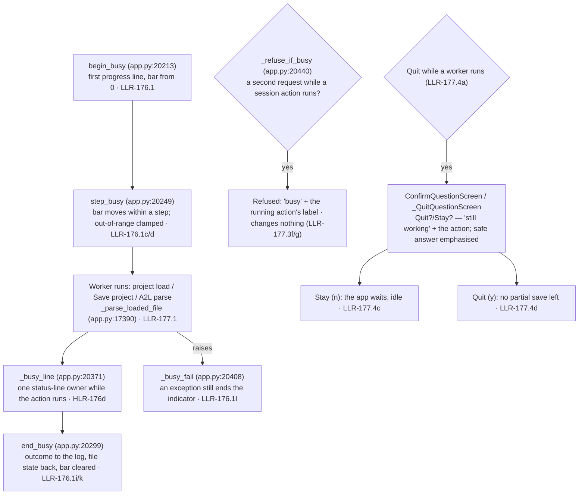

# Diagram — the busy model: begin → step → end/fail, busy refusal, quit question (flowchart)

> **Role:** `docs-writer`. Mermaid flowchart, 10 nodes. It shows the progress indicator's life, the busy refusal and the quit question (US-166, US-167; HLR-176/176a/176b/176c/176d, HLR-177/177a/177b/177c; LLR-176.1/176.2, LLR-177.3/177.4). Facts come from `03-increments/increment-021.md` and `increment-022.md` §1 and `01-requirements.md` §3/§4. Node names are the implementing functions on the current tree.

**Reading notes.**
- One timer advances the line (spinner, step and `mm:ss` elapsed) while an action runs and stops when none runs (LLR-176.1e/176.1f); progress widgets are written only on the main thread (LLR-176.1q).
- Only the seam sets the bar (LLR-176.2a); the action table names the seven long actions and each ends on every success and failure exit (LLR-176.2b/176.2c).
- The busy refusal covers a second load, a variant switch, an unload, a Save project and Patch Editor changes, and stops when the action ends (LLR-177.3a…177.3h).
- The quit question reuses the Inc 10 confirm modal (`ConfirmQuestionScreen`), with the safe answer carrying the emphasis (`PRIMARY_BUTTON`), and a confirmed quit leaves no partial save (LLR-177.4…177.4e).
- The project sync helpers (`_sync_loaded_file_to_project`, `_sync_loaded_a2l_to_project`) are guarded so an unreadable project folder during a sync paints one refusal line instead of failing the worker (SE5-12b-2, `fix-round-2.md`).
