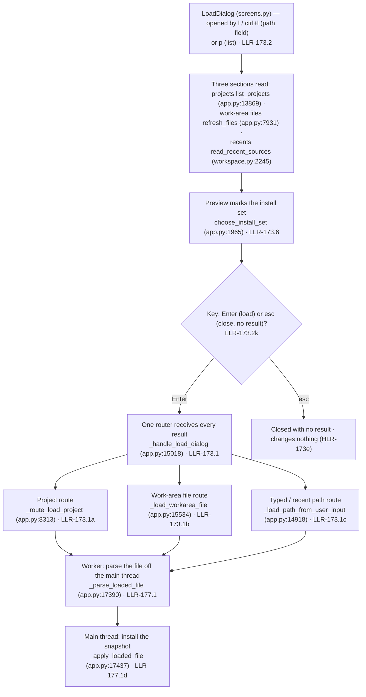

# Diagram — the Load dialog routes (flowchart)

> **Role:** `docs-writer`. Mermaid flowchart, 10 nodes. It shows the one Load dialog's sources and the routes a confirmed load takes to the worker and the main-thread install (US-163; HLR-173/173a/173b/173c/173e, LLR-173.1…173.6; US-162 / HLR-172/172a, LLR-172.4/172.5; US-167 / HLR-177, LLR-177.1). Facts come from `03-increments/increment-018.md` §1 and `01-requirements.md` §3/§4. Node names are the implementing functions on the current tree.

**Reading notes.**
- The three source sections are the project list (`list_projects`), the one work-area lister (`refresh_files`), and the recent-sources store read (`read_recent_sources`); the list order is projects, files, recents (LLR-173.4l). A folder that is not a project is not listed (LLR-173.4a).
- A project choice opens the project through the project route and shows the Load-result panel; a work-area choice loads the file as the list pick does; a path choice takes the typed-path route; a recent choice loads the recorded path unchanged (LLR-173.1a/173.1b/173.1c/173.1f).
- The preview's `●` marks equal the set `choose_install_set` installs (HLR-173a); the dialog itself reads nothing beyond that (LLR-173.6l).
- The worker (`_parse_loaded_file`) and the main-thread install (`_apply_loaded_file`) are the Inc 12b split: a worker reads only its request, the session is written only on the main thread (LLR-177.1d/177.1e).
