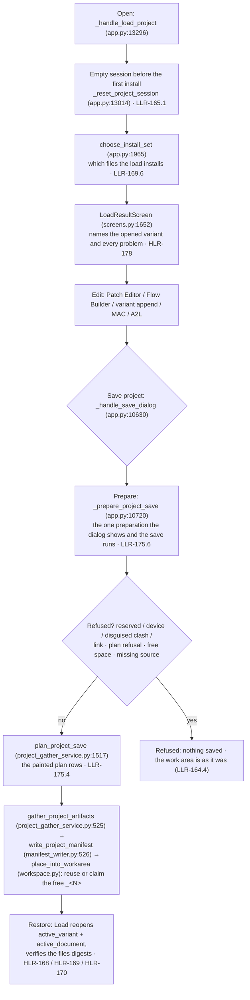

# Diagram — the project lifecycle: open → edit → Save project → manifest → restore (flowchart)

> **Role:** `docs-writer`. Mermaid flowchart, 12 nodes. It shows a project's round trip with the refusal paths (US-155, US-157, US-158, US-159, US-161, US-168; HLR-165/167/168/169/171/178; the refusal tokens of `01-requirements.md` §3). Facts come from `03-increments/increment-003/005/006/007/016.md` §1 and `01-requirements.md` §3/§4. Node names are the implementing functions on the current tree.

**Reading notes.**
- A project load runs `_reset_project_session` before the first install (LLR-165.1), so no A2L, MAC or change entry of the previous project leaks in (US-155, the PH-2 fix).
- Save project re-derives the change document onto a copy and emits only if that data differs from the source's; otherwise it copies byte-for-byte (LLR-167.1). The status names the entries the image carries (LLR-167.3).
- Every in-project writer rewrites the manifest carrying every key it does not own (LLR-168.3), and the save-back becomes `active_variant` (LLR-168.2), so Load reopens where the engineer stopped (US-158).
- The placement reuses a byte-identical file or claims the lowest free `_<N>` (LLR-163.1); repeated loads of an identical file no longer accumulate copies (US-153).
- The refusal names come from the §3 refusal-token table (reason token + next-step token); every refused or failed save leaves the work area as it was (LLR-164.4).
