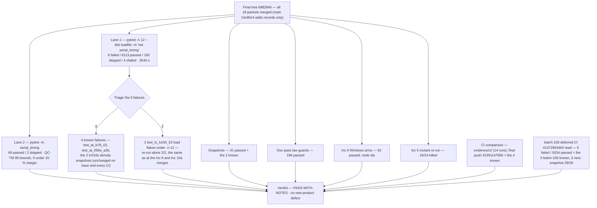

# Diagram — the batch-end gate battery and CI comparison (flowchart)

> **Role:** `docs-writer`. Mermaid flowchart. It shows the one complete gate run that closed batch-101 (the orchestrator's batch-end battery on the final tree `b982846`), its sibling batteries, and the CI comparison list across pushes. Facts come from `04-validation.md` (Verdict) and `evidence/close/`, `evidence/ci/`.

**Reading notes.**
- **One complete gate run.** The operator's 2026-11-06 order replaced the per-increment full suite with partial merge verification; the full suite ran once at batch end on `b982846` (the LAN Linux host), and it is the batch's ONE complete run.
- **The 6 failures split as 4 known + 2 flakes.** The 4 known are unchanged on base and on every CI push run; the 2 `test_tc_b100_53` flakes pass alone 2/2 on the same tree (same behaviour as the Inc 6 and Inc 10a merges). No new product defect.
- **Sibling batteries on the same tree.** Snapshots (`31 passed + 2 known`), the doc-pass law guards (`196 passed`), the Inc 6 Windows arms (`82 passed`, node ids — closes Inc 6 RA-4), and the Inc 5 mutant re-run (`24/24 killed` — closes Inc 5 RA-1).
- **CI comparison.** Every push run's FAILED set is the same 4 known failures; one transient redaction-gate failure (CI run `42326527453`) was fixed in `09b4808` and green again in `42335545221`. The final push run is `42391147566`.
- **The batch-100 deferral is closed.** The deferred post-close CI `41372953464` on `f72eef1` was read in: 5 failed / 5034 passed = the 5 batch-100 known failures, 0 new; snapshot job `success` 29/29.
