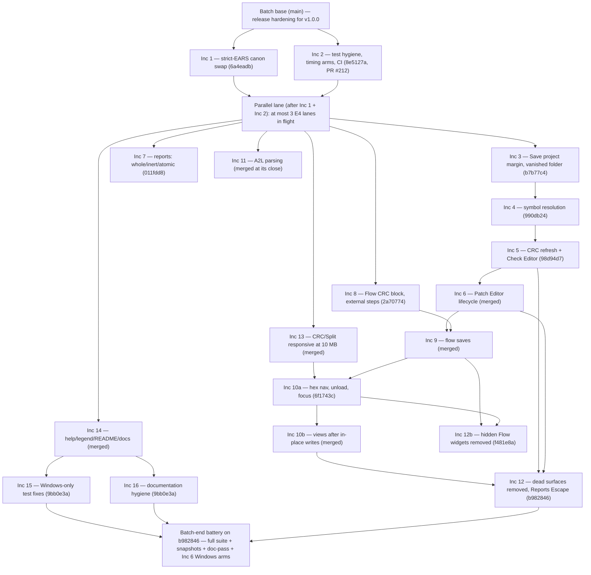

# Diagram — the increment dependency and merge order (flowchart)

> **Role:** `docs-writer`. Mermaid flowchart. It shows the 16 increments (18 packets with the 10 and 12 split into a/b), their dependency graph from `PLAN.md` §Roadmap, and the merge order recorded in `evidence/merge/`. The serial `app.py` chain is 3 → 4 → 5 → 6 → 9 → 10a → 10b → 12; Inc 1 ∥ Inc 2 open the batch, and Inc 3 ∥ 7 ∥ 8 ∥ 11 ∥ 13 ∥ 14 run in parallel after them. Inc 12b splits from Inc 12 and merges before the final full suite; Inc 15 ∥ Inc 16 merge together. Facts come from `PLAN.md` §Roadmap + §Order and `05-close.md` §3 (the merge SHAs).

**Reading notes.**
- **Parallel first.** Inc 1 (canon swap, delivered by the requirements re-write session) and Inc 2 (test hygiene) open the batch and merge first.
- **Parallel middle.** Inc 3 ∥ 7 ∥ 8 ∥ 11 ∥ 13 ∥ 14 run after Inc 1 + Inc 2, at most three E4 lanes in flight.
- **Serial `app.py` chain.** 3 → 4 → 5 → 6 → 9 → 10a → 10b → 12, one writer at a time; Inc 9 also depends on Inc 8, and Inc 10a on Inc 13.
- **The two splits.** Inc 12b (the Flow half of F-35) split from Inc 12 at E3 and merged earlier (`f481e8a`); Inc 10b split from Inc 10 at E3 and merges between 10a and 12.
- **The tail (the brief's merge order).** After Inc 9, Inc 12b and Inc 10a merge, then Inc 10b, then Inc 12 — which is the final increment and the batch-end full suite on `b982846`.
- **Inc 15 ∥ Inc 16** merge together (`9bb0e3a`), both after Inc 14; Inc 16 is documentation-only plus comment-only source fixes.
- **Merge evidence.** `evidence/merge/lan-merge-inc3.txt` … `lan-merge-inc15-inc16.txt`; the full suite runs once at batch end (`evidence/close/full-suite-final.txt`).
