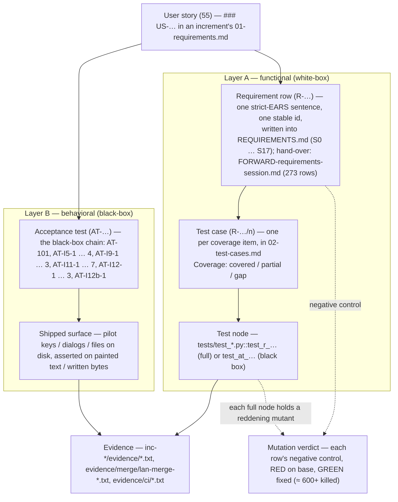

# Diagram — the requirement-to-test trace overview (flowchart)

> **Role:** `docs-writer`. Mermaid flowchart. It shows the two validation layers over the batch's canon-hosted requirement rows: the functional (white-box) chain US → `R-…` row → test case (`R-…/n`) → test node, and the behavioral (black-box) chain US → `AT-…` → observed outcome through the shipped surface. Batch-101's rows live in `REQUIREMENTS.md` (id form `R-…`), not in the batch-level contract; the hand-over is `close/FORWARD-requirements-session.md` (273 rows). Facts come from `01-requirements.md` (the user-story index), each `inc-<n>/01-requirements.md` + `02-test-cases.md`, and `04-validation.md`.

**Reading notes.**
- **One id space.** Batch-101's requirement rows are the canon ids `R-…`; the batch-level `01-requirements.md` carries only `HLR-001` / `LLR-001.1` plus the user-story index, so the chain reads off the increment records, not the batch contract.
- **273 rows.** `close/FORWARD-requirements-session.md` holds 234 new + 29 changed + 8 withdrawn + 2 brought in; the 8 withdrawn rows leave the canon, the other 265 are live.
- **Every row has a node.** Each increment closed with 0 blocker / 0 high open; per-row `Result: pass` in each `inc-*/04-validation.md`; the batch-level roll-up is `04-validation.md` Layer 0.
- **Two chains, both complete.** A story is complete only when both the functional chain (US → `R-…` → case → node) and the behavioral chain (US → `AT-…` → observed surface) exist; the matrix's §1 / §1b show both for all 55 stories.
- **The gate.** The batch-end battery on `b982846` (`evidence/close/full-suite-final.txt`): lane 1 `6 failed / 6113 passed / 182 skipped / 4 xfailed`, lane 2 `69 passed / 2 skipped` with `QC-TM 95 bounds, 0 under 20 % margin`; the 6 are 4 known + 2 load flakes — no new product defect.
