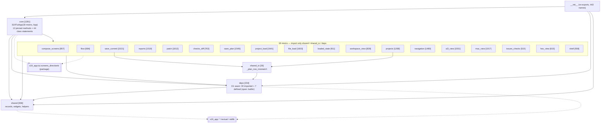
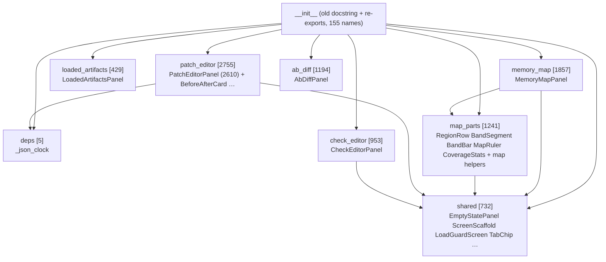

# batch-modular — E2 module graph and owners

Base `4f721985`. Source of every number: `design/module-map.json` (generated by
`tools/modularize/plan_map.py`). Rules: `design/interfaces.md`.

## Deviation: no Code-Wire function graph in this batch

The skill's E2 prototype is a Code-Wire graph of function contracts and examples. This batch
changes **no function contract**: every function, method and class moves with an AST-identical
body (R-MOD.2.x); the only edits are the closed rewrite list (interfaces I-6). A contract graph
would restate the unchanged contracts of 374 methods and every function of both modules, and could not show a defect the identity verifier
does not already catch mechanically. The design artefact that can be wrong here is the
**module structure** — where each unit lands and which module may import which — so E2 pins
that: the module map, this import graph, the seam (`deps`) and the core pins. Recorded as a
ruling (01-requirements.md, ruling RU-3).

## `s19_app.tui.app` — import graph (package-internal, module level)

Body lines in brackets (moved lines only; generated imports add ~30–150 per file).

Per-mixin edges (from `module-map.json` `app.graph`): `checks_diff`, `flow`, `hex_view`,
`issues_checks`, `workspace_view` → `deps` only; `loaded_state` → `shared` only;
`projects`, `save_commit` → `deps`, `shared`, `shared_io`; every other mixin → `deps`, `shared`.
No mixin imports another mixin; `core` is the only module that names the mixins.

## `s19_app.tui.screens_directionb` — import graph

`loaded_artifacts` and `ab_diff` import nothing from the package beyond outside modules.
The sdb package never imports the app package (as at base).

## Owners for the later parallel phases

Rule: one worker per module; a worker edits only its module and the tests whose
source-reading assertions point at it. Interface modules (`__init__`, `core`, `deps`, `shared`,
`shared_io`, sdb `__init__`/`shared`/`deps`) belong to the integrator: a worker that needs a
change there proposes it in `interfaces.md` and the integrator applies it (skill E2 rule).
Waves keep ≤ 6 workers at once and balance lines.

| Module | Body lines | Methods / units | Owner | Wave |
|---|---|---|---|---|
| app `core` | 1281 | 12 methods + 44 class statements + `main` | integrator | — |
| app `deps` | 234 | 7 defs + seam imports | integrator | — |
| app `shared` | 936 | 43 defs | integrator | — |
| app `shared_io` | 26 | 1 def | integrator | — |
| app `__init__` | generated | — | integrator (regenerated, never hand-edited) | — |
| app `patch` | 1812 | 30 | W-patch | 1 |
| app `project_load` | 1641 | 18 | W-project_load | 1 |
| app `file_load` | 1603 | 25 | W-file_load | 1 |
| app `a2l_view` | 1551 | 34 | W-a2l_view | 1 |
| app `save_plan` | 1545 | 13 | W-save_plan | 1 |
| app `save_commit` | 1521 | 11 | W-save_commit | 1 |
| app `reports` | 1519 | 26 | W-reports | 2 |
| app `navigation` | 1480 | 42 | W-navigation | 2 |
| app `projects` | 1268 | 24 | W-projects | 2 |
| app `mac_view` | 1017 | 20 | W-mac_view | 2 |
| app `loaded_state` | 911 | 9 | W-loaded_state | 2 |
| app `compose_screens` | 857 | 15 | W-compose_screens | 2 |
| app `workspace_view` | 828 | 10 | W-workspace_view | 3 |
| app `checks_diff` | 763 | 14 | W-checks_diff | 3 |
| app `shell` | 558 | 20 | W-shell | 3 |
| app `flow` | 684 | 20 | W-flow | 3 |
| app `hex_view` | 615 | 18 | W-hex_view | 3 |
| app `issues_checks` | 515 | 13 | W-issues_checks | 3 |
| sdb `patch_editor` | 2755 | PatchEditorPanel (57 methods) + 8 defs | W-patch_editor | 4 |
| sdb `memory_map` | 1857 | MemoryMapPanel (31 methods) | W-memory_map | 4 |
| sdb `map_parts` | 1241 | 4 widgets + 30 defs | W-map_parts | 4 |
| sdb `ab_diff` | 1194 | AbDiffPanel (29 methods) | W-ab_diff | 4 |
| sdb `check_editor` | 953 | CheckEditorPanel (38 methods) | W-check_editor | 4 |
| sdb `loaded_artifacts` | 429 | LoadedArtifactsPanel (9 methods) | W-loaded_artifacts | 4 |
| sdb `shared`, `deps`, `__init__` | 737 | — | integrator | — |

For THIS batch (the mechanical move) there is no per-module owner: the move is one
deterministic script run; the owners above apply from the ≤300-line / ≤40-line pass on.
The four source-reading test groups of `design/hazards.md` H-12 are this batch's only
parallel hand work.
