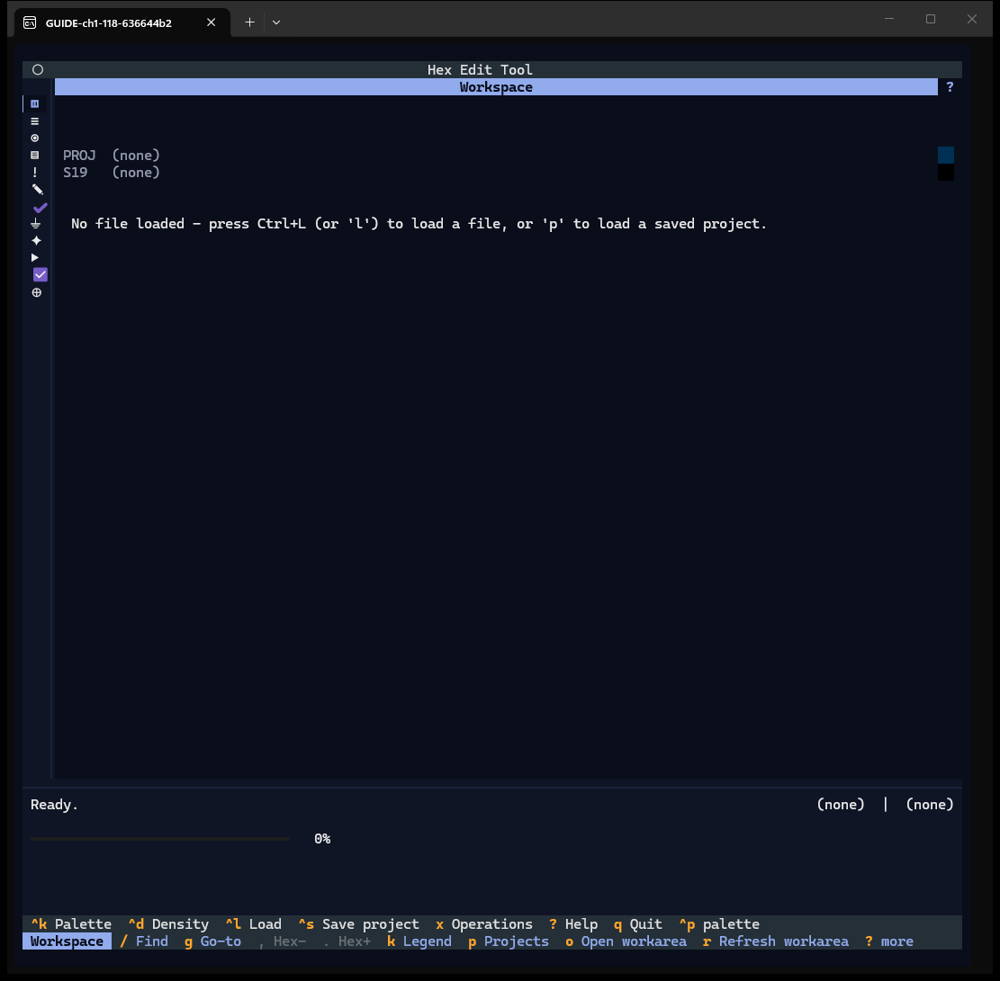
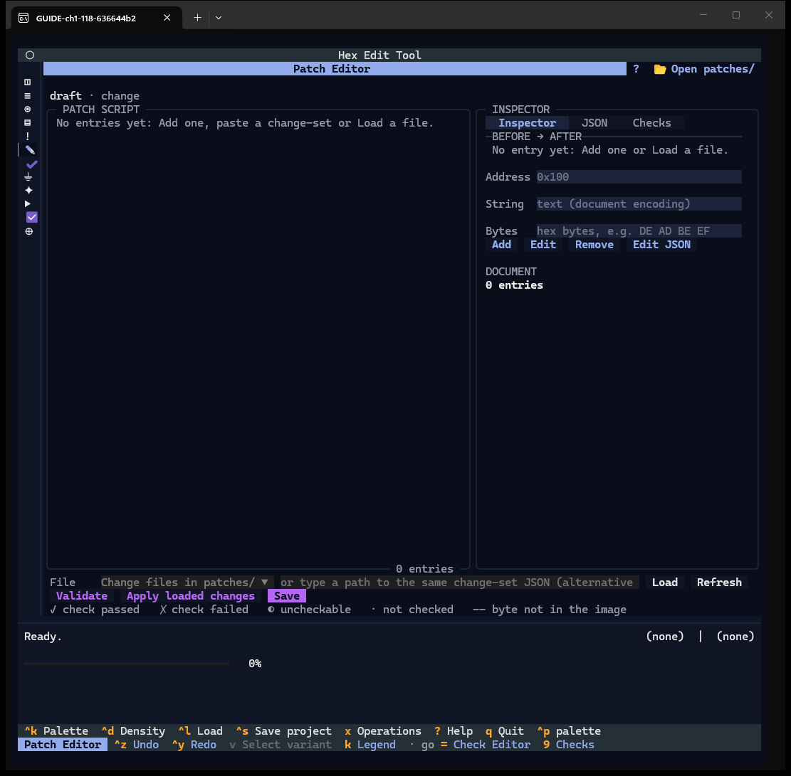
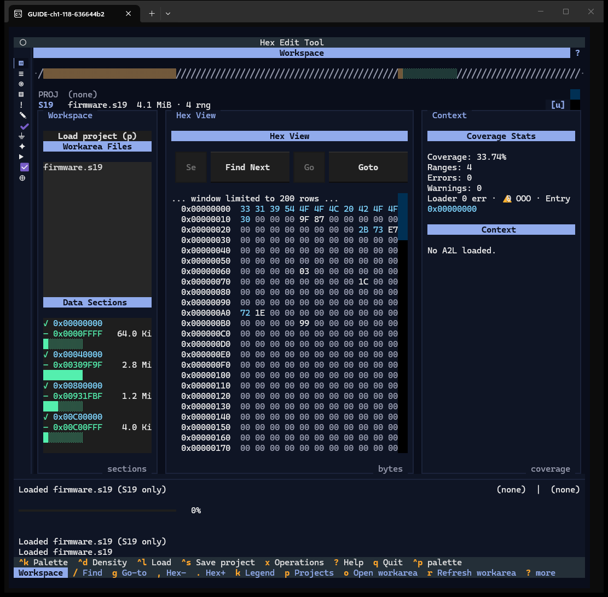

# Chapter 1 — Start the app and find your way

**Window:** the app shell (W00): header, activity rail, window body, status bar, key bar.
**How to get there:** run `s19tui` (or `s19tui --load <file>` to load a file at start).
**Demo input:** `firmware.s19` from the synthetic case (`examples/case_08_release_demo/`).

## What the shell is for

Every window of s19tui sits inside the same frame. The **rail** on the left switches
windows; the **status bar** at the bottom reports what the last action did; the
**key bar** under it lists the keys you can press right now. You never lose these
three, whatever window is open.

## Step by step

### 1.1 The first screen

Run `s19tui`. Nothing is loaded yet, so the Workspace shows one line:
*No file loaded - press Ctrl+L (or 'l') to load a file, or 'p' to load a saved project.*

- **Header** — the app title "Hex Edit Tool" and the window title bar ("Workspace"),
  with a `?` at the right end that opens this window's help (Chapter 19).
- **Rail** — twelve glyphs, one per window. At 118 columns the rail shows glyphs
  only; on a wider terminal it shows names too (see the 220-column capture in
  Chapter 6).
- **Status bar** — the status line ("Ready."), the context at the right
  (`project | A2L`, both "(none)" now), a progress bar, and the last four log lines.
- **Key bar** — row 1 holds the keys that work everywhere: `^k` Palette, `^d`
  Density, `^l` Load, `^s` Save project, `x` Operations, `?` Help, `q` Quit, `^p`
  Textual's palette. Row 2 starts with the window's name and lists that window's
  own keys. Dimmed keys (`,` Hex-, `.` Hex+) do nothing until an image is loaded.
  Every key in the bar can also be clicked.

### 1.2 Switching windows

Press a rail key or click a rail glyph. The rail keys are:

| Key | Window | Key | Window |
|---|---|---|---|
| `1` | Workspace | `7` | A2B Diff |
| `2` | A2L Explorer | `8` | Flow Builder |
| `3` | MAC View | `]` | Flow Execution |
| `4` | Memory Map | `9` | Checks |
| `5` | Issues Report | `0` | CRC Designer |
| `6` | Patch Editor | `=` | Check Editor |

The capture shows `6`: the Patch Editor, empty. Row 2 of the key bar now lists the
Patch Editor's keys (`^z` Undo, `^y` Redo, `v` Select variant, `k` Legend) and the
"go" keys to its neighbours (`=` Check Editor, `9` Checks).

One more window, **Split / Join / Export**, has no rail key; it opens from the
command palette (Chapter 14).

### 1.3 After the first load

Back on the Workspace (`1`), load `firmware.s19` (Chapter 2 shows the Load dialog).
The status line reads *Loaded firmware.s19 (S19 only)*, the log tail keeps the last
four messages, and the Workspace panes fill in (Chapter 3).

Starting with `s19tui --load firmware.s19` gives the same screen without opening the
Load dialog.

## Features of this window shown in this chapter

| Feature | How | Capture |
|---|---|---|
| Empty-state prompt | start with nothing loaded | 1.1 |
| Header, rail, status bar, key bar | always visible | 1.1 |
| Rail keys and rail clicks | `1`–`0`, `=`, `]` | 1.2 |
| Window keys in key bar row 2 | change with the window | 1.2 |
| Startup load | `s19tui --load <file>` | 1.3 |

Palettes, help, density and Viewer settings are in Chapter 19; Quit in Chapter 20.
