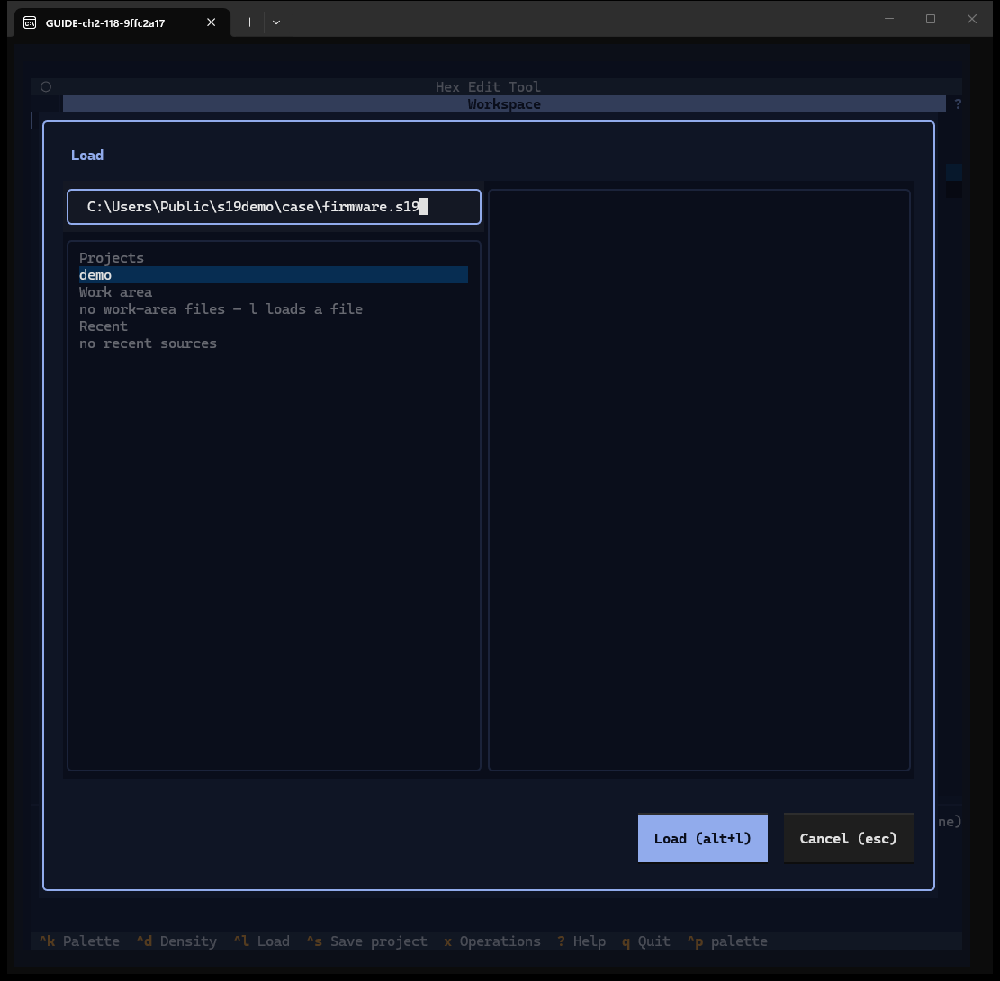
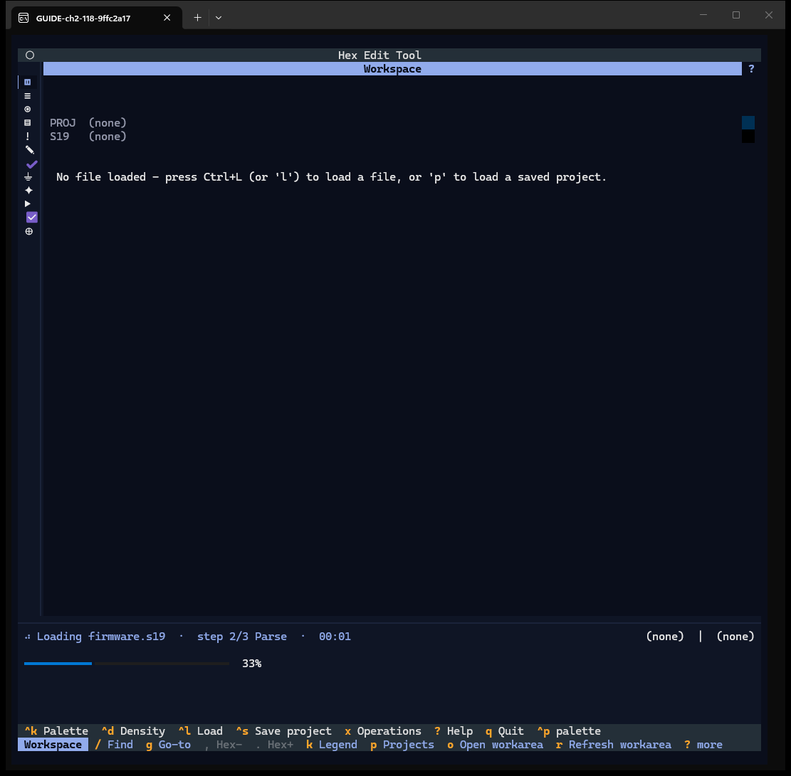
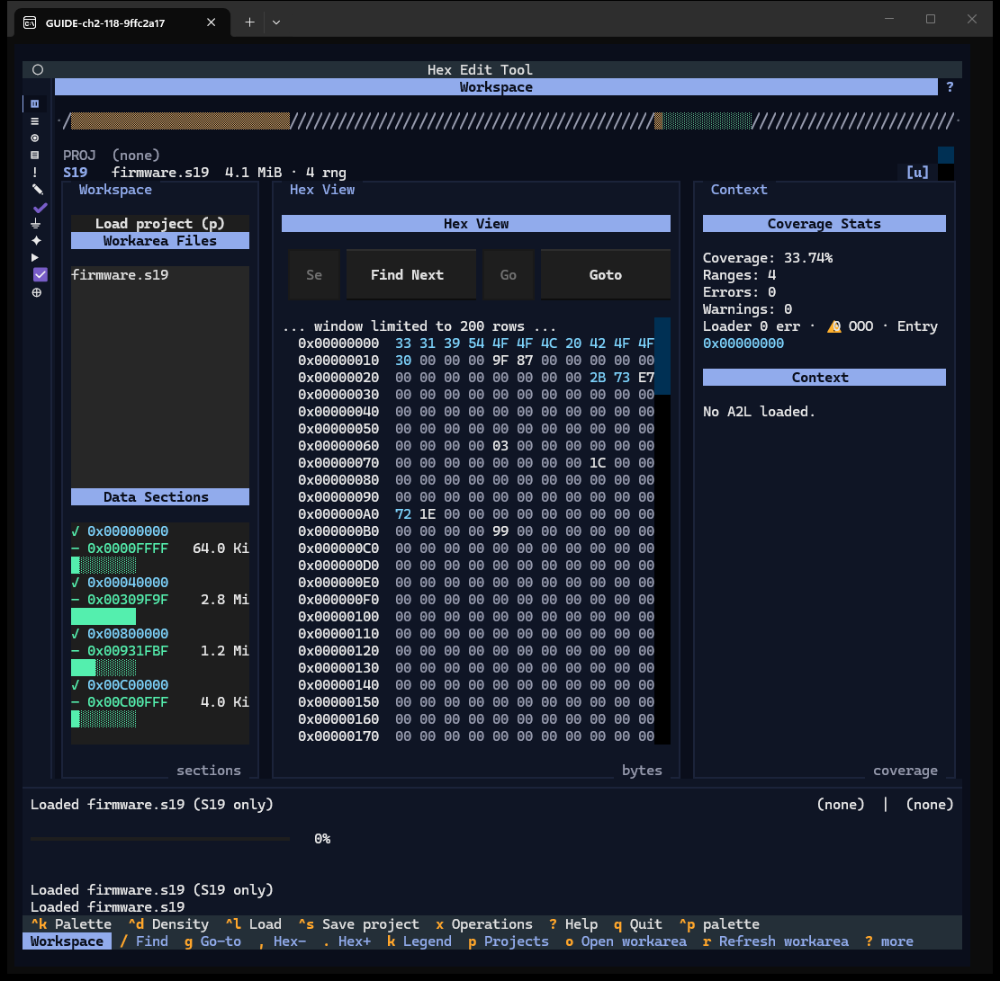
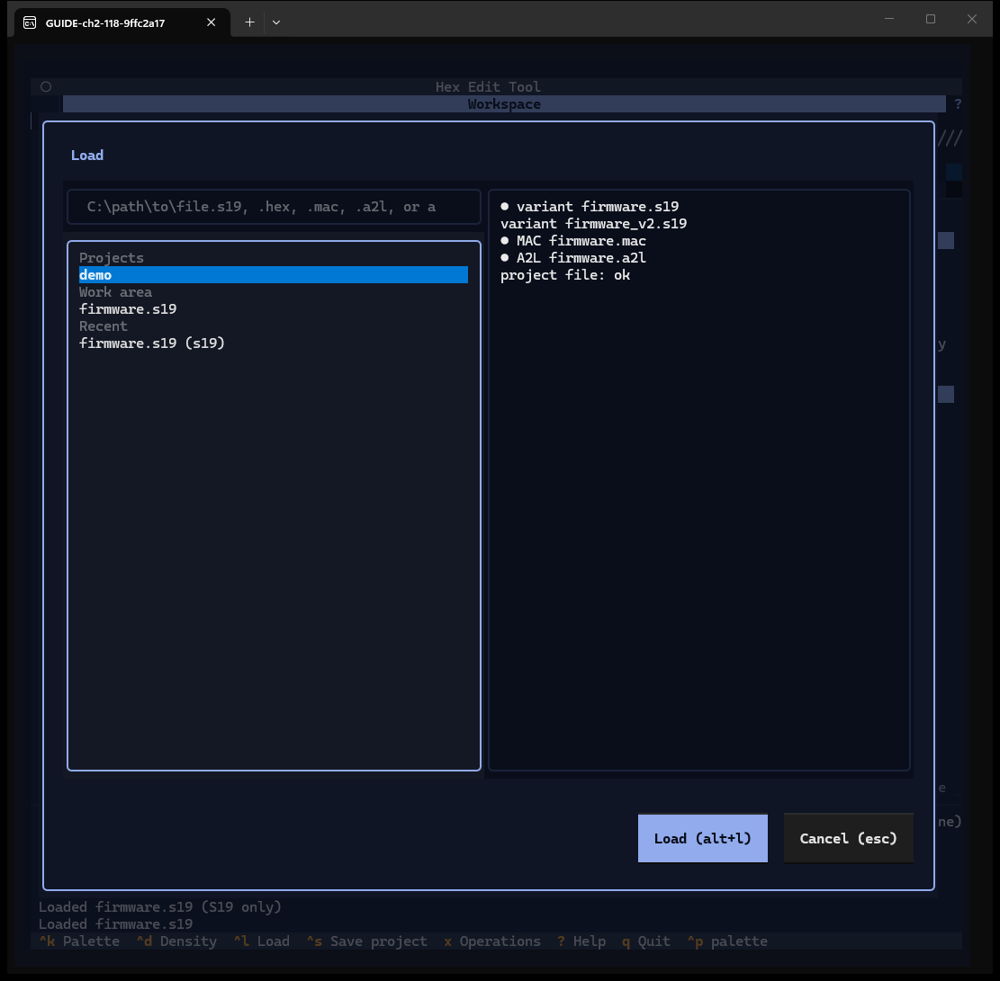
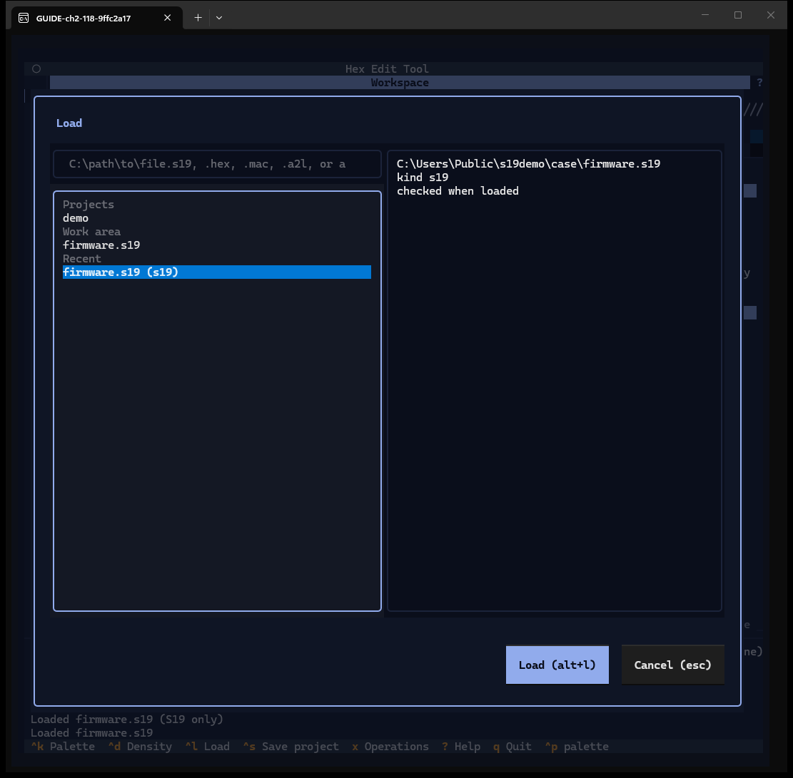
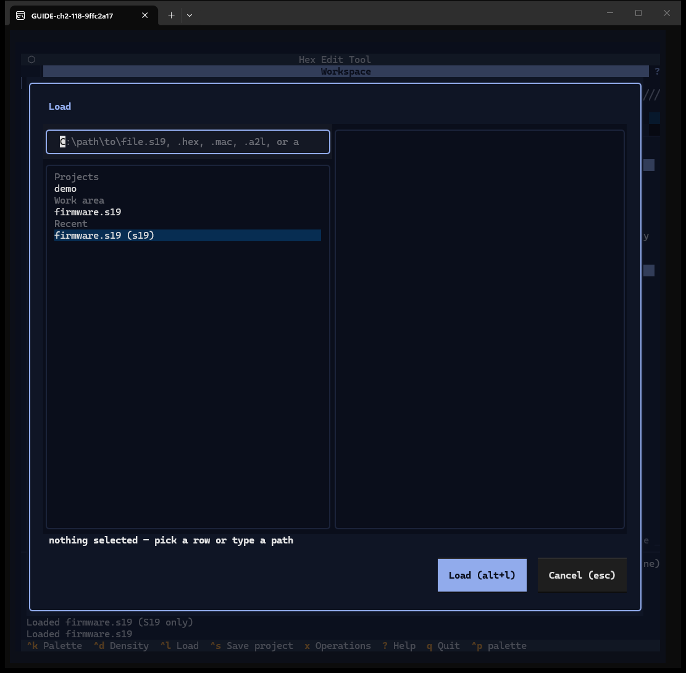
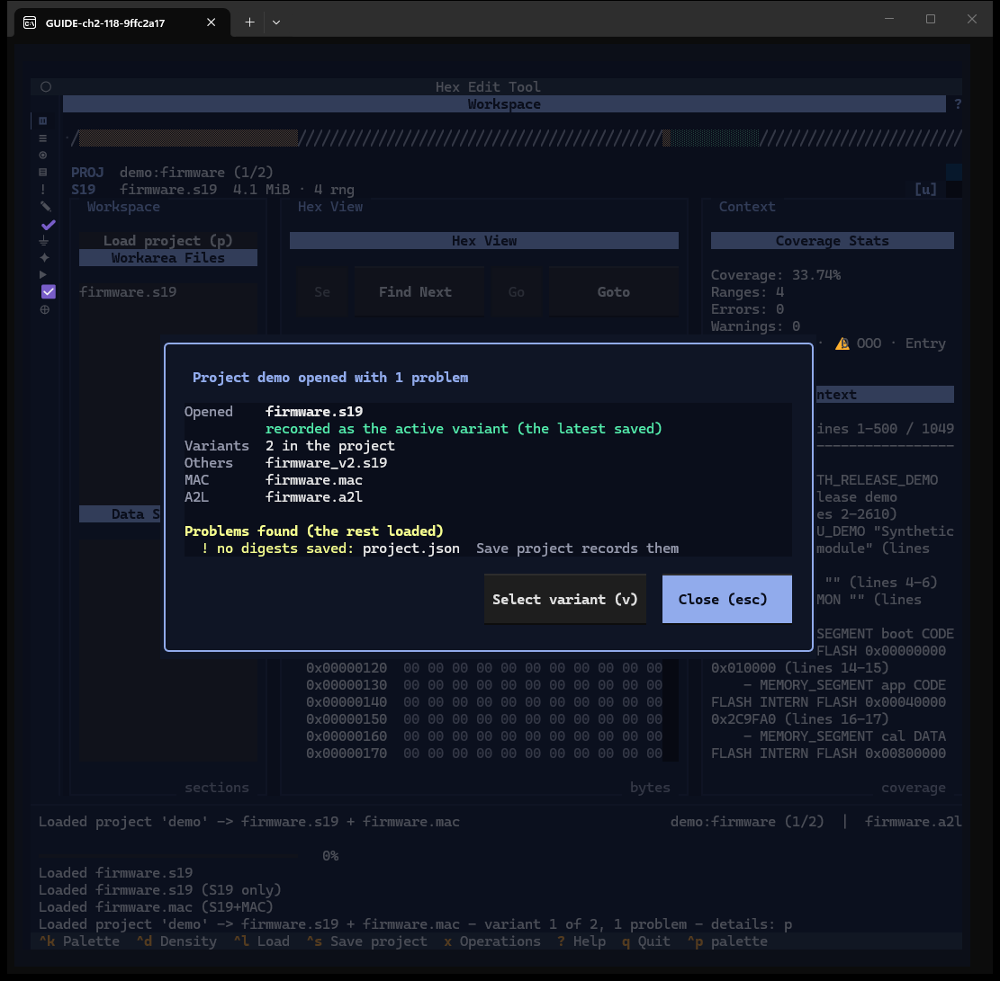
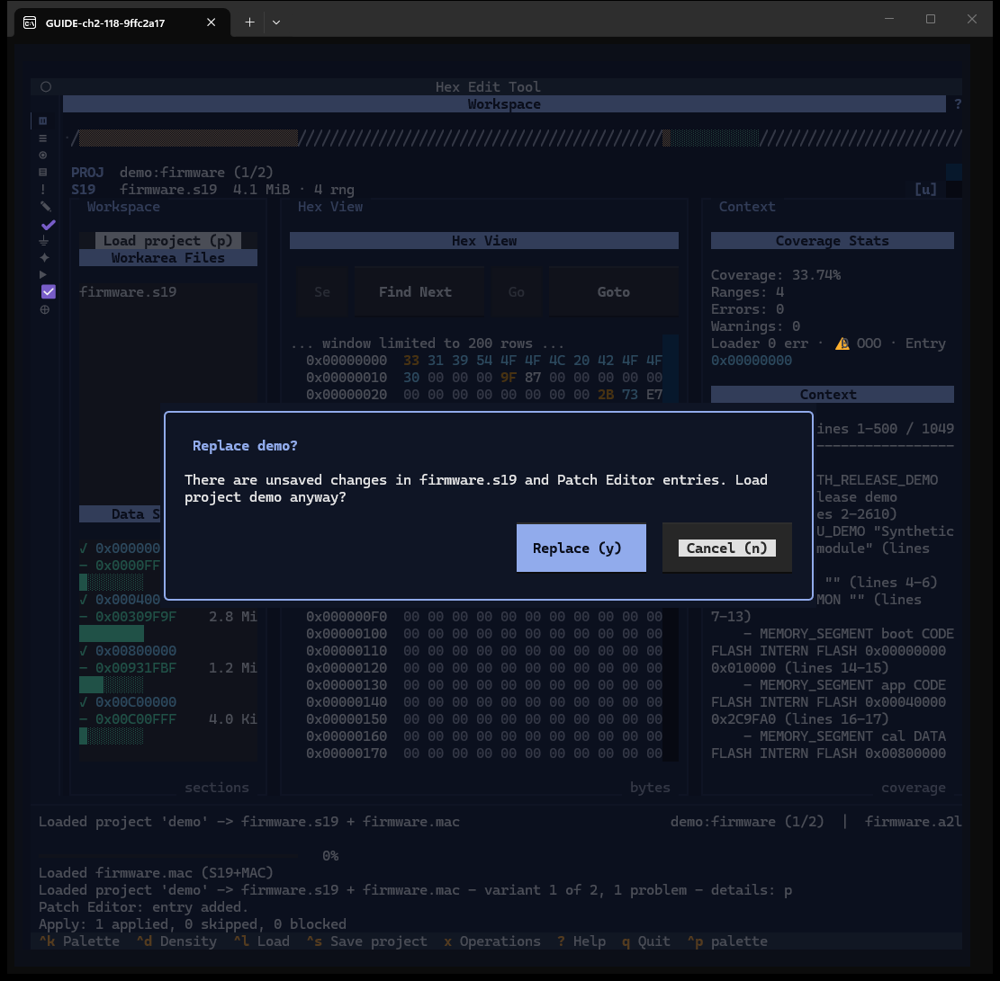
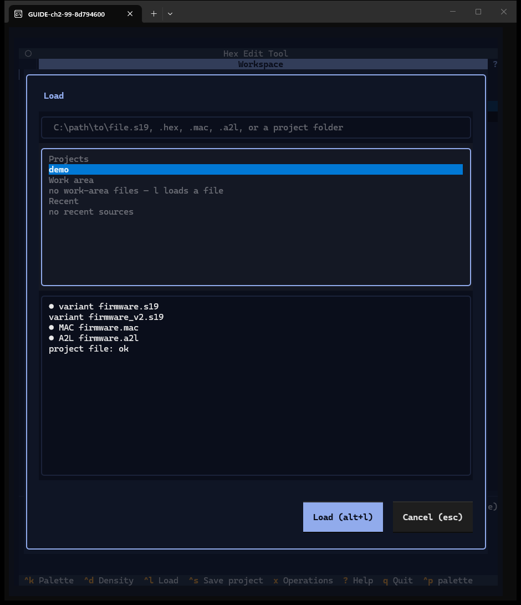

# Chapter 2 — Load files and projects

**Windows:** Load dialog (W01), Load result panel (W02), Replace question (W03).
**How to get there:** `^l` or `l` opens the Load dialog with the path field focused;
`p` (or the Workspace button "Load project (p)") opens it with the list focused.
**Demo inputs:** `firmware.s19` typed as a path; project `demo` in the work area
(holds `firmware.s19`, `firmware_v2.s19`, `firmware.a2l`, `firmware.mac`).

> The demo project was assembled for the guide by copying the four case files
> into a project folder with a minimal `project.json`; that is why its load
> result reports "no digests saved". Saving it once with `^s` (Chapter 15)
> records the digests.

## What the Load dialog is for

One dialog loads everything: an S19 or HEX image, an A2L, a MAC file, or a whole
project folder. You either type a path or pick a row from three lists — saved
**projects**, files already in the **work area**, and **recent** sources.

## Step by step

### 2.1 Type a path

Press `^l`. The cursor is in the path field. Type the file path and press Enter (or
`alt+l`, or click **Load (alt+l)**). The dialog accepts `.s19`, `.hex`, `.mac`,
`.a2l` or a project folder.

### 2.2 Watch the load

Loading copies the file into the work area and parses it in the background. The
status line shows the action, the step (`step 2/3 Parse`) and the elapsed time; the
progress bar moves. The 10 MB demo image takes about 15 seconds. While it runs, a
second load or save is refused.

### 2.3 Loaded

The status line reads *Loaded firmware.s19 (S19 only)*. The file now also appears
under **Workarea Files**.

### 2.4 Pick from the lists

Press `p`. The list has three sections:

- **Projects** — folders in the work area (`demo`).
- **Work area** — files already copied into the work area (`firmware.s19`).
- **Recent** — files you loaded before, with their kind (`firmware.s19 (s19)`).

The right pane previews the highlighted row. For a project it lists the variants,
the MAC and the A2L, and marks with `●` what a load would open (here
`firmware.s19`, `firmware.mac`, `firmware.a2l`). If you start typing while the
list has focus, the text goes into the path field.

### 2.5 Recent sources

A recent row previews the full recorded path, its kind, and "checked when loaded":
the file is checked again only when you load it.

### 2.6 Nothing selected

Enter on an empty path field writes *nothing selected — pick a row or type a path*
under the panes. The dialog stays open; `esc` or **Cancel (esc)** closes it.

### 2.7 Load a project: the result panel

Pick `demo` and press Enter. When the project has loaded, the **result panel**
lists what was opened (the active variant, how many variants, the other variants,
the MAC, the A2L) and any problems. **Select variant (v)** opens the variant
selector (Chapter 15); **Close (esc)** returns to the window. The context at the
right of the status bar now reads `demo:firmware (1/2) | firmware.a2l`.

### 2.8 Loading over unsaved work

If a load would replace unsaved work — a patched image, unsaved Patch Editor
entries or an unsaved flow — the app asks first. Here one entry was added and
applied in the Patch Editor, then `demo` was loaded again. **Replace (y)** loads
and drops the unsaved work; **Cancel (n)** (default) keeps it.

### 2.9 Narrow terminals

Below 100 columns the list and the preview stack vertically (capture at 99×54).

## Features of these windows

| Feature | How | Capture |
|---|---|---|
| Path field | `^l`, type, Enter | 2.1 |
| Background load with step and time | — | 2.2 |
| Projects / Work area / Recent sections | `p`, arrows | 2.4, 2.5 |
| Preview pane with `●` marks | highlight a row | 2.4, 2.5 |
| Typing from the list goes to the path | type | 2.4 (text) |
| Load (`enter`, `alt+l`, button) / Cancel (`esc`) | — | 2.1, 2.6 |
| Reason line, dialog stays open | — | 2.6 |
| Project result panel, Select variant (v), Close (esc) | — | 2.7 |
| Replace question, Replace (y) / Cancel (n) | — | 2.8 |
| Stacked layout under 100 columns | resize | 2.9 |
