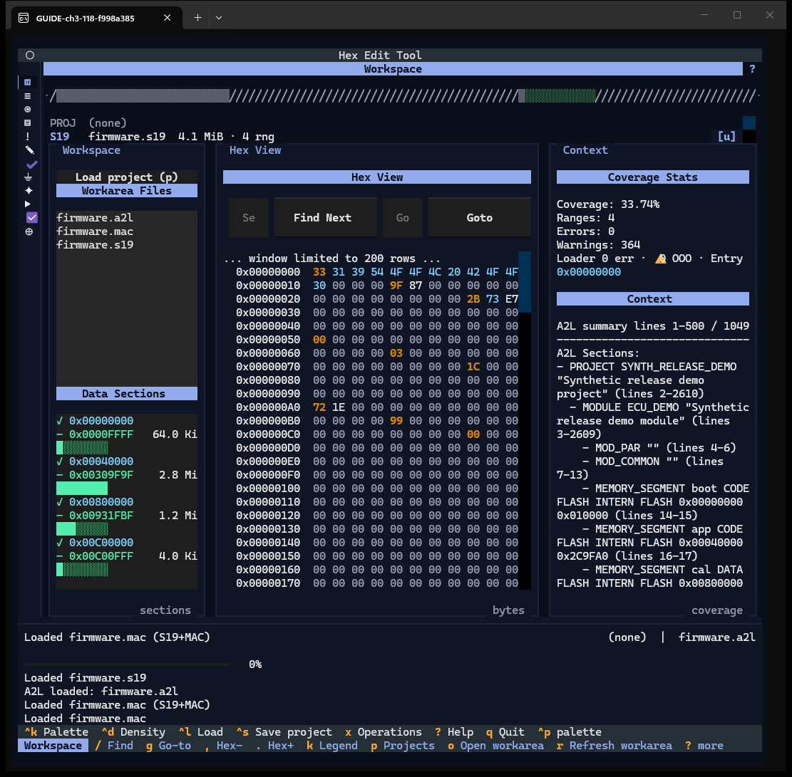
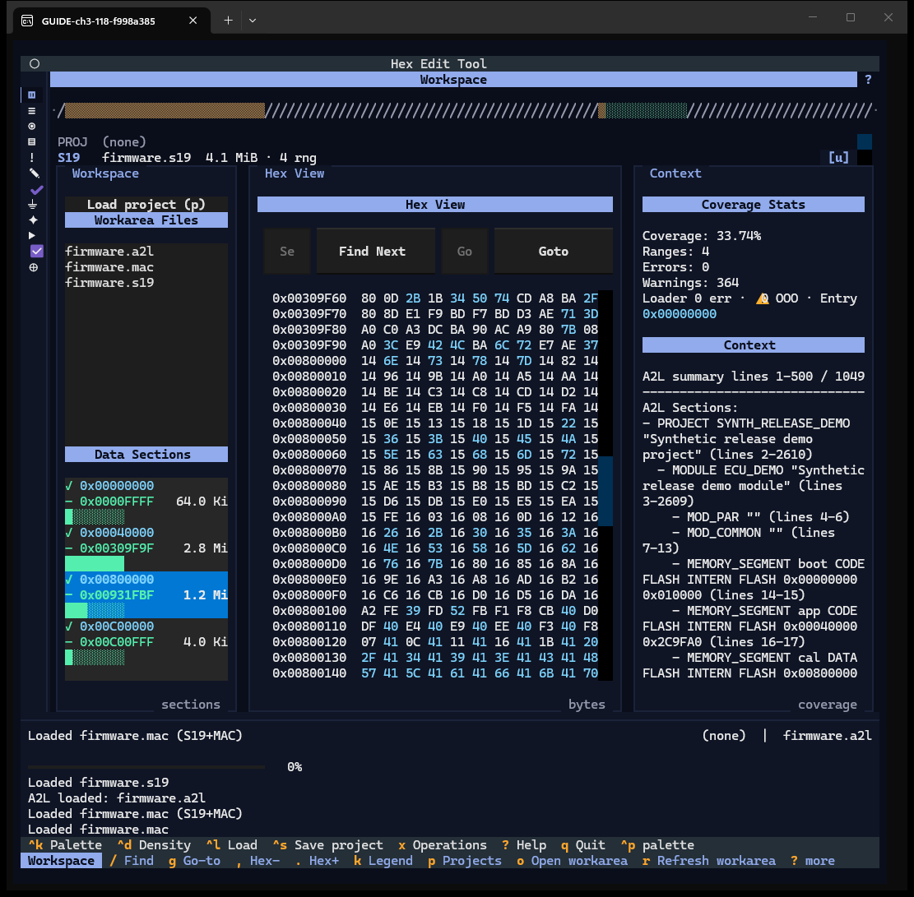
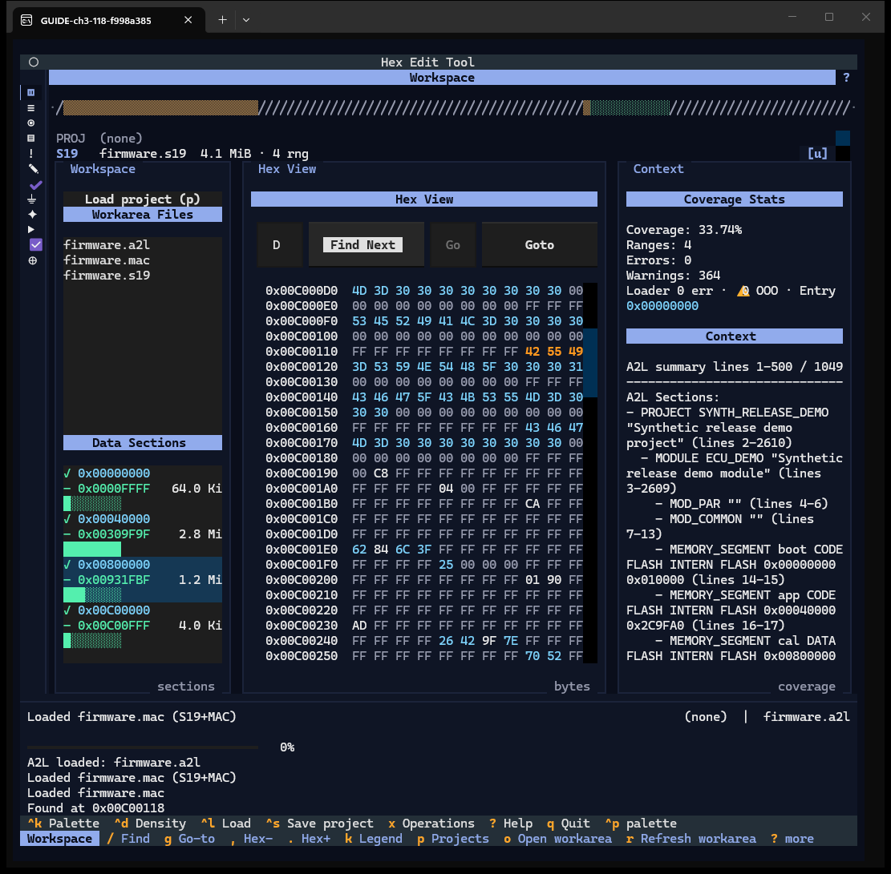
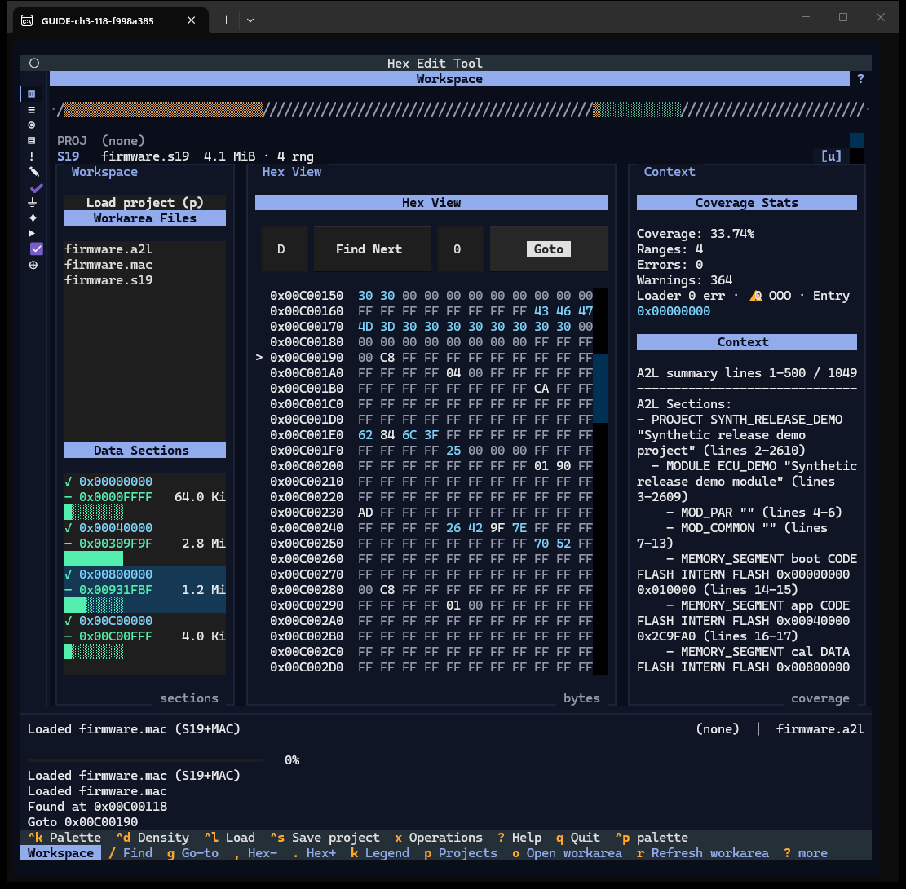
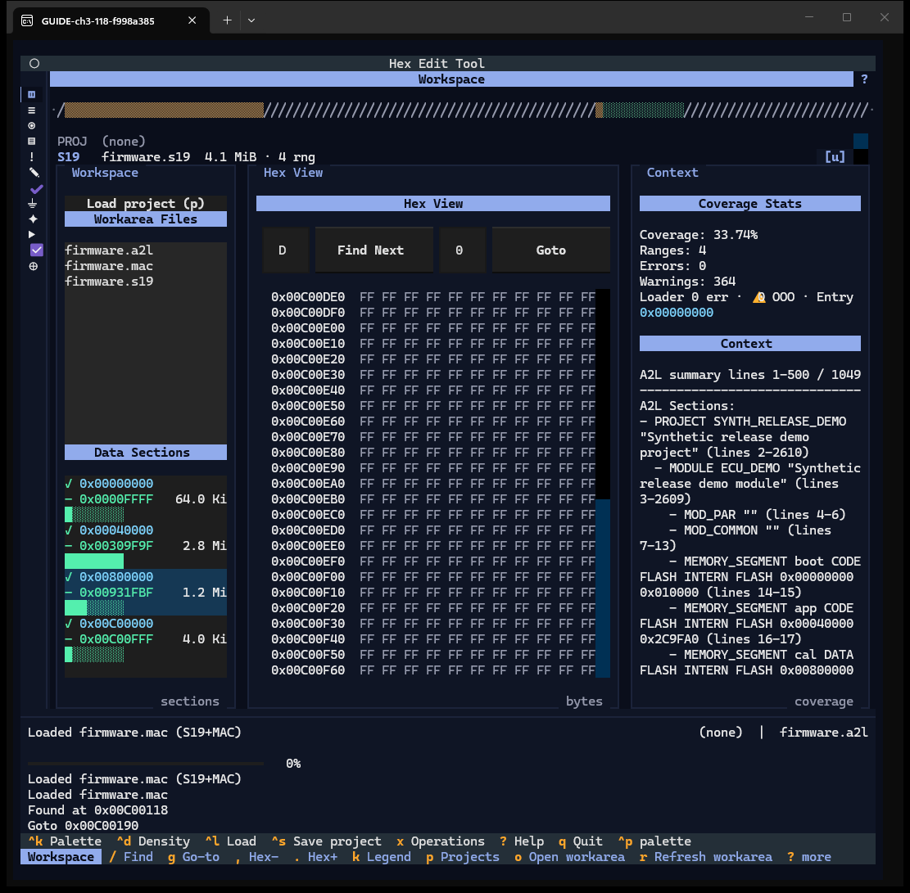
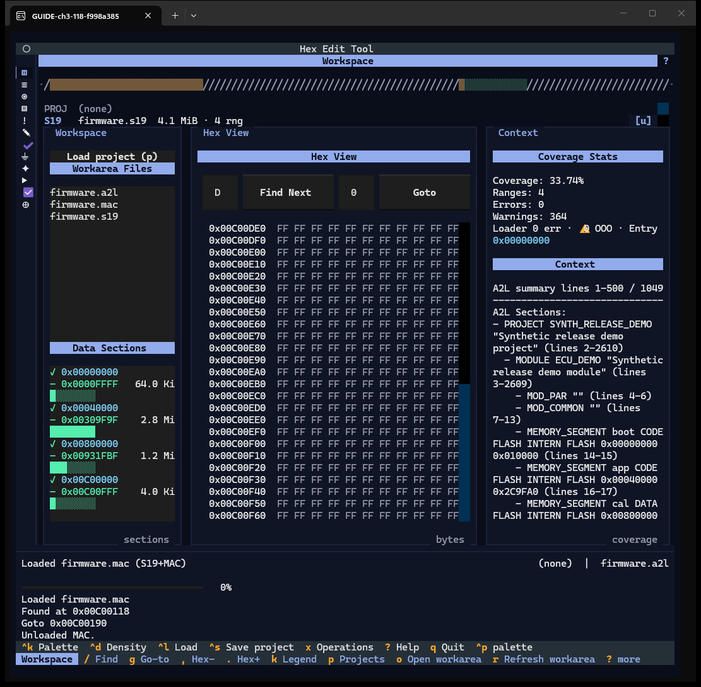
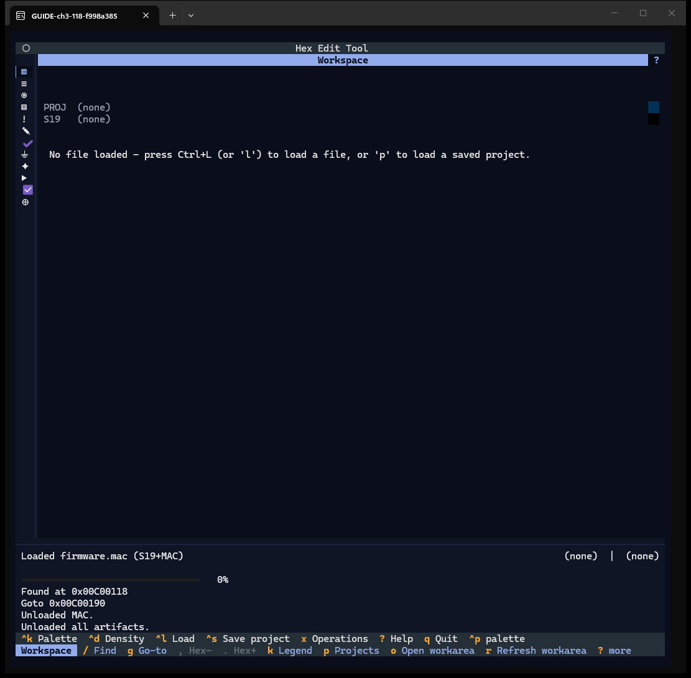

# Chapter 3 — Workspace

**Window:** Workspace (W04). **How to get there:** `1`, or the first rail glyph. It is
the window the app starts on.
**Demo inputs:** `firmware.s19`, `firmware.a2l`, `firmware.mac`, loaded one after the
other with `^l`.

## What the Workspace is for

The Workspace is the overview of what is loaded: which files, which memory ranges
the image covers, the raw bytes, and a summary of the A2L. From here you jump into
the hex bytes by section, by text search or by address.

## Step by step

### 3.1 The three panes

- **Memory strip** (top row) — the whole image in one line; `/` marks gaps.
- **Loaded panel** — `PROJ` and `S19` lines with the file name, its size and range
  count, and an `[u]` button that unloads that file. (At 118×54 only these two
  lines are visible; the MAC and A2L slots are clipped — finding F-12.)
- **Left pane** — **Load project (p)**, **Workarea Files** (pick one to load it),
  and **Data Sections**, one block per contiguous range with its size bar.
- **Centre pane** — the hex view, with *Search ASCII text* + **Find Next** and
  *Goto 0xADDR* + **Goto** above it.
- **Right pane** — **Coverage Stats** (coverage %, ranges, errors, warnings, loader
  notes) and **Context**, the A2L summary (project, module, memory segments …).

### 3.2 Jump to a section

Move to a block in **Data Sections** and press Enter (or click it). The hex view
loads a window around that range. Here the calibration section at `0x00800000` was
picked; the hex pane was then scrolled with the mouse wheel to show its first row,
because the jump does not scroll the pane to the target row (finding F-07).

### 3.3 Search for text

Press `/` to focus the search field, type `BUILD_ID`, then Tab and Enter (or click
**Find Next**). The status log reports *Found at 0x00C00118* and the match is
highlighted in orange. Press **Find Next** again for the next match. The search
field is only a few characters wide at 118 columns (finding F-08).

### 3.4 Go to an address

Press `g`, type `0x00C00190`, Tab, Enter (or **Goto**). The target row gets a `>`
marker. `esc` releases the search or go-to field.

### 3.5 Page the hex view

`.` shows the next window of rows, `,` the previous one (the key bar shows them as
`Hex+` / `Hex-`).

### 3.6 Unload one file

`[u]` beside a slot unloads that file. Here the MAC was unloaded: the log says
*Unloaded MAC.* (The status line above still reads the earlier load message —
finding F-13.)

### 3.7 Unload everything

`U` (or `[U]` in the Loaded panel) unloads image, A2L and MAC at once; the window
returns to the empty state.

### Not captured, on purpose

- `o` opens the work-area folder in the file manager, a window outside the terminal.
- `r` re-reads the Workarea Files list.
- `k` opens the legend; on the Workspace it shows only the example card.

## Features of this window

| Feature | How | Capture |
|---|---|---|
| Memory strip | — | 3.1 |
| Loaded panel, `[u]` per file, `[U]` / `U` all | click / `U` | 3.1, 3.6, 3.7 |
| Load project (p) button | click / `p` | 3.1 (Chapter 2) |
| Workarea Files (pick loads) | Enter / click | 3.1 |
| Data Sections (pick jumps) | Enter / click | 3.2 |
| Search ASCII + Find Next | `/` | 3.3 |
| Goto + `>` marker | `g` | 3.4 |
| Hex paging | `,` `.` | 3.5 |
| Coverage Stats, Context (A2L summary) | — | 3.1 |
| Refresh list, open folder, legend | `r`, `o`, `k` | text only |
