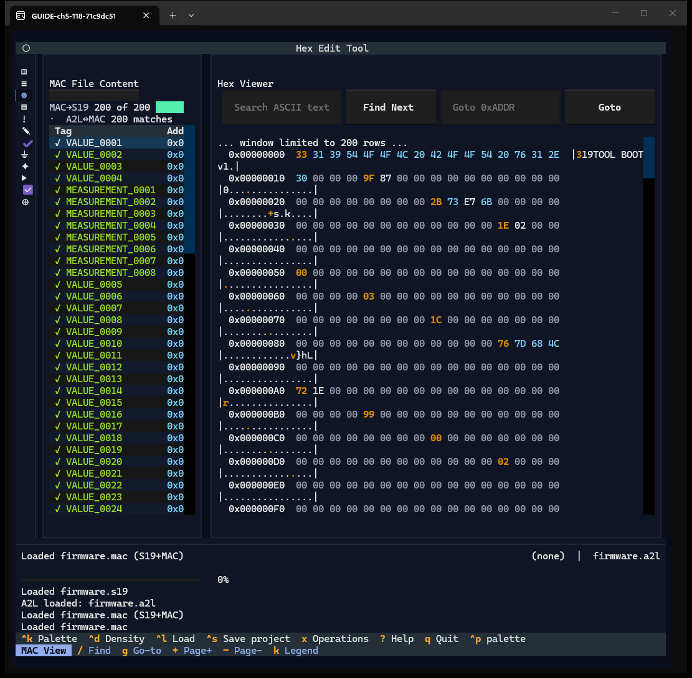
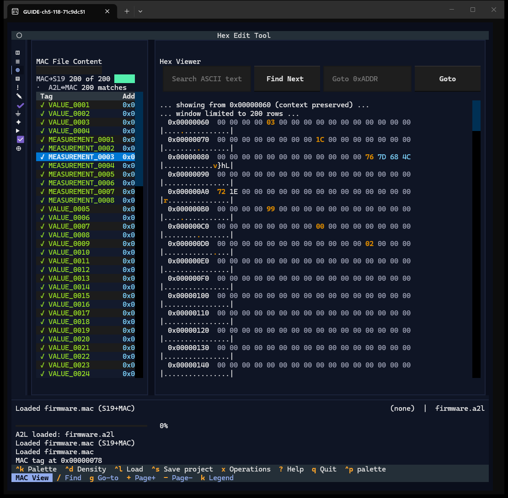
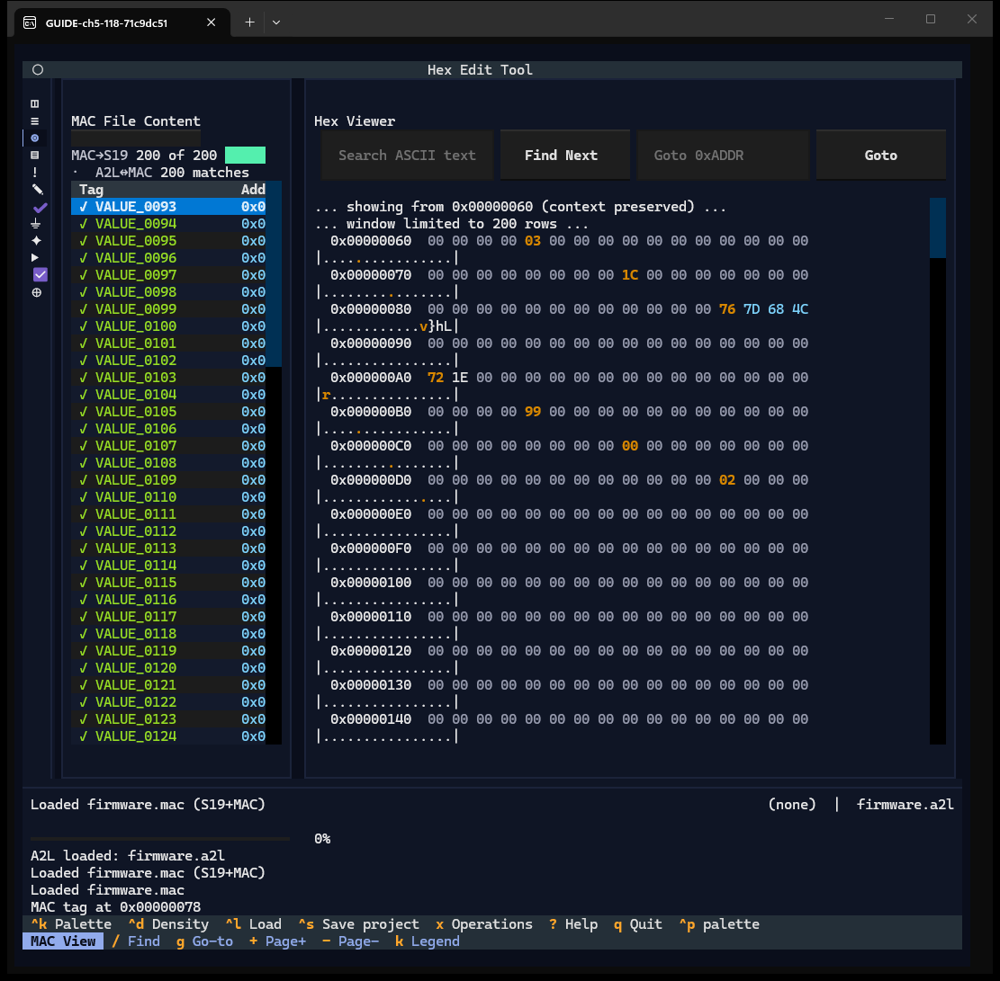
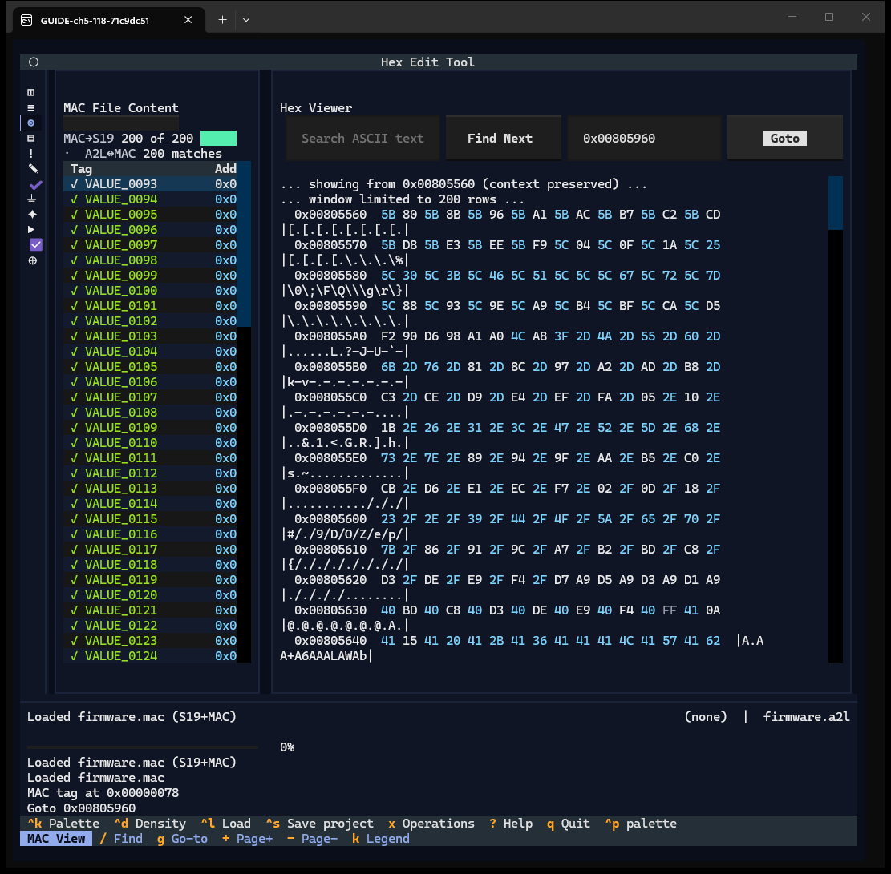
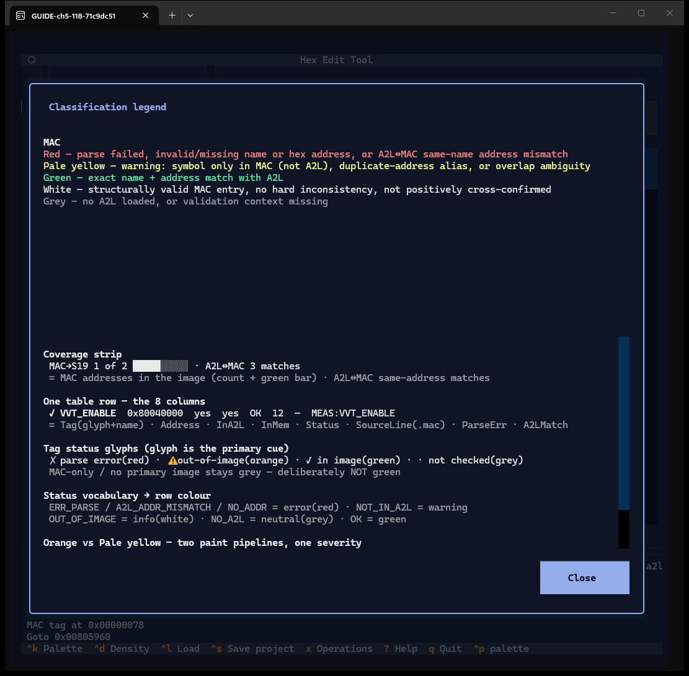

# Chapter 5 — MAC View

**Window:** MAC View (W07). **How to get there:** `3`, or the third rail glyph.
**Demo inputs:** `firmware.s19`, `firmware.a2l`, `firmware.mac` (200 `NAME=0xADDRESS`
lines, all matching A2L objects).

## What the MAC View is for

A MAC file is a list of symbol names with addresses. The MAC View checks each line
against the image and the A2L and shows the bytes at each address.

## Step by step

### 5.1 The record table

- **Coverage strip** — `MAC→S19 200 of 200` (addresses inside the image, with a bar)
  and `A2L↔MAC 200 matches`.
- **Record table** — one row per MAC line. At 118 columns only the Tag column and
  the start of Address are visible; InA2L, InMem, Status, SourceLine, ParseErr and
  A2LMatch are off to the right (finding F-11).
- **Hex Viewer** — search, goto, and the bytes; MAC addresses are highlighted.

At 118×54 the **Page Prev / Page Next / Legend** buttons above the table collapse to a
thin bar and cannot be seen (finding F-11); `+` / `-` and `k` do the same. This window
has no title bar and no `?` chip; `?` here opens the global help panel.

### 5.2 Jump to a record's address

Enter (or click) on a row: the hex pane moves to that address (*MAC tag at
0x00000078*).

### 5.3 Page the records

`+` (or **Page Next**) shows the next 100 records (VALUE_0093 onwards); **Page Prev** /
`-` goes back. The page size is in Viewer settings.

### 5.4 Go to an address in the hex pane

`g`, type `0x00805960`, Tab, Enter: the log says *Goto 0x00805960* and the pane loads a
window starting at `0x00805560`; the target row is further down and has to be scrolled
to (finding F-07). `/` searches ASCII text the same way.

### 5.5 The legend

**Legend** (or `k`) explains the colours for this window: red = parse failure or
same-name address mismatch, pale yellow = warning (only in MAC, duplicate address
alias, overlap), green = exact name + address match with the A2L, white = valid but
not cross-confirmed, grey = no A2L. Below are the coverage strip, the eight columns
and the status words.

## Features of this window

| Feature | How | Capture |
|---|---|---|
| Coverage strip | — | 5.1 |
| Record table (8 columns) | — | 5.1 |
| Row → hex jump, MAC highlight | Enter / click | 5.2 |
| Paging | buttons, `+` `-` | 5.3 |
| Hex search / goto / paging | `/` `g` `,` `.` | 5.4 |
| Legend | button / `k` | 5.5 |
