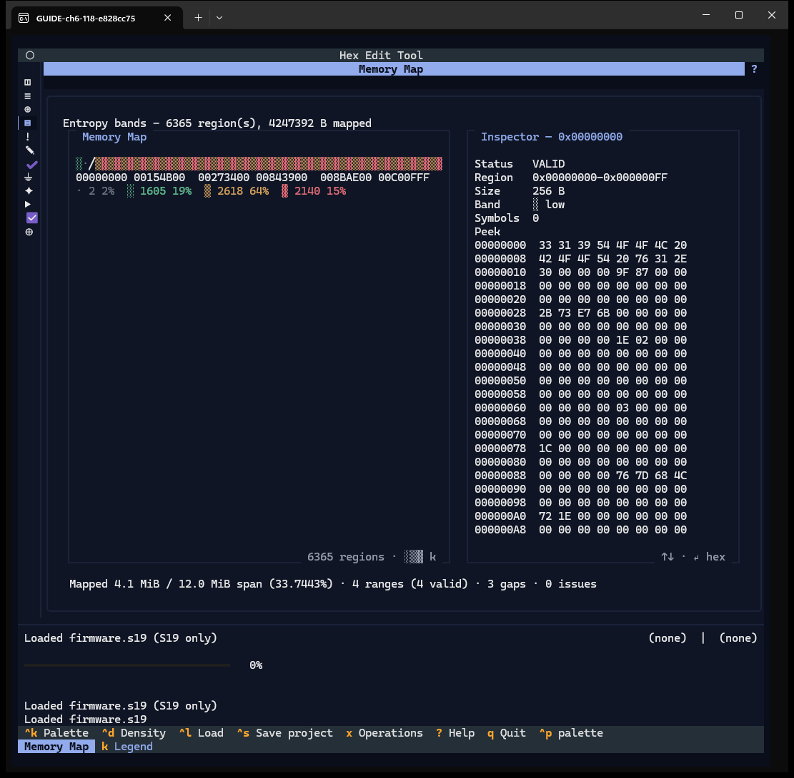
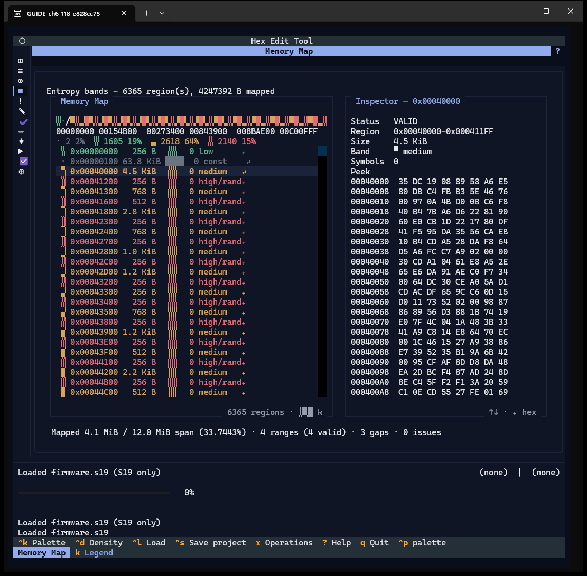
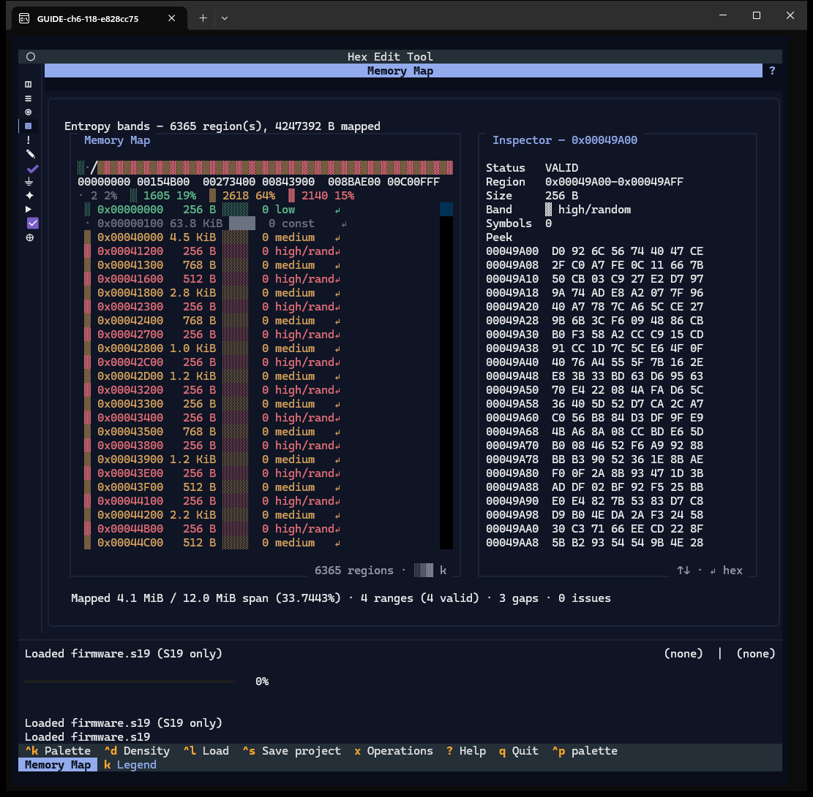
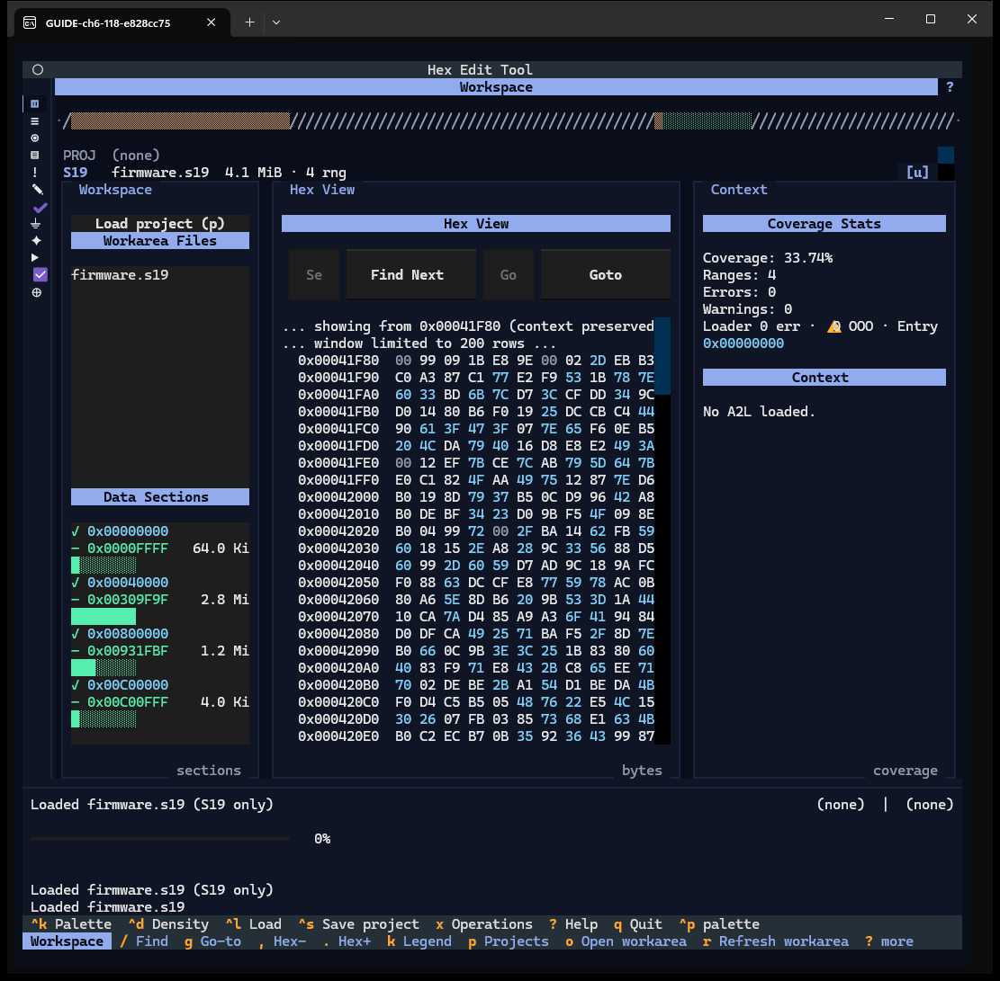
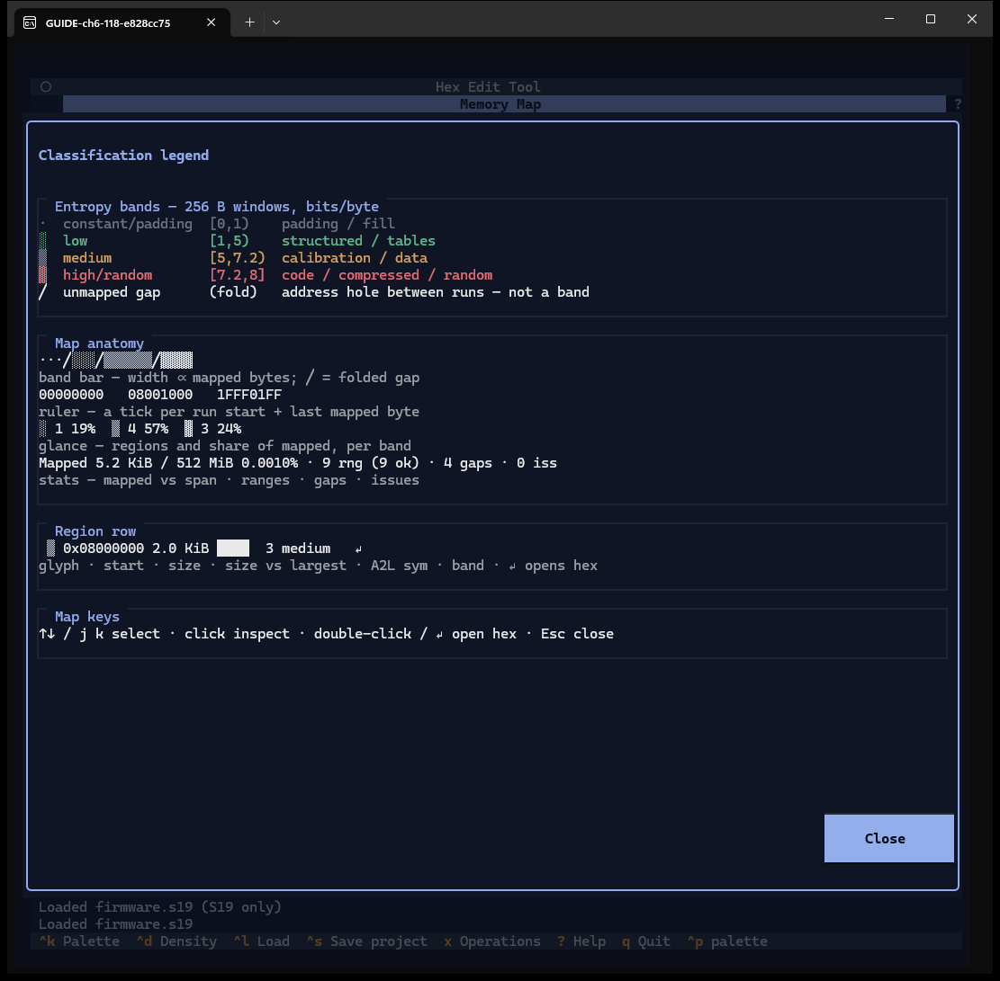
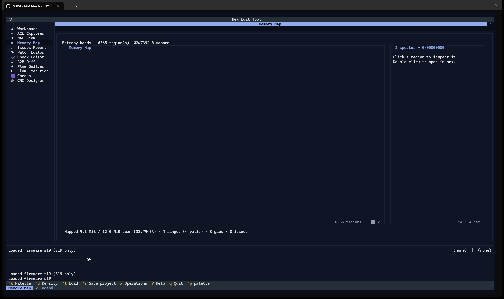

# Chapter 6 — Memory Map

**Window:** Memory Map (W08). **How to get there:** `4`, or the fourth rail glyph.
**Demo input:** `firmware.s19` (4 ranges, 3 gaps, 4.1 MiB mapped over a 12 MiB span).

## What the Memory Map is for

It shows where the image's bytes sit and what kind of content they are: the image is
cut into 256-byte windows and each window is coloured by its entropy — constant
padding, low (tables), medium (calibration data), high (code or random data).

## Step by step

### 6.1 Open the map

- **Band bar** — the mapped bytes as one bar, coloured by band; `/` marks a gap.
- **Ruler** — the start address of each run and the last mapped byte.
- **Glance line** — regions and share per band (`2 2%`, `1605 19%`, `2618 64%`,
  `2140 15%`).
- **Region list** — one row per run of equal band.
- **Inspector** — the selected region: status, range, size, band, A2L symbols, and
  an 8-byte-per-row peek.
- **Stats line** — mapped vs span, ranges, gaps, issues.

On first show the region list stays empty until you press a key (finding F-15); the
demo image has 6365 regions, which makes the map slow to repaint.

### 6.2 Inspect a region

↑ ↓ move through the region list; Enter (or a single click) shows the region in the
Inspector — here `0x00040000`, 4.5 KiB, medium.

### 6.3 Click the band bar

A click on the band bar inspects the run under the pointer (here a high/random run
at `0x00049A00`).

### 6.4 Open a region in hex

A double click on a region row opens the Workspace with the hex view at that region.

### 6.5 The band legend

`k` explains the bands and their entropy ranges, the parts of the map, a region row,
and the keys. The "Map keys" line says `j k` select and `↵` opens hex; in the code
only ↑ ↓ move and Enter inspects (finding F-16).

### 6.6 Wide terminal

At 220×60 the rail shows window names. In this capture the band bar and region list
are blank on first show (finding F-15).

## Features of this window

| Feature | How | Capture |
|---|---|---|
| Band bar, ruler, glance line, stats | — | 6.1 |
| Region list, arrows, Enter / click inspect | ↑ ↓ Enter | 6.2 |
| Band bar click | click | 6.3 |
| Double click opens Workspace hex | double click | 6.4 |
| Entropy legend | `k` | 6.5 |
