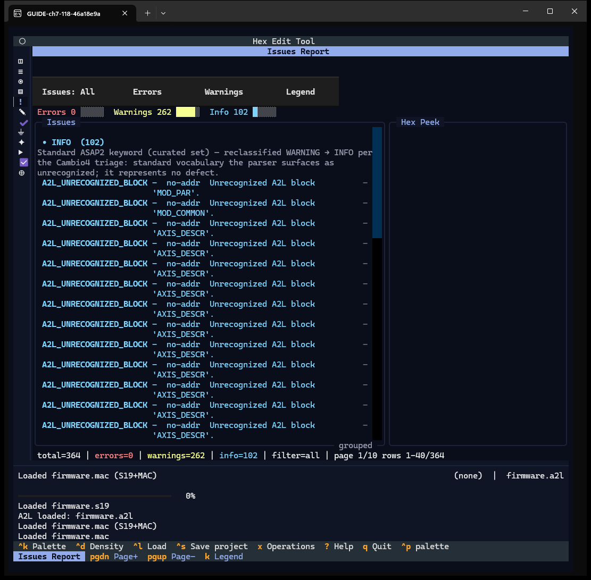
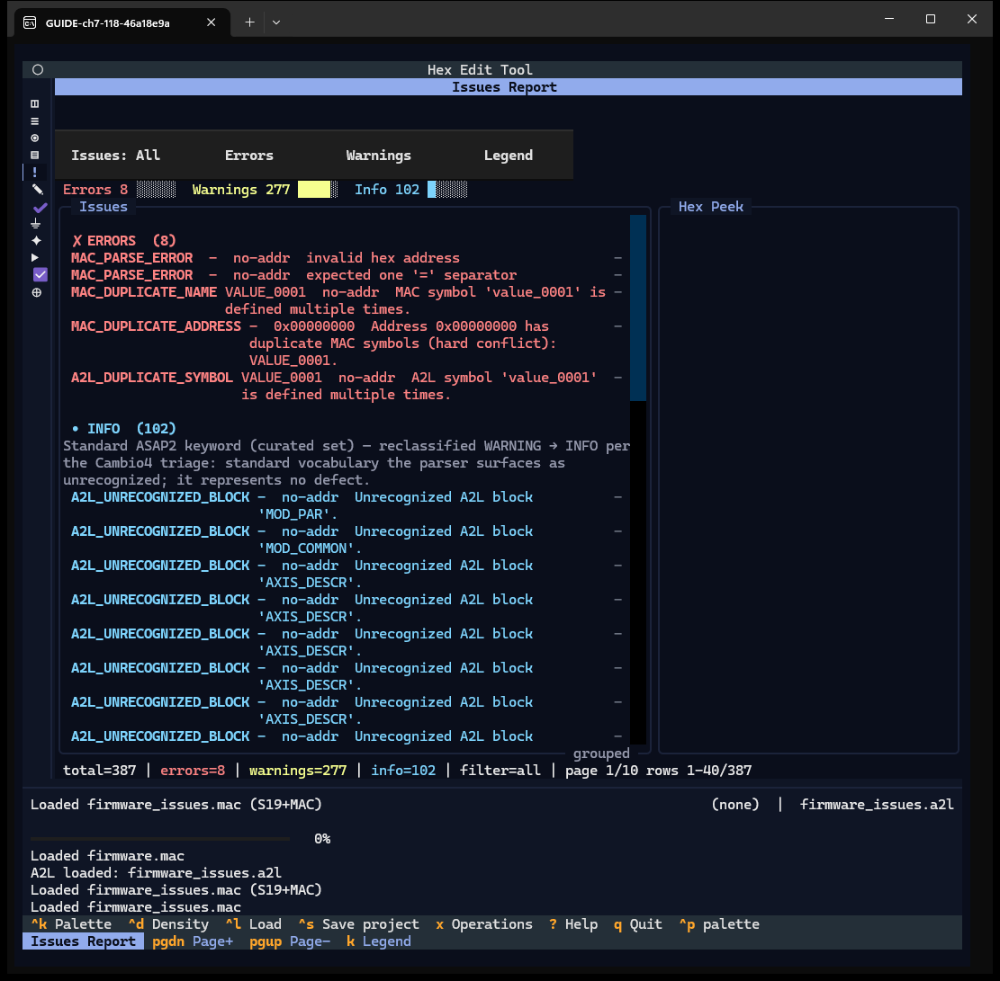
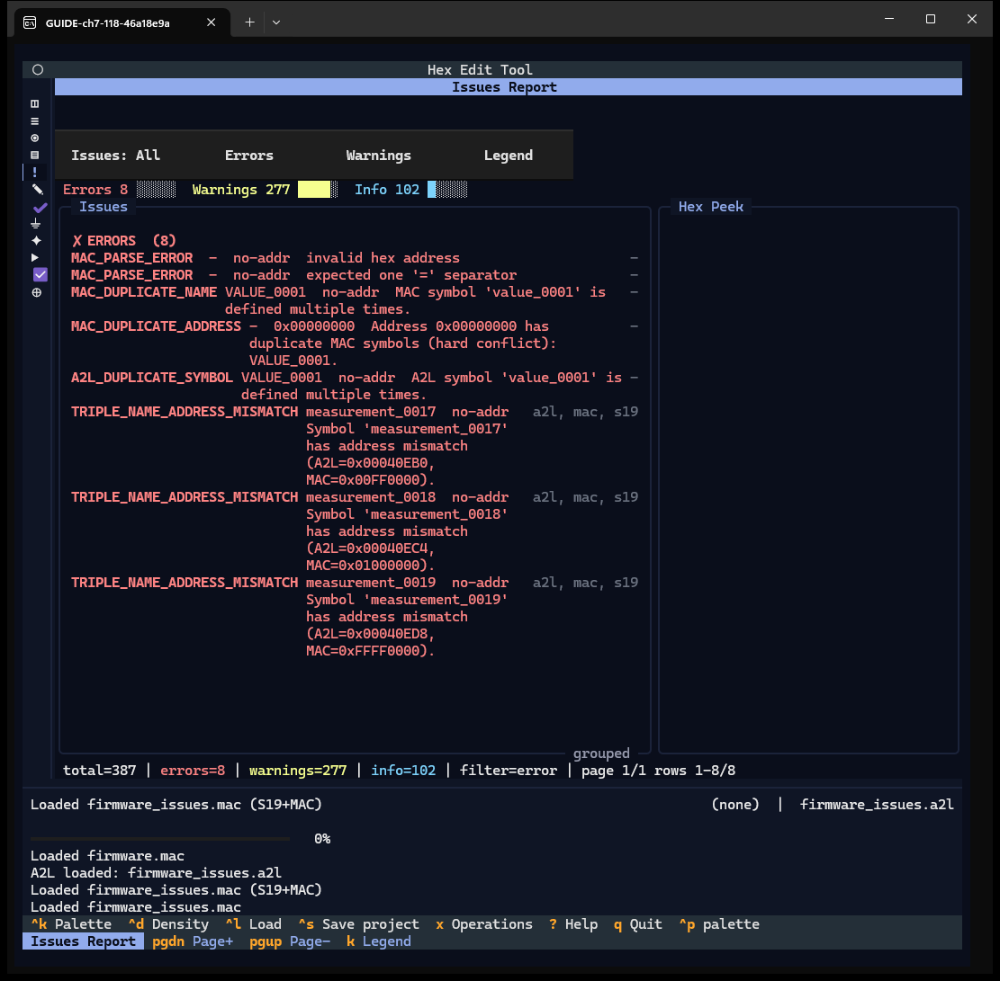
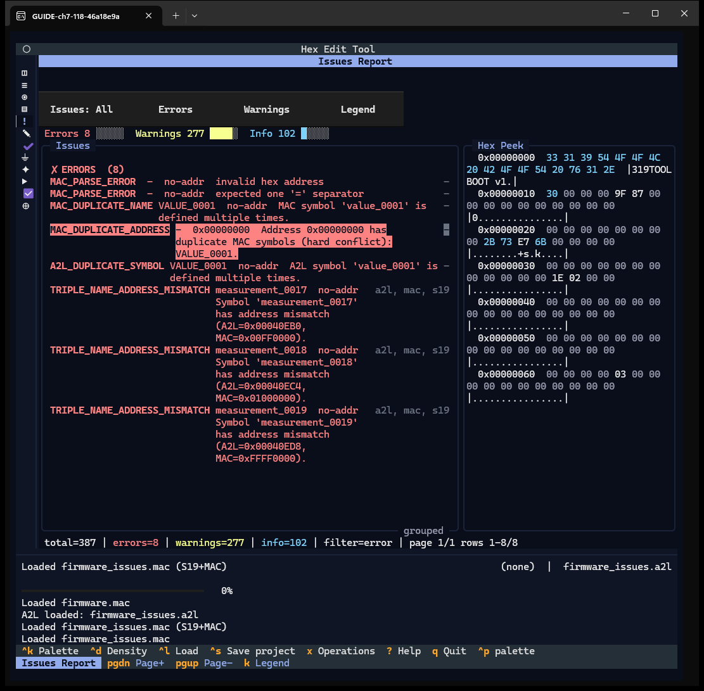
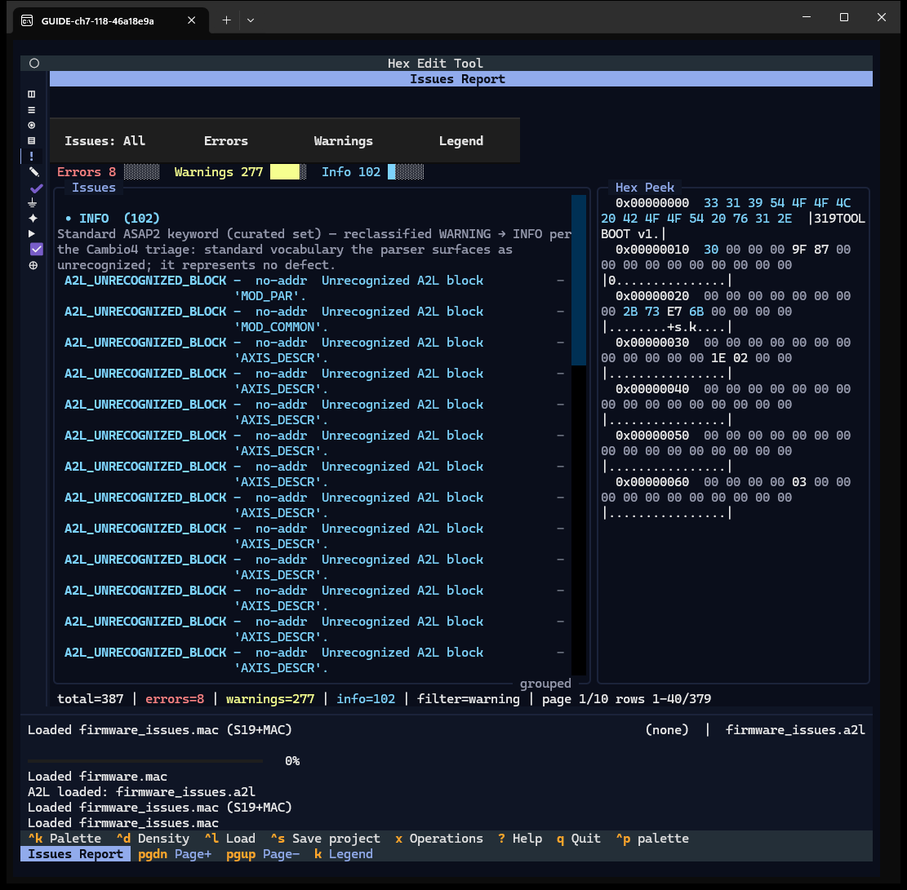
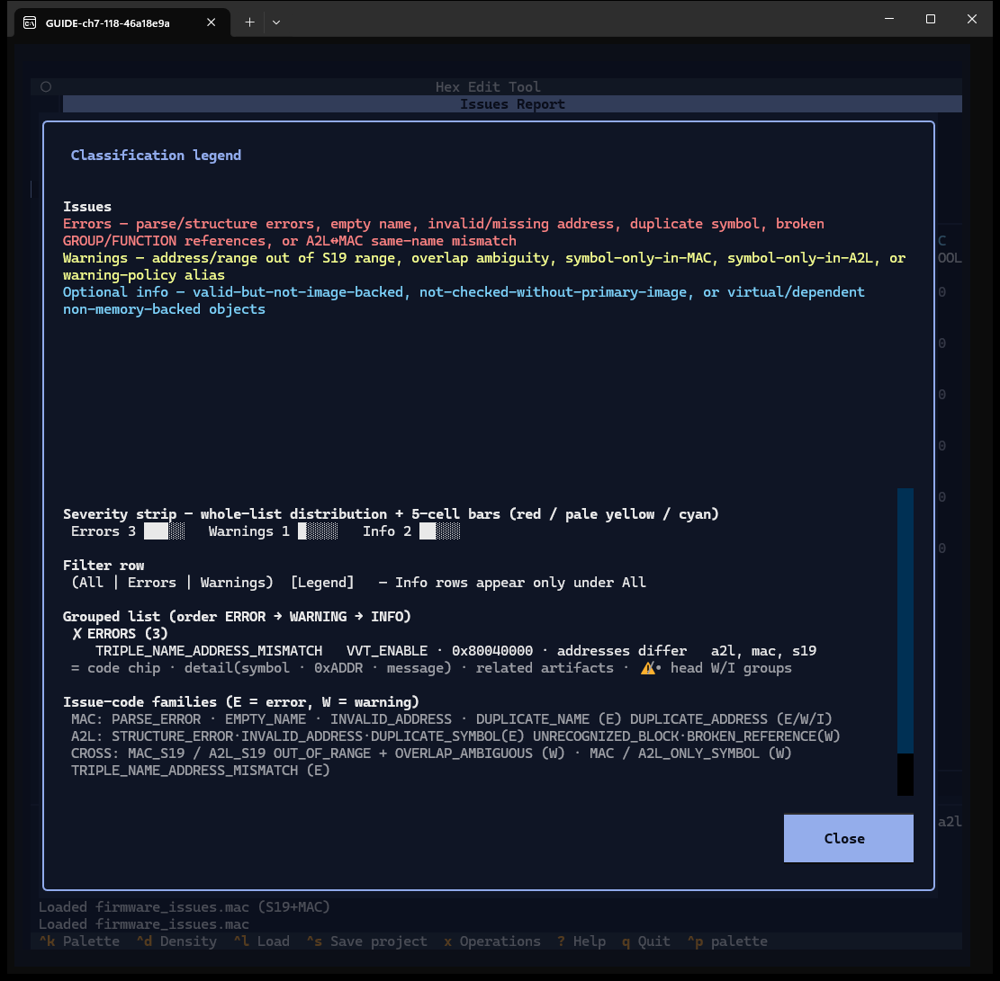

# Chapter 7 — Issues Report and the legend

**Windows:** Issues Report (W09), Classification legend (W10).
**How to get there:** `5`, or the fifth rail glyph; the legend with `k` or the
**Legend** button.
**Demo inputs:** first the clean `firmware.s19` + `firmware.a2l` + `firmware.mac`;
then the **faulty variant** `firmware_issues.a2l` + `firmware_issues.mac`, which the
case generator built with deliberate faults (out-of-image tags, span-over,
duplicate symbol, missing conversion, out-of-limits value, MAC-only names, bad hex,
missing `=`). The faulty files are used only in this chapter.

## What the Issues Report is for

It lists every validation finding across the image, the A2L and the MAC, grouped by
severity, and shows the bytes of the selected finding.

## Step by step

### 7.1 The clean case

Even the clean demo files produce entries:

- **102 Info** `A2L_UNRECOGNIZED_BLOCK` rows for the standard blocks `MOD_PAR`,
  `MOD_COMMON` and `AXIS_DESCR`. This is a known app defect queued for the release
  fix (finding F-02); the rows are shown as they are.
- **262 Warnings** — the 262 A2L tags that the MAC file does not list (the MAC holds
  200 of the 462 tags), reported as symbols only in the A2L.

The grouped list shows the Info group first and the warnings after it, although the
legend says the order is error → warning → info (finding F-39).

Top to bottom: the filter row (**Issues: All**, **Errors**, **Warnings**,
**Legend**), the severity strip with counts and bars, the grouped list, the **Hex
Peek** pane, and the summary line (`total=364 | errors=0 | … | page 1/10`).

### 7.2 The faulty variant

After loading `firmware_issues.a2l` and `firmware_issues.mac`, the list starts with
**8 errors**: MAC parse errors (invalid hex, missing `=`), duplicate MAC name and
address, duplicate A2L symbol, and three name/address mismatches between A2L and MAC.

### 7.3 Errors only

**Errors** keeps only the error group (8 rows). Each row shows the code, the symbol,
the address (or `no-addr`), the message, and the files involved (`a2l, mac, s19`).

### 7.4 Peek at the bytes

Click a row or press Enter on it: **Hex Peek** shows the bytes at the issue's
address — here `MAC_DUPLICATE_ADDRESS` at `0x00000000`. A row without an address
shows *(issue has no address — nothing to show)*.

### 7.5 Warnings

**Warnings** shows 379 rows: the 277 warnings plus the 102 Info rows, although the
legend says Info rows appear only under All (finding F-03).

### 7.6 Page through

PgDn / PgUp move 40 rows at a time (`page 2/10 rows 41-80/387`).

### 7.7 The legend

**Legend** (or `k`) shows only this window's rows: what makes an error, a warning
or an info row, how to read the severity strip, the filter row, a grouped row, and
the issue-code families. Every window's legend is scoped the same way; Map shows the
entropy key (Chapter 6), MAC its own colours (Chapter 5).

## Features of these windows

| Feature | How | Capture |
|---|---|---|
| Severity strip, grouped list, summary | — | 7.1, 7.2 |
| All / Errors / Warnings filters | buttons | 7.2, 7.3, 7.5 |
| Row → Hex Peek | click / Enter | 7.4 |
| Paging | PgDn / PgUp | 7.6 |
| Legend scoped to the window, Close | button / `k`, `esc` | 7.7 |
