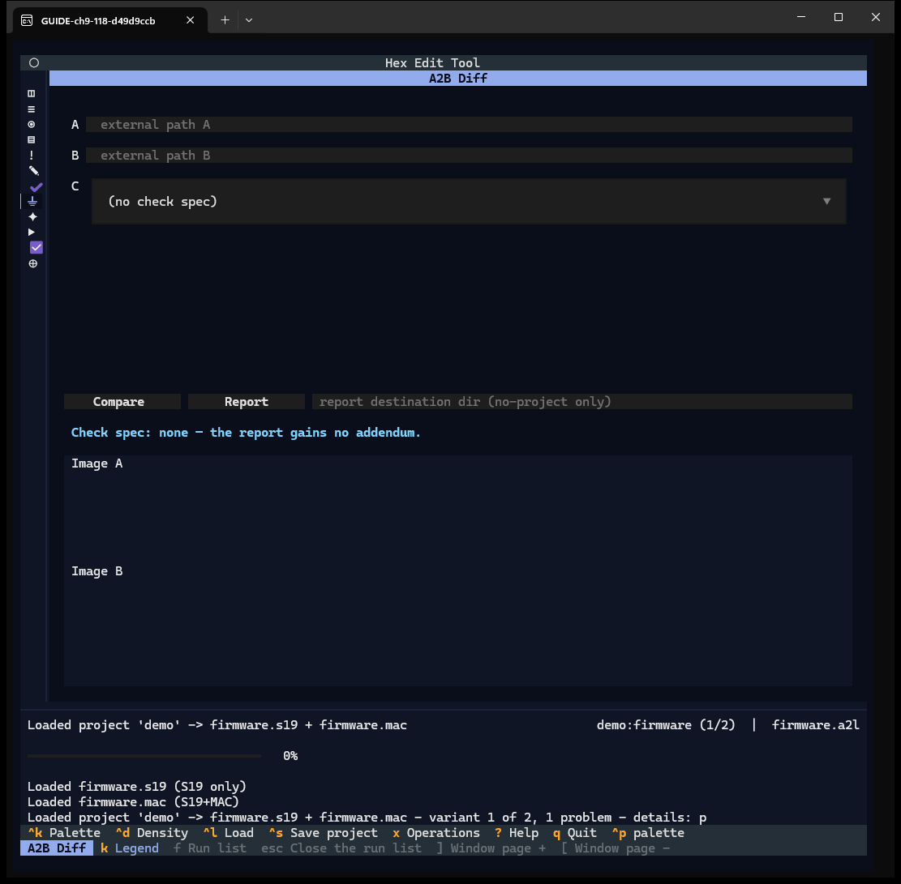
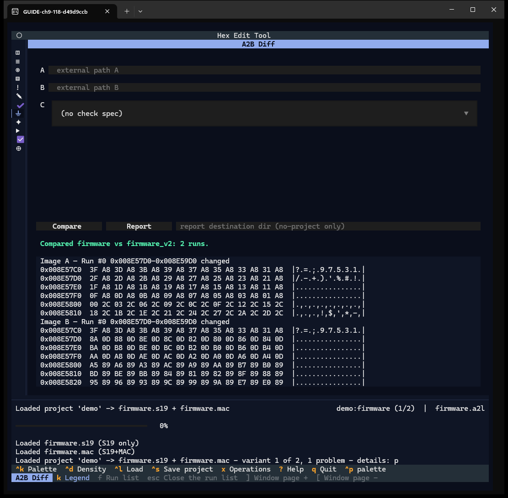
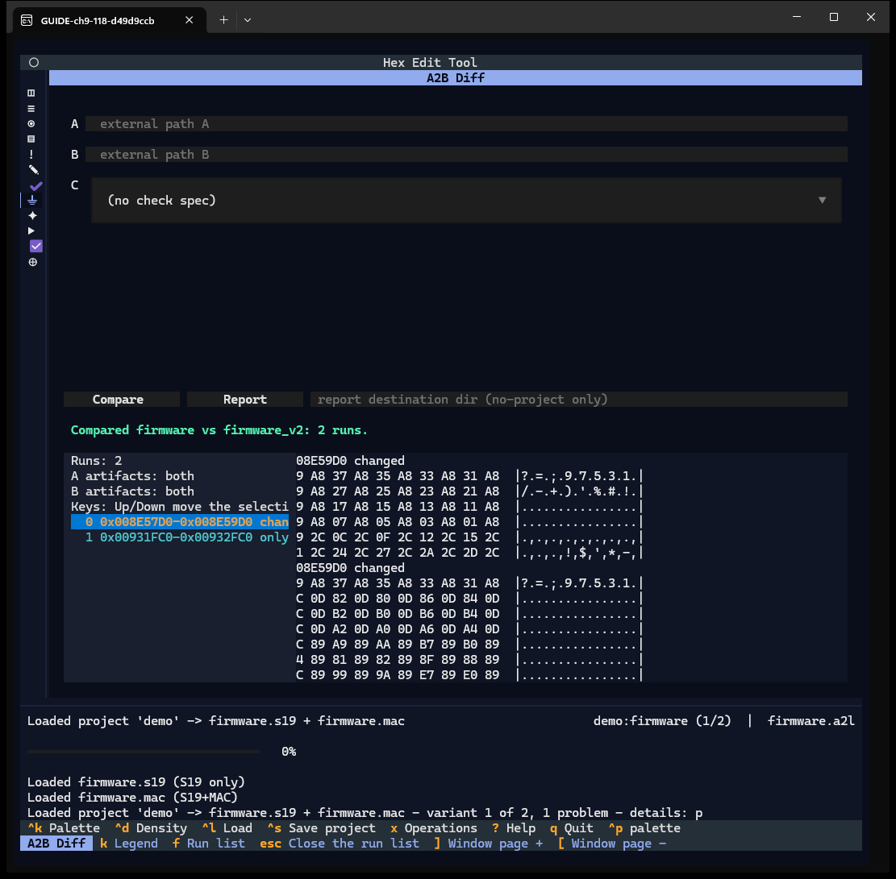
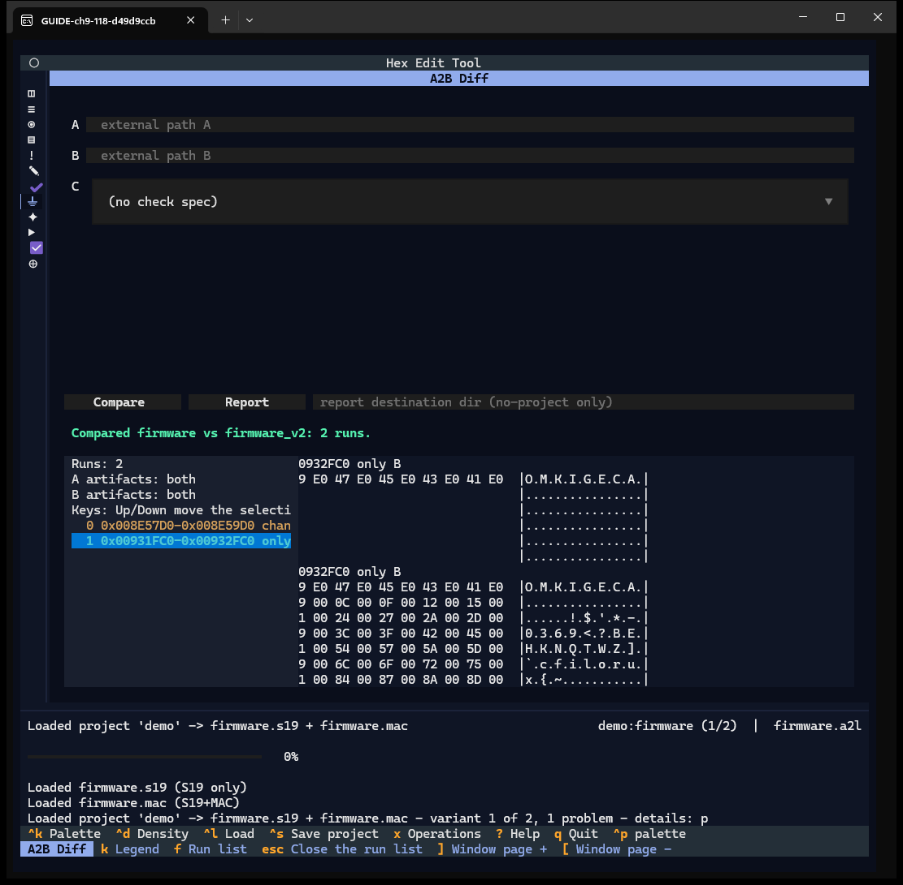
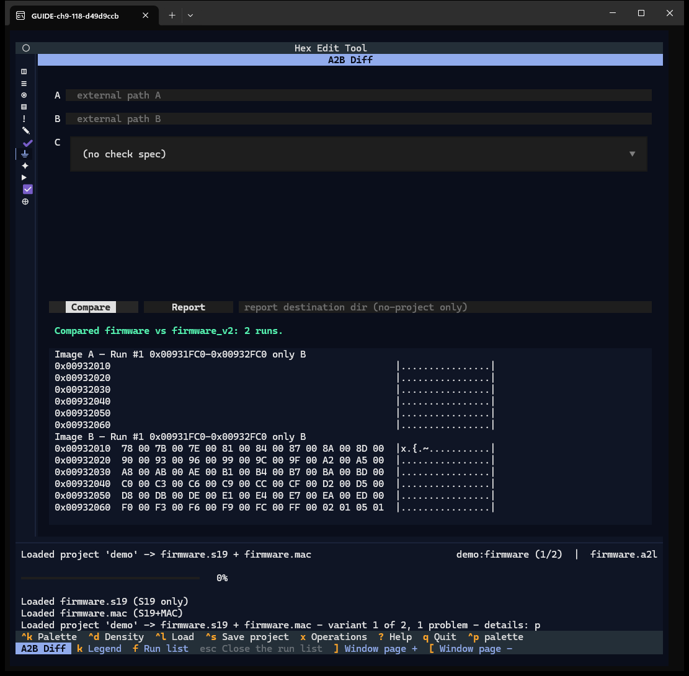
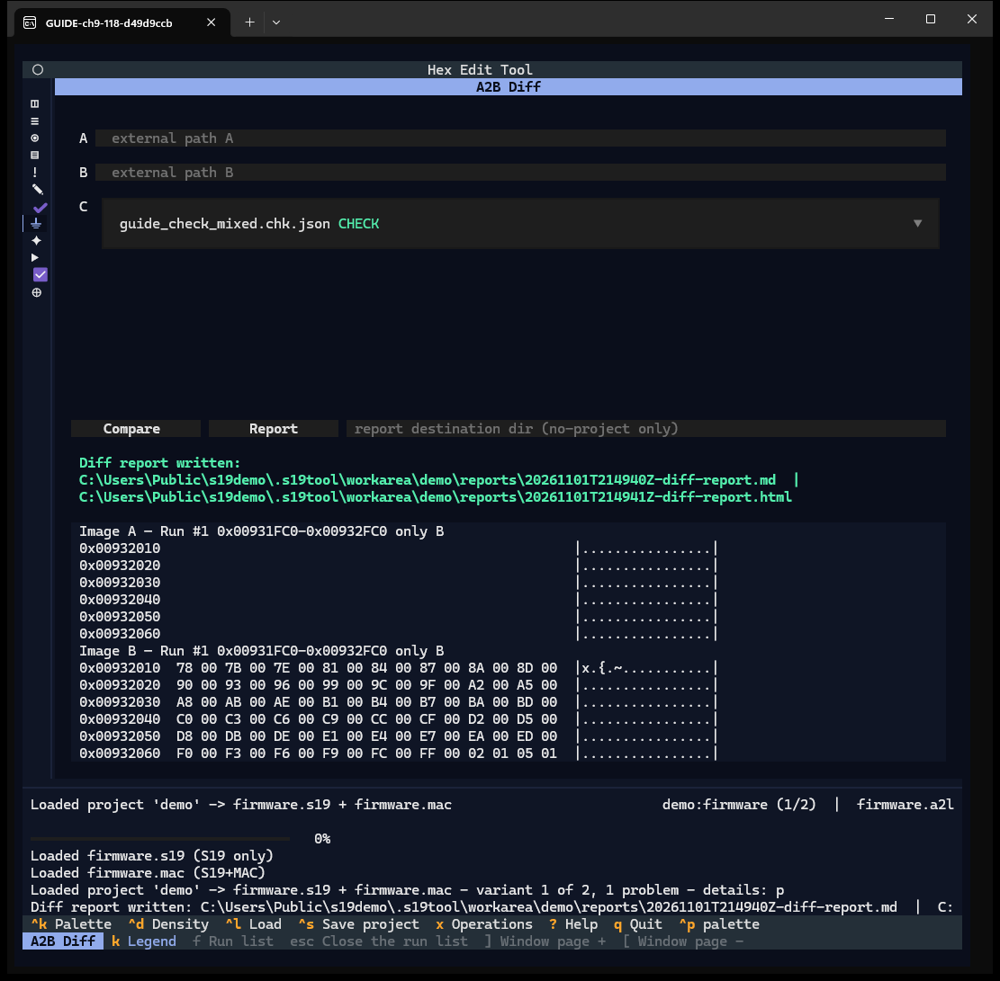
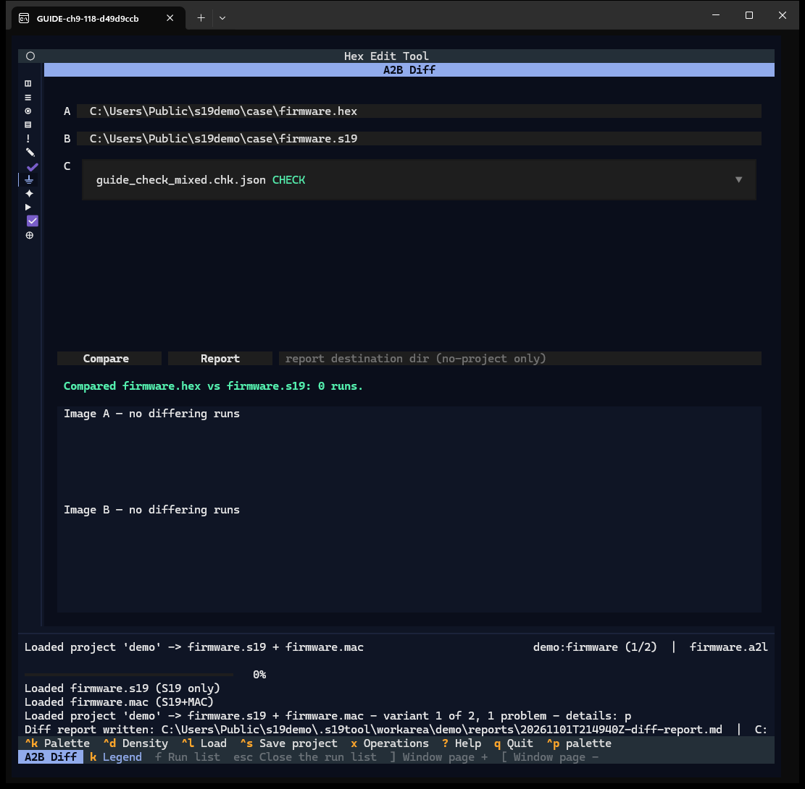
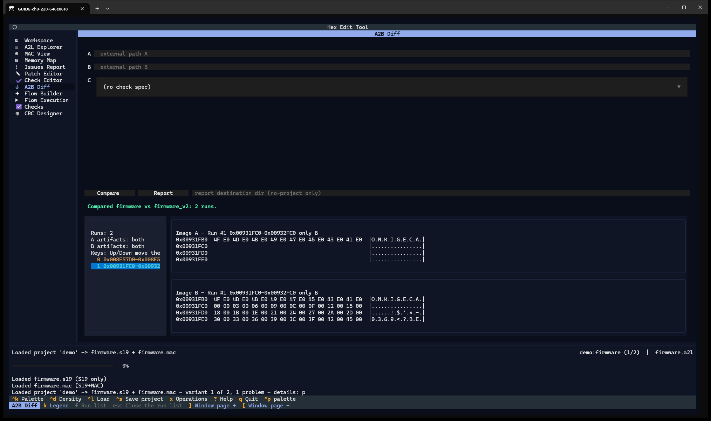

# Chapter 9 — A2B Diff

**Window:** A2B Diff (W17). **How to get there:** `7`, or the eighth rail glyph.
**Demo inputs:** project `demo` (variants `firmware` and `firmware_v2`);
`firmware.hex` and `firmware.s19` as external paths; the check document
`guide_check_mixed.chk.json` from the common patches folder.

## What the A2B Diff is for

It compares two images byte by byte, lists every run of differing addresses, shows
both sides of the selected run, and writes a diff report.

## Step by step

### 9.1 The window

- **A** and **B** — each side is a project variant (dropdown) or an external file
  path. At 118 and 220 columns only the *external path* fields are visible; the
  variant dropdowns are not painted (finding F-25). In the captures below the
  variant was set through the dropdown's value, which is what picking it does.
- **C** — the check-spec dropdown (`(no check spec)` by default).
- **Compare**, **Report**, and the report destination field (used only without a
  project).
- The status line, then the **Image A** / **Image B** windows.

The key bar lists the window's keys: `k` Legend, `f` Run list, `esc` Close the run
list, `]` Window page +, `[` Window page −.

### 9.2 Compare two variants

A = `firmware`, B = `firmware_v2`, **Compare**: *Compared firmware vs firmware_v2:
2 runs.* The windows show run #0 — the 512-byte window `0x008E57D0–0x008E59D0`
changed in v2 — on both sides.

### 9.3 The run list

Below 139 columns the run list is an overlay: `f` opens it (run count, which images
hold artifacts, the runs). ↑ ↓ select a run.

### 9.4 Select the second run

Run #1, `0x00931FC0–0x00932FC0`, is marked `only B`: the 4096-byte extension exists
only in v2. `esc` closes the overlay.

### 9.5 Page the windows

With the focus inside the panel, `]` pages both windows forward over the selected
run and `[` back. Image A shows empty rows: those addresses do not exist in A.
With the focus outside the panel (on the rail), `]` opens Flow Execution instead
(checked live — finding F-20).

### 9.6 Write the report with a check spec

Pick a check spec in **C** (here `guide_check_mixed.chk.json`, labelled `CHECK`) and
press **Report**. In a project the report pair goes to the project's `reports\`
folder: *Diff report written: …\reports\<time>-diff-report.md | …html*. The check
spec adds a `## Checks` section to the report.

### 9.7 External files: HEX against S19

Set A and B to external paths, type the paths of `firmware.hex` and `firmware.s19`,
**Compare**: *0 runs* — the two files hold the same image.

### 9.8 Wide terminal

From 139 columns the run list sits beside the windows instead of in an overlay.

## Features of this window

| Feature | How | Capture |
|---|---|---|
| A / B: variant or external path | dropdown / type | 9.1, 9.7 |
| Check spec dropdown | select | 9.6 |
| Compare, status, Image A / B windows | button | 9.2 |
| Run list (overlay below 139 columns) | `f`, ↑ ↓, `esc` | 9.3, 9.4 |
| Window paging | `]` `[` (focus in panel) | 9.5 |
| Report (+ `## Checks` addendum) | button | 9.6 |
| Report destination (no project) | type | 9.1 (text) |
| Wide layout | ≥ 139 columns | 9.8 |
| Legend (Hex rows) | `k` | text |
