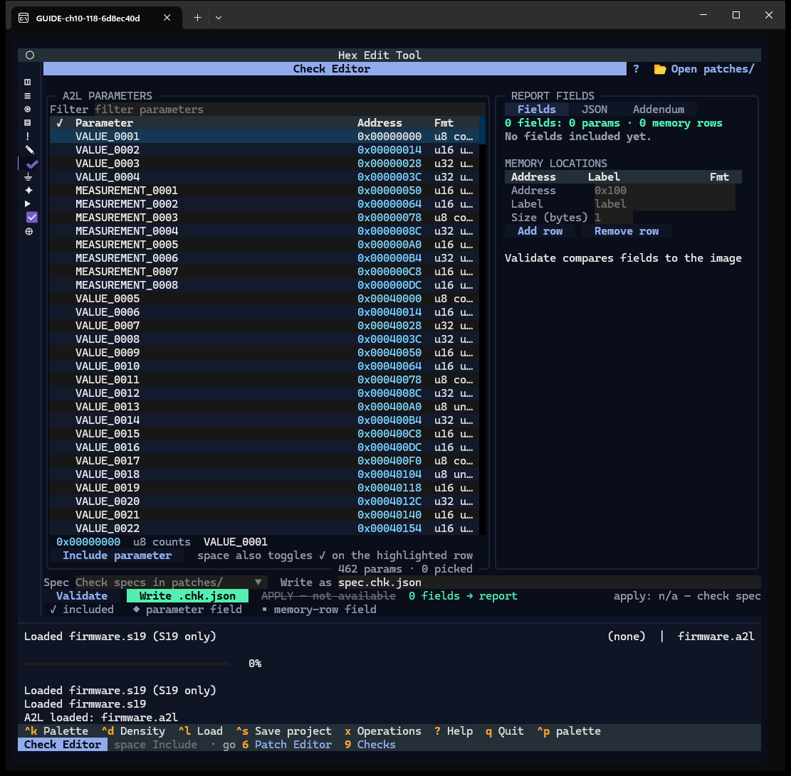
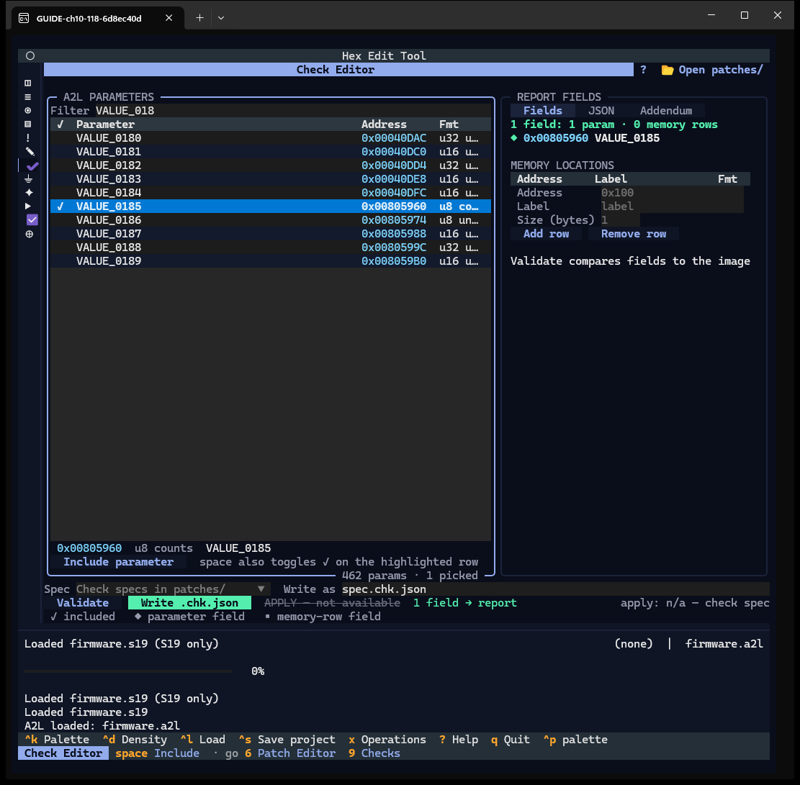
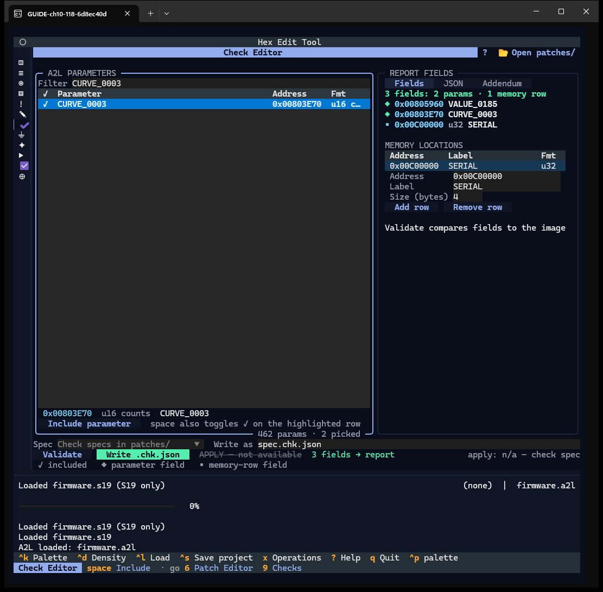
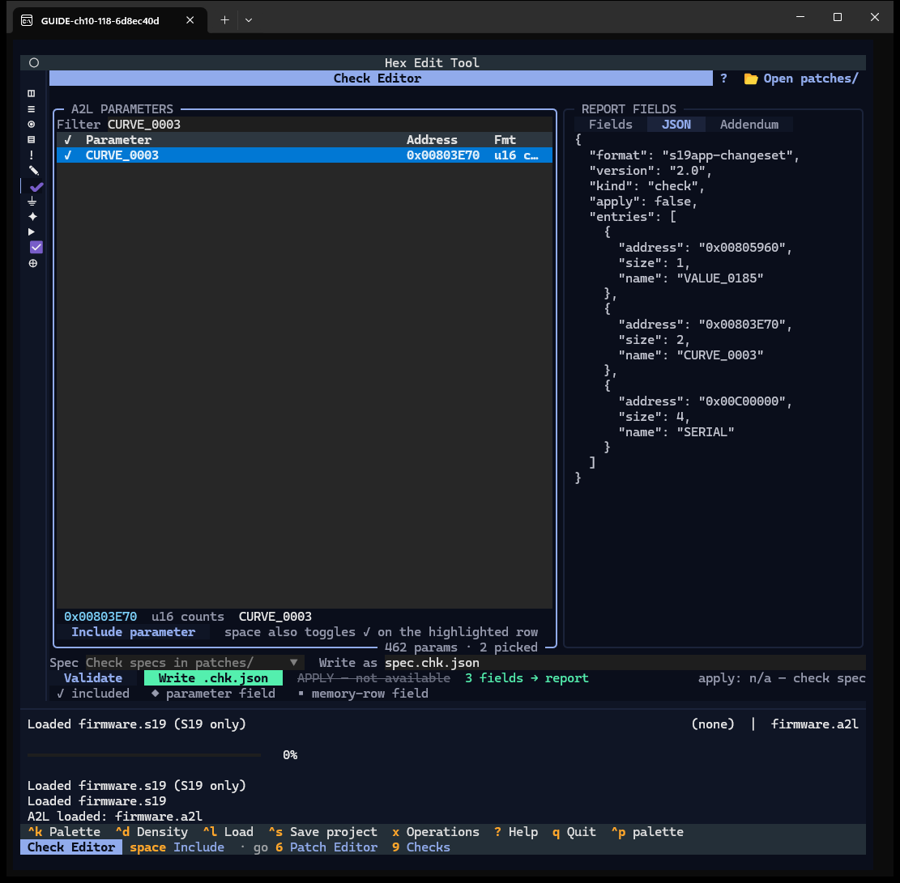
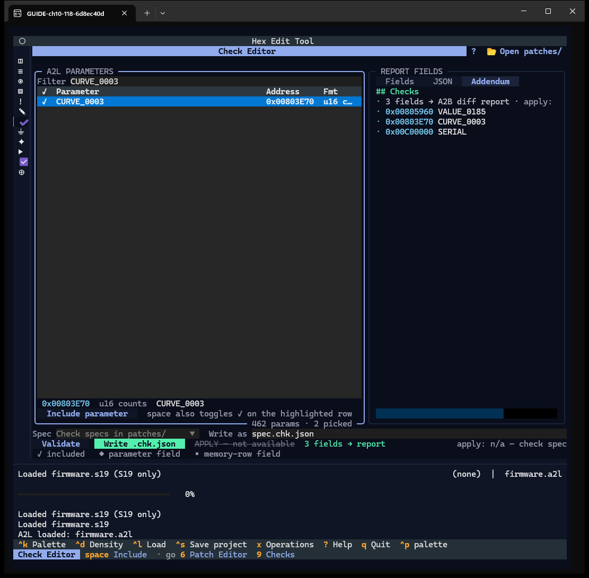
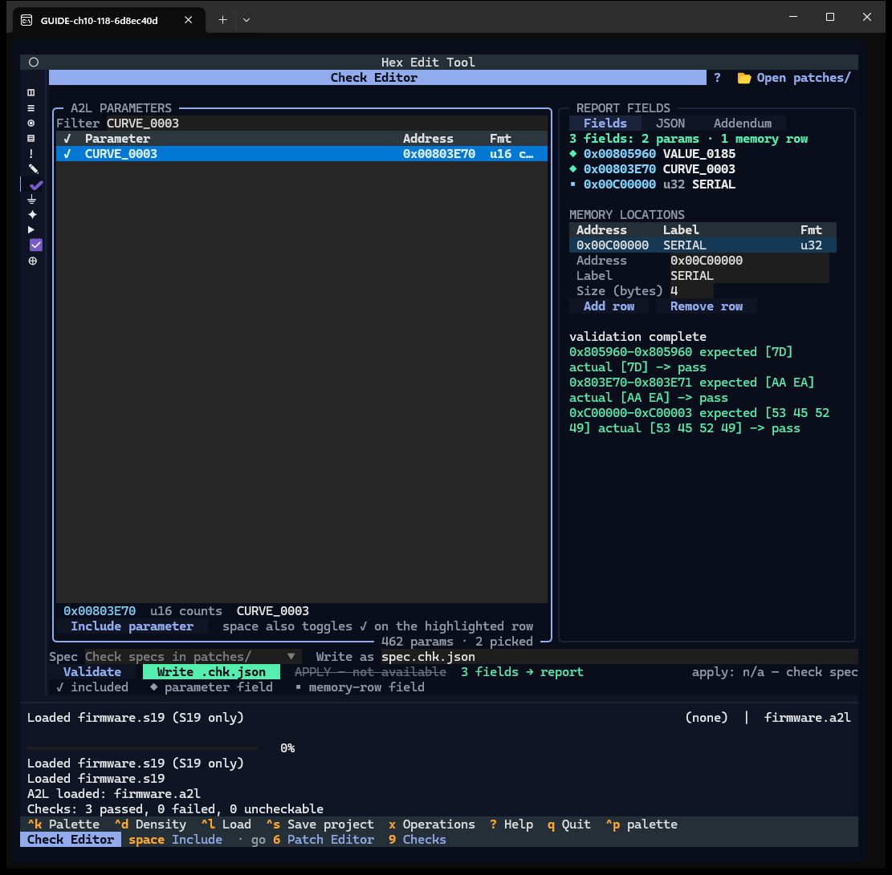
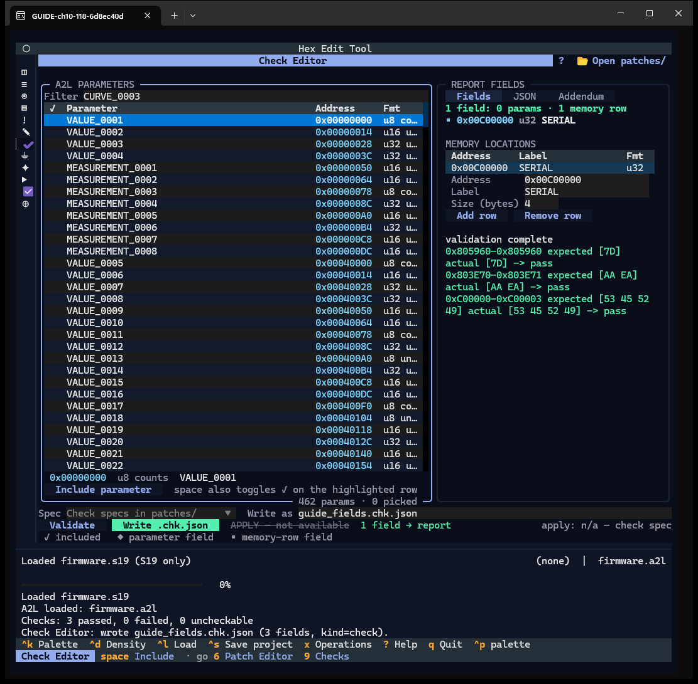
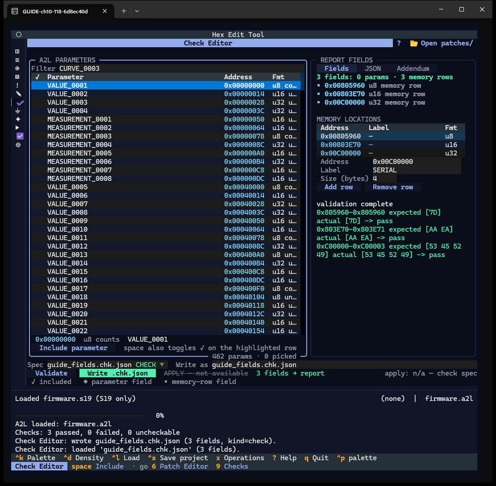

# Chapter 10 — Check Editor

**Window:** Check Editor (W15). **How to get there:** `=`, or the seventh rail glyph.
**Demo inputs:** `firmware.s19` + `firmware.a2l`, no project.

## What the Check Editor is for

It builds a **check spec** (`.chk.json`): a list of A2L parameters and memory rows
whose values should appear in the A2B diff report. A check spec is never applied to
the image.

## Step by step

### 10.1 The window

- **A2L PARAMETERS** (left) — *Filter*, the parameter ledger (✓, name, address,
  format), the full name and address of the highlighted row, **Include parameter**.
- **REPORT FIELDS** (right) — tabs **Fields**, **JSON**, **Addendum**; the field
  lines; **MEMORY LOCATIONS** with *Address*, *Label*, *Size (bytes)*, **Add row**,
  **Remove row**.
- Bottom — *Spec* dropdown (the project's check specs, then the common library's
  `library/<n>`; without a project, the common patches folder), *Write as* (file
  name), **Validate**, **Write .chk.json**, a struck-through *APPLY — not
  available*, and the glyph legend.
- Header: `?` and **📂 Open patches/** (without a project the specs live in the
  common patches folder; with a project the chip reads *Open checks/*).

### 10.2 Include a parameter

Type in *Filter* (`VALUE_018`), move to a row and press `space` (or Enter, or
**Include parameter**). The row gets `✓` and a `◆` field line appears on the right.
Press `space` again to remove it.

### 10.3 Add a memory row

After a second parameter (`CURVE_0003`), type *Address* `0x00C00000`, *Label*
`SERIAL`, *Size* `4` and press **Add row**. The row appears as a `▪` field
(`u32 SERIAL`). **Remove row** deletes the highlighted row.

### 10.4 The JSON tab

The spec as it will be written: `kind: "check"`, `apply: false`, one entry per field
with address, size and name.

### 10.5 The Addendum tab

What the A2B diff report gains: a `## Checks` section with the three fields.

### 10.6 Validate

**Validate** reads the fields from the loaded image and lists them under the form:
*validation complete*, three `pass` lines. A field loaded back from a spec is
compared with the bytes that spec declared, so Validate can now report `fail` when
the image no longer matches the spec.

### 10.7 Write the spec

Type a name in *Write as* and press **Write .chk.json**: *wrote guide_fields.chk.json
(3 fields, kind=check)*. The collector keeps its fields after the write — the
included parameters stay included. Write does not re-baseline a field loaded from
a spec against the image: it writes the spec's bytes again. To re-baseline one
field from the image, exclude the parameter and include it again, or remove the
memory row and add it again. A rewritten spec lists its parameter entries first,
then its memory rows.

### 10.8 Load a spec back

Pick the spec in the *Spec* dropdown: *loaded 'guide_fields.chk.json' (3 fields)*.
Each entry whose parameter the loaded A2L lists comes back as a `✓` parameter with
its name; the memory-row label (`SERIAL`) is not restored. A parameter a newly
loaded A2L moves, resizes, or no longer lists comes back as an unlabelled `▪`
memory row at the spec's address.

## Features of this window

| Feature | How | Capture |
|---|---|---|
| Filter, parameter ledger, full-name line | type, ↑ ↓ | 10.1, 10.2 |
| Include / exclude parameter | `space` / Enter / button | 10.2 |
| Fields / JSON / Addendum tabs | click | 10.3–10.5 |
| Memory row: Address, Label, Size, Add row, Remove row | type, buttons | 10.3 |
| Validate | button | 10.6 |
| Write as + Write .chk.json | type, button | 10.7 |
| Spec dropdown (load a spec) | select | 10.8 |
| Apply ghost, glyph legend | — | 10.1 |
