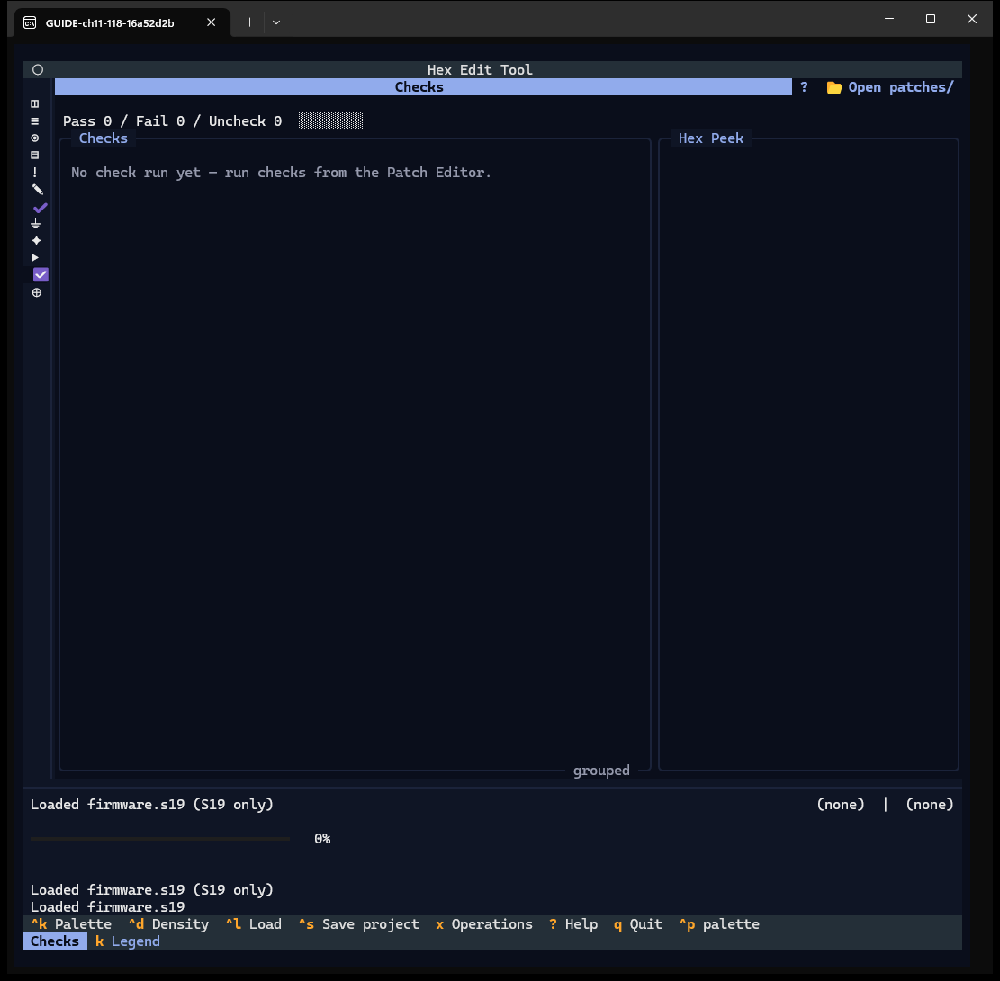
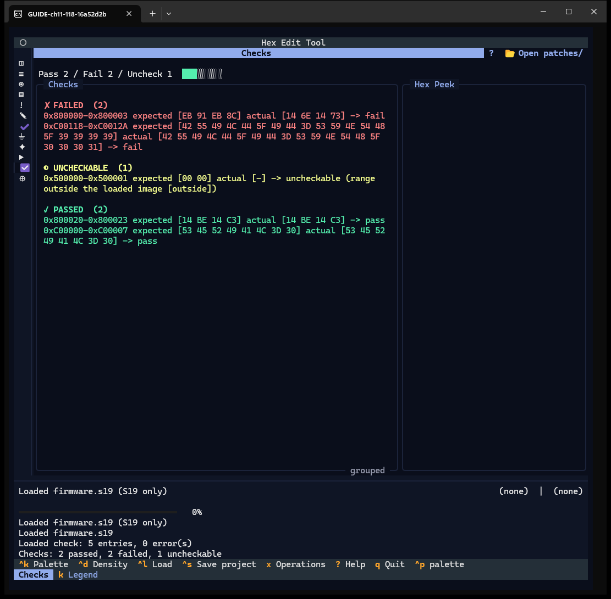
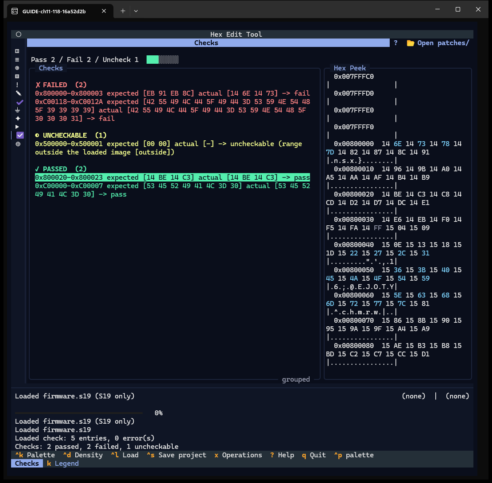

# Chapter 11 — Checks

**Window:** Checks (W16). **How to get there:** `9`, or the eleventh rail glyph.
**Demo inputs:** `firmware.s19` (not patched) and `guide_check_mixed.chk.json` run
from the Patch Editor.

## What the Checks window is for

It is the read-only result view of the last check run. Checks are run from the Patch
Editor (**Checks** tab → **Run checks**); this window groups the results by outcome
and shows the bytes of each one.

## Step by step

### 11.1 Before a run

*Pass 0 / Fail 0 / Uncheck 0* and *No check run yet — run checks from the Patch
Editor.* Header: `?` and **📂 Open patches/** (the check-document folder; *Open
checks/* in a project).

### 11.2 After a run

Run `guide_check_mixed.chk.json` in the Patch Editor, then press `9`. The strip reads
*Pass 2 / Fail 2 / Uncheck 1*; the list groups **FAILED**, **UNCHECKABLE** and
**PASSED**, each line with the address range, expected and actual bytes. On this
unpatched image the bytes at `0x800000` fail; after the patch in Chapter 8 they
pass. An *uncheckable* entry is not a failure: it names why it could not be checked
(here, outside the loaded image).

### 11.3 Peek at the bytes

Click a line or press Enter on it: **Hex Peek** shows the bytes around its address.

`k` opens the legend with the Issues colour rows.

## Features of this window

| Feature | How | Capture |
|---|---|---|
| Pass / Fail / Uncheck strip | — | 11.1, 11.2 |
| Grouped-by-outcome list | — | 11.2 |
| Row → Hex Peek | click / Enter | 11.3 |
| Open checks/ chip, legend | click, `k` | text |
