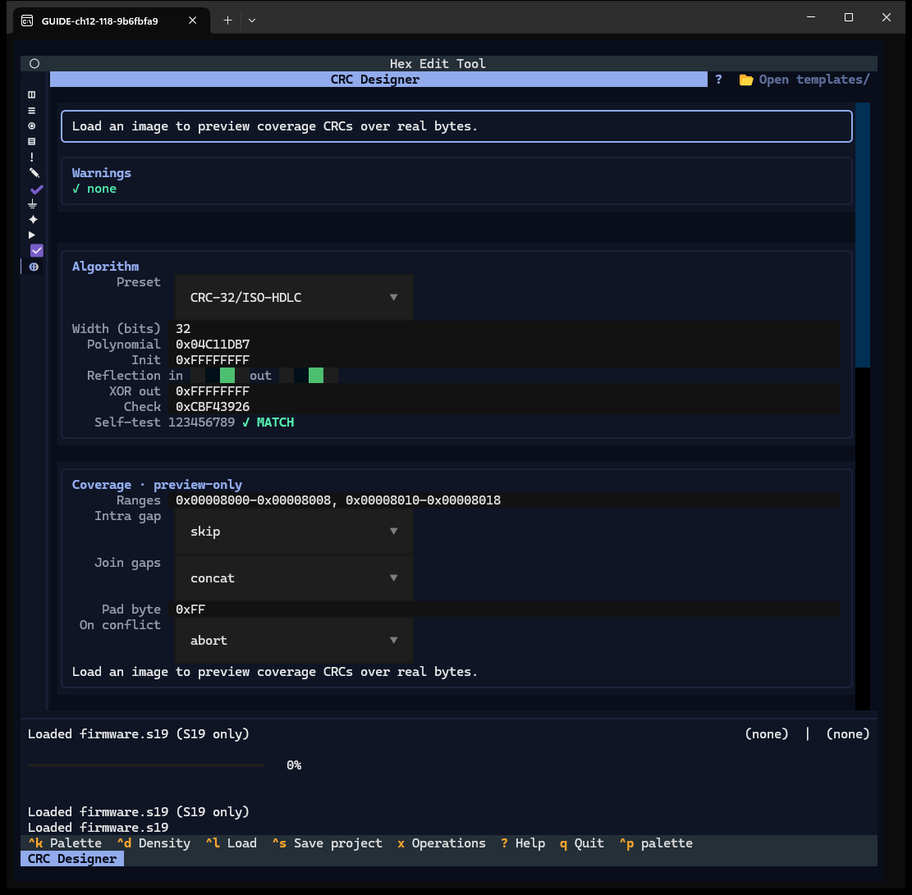
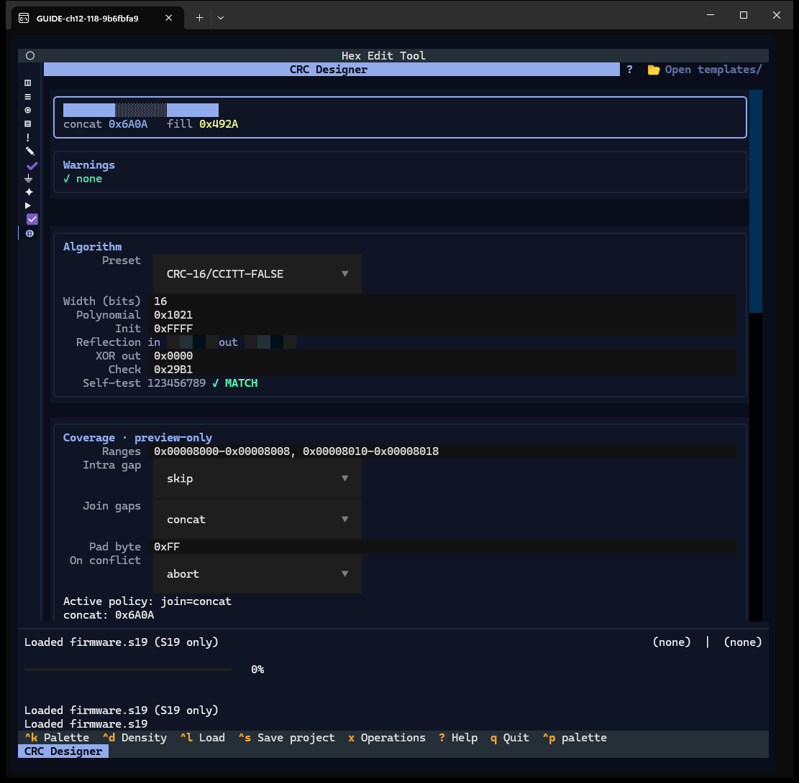
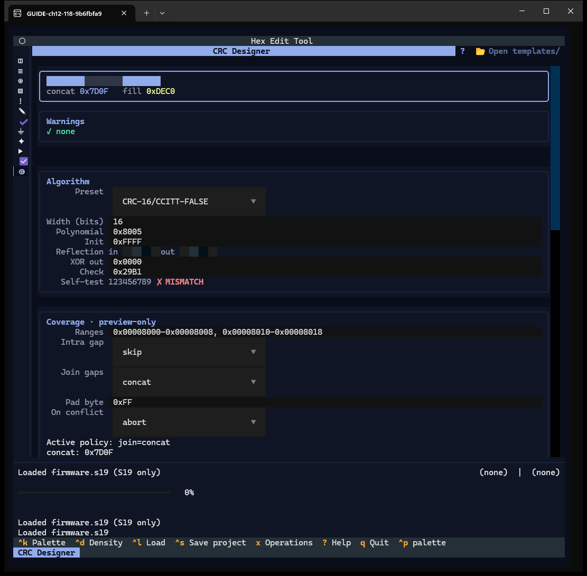
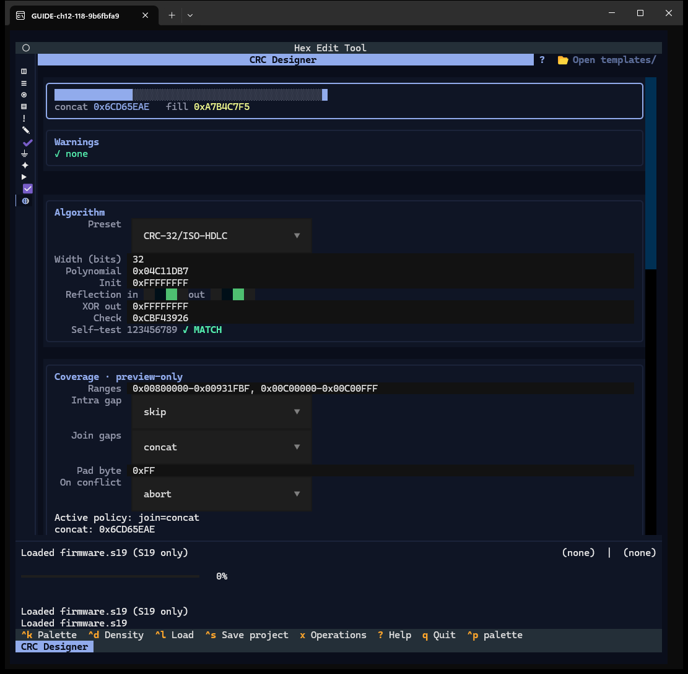
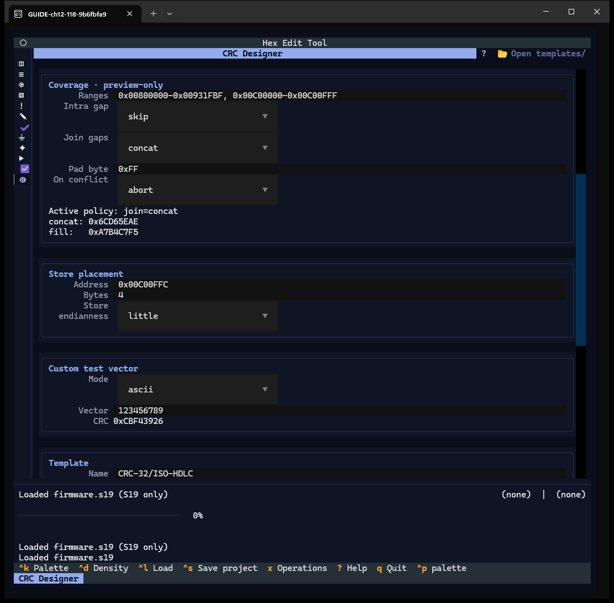
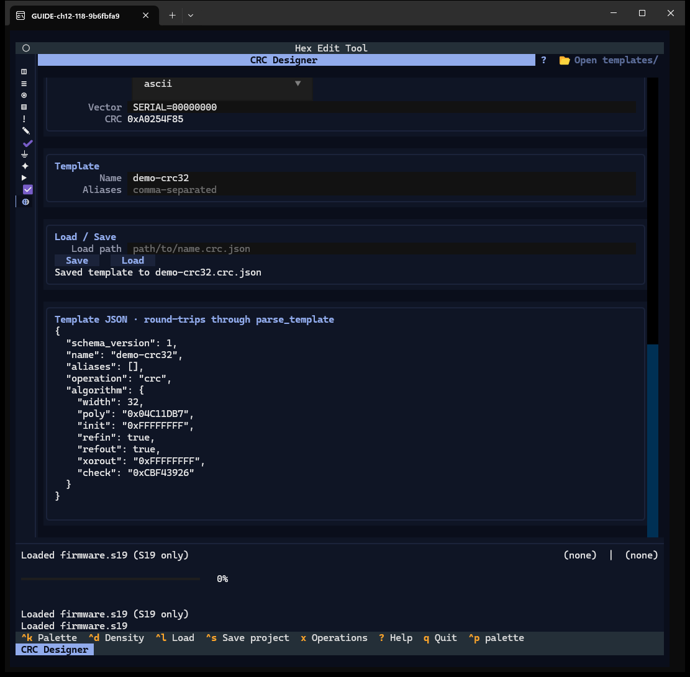
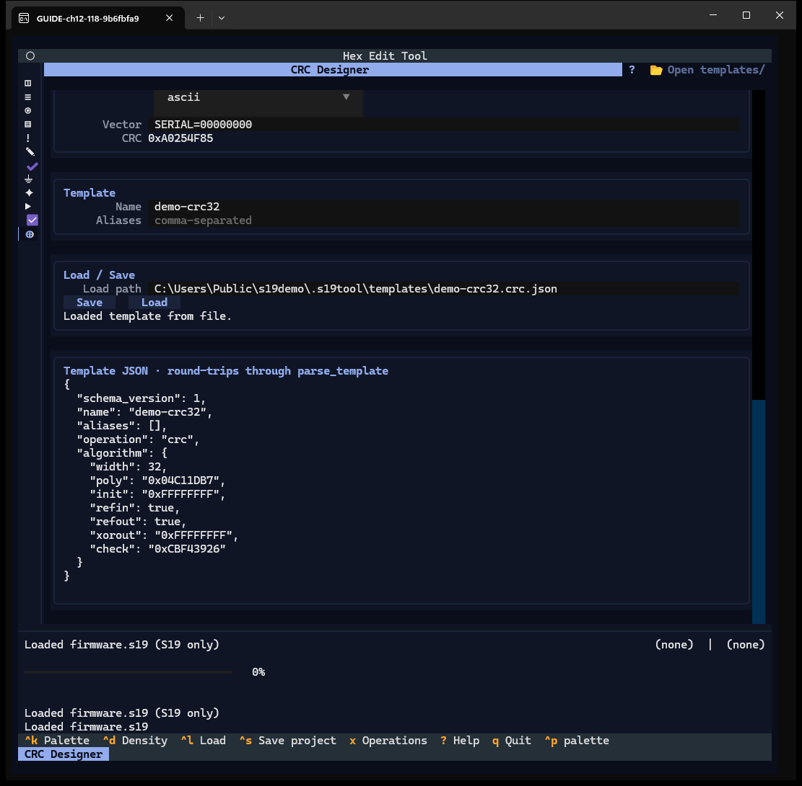

# Chapter 12 — CRC Designer

**Window:** CRC Designer (W18). **How to get there:** `0`, or the last rail glyph.
**Demo input:** `firmware.s19`, no project.

## What the CRC Designer is for

It defines a CRC algorithm, proves it with the standard test vector, previews CRCs
over address ranges of the loaded image, and saves the algorithm as a reusable
**template** (`.crc.json`). It never writes into the image: writing a CRC is done in
Operations (Chapter 13). The window is taller than 54 rows; scroll it to reach the
lower groups (finding F-32).

## Step by step

### 12.1 The bench

- **Coverage window** (top) — the CRC of the coverage ranges, in *concat* and *fill*
  form, with a band of the ranges. On first open it says *Load an image to preview…*
  although an image is loaded; it updates after the first edit (finding F-24).
- **Warnings**.
- **Algorithm** — *Preset*, *Width (bits)*, *Polynomial*, *Init*, *Reflection in / out*
  (switches), *XOR out*, *Check*, and **Self-test 123456789** with its verdict.
- **Coverage · preview-only** — *Ranges*, *Intra gap*, *Join gaps*, *Pad byte*, *On
  conflict*, and the active-policy result.
- Lower (scroll): **Store placement**, **Custom test vector**, **Template**,
  **Load / Save**, **Template JSON**.
- Header: `?` and **📂 Open templates/**.

### 12.2 Pick a preset

*CRC-16/CCITT-FALSE* fills every field; the self-test reads **✓ MATCH**. Presets are
starting points: every field stays editable.

### 12.3 Edit a parameter

Changing the polynomial to `0x8005` keeps the preset's check value, so the self-test
turns **✗ MISMATCH**: don't trust a custom set until it matches.

### 12.4 Coverage over the image

Back on *CRC-32/ISO-HDLC*, type the ranges `0x00800000-0x00931FBF,
0x00C00000-0x00C00FFF` (the calibration and config regions). The coverage window
shows both results: concat `0x6CD65EAE`, fill `0xA7B4C7F5`. Each edit recomputes over
1.2 MiB and took about 10 s with this image (finding F-23).

### 12.5 Store placement and custom vector

**Store placement** says where a CRC would be written (*Address* `0x00C00FFC`,
*Bytes* 4, *Store endianness* little) — preview only. **Custom test vector** computes
the CRC of any ASCII or hex input.

### 12.6 Save a template

Type a *Name* (`demo-crc32`) and press **Save**: *Saved template to
demo-crc32.crc.json* — in the project's `templates\` folder, or without a project in
the common `.s19tool\templates\` library. The **Template JSON** shows what is written:
the algorithm parameters (not the coverage or the store placement).

### 12.7 Load a template

Type its path in *Load path* and press **Load**: *Loaded template from file.*

## Features of this window

| Feature | How | Capture |
|---|---|---|
| Preset dropdown | select | 12.2 |
| Width, Polynomial, Init, Reflection in/out, XOR out, Check | type, switches | 12.1, 12.3 |
| Self-test verdict | — | 12.2, 12.3 |
| Coverage ranges, intra gap, join, pad, on conflict, results | type, select | 12.4 |
| Store placement (address, bytes, endianness) | type, select | 12.5 |
| Custom test vector (mode, vector, CRC) | select, type | 12.5 |
| Template name, aliases, JSON preview | type | 12.6 |
| Save / Load path + Load | buttons | 12.6, 12.7 |
| Warnings, Open templates/ | — | 12.1 |
