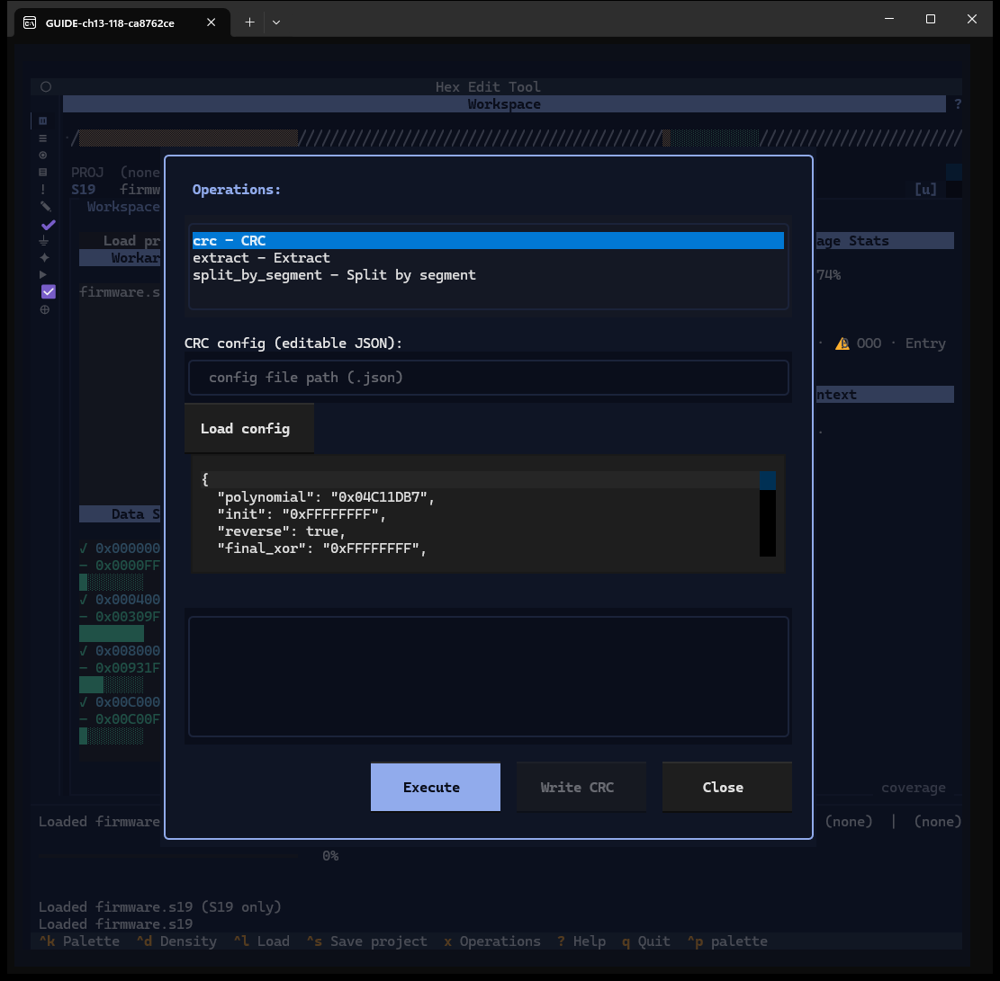
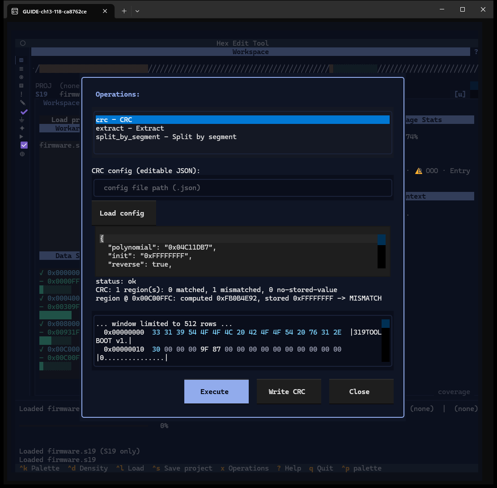
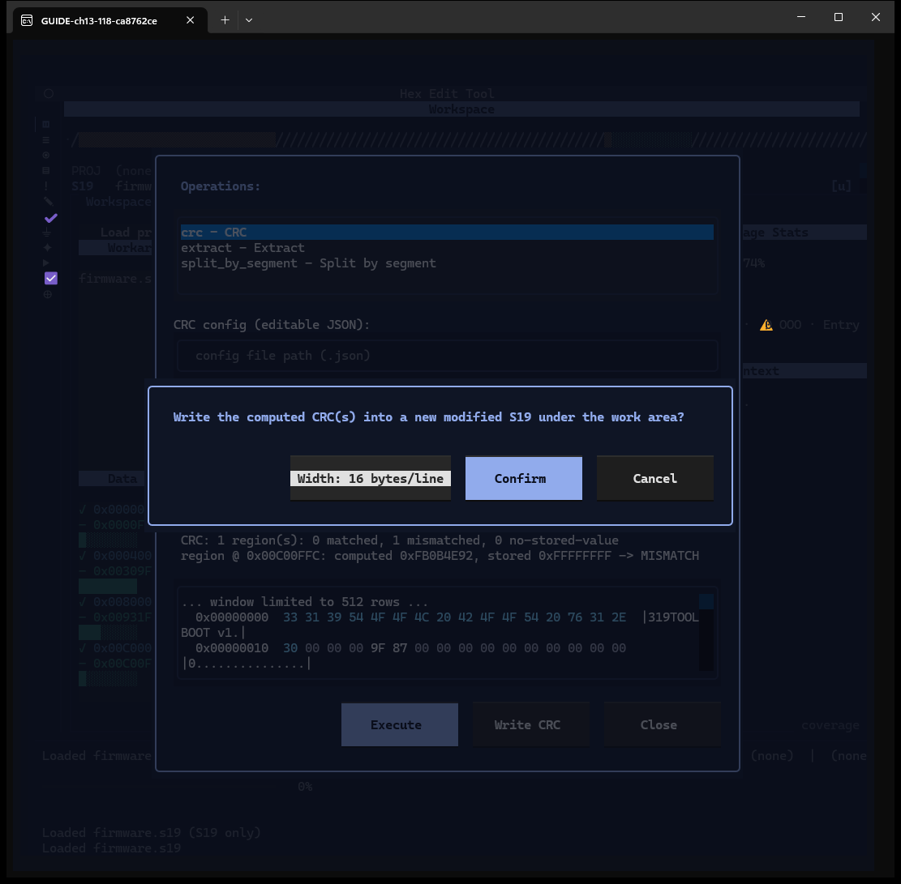
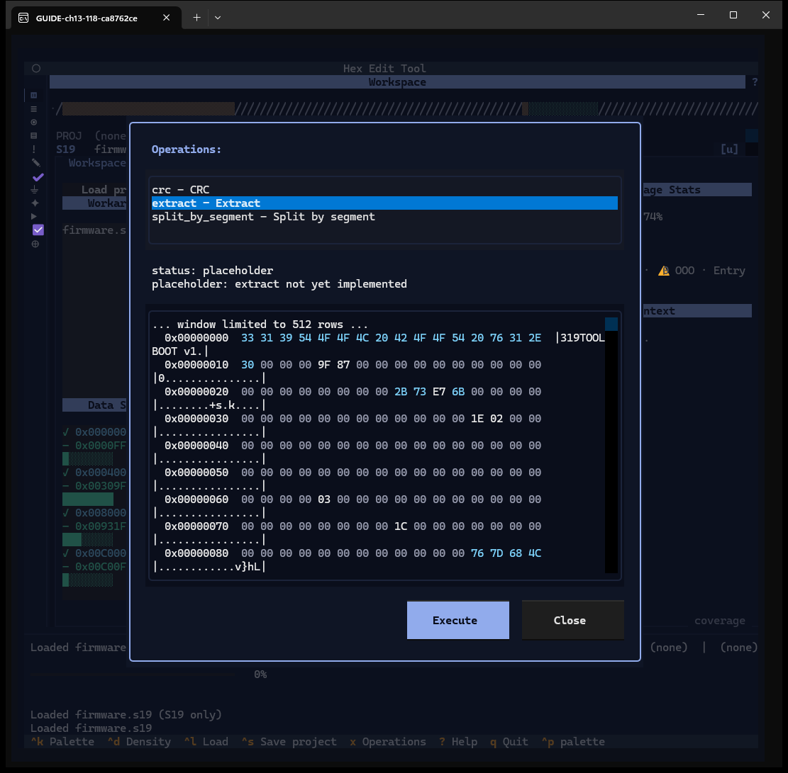

# Chapter 13 — Operations: compute and write a CRC

**Windows:** Operations (W19), Confirm CRC write (W20).
**How to get there:** `x` (needs a loaded image; otherwise one status line).
**Demo input:** `firmware.s19`; a CRC config typed into the dialog: CRC-32 over the
config region `0x00C00000–0x00C00FF0`, stored at `0x00C00FFC`.

## What the Operations dialog is for

It runs an operation on the loaded image. The one real operation is **crc**: compute
CRCs over regions described by a JSON config, compare them with the value stored in
the image, and optionally write a new S19 with the computed CRCs. This is the place
where a CRC is written into an image; the CRC Designer (Chapter 12) only previews.

## Step by step

### 13.1 Open the dialog

- The operations list: `crc`, `extract`, `split_by_segment`.
- *CRC config (editable JSON)* — a path field with **Load config** to read a config
  file, and the editable config (prefilled with an example whose regions are not in
  the demo image, so it was replaced for this guide).
- The result area, then **Execute**, **Write CRC** (off until a CRC was computed),
  **Close**.

### 13.2 Execute

With `crc` selected and the config edited, **Execute** shows *status: ok* and, per
region, the computed and the stored value: *computed 0xFB0B4E92, stored 0xFFFFFFFF
-> MISMATCH* (the demo image holds erased bytes there). The hex view below shows the
result image. **Write CRC** is now enabled.

### 13.3 Confirm the write

**Write CRC** asks *Write the computed CRC(s) into a new modified S19 under the work
area?* **Width** switches the S19 line length between 32 and 16 bytes; **Confirm**
writes, **Cancel** writes nothing.

### 13.4 Written

*wrote …\workarea\crc\firmware-crc.s19 (verified)* and *region @ 0x00C00FFC: wrote
0xFB0B4E92 (4 LE bytes)*. The loaded image itself is not changed; the new file can be
loaded like any other.

### 13.5 Placeholder operations

`extract` and `split_by_segment` are listed but not implemented: *status:
placeholder — extract not yet implemented* (finding F-31). Splitting is done in the
Split / Join / Export window (Chapter 14).

## Features of these windows

| Feature | How | Capture |
|---|---|---|
| Operations list | ↑ ↓ / click | 13.1 |
| Config path + Load config | type, button | 13.1 (text) |
| Editable CRC config | type | 13.1 |
| Execute → status, per-region result, hex | button | 13.2 |
| Write CRC → confirm (Width, Confirm, Cancel) | buttons | 13.3, 13.4 |
| Placeholder operations | select, Execute | 13.5 |
| Close | button | — |
