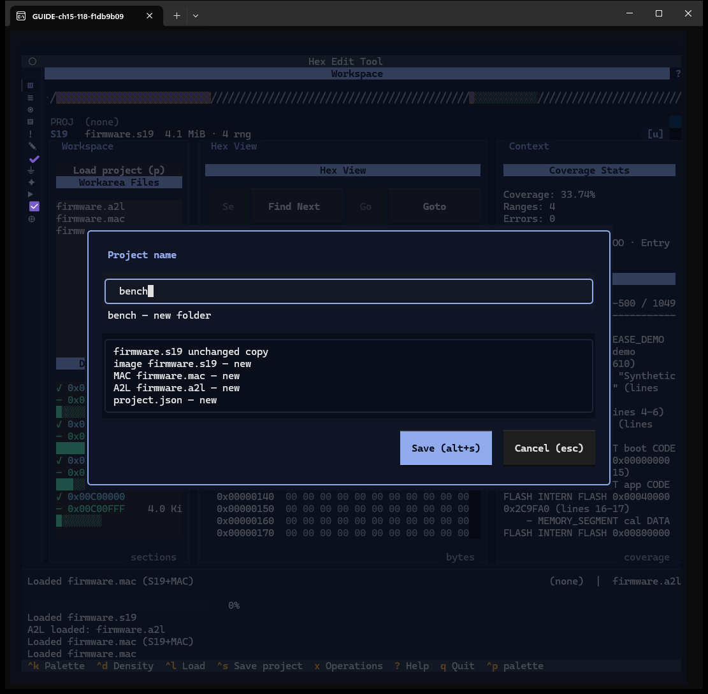
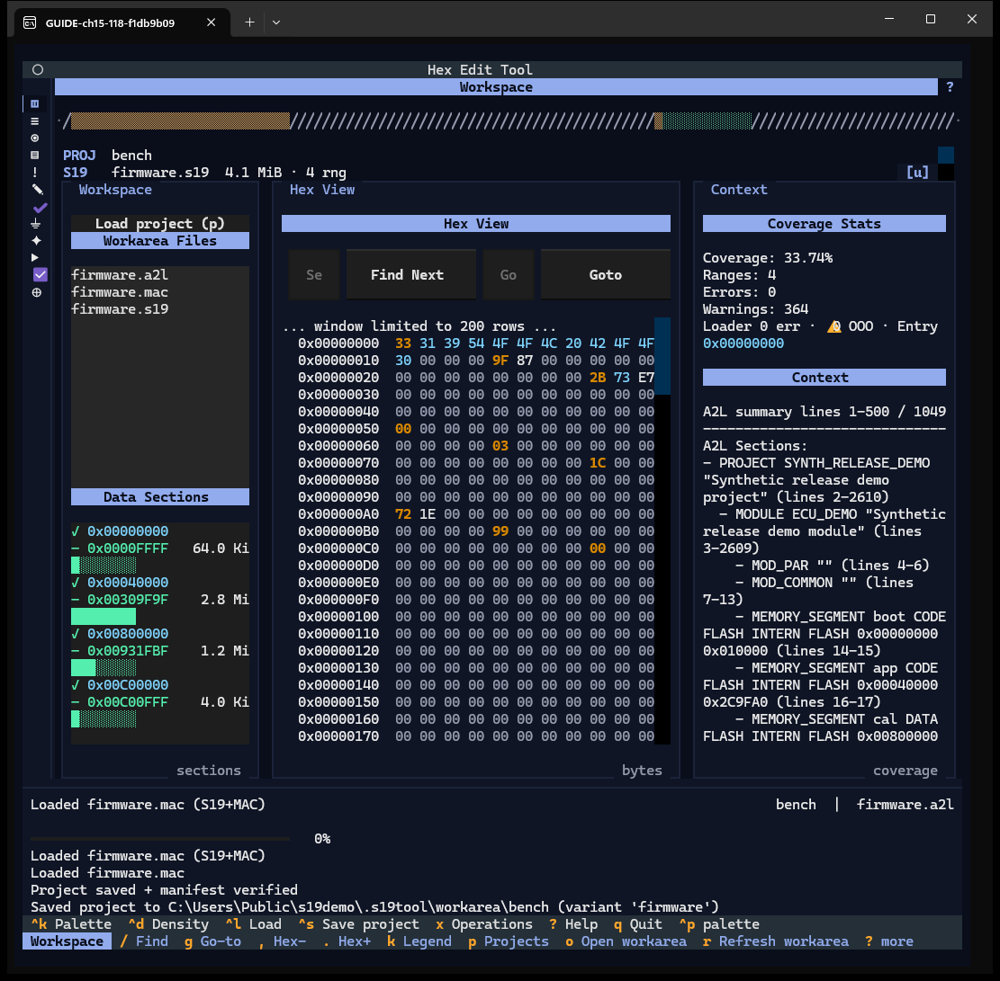
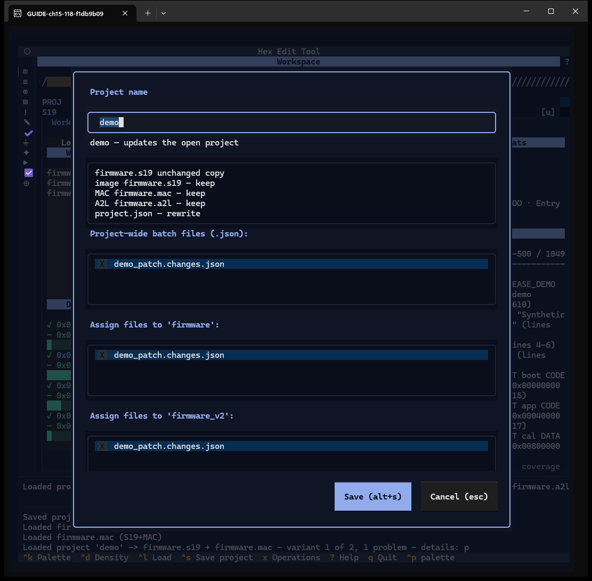
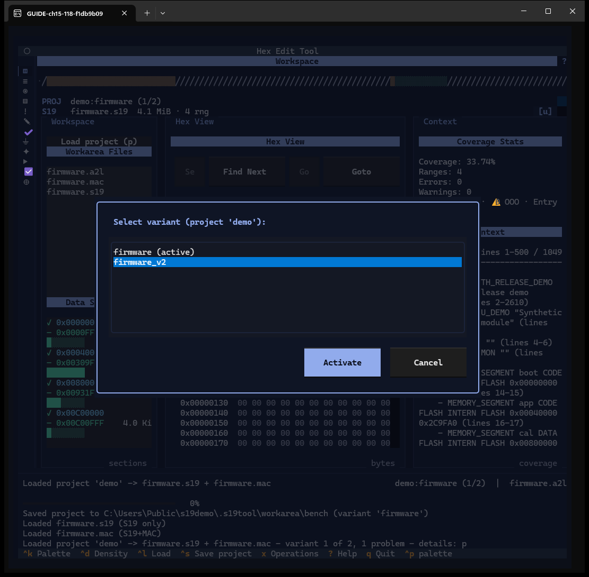
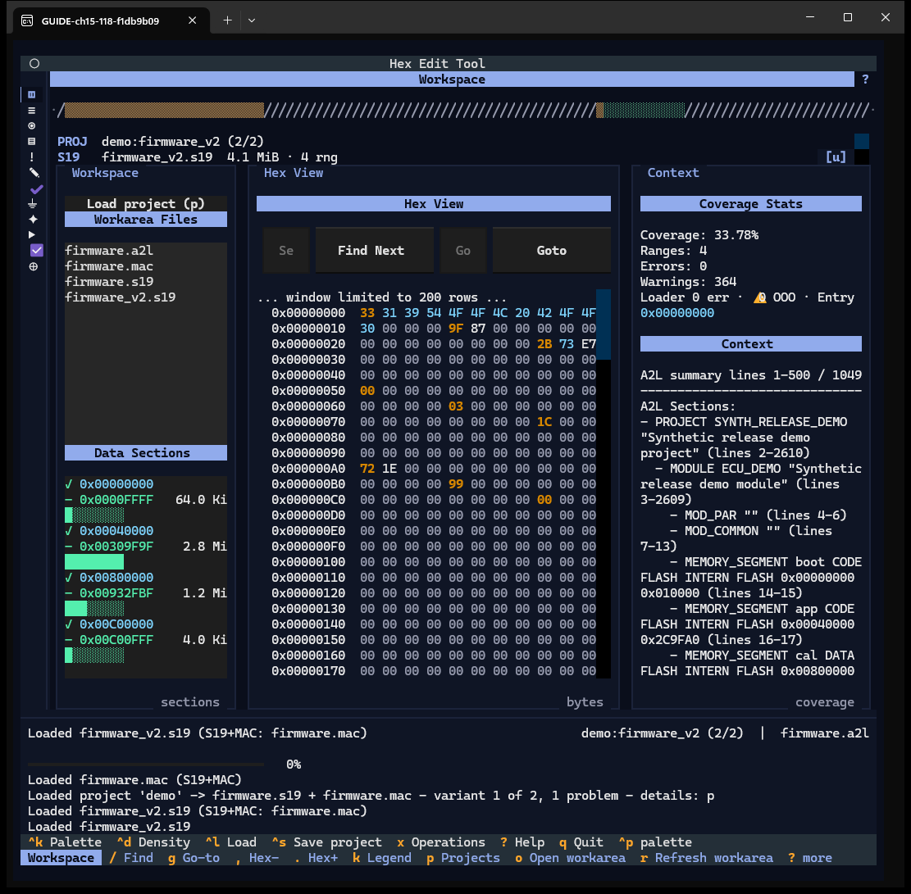

# Chapter 15 — Save the project and switch variants

**Windows:** Save project (W22), Select variant (W23).
**How to get there:** `^s` or `s` (needs a loaded image or A2L); `v` for the
variants of an open project.
**Demo inputs:** `firmware.s19` + `firmware.a2l` + `firmware.mac` (new project
`bench`); project `demo` with variants `firmware` and `firmware_v2` and the change-set
`demo_patch.changes.json` in its folder.

## What the Save dialog is for

A project is one folder in the work area holding the images (each S19/HEX is a
*variant*), at most one A2L and one MAC, the change and check documents, reports and
flows, plus `project.json`, which records what belongs together and the files'
digests. Saving gathers the loaded files into that folder.

## Step by step

### 15.1 Save a new project

`^s` opens **Project name**. Type a name (letters, digits, `-`, `_`). Under the
field the dialog says what will happen (*bench — new folder*) and lists every file:
image, MAC, A2L, `project.json`, each marked *new*, *keep* or *rewrite*.
**Save (alt+s)** saves; **Cancel (esc)** closes.

### 15.2 Saved

*Project saved + manifest verified* and *Saved project to …\workarea\bench (variant
'firmware')*. The context shows `bench`, and the Loaded panel's `PROJ` line names it.

### 15.3 Re-save a project with variants

In an open project with several variants and JSON documents in its folder, `^s`
shows *demo — updates the open project* and two extra lists:

- **Project-wide batch files** — documents run for every variant;
- **Assign files to '‹variant›'** — documents run for that variant only.

Toggle a row with a click or `space`. These assignments are what the Patch Editor's
**Execute scope** runs (Chapter 8).

### 15.4 Choose a variant

`v` opens **Select variant**: the project's variants with the active one marked.
Pick `firmware_v2` and press **Activate**.

### 15.5 The other variant is loaded

The image is replaced by `firmware_v2.s19` (`demo:firmware_v2 (2/2)`); the A2L and MAC
stay. If the current image had unsaved changes, the replace question (Chapter 2)
would come first.

## Features of these windows

| Feature | How | Capture |
|---|---|---|
| Project name, where line, plan rows | type | 15.1, 15.3 |
| Batch and per-variant assignment lists | click / `space` | 15.3 |
| Save (alt+s) / Cancel (esc) | keys, buttons | 15.1, 15.2 |
| Variant list, Activate, Cancel | `v`, buttons | 15.4, 15.5 |
