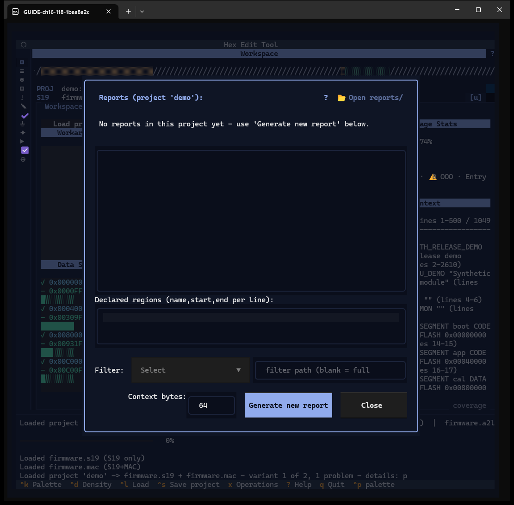
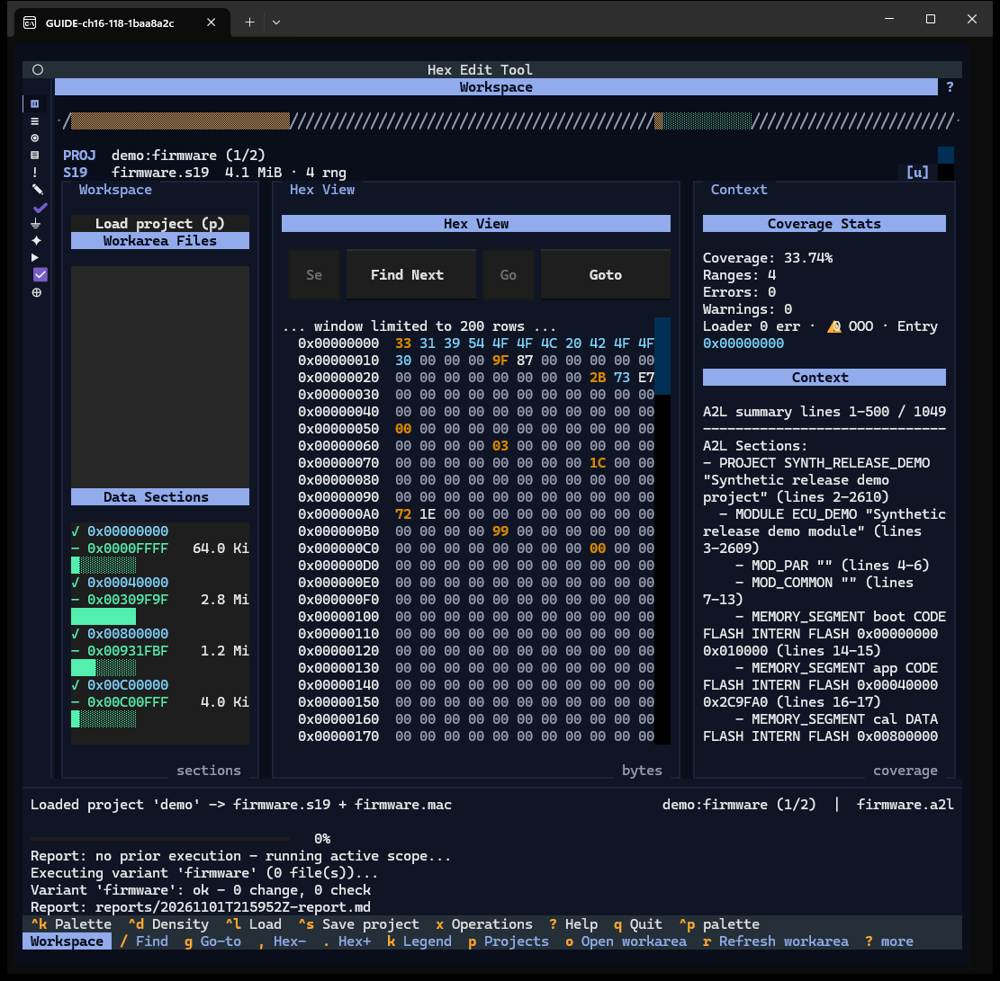
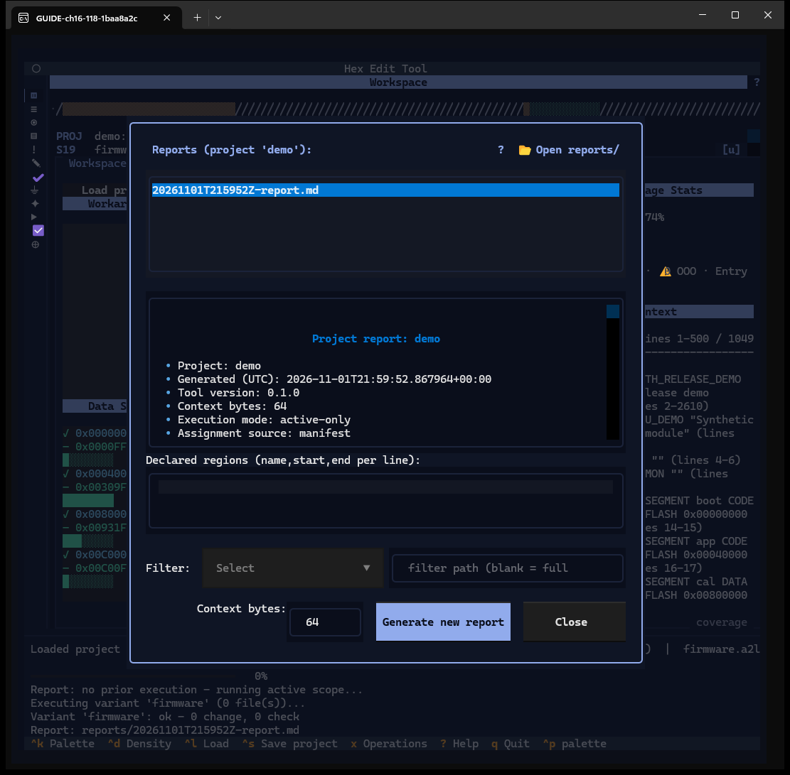

# Chapter 16 — Reports

**Window:** Reports viewer (W24). **How to get there:** `t` (needs an open project;
otherwise one status line).
**Demo input:** project `demo`.

## What the Reports viewer is for

It lists the project's reports (`reports\*.md`), shows the selected one, and writes a
new project report.

## Step by step

### 16.1 No reports yet

- Title *Reports (project 'demo')*, `?` help and **📂 Open reports/**.
- The list (here *No reports in this project yet*), the report view.
- **Declared regions** — `name,start,end` lines that the generated report uses to
  annotate coverage. It holds the regions saved with the project; the demo project
  has none, so it is empty.
- **Filter** — a dropdown of `filters\*.json` files, or a typed filter path (blank =
  full report).
- **Context bytes** — how many bytes around each change the report shows (64).
- **Generate new report**, **Close**.

### 16.2 Generate

**Generate new report** closes the viewer, runs the active variant's assigned
documents first if nothing was run yet (*Report: no prior execution - running active
scope…*), and writes `reports\<time>-report.md`. It writes Markdown only: no `.html`
copy is produced, as the window's help says. The reports that do have an HTML copy
are shown in Chapter 21.

### 16.3 Read a report

Press `t` again: the new report is in the list; selecting it renders it — project,
generation time, tool version, context bytes, execution mode, assignment source, and
the sections below.

Reports written elsewhere — the before/after report (Chapter 8), the diff report
(Chapter 9), the flow chain-set report (Chapter 18) — land in the same folder and
list here.

## Features of this window

| Feature | How | Capture |
|---|---|---|
| Report list, empty state | ↑ ↓ / click | 16.1, 16.3 |
| Markdown view | select | 16.3 |
| Declared regions | type | 16.1 |
| Filter dropdown / path | select / type | 16.1 |
| Context bytes | type | 16.1 |
| Generate new report | button | 16.2 |
| Open reports/, `?` | chips | 16.1 |
| Close | button / `esc` | 16.1 |
