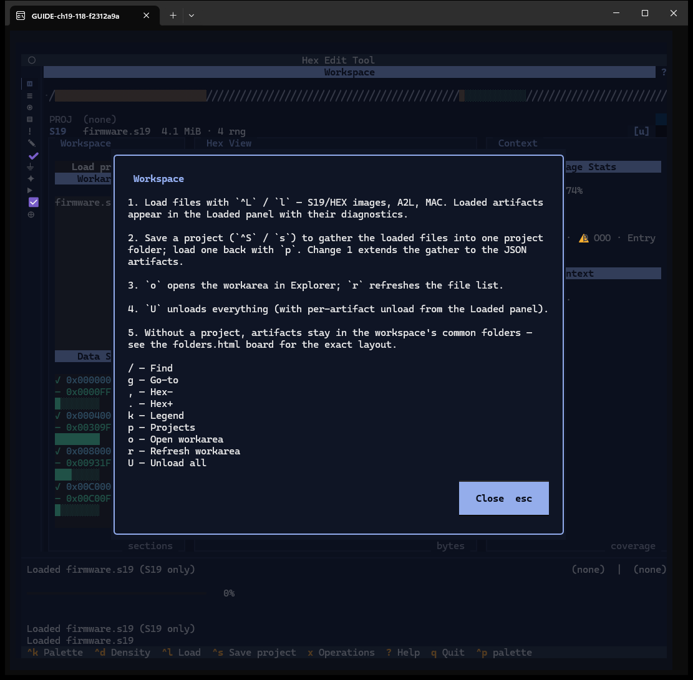
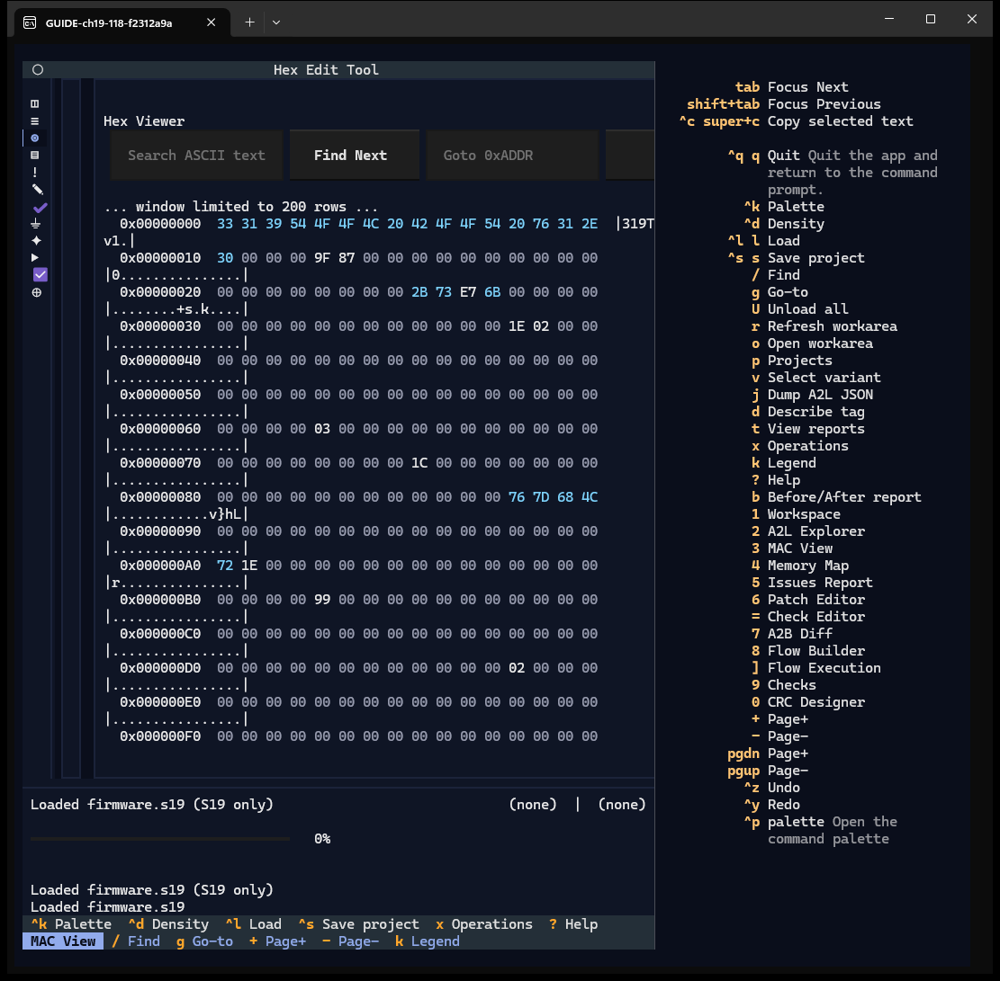
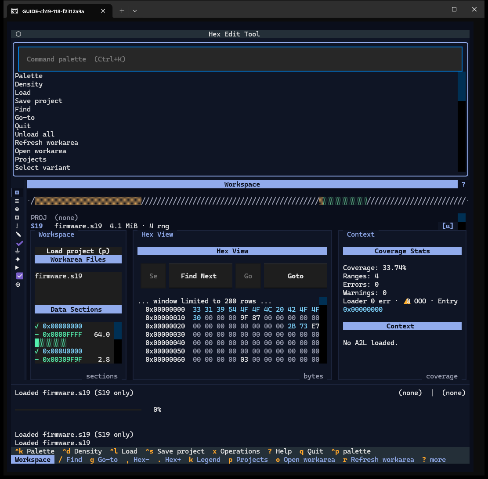
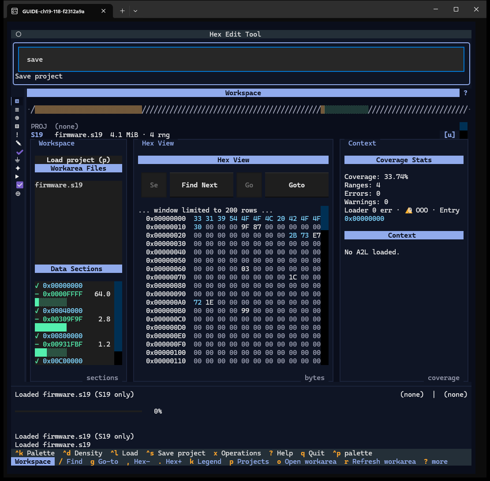
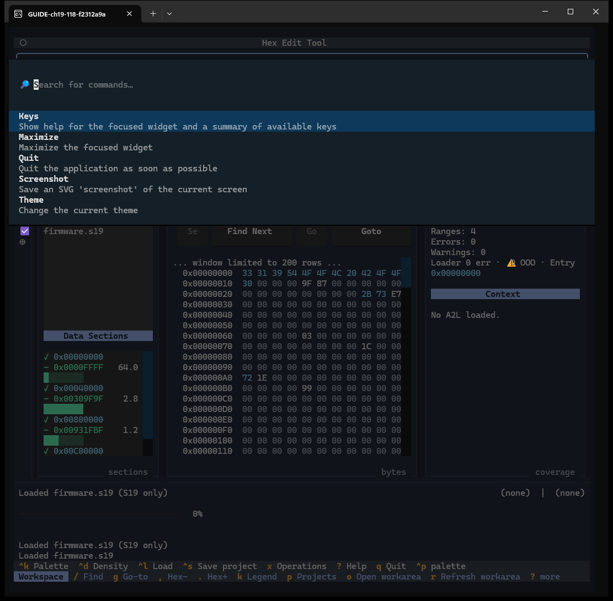
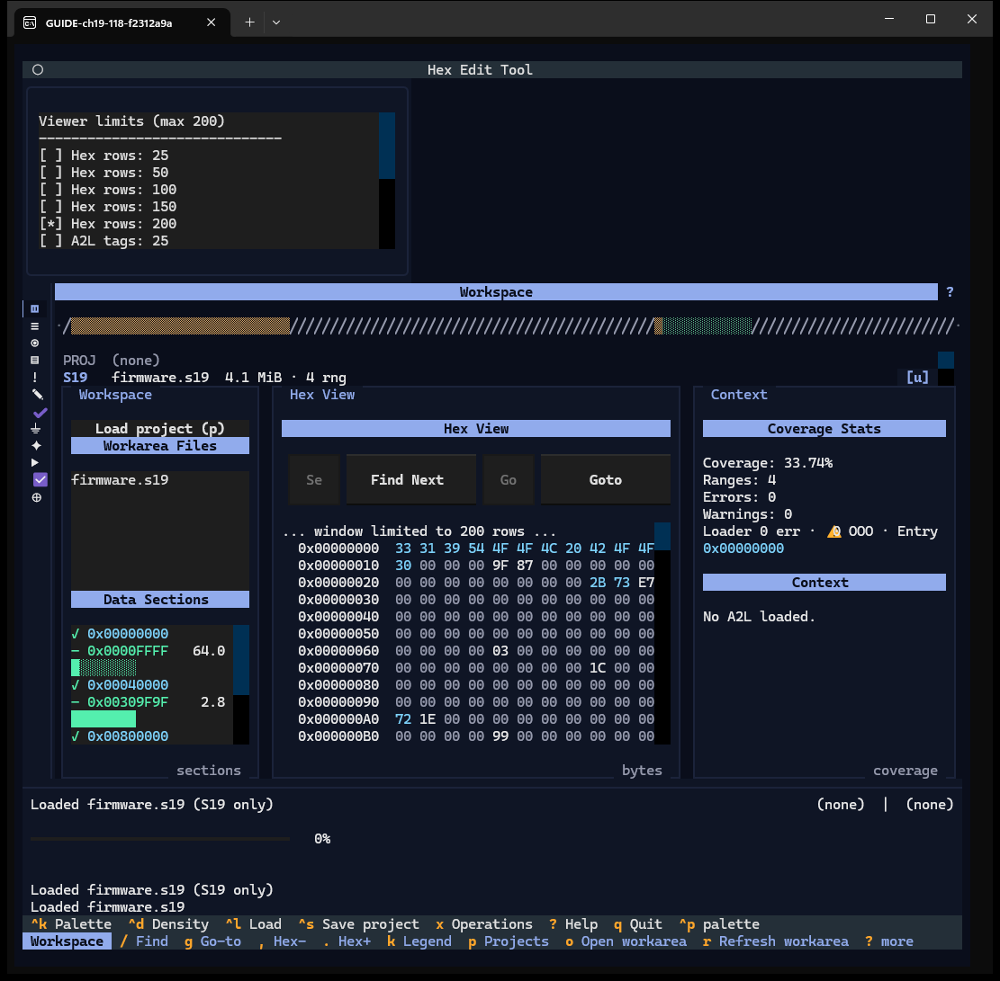
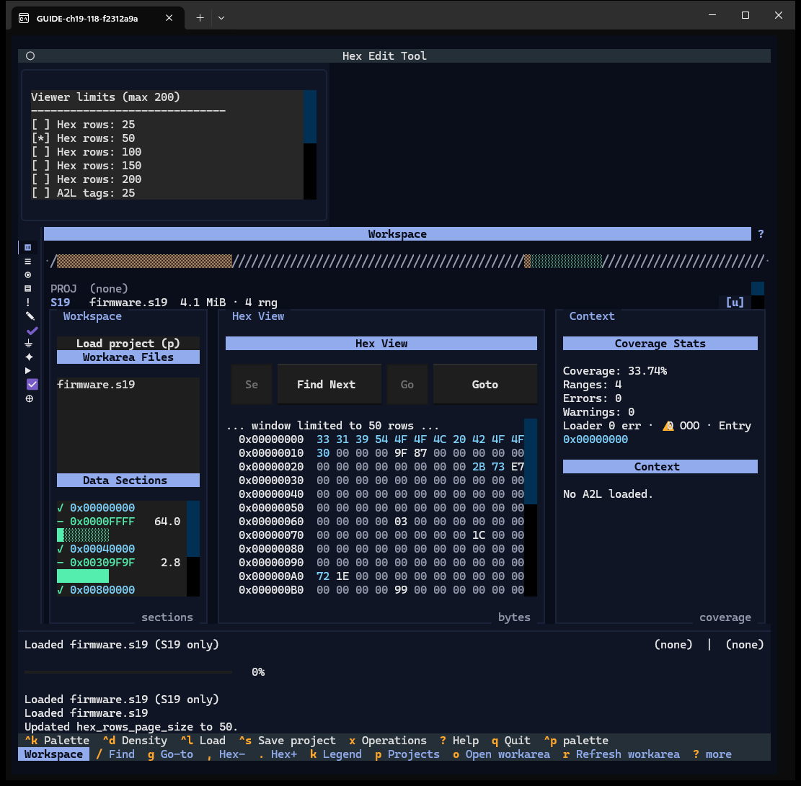
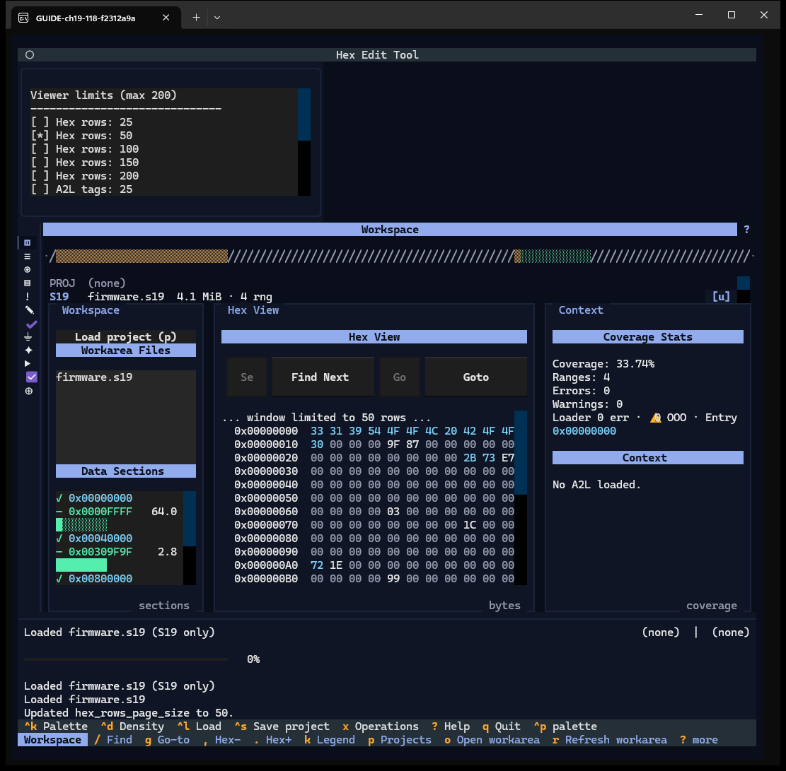
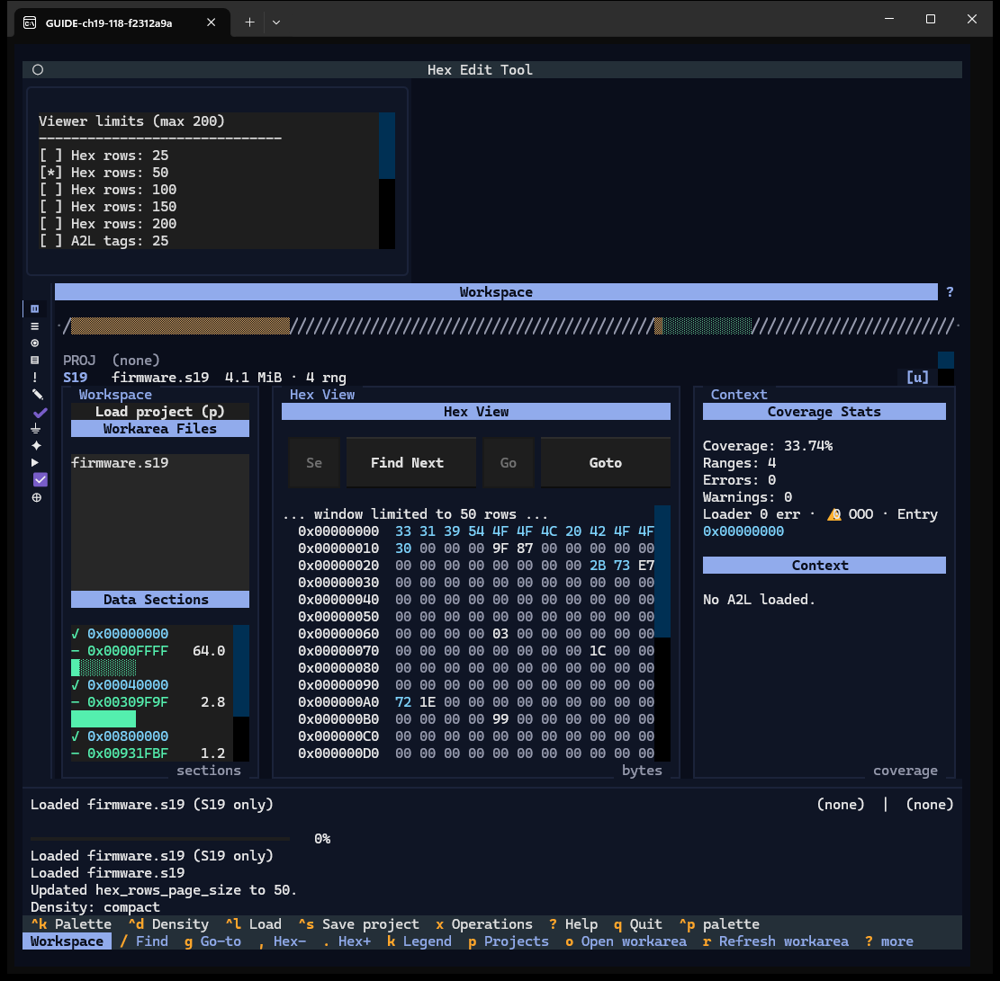

# Chapter 19 — Help, palettes and settings

**Windows:** app shell (W00): help panel, command palette, Textual palette, Viewer
settings, density; Window help (W30).
**Demo input:** `firmware.s19`.

## Step by step

### 19.1 Help for this window

Press `?` while a widget of the window has focus, or click the `?` at the right of the
window's title bar. The dialog lists numbered steps for that window and then its keys.
↑ ↓ PgUp PgDn Home End scroll; `esc` or **Close** closes. Windows with a help section:
Workspace, A2L Explorer, Memory Map, Patch Editor, Check Editor, Checks, CRC Designer,
Flow Builder, Flow Execution, Reports, Split / Join / Export. Some steps do not match
the app yet (finding F-37) — e.g. this Workspace text refers to a
"folders.html board" that the app does not have.

### 19.2 The help panel

Where no window claims `?` (MAC View, Issues Report, A2B Diff, or with the focus on the
rail), `?` opens the help panel on the right: every key that works now, including the
hidden ones. Press `?` again to close it.

### 19.3 The command palette

`^k` opens the app's command palette: one entry per key action, plus *Viewer settings*
and *Split / Join / Export*.

Type to filter (`save` → *Save project*), Enter or a click runs the entry, `esc`
closes it.

### 19.4 Textual's palette

`^p` opens the palette of the Textual framework: *Keys*, *Maximize*, *Quit*,
*Screenshot* (writes an SVG), *Theme*.

### 19.5 Viewer settings

`^k` → *Viewer settings* opens a list of page sizes (25 … 200) for Hex rows, A2L tags
and MAC rows; `[*]` marks the current one.

Picking *Hex rows: 50* applies at once (*Updated hex_rows_page_size to 50*; the hex
view now says *window limited to 50 rows*).

The list cannot be closed: it stayed open after the pick, after `esc`, after opening
the palette entry again and after switching windows (checked live — finding F-19).

### 19.6 Density

`^d` switches the layout between comfortable and compact (*Density: compact*): pane
padding and title rows shrink.

## Features shown

| Feature | How | Capture |
|---|---|---|
| Window help | `?` / title `?` | 19.1 |
| Help panel (all keys) | `?` | 19.2 |
| Command palette | `^k`, type, Enter | 19.3 |
| Textual palette | `^p` | 19.4 |
| Viewer settings | `^k` → Viewer settings | 19.5 |
| Density | `^d` | 19.6 |
| Legend | `k` | Chapters 5–7 |
