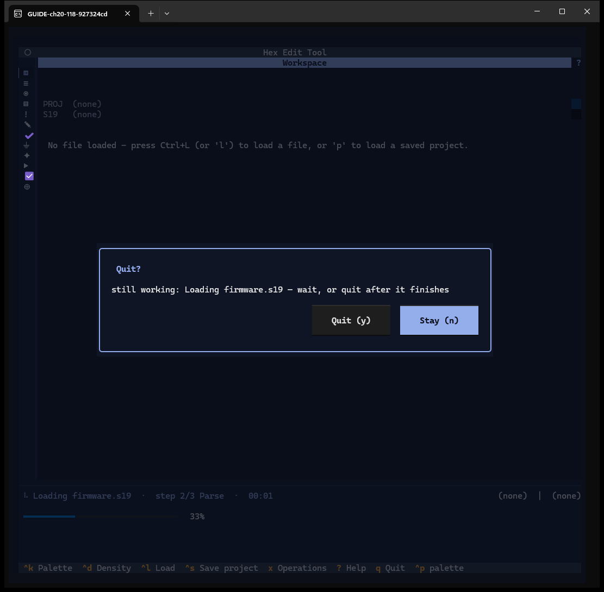
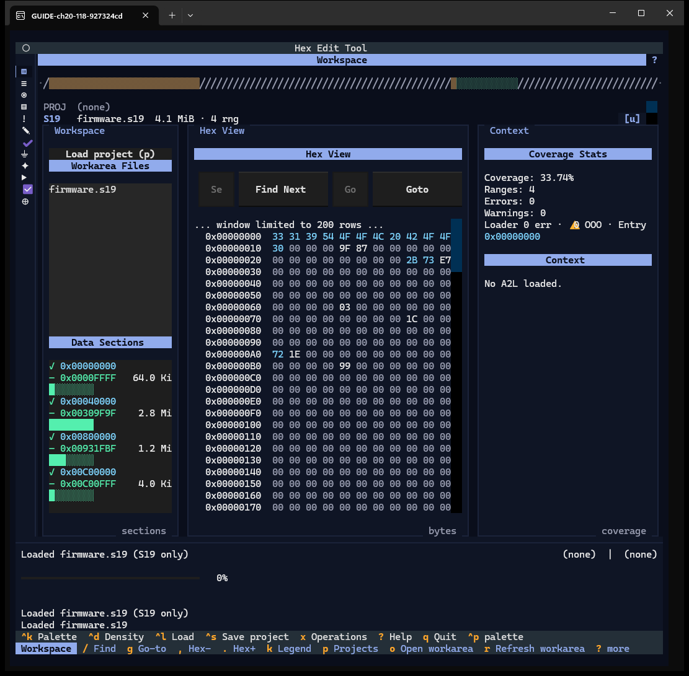

# Chapter 20 — Quit

**Windows:** app shell (`q`), Quit? question (W31).
**Demo input:** `firmware.s19` (about 15 s to load, long enough to quit during it).

## Step by step

### 20.1 Quit with nothing running

Press `q` (or Textual's `^q`): the app exits at once. Unsaved work is not asked about
on quit; save the project first (Chapter 15).

### 20.2 Quit while a load or save runs

Start loading `firmware.s19` and press `q` during the parse. The **Quit?** question
says what is still working (*Loading firmware.s19 — wait, or quit after it finishes*).
**Quit (y)** quits as soon as the action ends; **Stay (n)** (default, also `esc`) keeps
working.

### 20.3 Stayed

After `n` the load finishes normally.

## Features shown

| Feature | How | Capture |
|---|---|---|
| Quit at once | `q` / `^q` | text |
| Quit? while an action runs: Quit (y), Stay (n) | `q` during a load | 20.2, 20.3 |
