# Chapter 21 — HTML reports: review what was modified, checked and compared

**Windows:** Patch Editor (W11), A2B Diff (W17), Flow Builder (W25), Reports viewer
(W24); the reports themselves are files in the project's `reports\` folder.
**Demo inputs:** project `demo`; `guide_patch_nosym.changes.json` and
`guide_check_mixed.chk.json` (Chapter 8); the reports below are the real files the app
wrote during one capture run — none was edited.
**How the HTML pages were captured:** each `.html` file was opened from disk in
**Microsoft Edge, headless** (`msedge --headless=new --screenshot`, 1280 px wide, a
throw-away profile), the full page was rendered and cut into the slices shown.

## Which reports exist, and in which format

| Report | Written by | Files | Chapter |
|---|---|---|---|
| Before/after report | Patch Editor → **Write before/after report** (or `b`), after a patched image was written, in a project | `<time>-before-after-report.md` **and** `.html` | 21.1 |
| Diff report (optionally with the `## Checks` addendum) | A2B Diff → **Report** | `<time>-diff-report.md` **and** `.html` | 21.2 |
| Diff report with flow change attribution | A2B Diff → **Report**, when image B is a file written by the last Flow Builder run | `<time>-diff-report.md` **and** `.html` | 21.3 |
| Flow report (REPORT block) | Flow Builder → **Run** of a flow that contains a REPORT block | `<time>-report.md` only | 21.4 |
| Project report | Reports → **Generate new report** | `<time>-report.md` only | 21.5 |
| Chain-set report | Flow Execution → **Run** | `<time>-chain-set-report.md` only | Chapter 18 |

Only the before/after report and the diff report have an HTML copy; the other three
are Markdown only (finding F-44). The Markdown files open in the Reports
viewer (`t`).

## 21.1 Before/after report — what the patch changed

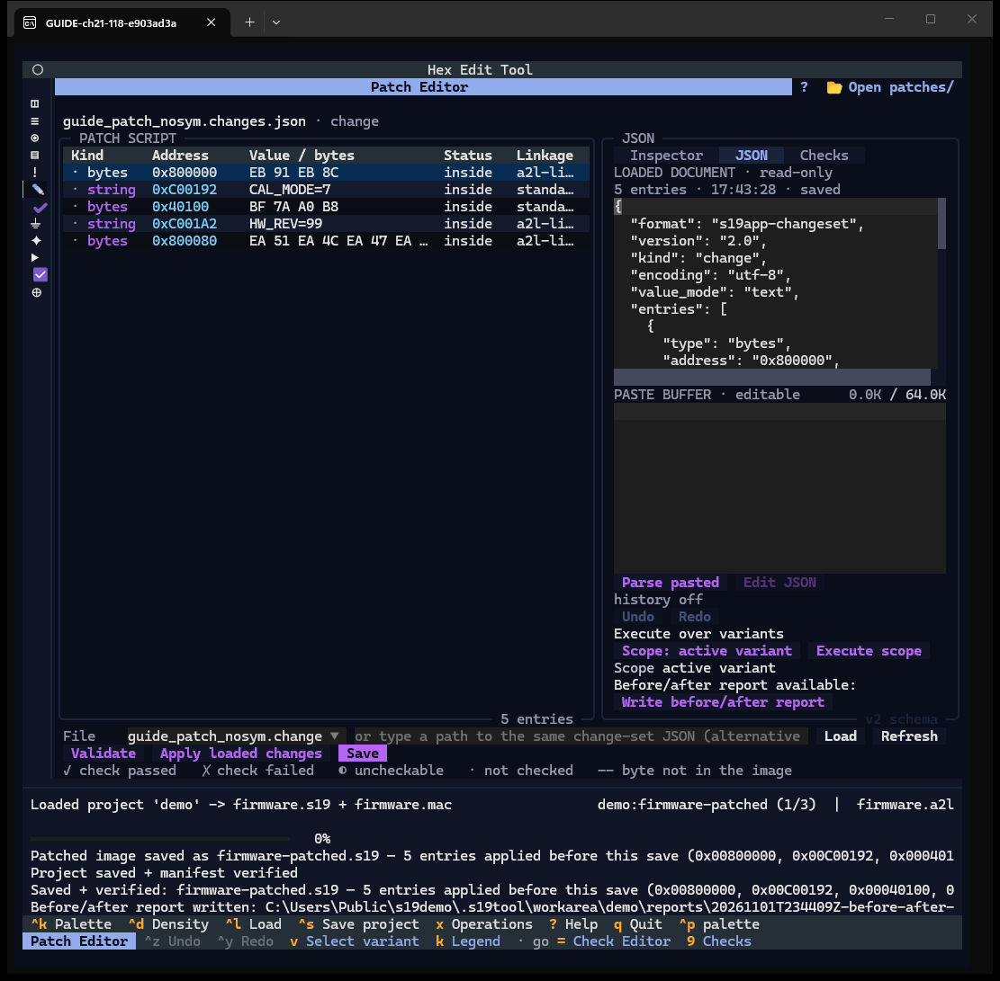

In project `demo`, the Patch Editor applied `guide_patch_nosym.changes.json`, wrote the
patched image (`firmware-patched.s19`, now a project variant) and then **Write
before/after report**: the log ends with *Before/after report written:
…\reports\<time>-before-after-report…* (the `.md` and the `.html` side by side).

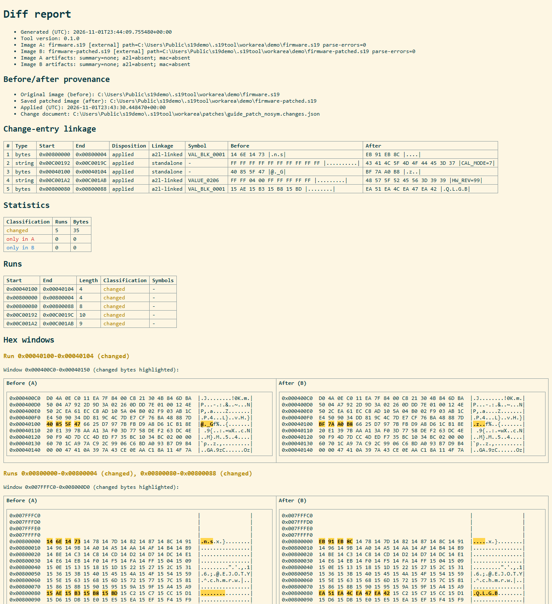

What each section tells you:

- **Header** — when, with which tool version, and which two files were compared: A is
  the image as loaded (`firmware.s19`), B the written file (`firmware-patched.s19`),
  with artifact lines computed against the loaded A2L and MAC (`a2l=used (…)`). The
  page is titled "Before/after report". (capture taken before 1.0.0: it shows the
  title "Diff report" and `a2l=absent; mac=absent`, finding F-42)
- **Before/after provenance** — the original image, the saved patched image, when the
  change was applied, and the change document that was applied. This is the audit
  trail: which document produced which file.
- **Change-entry linkage** — one row per entry of the change document: type, address
  range, disposition (`applied`), how it links to the A2L (`a2l-linked` with the
  symbol it falls in, or `standalone`), and the bytes before and after with their
  ASCII. Use it to confirm every entry landed where intended.
- **Statistics** — runs and bytes per class: `changed`, `only in A`, `only in B`.
  Here 5 runs, 35 bytes changed, nothing added or removed.
- **Runs** — each differing address run with its length and class. The *Symbols*
  column names the A2L and MAC symbols whose address lies in the run, from the loaded
  A2L and MAC (the capture, taken before 1.0.0, shows `-`).
- **Hex windows** — for each run (nearby runs grouped), the bytes around it before (A)
  and after (B), changed bytes highlighted.

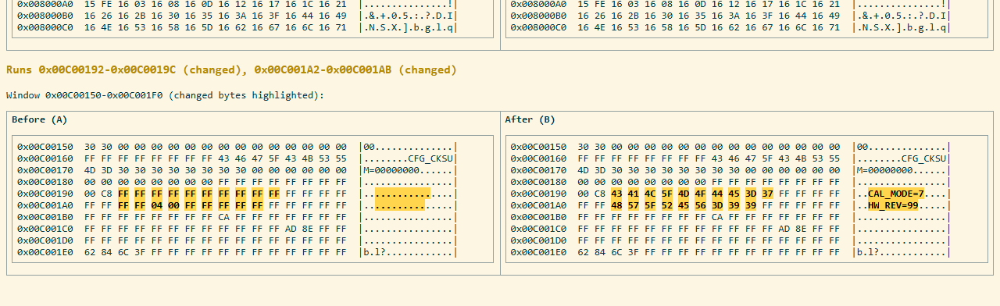

The last window shows the two strings written into the config area: `CAL_MODE=7` and
`HW_REV=99`, replacing erased `FF` bytes. The before/after report has no Checks
section; checks are reported by the diff report's addendum (21.2).

## 21.2 Diff report with the Checks addendum — what differs between two images

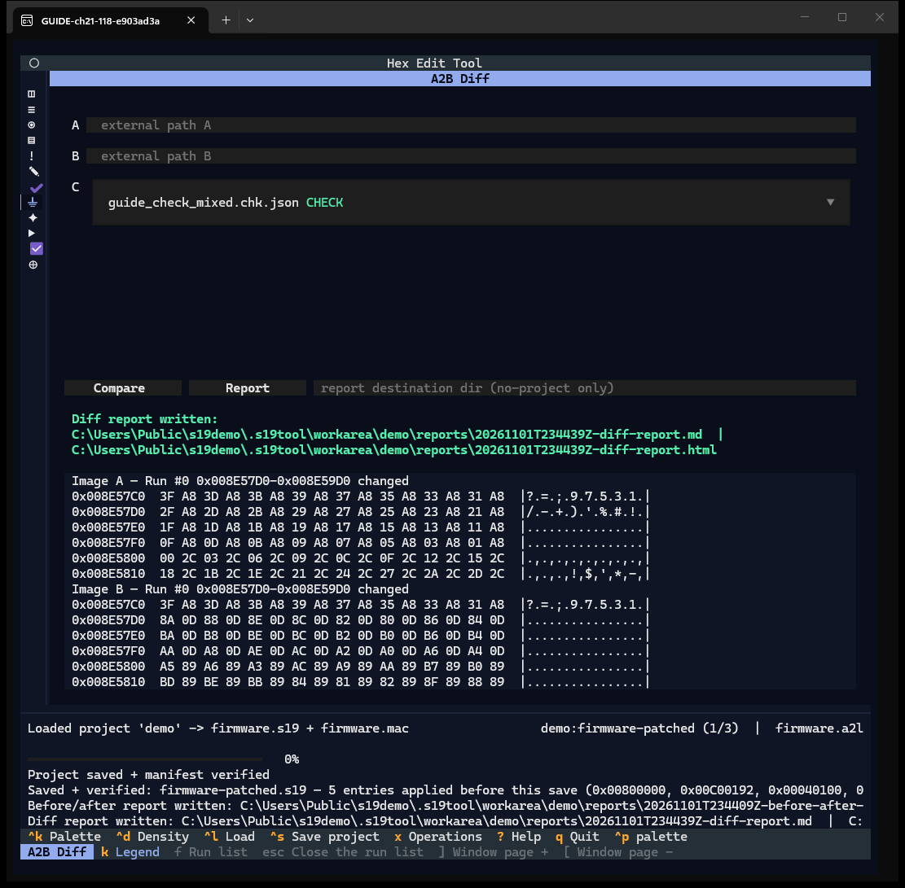

A2B Diff, A = variant `firmware`, B = variant `firmware_v2`, check spec
`guide_check_mixed.chk.json` (C), **Report**: *Diff report written: …diff-report.md |
…diff-report.html*.

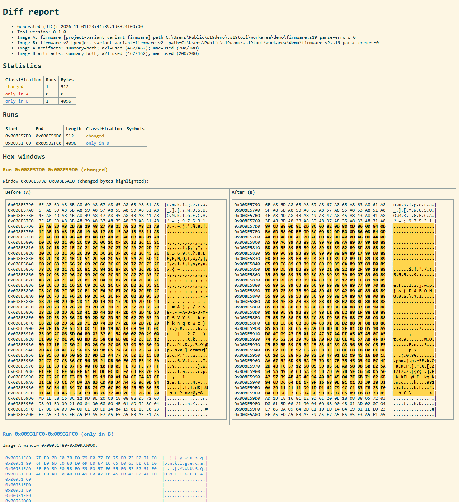

- **Header** — both images with their kind (`project-variant`), path and parse errors,
  and which artifacts were available for symbol lookup (`a2l=used (462/462);
  mac=used (200/200)`).
- **Statistics** — 1 run / 512 bytes changed, 1 run / 4096 bytes only in B.
- **Runs** — `0x008E57D0–0x008E59D0` changed, `0x00931FC0–0x00932FC0` only in B: the
  two known differences of the demo v2 image.
- **Hex windows** — the changed window side by side; for an `only in B` run, one
  window of B (A has no bytes there). This report is long (about 9 500 px) because the
  4 KiB extension is printed in full.

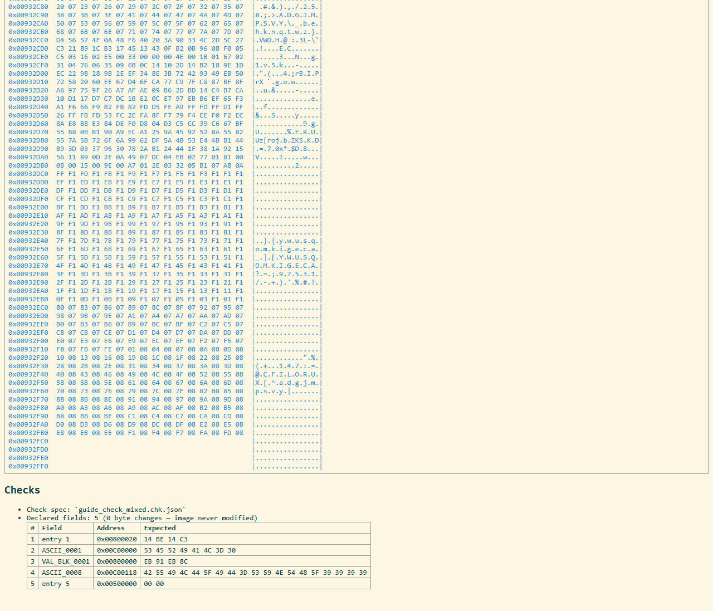

- **Checks** — added because a check spec was chosen: the spec name and its declared
  fields (address and expected bytes; a field is named by the A2L symbol that holds it,
  e.g. `VAL_BLK_0001`, or `entry n`). The line *0 byte changes — image never modified*
  states that a check spec is a record, never applied. The addendum lists expected
  values only, without the actual value or a pass/fail verdict (finding F-43); run the
  check document in the Patch Editor for the verdicts (Chapter 11).

In the `.md` file, names carry a backslash before each Markdown character (`CAL\_A`,
`img\.s19`), and paths stay as written inside their code spans, so a Markdown reader
shows both exactly; a plain-text search of the `.md` file for `CAL_A` finds nothing —
search the `.html` file, or open the `.md` in a Markdown reader.

## 21.3 Diff report with flow change attribution — what a flow changed

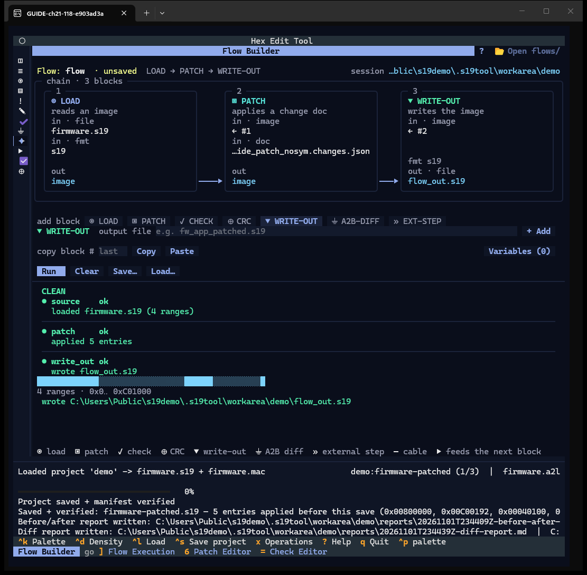

Flow Builder: LOAD `firmware.s19` → PATCH `patches/guide_patch_nosym.changes.json` →
WRITE-OUT `flow_out.s19`, **Run**: *wrote flow_out.s19*.

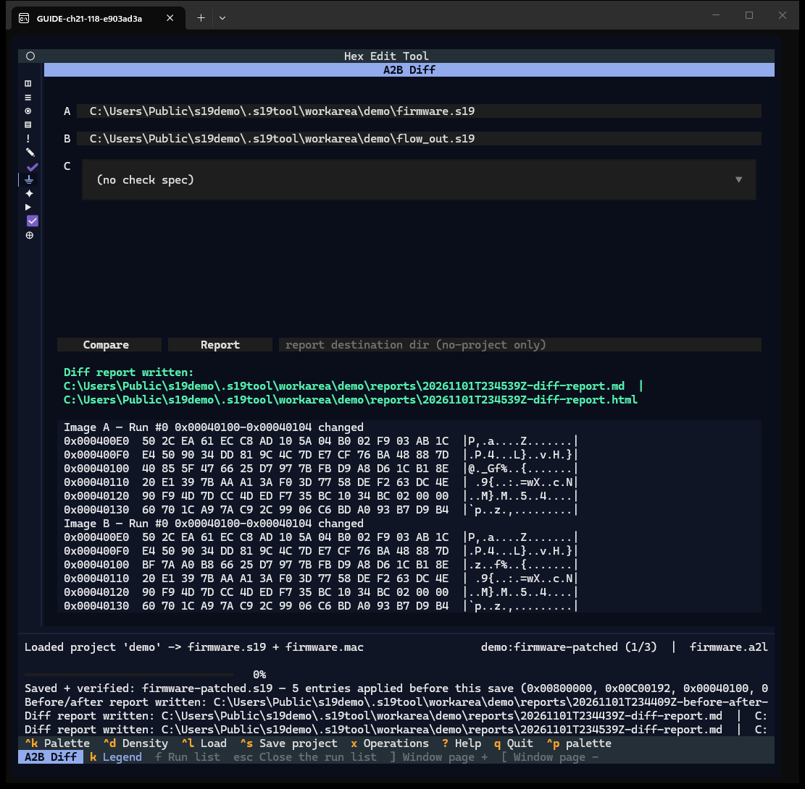

A2B Diff, A = `firmware.s19`, B = `flow_out.s19` (external paths), no check spec,
**Report**. Because B is a file the last Flow Builder run wrote, the report gains a
**Flow change attribution** section.

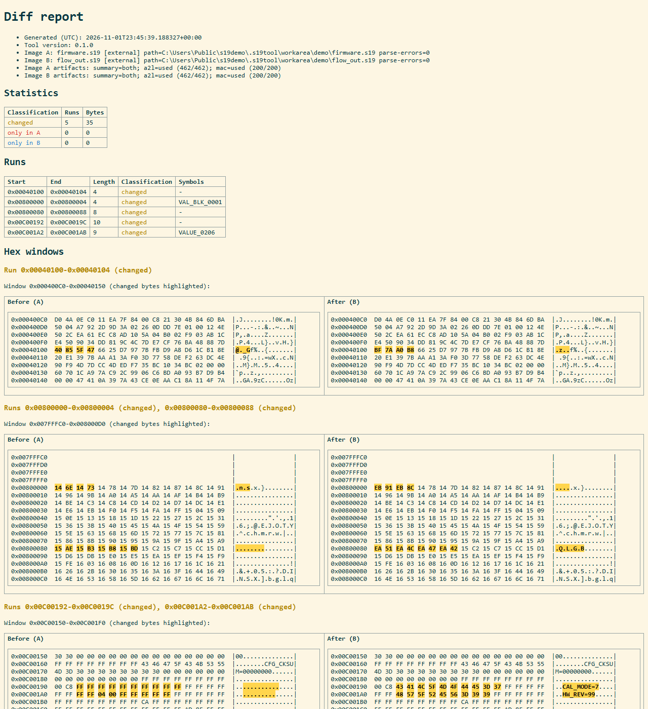

The same sections as 21.2; here the *Symbols* column of **Runs** is filled
(`VAL_BLK_0001`, `VALUE_0206`) because the A2L and MAC were used for this comparison.

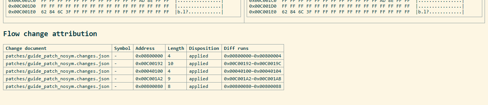

- **Flow change attribution** — one row per change the flow applied: the change
  document, symbol, address, length, disposition, and the diff run that shows it. Each
  difference in the image can be traced back to the document entry that made it.

## 21.4 Flow report (REPORT block) — Markdown only

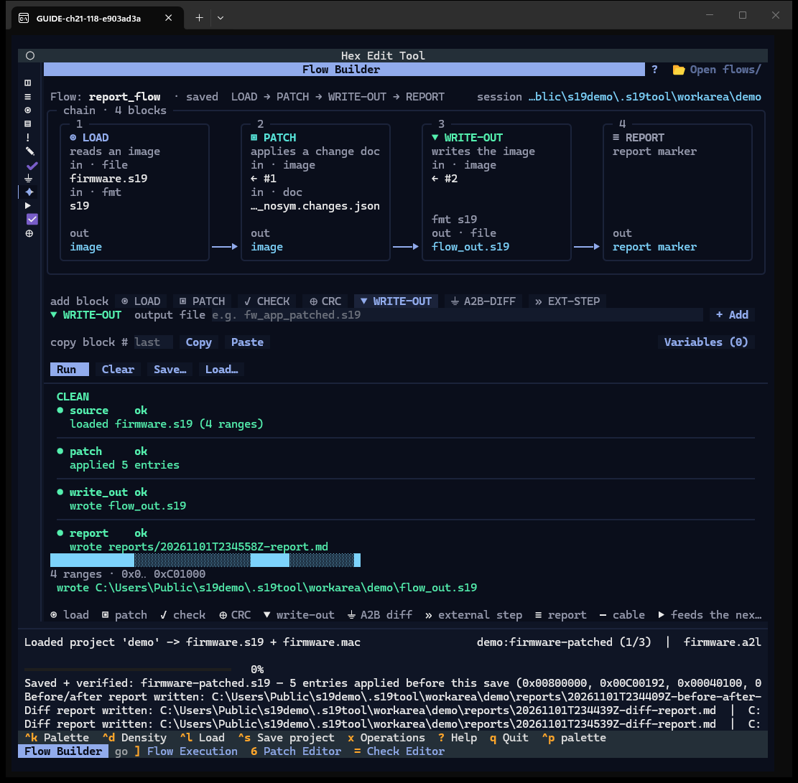

A REPORT block cannot be added from the Flow Builder (finding F-36); it appears only in
a flow file that contains one. For this guide the flow `report_flow` was saved from the
builder and one line, `{"kind": "report"}`, was added to its file
`flows\report_flow.json`; the flow was then loaded with **Load…** and run. The REPORT
card reads *report marker*, and the run log says *wrote reports/<time>-report.md*.

The file is Markdown only. Its sections, from the real file: **Pipeline ledger** (each
block with status and summary), **Change attribution** (per entry: change document,
address, length, bytes before and after, symbol), **Not applied**, **Refusals**,
**Image footprint** (the final ranges and byte count) and **Written files**. The report
covers the blocks *before* it; a REPORT block placed earlier reports only what ran so
far.

## 21.5 Project report — Markdown only

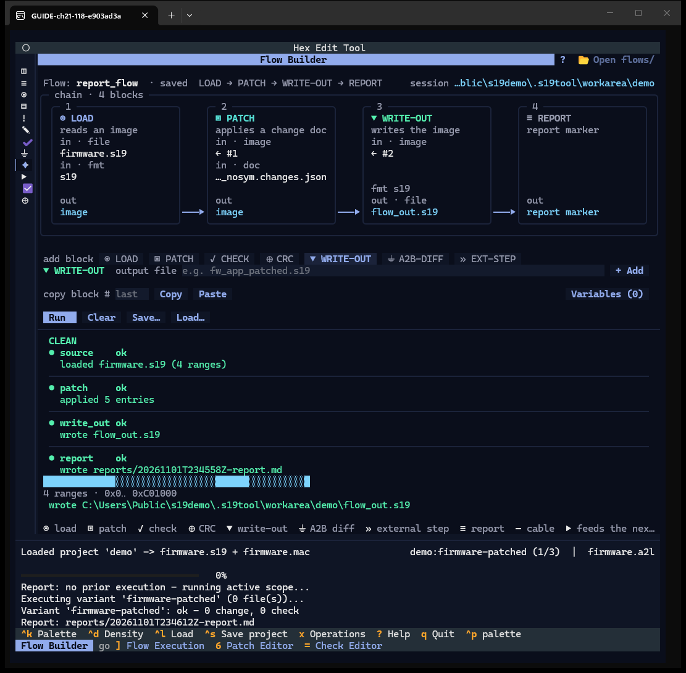

Reports (`t`) → **Generate new report** wrote `reports/<time>-report.md` (it first ran
the active variant's assigned documents: *Report: no prior execution - running active
scope…*). Markdown only. Its sections: variant inventory, consolidated
overview, the legend, and per variant the modified files, modifications, declaration
errors, checklists, memory regions and entropy.

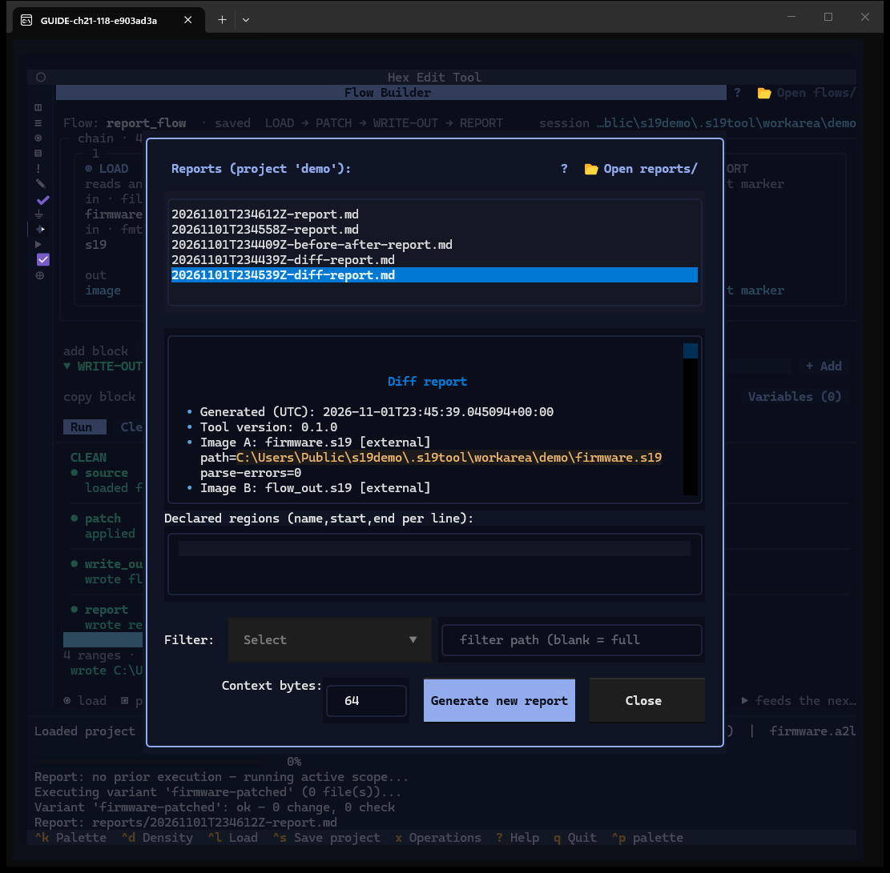

The Reports viewer lists every Markdown report of the project — project reports, the
flow report, the before/after report and both diff reports — and renders the one
selected (here the flow diff report). The HTML copies are not listed; open them from
the `reports\` folder (**📂 Open reports/**) in a browser.

## Features shown

| Feature | How | Capture |
|---|---|---|
| Before/after report (.md + .html) | Patch Editor → Write before/after report / `b` | 21.1 |
| Diff report (.md + .html) + Checks addendum | A2B Diff → check spec, Report | 21.2 |
| Diff report with flow change attribution | Flow Builder Run, then A2B Diff → Report | 21.3 |
| Flow report (REPORT block, .md) | Run a flow file with a REPORT block | 21.4 |
| Project report (.md) | Reports → Generate new report | 21.5 |
| Reading reports in the app | `t`, pick a report | 21.5 |
